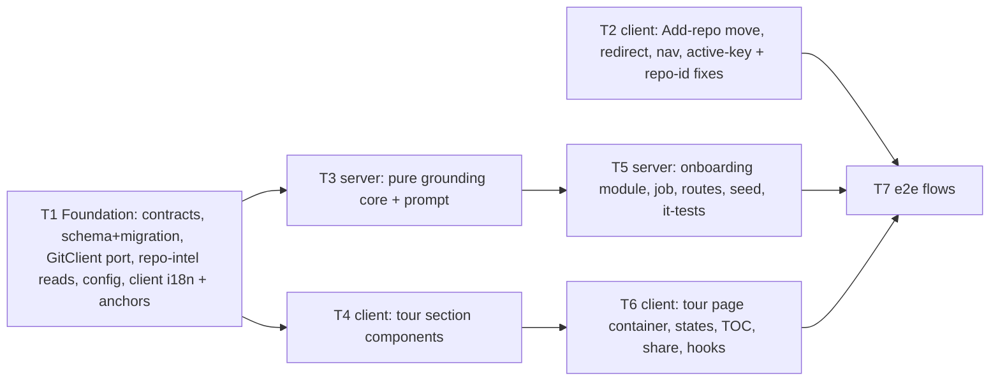

# Implementation Plan: Onboarding Generator — per-repo Onboarding Tour

- **Requirements:** `specs/2026-10-25-onboarding-generator.md` (SPEC-2026-10-25-onboarding-generator, Status: approved)
- **Execution mode:** multi-agent
- **Status:** planned

## Goal

Give every connected, indexed repo a one-click **Onboarding Tour** at `/repos/:repoId/onboarding`.
The tour has five fixed sections: Architecture overview, Critical paths, How to run locally,
Guided reading path, and First tasks. It is generated in the background with at most one
structured LLM call. Every path is grounded in code. The tour degrades to a deterministic version
when the model is unavailable, and it is marked stale when the index moves.

The "Add a repository" screen moves from `/onboarding` to `/repos/new`. The old URL redirects
there with history replace, and every in-app caller navigates to the new URL.

reviewer-core and mcp-server do not change.

## Decisions

User answers (Phase 1, 2026-10-25) and accepted recommendations:

1. **e2e seed (Q1 = A).** `server/src/db/seed.ts` inserts a fixed, deterministic, contract-valid
   tour for `acme/payments-api`. The fixture lives in the new file `server/src/db/seed-onboarding.ts`.
   - The seeded repo has `clone_path = null`. So the tour page shows the seeded tour, and
     **Regenerate** is disabled with the reason "repo is not cloned yet" as visible helper text.
   - **Plan-level clarification of AC-44, not a spec edit:** AC-44's empty state applies only
     when there is no tour. When a tour exists and the repo has no clone, the tour stays visible,
     Regenerate is disabled, and the not-cloned reason shows next to it.
   - The same rule applies to `no_index` (AC-45): an existing tour stays visible, Regenerate is
     disabled, and a Resync link shows.
   - The seed has no `repo_index_state` row, so `current_index_sha = null` and `stale = false`.
2. **Command script resolution (Q2 = A), for AC-34.** A run step is kept only if all of these hold:
   - `source_path` exists in the tracked-file tree at `source_sha`.
   - It is one line of at most 300 characters.
   - It matches no secret pattern.
   - If it invokes a package-manager script (`npm run x`, `npm x` for the npm lifecycle aliases
     `start`/`test`, `pnpm [run] x`, `yarn [run] x`, `bun run x`) or `make <target>`, the script
     or target is declared in the right file. That file is the `package.json` / `Makefile` of
     the directory named in a leading `cd <dir> &&` prefix, otherwise the root one.

   Package-manager built-ins are kept without a script lookup. The built-ins are `install`, `i`,
   `ci`, `add`, `exec`, `dlx`, `x`, `npx …`, `pnpm -r …`/`--filter` (resolved against each
   matching manifest is out of scope, so keep), `create`, `init`, `--version`. Commands that
   invoke no script (`docker compose up -d`, `cp .env.example .env`, `make` with no target) are
   kept when `source_path` exists. A `cd <dir>` whose directory is not in the tracked tree drops
   the step.
3. **Overlong model output (Q3 = A).** Only the offending part is dropped:
   - `summary_md` longer than 1 200 characters → `null`.
   - The diagram is cut to the first 12 nodes and 20 edges, in model order. Edges that point at
     a cut node are dropped.
   - Count caps for every section are applied after grounding, in model order.
   - Single-line display fields (`why`, `note`, node `label`, edge `label`, task `title`) longer
     than their cap are cut to `cap − 1` characters plus `…`. They are presentation text, so
     cutting is safer than dropping.
   - Commands longer than 300 characters and paths longer than 512 characters are **dropped**.
     They can't be cut safely.
   - The LLM's strict JSON schema (`draft-schema.ts`) carries **no** length or count limits, and
     `complexity` is a plain string. All caps live in code.
4. **Job execution.**
   - Generation is enqueued on `container.jobs` with kind `onboarding-generate`.
   - The handler **never throws**, so JobRunner neither retries nor re-calls the LLM (NFR-5).
   - The handler wraps its work in `withTimeout(…, config.onboardingTimeoutMs)`. The new
     `AppConfig.onboardingTimeoutMs` comes from env `ONBOARDING_TIMEOUT_MS`, default `120000`.
   - On timeout the handler writes `failed/timeout`.
   - Every terminal write is conditional: `WHERE repo_id = $1 AND generation_id = $2 AND
     generation_status = 'generating'`. A late or zombie completion can therefore never overwrite
     a newer state.
   - `GET` also expires an overdue `generating` row (`started_at` older than
     `onboardingTimeoutMs + 30 s` queue grace) to `failed/timeout`, using the same conditional
     update.
5. **Boot reaper (AC-15).** The onboarding routes plugin, at registration and before the server
   listens, runs `repository.reapGenerating()`. It sets every `generating` row to
   `failed/interrupted`, with `finished_at = now()`. `app.ts` is not touched. This assumes one API
   instance per DB, the same as `reapStaleRunningRuns`.
6. **Storage.** The existing `onboarding` table (`server/src/db/schema/context.ts:120-126`) is
   extended, not renamed. The column `json` keeps its name, because a rename makes drizzle-kit
   prompt.
   - `json` → nullable (holds the `Onboarding` tour).
   - `generated_at` → nullable, no default.
   - New nullable columns:
     - `generation_id uuid`
     - `generation_status text`, values `generating|done|failed`; enforced in code
     - `generation_started_at timestamptz`
     - `generation_finished_at timestamptz`
     - `generation_error text`, a reason code
     - `updated_at timestamptz DEFAULT now()`
   - Migration `0014_*.sql` is produced by `pnpm db:generate` only.
   - **AC-13 single-flight** uses an atomic claim:
     `INSERT … ON CONFLICT (repo_id) DO UPDATE SET generation_* = … WHERE onboarding.generation_status IS DISTINCT FROM 'generating' RETURNING *`.
     If no row comes back, read the in-flight row and return its generation.
7. **New port method `GitClient.listTrackedFiles(repo, sha): Promise<string[]>`.**
   - Implemented as `git ls-tree -r -z --name-only <sha>`. `-z` keeps non-ASCII paths unquoted
     (EC-21).
   - Added to `SimpleGitClient` and to `MockGitClient` (new option `trackedFiles`).
   - Mirrored into `client/src/vendor/shared/adapters.ts` at its own anchor.
   - It is used for First-tasks grounding (AC-40, EC-34) and for finding README, manifests,
     compose files, Makefiles and env templates, which the JS/TS-only index can't see.
   - It is also the existence check for run-step `source_path`. AC-34 says "a repo file that
     exists", and README and `package.json` are never in the index.
   - If it throws (for example the SHA is absent from the depth-1 clone), tracked is `null`.
     First tasks then becomes empty with `empty_reason: 'no_data'`, and run steps fall back to
     the set of key files actually read.
8. **New repo-intel facade reads** on the `RepoIntel` interface. All return `[]` / an empty Map
   when `repoIntelEnabled` is false.
   - `getIndexedFiles(repoId): Promise<string[]>` returns `file_rank` paths. When `file_rank` has
     no rows (the soft-budget `partial` case skips rank, `pipeline/full.ts:211-251`), it returns
     the distinct `symbols.path` instead. This is the "index file list" for AC-17/18/25.
   - `getFanIn(repoId, paths): Promise<Map<string, number>>` is `count(*)` from `file_edges`
     grouped by `to_file` (AC-30).
   - `getEndpointFacts(repoId, limit): Promise<{ path: string; endpoints: string[] }[]>` reads
     from `file_facts`.
   - `getTopFilesByRank` and `getCriticalPaths` are reused unchanged.
9. **Clone reads only through `container.git.readFile`**, which is realpath-confined. The
   repo-intel `readClone` (`service.ts:934`) is never used. The onboarding service resolves the
   repo **scoped to the workspace first**, then calls the facade. The facade takes only `repoId`,
   so this follows the IDOR lesson. Secret files are never read, by a denylist on the path.
10. **Grounding sources.**
    - The index file list grounds Architecture (summary refs and node paths), Critical paths and
      Reading path.
    - The tracked tree at `source_sha` grounds First-task paths and run-step `source_path`.
    - Path normalisation: trim, strip a leading `./`, `path.posix.normalize`, collapse a trailing
      `/` for directories. Paths are rejected if they are absolute, contain a `..` segment,
      NUL/control characters, or are longer than 512 characters. Matching is exact and
      case-sensitive (EC-9).
11. **Failure rules.**
    - On LLM failure (`ConfigError` → `llm_unavailable`; any other error, or a draft that fails
      the schema after the provider's repair → `llm_failed`):
      - **with no previous tour:** store a deterministic tour (`degraded: true`, reason added) and
        set the generation to `done`.
      - **with a previous tour:** keep the previous tour and set the generation to
        `failed/<reason>` (AC-16, AC-48, spec Q9). This applies to `llm_unavailable` too.
    - `timeout`, `interrupted` and `internal` never store a tour.
12. **Deterministic tour content (AC-49).**
    - `run_locally` steps are built from the root `package.json` scripts:
      - `command`: `<pm> run <name>`, where `<pm>` comes from the lockfile (`pnpm-lock.yaml` →
        pnpm, `yarn.lock` → yarn, `bun.lockb` → bun, else npm).
      - `note`: `<name> → <script body>`, cut to 120 characters.
      - `source_path`: `package.json`.
      - At most 10 steps.
    - `reading_path` is the flattened `getCriticalPaths` chains, deduplicated, at most 10 steps,
      with `why` = `"Step <k> of the dependency chain from <root>"` (cut to 120). The text is
      English (NG8).
    - `critical_paths` is the top 8 by rank with `why: null` and the real `fan_in`.
    - `architecture.top_dirs` is the top-level directories of the indexed file list with file
      counts, sorted by count. It has no summary and no diagram.
    - `first_tasks` is `tasks: []` with `empty_reason: 'needs_llm'`.
13. **Degraded reasons.**
    - `index_partial` is set when the index status is `partial`.
    - `no_import_graph` is set when the repo has 0 `file_edges` (EC-5).
    - Any reason present sets `degraded: true`.
    - `model` is `null` for a deterministic tour.
14. **API error shapes.**
    - The `409` is sent by the route itself as
      `{ error: { code: 'onboarding_unavailable', message, reason } }`, the exact spec shape. It
      does not go through `AppError`, which would nest `reason` under `details`.
    - A foreign or unknown repo throws `AppError('repo_not_found', …, 404)`.
    - Request params are UUID-validated through Zod (`IdParams`).
15. **Client pieces.**
    - **Section anchors:** `architecture`, `critical-paths`, `run-locally`, `reading-path`,
      `first-tasks`. Only these five act as a hash target.
    - **Polling:** `refetchInterval` is 2 000 ms while `generation.status === 'generating'`,
      otherwise `false` (NFR-3).
    - **AC-71:** a CSS container query (Tailwind 4 `@container`); inline style objects can't
      express it.
    - **Diagram:** SVG plus HTML with no new dependency. Nodes go in kind-ordered columns
      (`client` → `entrypoint` → `middleware` → `module` → `datastore` → `external`), with SVG
      arrows, a legend for the kinds present, and a visually-hidden edge list for screen readers.
      `components/mermaid-diagram` stays unused.
    - **`/onboarding` redirect:** a server component calling
      `redirect("/repos/new", RedirectType.replace)` from `next/navigation`.
    - **Nav item icon:** an existing `vendor/ui/icons.tsx` key, `Workflow` (no `Map`/`Compass`
      key exists).
16. **Coverage outside CI.**
    - AC-61's "fresh DB" step is RTL only, because `scripts/e2e.sh` always seeds a repo.
    - NFR-12, the AC-53 scroll highlight, the AC-71 visual layout, and the AC-55 "in view"
      position are manual checks.
    - e2e asserts AC-55's hash and section content after a reload. RTL asserts `scrollIntoView`
      is called.

## Affected modules

- **Shared contracts.** `server/src/vendor/shared` **and** `client/src/vendor/shared`; keep the
  touched blocks identical.
  - `contracts/knowledge.ts`: `Onboarding` evolves to the five typed sections. Add new
    `OnboardingGeneration`, `OnboardingAvailability`, `OnboardingTourResponse`,
    `OnboardingGenerateResponse`, and constants.
  - `adapters.ts`: `GitClient.listTrackedFiles`.
- **server:**
  - schema and generated migration 0014
  - `simple-git` adapter and mock
  - `config.ts` (`onboardingTimeoutMs`)
  - three repo-intel facade reads
  - new module `modules/onboarding` (pure grounding core plus service, routes, job and
    repository)
  - rewritten prompt `src/prompts/onboarding.system.md`
  - seed fixture
  - `test/contracts.test.ts`
- **client:**
  - Add-repo move to `/repos/new`, the `/onboarding` redirect, 4 callers, `activeKeyFor` and
    `repoIdFromPath`
  - new nav item
  - new tour route `/repos/[repoId]/onboarding` with its section components
  - hooks
  - `messages/en/onboarding.json`, with its content replaced
  - `lib/github-urls.ts` (tree URL)
- **e2e:** flow 06 updated, plus a new flow 09.
- **reviewer-core and mcp-server:** no change. reviewer-core's `wrapUntrusted` is imported
  read-only.

## Parallelization graph



- **Wave 1:** T1 and T2 in parallel. T2 is client routing only and file-disjoint from T1.
- **Wave 2:** T3 (server) and T4 (client) in parallel.
- **Wave 3:** T5 (server, needs T3) and T6 (client, needs T4) in parallel.
- **Wave 4:** T7 (needs T2, T5 and T6, and a live seeded stack).

## Owned-paths matrix

| Task | Owned paths |
|---|---|
| T1 | `server/src/vendor/shared/contracts/knowledge.ts`, `server/src/vendor/shared/adapters.ts`, `client/src/vendor/shared/contracts/knowledge.ts`, `client/src/vendor/shared/adapters.ts`, `server/src/db/schema/context.ts`, `server/src/db/rows.ts` (only if onboarding row types are added), `server/src/db/migrations/**` (**generated only**, via `pnpm db:generate`), `server/src/adapters/git/simple-git.ts`, `server/src/adapters/mocks.ts`, `server/src/platform/config.ts`, `server/src/modules/repo-intel/types.ts`, `server/src/modules/repo-intel/service.ts`, `server/src/modules/repo-intel/repository.ts`, `server/test/contracts.test.ts`, `server/test/repo-intel-onboarding-reads.it.test.ts` (new), `server/test/git-list-tracked.test.ts` (new), `client/messages/en/onboarding.json`, `client/src/lib/onboarding-sections.ts` (new) |
| T2 | `client/src/app/onboarding/**` (the page becomes a redirect; `_components/AddRepoView/` moves away), `client/src/app/repos/new/**` (new), `client/src/app/page.tsx`, `client/src/components/repo-not-found/RepoNotFound.tsx`, `client/src/components/repo-not-found/RepoNotFound.test.tsx` (new), `client/src/components/app-shell/hooks/useShellContext.ts`, `client/src/components/app-shell/hooks/useShellContext.test.tsx` (new), `client/src/components/app-shell/helpers.ts`, `client/src/components/app-shell/helpers.test.ts` (new), `client/src/lib/repo-context.tsx`, `client/src/lib/repo-context.test.tsx` (new), `client/src/app/page.test.tsx` (new), `client/src/vendor/ui/nav.ts` |
| T3 | `server/src/modules/onboarding/paths.ts`, `ground.ts`, `commands.ts`, `inputs.ts`, `deterministic.ts`, `draft-schema.ts`, `limits.ts` (all new), and their colocated `*.test.ts` (new); `server/src/prompts/onboarding.system.md` |
| T4 | `client/src/app/repos/[repoId]/onboarding/_components/sections/**` (new), `client/src/lib/github-urls.ts`, `client/src/lib/github-urls.test.ts` (new) |
| T5 | `server/src/modules/onboarding/routes.ts`, `service.ts`, `repository.ts`, `job.ts`, `facts.ts`, `constants.ts`, `schemas.ts` (all new), `server/src/modules/index.ts`, `server/src/db/seed.ts`, `server/src/db/seed-onboarding.ts` (new), `server/test/onboarding*.it.test.ts` (new), `server/test/helpers/onboarding-fixture.ts` (new) |
| T6 | `client/src/app/repos/[repoId]/onboarding/page.tsx` (new), `client/src/app/repos/[repoId]/onboarding/error.tsx` (new), `client/src/app/repos/[repoId]/onboarding/_components/OnboardingView/**` (new), `client/src/lib/hooks/onboarding.ts` (new), `client/src/lib/hooks/onboarding.test.tsx` (new), `client/src/lib/hooks/index.ts` |
| T7 | `e2e/specs/06-onboarding.flow.json`, `e2e/specs/09-onboarding-tour.flow.json` (new) |

**Disjointness proof:**

- **Wave 1 (T1 ∥ T2).**
  - T1's client files are `vendor/shared/**`, `messages/en/onboarding.json` and
    `lib/onboarding-sections.ts`.
  - T2's files are `app/onboarding/**`, `app/repos/new/**`, `app/page.tsx`, `repo-not-found/**`,
    `app-shell/**`, `lib/repo-context.tsx` and `vendor/ui/nav.ts`.
  - No overlap. The nav label `onboarding-tour` already exists in `shell.json:19`, so neither
    task edits `shell.json`.
- **Wave 2 (T3 ∥ T4).** T3 is server only (`modules/onboarding/<pure files>` and the prompt).
  T4 is client only (`…/onboarding/_components/sections/**` and `lib/github-urls*`).
- **Wave 3 (T5 ∥ T6).**
  - T5 owns server files that T3 does not own. Both work in the same directory but on distinct
    filenames, as listed. T5 imports T3's files and must not edit them; if a T3 helper needs a
    change, T5 reports it instead.
  - T6 owns `page.tsx`, `error.tsx`, `_components/OnboardingView/**` and the hooks. It imports
    T4's `sections/**` and T1's `onboarding-sections.ts` / `onboarding.json` read-only.
- **Wave 4.** T7 owns only e2e flow files.
- **Owned by nobody:** `server/src/app.ts` (the reaper lives in the plugin),
  `client/messages/en/shell.json`, `server/src/platform/container.ts` (no new getter: `git` and
  `repoIntel` already exist) and `server/src/platform/jobs.ts`.
- **`seed.ts`** is owned only by T5, the single server task in wave 3. Every `*.it.test.ts` calls
  `seed()`, so T5 must keep seed valid; no other task touches it.

INSIGHTS.md appends:

- **Server:** T1 (wave 1), T3 (wave 2) and T5 (wave 3) are the only server tasks in their waves,
  so each appends to `server/INSIGHTS.md` at the end of its task.
- **Client:**
  - T2 (wave 1), T4 (wave 2) and T6 (wave 3) are the only client tasks touching
    `client/INSIGHTS.md` in their waves.
  - T1 does **not** append to `client/INSIGHTS.md`; it reports client insights in its hand-back
    instead.
- **e2e:** T7 appends to `e2e/INSIGHTS.md`.
- **Method:** always use a targeted append under the right heading; never rewrite the file.

## Tasks

### T1 — Foundation: contracts, schema + migration, GitClient port, repo-intel reads, config, client i18n

- **Type:** backend (+ client contract mirror and i18n)
- **Skills:** `onion-architecture`, `fastify-best-practices`, `drizzle-orm-patterns`,
  `postgresql-table-design`, `zod`, `security`, `typescript-expert`, `engineering-insights`
- **Owned paths:** see the matrix.
- **Depends-on:** none
- **Relevant insights:**
  - The `vendor/shared` server/client copies already differ, so `diff -r` is never clean. Edit
    each copy at its own anchor, never `git apply` the server patch onto the client. Verify with
    a targeted diff of only the blocks you touched, then run client `pnpm typecheck`.
  - A new `NOT NULL` column needs a `DEFAULT`; all new columns here are nullable. Never patch a
    migration with a follow-up; regenerate. Never hand-edit `server/src/db/migrations/**`.
  - `vitest related` needs `--exclude '**/*.it.test.ts'`.
  - repo-intel indexes only JS/TS and caps at 5 000 files (`constants.ts:14, 38`).
  - The repo-intel facade has no workspace scoping. Callers must scope first (documented here
    for T5).
- **What to do:**
  1. **Contracts (`contracts/knowledge.ts`, both copies; identical new block).** Replace the
     `// ---- Onboarding ----` block, keeping the same names:
     - **Constants:**
       - `ONBOARDING_SECTION_KINDS = ['architecture','critical_paths','run_locally','reading_path','first_tasks'] as const`
       - `ONBOARDING_LIMITS = { summaryChars: 1200, nodesMax: 12, nodesMin: 2, edgesMax: 20, nodeLabel: 40, edgeLabel: 30, criticalMax: 8, whyChars: 120, stepsMax: 10, commandChars: 300, noteChars: 120, readingMax: 10, tasksMax: 3, taskTitle: 80, pathChars: 512 } as const`
     - **Enums:**
       - `OnboardingSectionEmptyReason = z.enum(['all_dropped','needs_llm','no_data'])`
       - `OnboardingNodeKind = z.enum(['client','entrypoint','module','middleware','datastore','external'])`
       - `OnboardingDegradedReason = z.enum(['index_partial','no_import_graph','llm_unavailable','llm_failed'])`
       - `OnboardingErrorReason = z.enum(['timeout','interrupted','llm_failed','llm_unavailable','internal'])`
     - **Section schemas.** Every section has `kind` (literal) and `empty_reason`
       (`OnboardingSectionEmptyReason.nullable()`).
       - `ArchitectureSection`:
         - `summary_md: z.string().max(1200).nullable()`
         - `top_dirs: z.array(z.object({ path, files: int }))`
         - `diagram: z.object({ nodes: z.array(Node).min(2).max(12), edges: z.array(Edge).max(20) }).nullable()`
         - `Node`: `{ id, label (max 40), kind: OnboardingNodeKind, path: string.nullable() }`
         - `Edge`: `{ from, to, label: string.max(30).nullable() }`
       - `CriticalPathsSection`: `items` (max 8) of `{ path, why: string.max(120).nullable(), fan_in: int ≥ 0 }`.
       - `RunLocallySection`: `steps` (max 10) of `{ command (max 300), source_path, note: string.max(120).nullable() }`.
       - `ReadingPathSection`: `steps` (max 10) of `{ path, why (max 120) }`.
       - `FirstTasksSection`: `tasks` (max 3) of `{ title (max 80), path (max 512), path_kind: enum file|dir|new_file, complexity: enum low|medium }`.
     - **`OnboardingSection`**: `z.discriminatedUnion('kind', [...])`.
     - **`Onboarding`**: `{ generated_at (ISO string), source_sha, files_indexed (int), index_status ('full'|'partial'), degraded (bool), reasons (OnboardingDegradedReason[]), model ({provider, model}.nullable()), dropped_refs (int ≥ 0), sections }`.
       - `sections` is a `z.tuple([ArchitectureSection, CriticalPathsSection, RunLocallySection, ReadingPathSection, FirstTasksSection])`. It enforces exactly 5, in order.
     - **API schemas:**
       - `OnboardingGeneration`: `{ id, status: 'generating'|'done'|'failed', started_at, finished_at (nullable), error_reason (OnboardingErrorReason.nullable()) }`.
       - `OnboardingAvailability`: `{ can_generate: bool, reason: enum not_cloned|no_index nullable }`.
       - `OnboardingTourResponse`: `{ repo_id, tour: Onboarding.nullable(), generation: OnboardingGeneration.nullable(), availability, stale: bool, current_index_sha: string.nullable() }`.
       - `OnboardingGenerateResponse`: `{ generation: OnboardingGeneration }`.
     - Remove `OnboardingLink`; it has no consumers (verified by grep). Export types with `z.infer`.
  2. **`server/test/contracts.test.ts`:** replace the old `Onboarding.parse` fixture with a valid
     five-section tour. Add these negative cases:
     - 4 sections fails
     - wrong order fails
     - a 1 201-char `summary_md` fails
     - 13 nodes fails
     - `complexity: 'high'` fails
     - the old `{sections:[{kind,title,body,links}]}` shape fails (NFR-11)
  3. **Port (`adapters.ts`, both copies):** add
     `listTrackedFiles(repo: RepoRef, sha: string): Promise<string[]>` to `GitClient`, with a doc
     comment (repo-relative posix paths, files only).
     - `SimpleGitClient`: `raw(['ls-tree','-r','-z','--name-only', sha])`, split on `\0`, drop
       empty entries. Reject a `sha` that doesn't match `/^[0-9a-f]{7,40}$/i` by throwing.
     - `MockGitClient`: new option `trackedFiles?: string[]`. Return it, or `Object.keys(files ?? {})`.
     - New unit test `server/test/git-list-tracked.test.ts`: a temp `git init` repo containing a
       Cyrillic filename and a nested dir. It asserts exact unquoted paths and that a bad SHA
       throws.
  4. **Schema (`schema/context.ts` `onboarding`):** apply Decision 6, then run
     `cd server && pnpm db:generate`. Check the generated SQL:
     - only `ALTER COLUMN … DROP NOT NULL` / `DROP DEFAULT` and `ADD COLUMN` (all nullable, or
       with a default)
     - no rename and no data loss
     - it is `0014_*`
  5. **Config:** add `ONBOARDING_TIMEOUT_MS: z.coerce.number().int().positive().optional()` to
     `EnvSchema`, and `onboardingTimeoutMs: number` (default `120_000`) to `AppConfig` /
     `loadConfig`, with a doc comment.
  6. **repo-intel reads (Decision 8):**
     - Add `getIndexedFiles`, `getFanIn` and `getEndpointFacts` to the `RepoIntel` interface
       (`types.ts`, next to the "T3: onboarding" block) and to `RepoIntelService`.
     - Put the Drizzle queries in `repository.ts`:
       - `getRankedFilePaths(repoId)`
       - `getDistinctSymbolPaths(repoId)`
       - `getFanInCounts(repoId, paths)`: `select to_file, count(*) … where repo_id = $1 and to_file in (...) group by to_file`
       - `getFileFactsWithEndpoints(repoId, limit)`
     - Each returns empty when `repoIntelEnabled` is false. Never throw: catch and return empty.
     - New integration test `server/test/repo-intel-onboarding-reads.it.test.ts`. It inserts
       `file_rank`, `file_edges`, `symbols` and `file_facts` rows for a repo and asserts:
       - the file list comes from rank, and from symbols when rank is empty
       - fan-in counts are right, and a file with 0 importers is absent from the Map
       - the endpoint list is capped by `limit`
  7. **Client i18n (`client/messages/en/onboarding.json`):** replace the content completely. The
     old "overview, architecture, key modules…" copy must not survive (NFR-7). Use exactly these
     keys (T4 and T6 consume them):

     ```json
     {
       "breadcrumb": "Onboarding Tour",
       "heading": "Onboarding for {name}",
       "subtitle": "Generated from index of {count} files · last refreshed {ago}",
       "regenerate": "Regenerate",
       "regenerating": "Regenerating…",
       "shareLink": "Share link",
       "share": {
         "copied": "Link copied. It opens in DevDigest wherever this repo is connected.",
         "manualLabel": "Tour link",
         "manualHint": "Couldn’t copy automatically — copy the link below."
       },
       "toc": { "label": "On this page" },
       "sections": {
         "architecture": "Architecture overview",
         "critical_paths": "Critical paths",
         "run_locally": "How to run locally",
         "reading_path": "Guided reading path",
         "first_tasks": "First tasks"
       },
       "section": {
         "toggle": "Toggle {title}",
         "nothingVerifiable": "Nothing verifiable to show",
         "needsLlm": "Needs a language model — configure an API key and regenerate.",
         "noData": "No data available for this section yet."
       },
       "empty": {
         "title": "Generate onboarding tour",
         "body": "DevDigest indexes the repo and writes a guided tour: architecture, critical paths, how to run, a reading order, and first tasks. Takes 30–60s and ~5,000 tokens.",
         "cta": "Generate onboarding tour",
         "generating": "Generating…",
         "elapsed": "{seconds}s elapsed",
         "lastFailed": "Last generation failed: {reason}"
       },
       "unavailable": {
         "notCloned": { "title": "Repository not available", "body": "repo is not cloned yet" },
         "noIndex": { "title": "No usable index", "body": "The repository index is missing, failed, or running on a fallback. Resync to rebuild it.", "resync": "Resync" }
       },
       "banner": {
         "stale": "This tour was generated from {from}; the repo index is now at {to}",
         "partial": "Based on a partial index ({count} files)",
         "lastRegenFailed": "Last regeneration failed: {reason}",
         "settingsLink": "Settings → API Keys"
       },
       "reasons": {
         "timeout": "the generation timed out",
         "interrupted": "the server restarted during generation",
         "llm_failed": "the model call failed",
         "llm_unavailable": "no API key is configured for the Onboarding Tour model",
         "internal": "an internal error occurred"
       },
       "degraded": {
         "index_partial": "The repo index is partial, so some files are missing from this tour.",
         "no_import_graph": "No import graph is available (only JS/TS is parsed), so file importance is approximate.",
         "llm_unavailable": "No API key is configured for the Onboarding Tour model — this tour was built from index facts only.",
         "llm_failed": "The model call failed — this tour was built from index facts only."
       },
       "architecture": {
         "diagramLabel": "Architecture diagram",
         "legend": "Legend",
         "edges": "Connections",
         "edge": "{from} → {to}",
         "nodeName": "{label} ({kind})",
         "kinds": { "client": "client", "entrypoint": "entrypoint", "module": "module", "middleware": "middleware", "datastore": "datastore", "external": "external" },
         "topDirs": "Top-level directories",
         "dirFiles": "{count, plural, one {# file} other {# files}}"
       },
       "critical": {
         "open": "Open",
         "openLabel": "Open {path} on GitHub",
         "importedBy": "imported by {count, plural, one {# file} other {# files}}"
       },
       "run": {
         "caption": "Commands are generated from repository files. Check each one before you run it.",
         "copy": "Copy command {command}",
         "copied": "Copied",
         "copyFailed": "Couldn’t copy the command",
         "source": "from {path}"
       },
       "reading": { "openLabel": "Open {path} on GitHub" },
       "tasks": {
         "complexity": { "low": "Low complexity", "medium": "Medium complexity" },
         "newFile": "new file",
         "openLabel": "Open {path} on GitHub"
       },
       "loadError": { "title": "Couldn’t load the onboarding tour" }
     }
     ```
  8. **`client/src/lib/onboarding-sections.ts`:**
     - `ONBOARDING_SECTIONS: readonly { kind: OnboardingSection['kind']; anchor: string; titleKey: string }[]`
       holds the five sections in page order. Anchors: `architecture`, `critical-paths`,
       `run-locally`, `reading-path`, `first-tasks`. `titleKey` is `sections.<kind>`.
     - `anchorFor(kind)` and `isSectionAnchor(hash: string): boolean`.
     - Use **type-only** imports from `@devdigest/shared`.
- **Test + typecheck:**
  - `cd server && pnpm typecheck && pnpm exec vitest run --exclude '**/*.it.test.ts'`
  - `cd server && pnpm exec vitest run repo-intel-onboarding-reads` (Docker)
  - `cd client && pnpm typecheck && pnpm test`
  - A targeted diff of the onboarding block in both `knowledge.ts` copies and of the `GitClient`
    block in both `adapters.ts` copies shows identical text.
- **Acceptance:**
  - Both packages typecheck and the existing unit suites stay green.
  - The migration was generated, not hand-edited, and applies with `pnpm db:migrate`.
  - New tests pass: contract negatives (NFR-11, caps for AC-22/23/29/32/36/39/70 at the contract
    level), `listTrackedFiles` (EC-21) and the repo-intel reads (the AC-30 data source).

### T2 — client: Add-repo move to `/repos/new`, `/onboarding` redirect, nav item, active-key and repo-id fixes

- **Type:** ui
- **Skills:** `frontend-architecture`, `next-best-practices`, `react-best-practices`,
  `react-testing-library`, `security` (DOM sinks only), `typescript-expert`,
  `engineering-insights`
- **Owned paths:** see the matrix.
- **Depends-on:** none
- **Relevant insights:**
  - `activeKeyFor` uses substring `includes`, and the first match wins (`helpers.ts:26-41`).
  - `repoIdFromPath` treats any `/repos/<x>` as a repo id (`repo-context.tsx:18-22`).
  - Next static segments (`repos/new`) beat `[repoId]`.
  - `@testing-library/user-event` is NOT installed; use `fireEvent`.
  - Vitest path filters don't match bracketed dirs; filter by file name.
  - Thin pages: `page.tsx` is 5–15 lines.
  - No per-component `index.ts` barrels.
- **What to do:**
  1. Move `client/src/app/onboarding/_components/AddRepoView/AddRepoView.tsx` to
     `client/src/app/repos/new/_components/AddRepoView/AddRepoView.tsx` **unchanged**
     (NG12: content and behaviour unchanged). Add
     `client/src/app/repos/new/page.tsx`, a thin `"use client"` wrapper like the old page
     (AC-3). Delete the old `_components` folder.
  2. Replace `client/src/app/onboarding/page.tsx` with a server component:
     `import { redirect, RedirectType } from "next/navigation"; export default function OnboardingRedirect() { redirect("/repos/new", RedirectType.replace); }`
     (AC-60, EC-31). The query string is not carried over.
  3. Point the four callers at `/repos/new`:
     - `app/page.tsx:36` (AC-61)
     - `RepoNotFound.tsx:20` (AC-62)
     - `useShellContext.ts:39` `onAddRepo` (AC-63)
     - `useShellContext.ts:52` delete-last-repo fallback (AC-64, EC-29)

     Afterwards, `grep -rn '"/onboarding"' client/src` must find only the redirect file's comment,
     or nothing (NFR-10).
  4. **`activeKeyFor`:** replace the `includes("/onboarding")` branch with
     `/^\/repos\/(?!new(?:[/?#]|$))[^/?#]+\/onboarding(?:[/?#]|$)/.test(pathname)` → `"onboarding-tour"`.
     Keep it before the `/context` and `/pulls` branches. `/onboarding` and `/repos/new` must
     return `""` (AC-4, EC-24, EC-32).
  5. **`repoIdFromPath`:** export it, and add `const RESERVED_REPO_SEGMENTS = new Set(["new"])`.
     A reserved first segment returns `null`, so the active repo falls back to stored or first
     (AC-65, EC-30).
  6. **`vendor/ui/nav.ts`:** add
     `{ key: "onboarding-tour", label: "Onboarding Tour", icon: "Workflow", href: "/repos/:repoId/onboarding" }`
     between `pulls` and `context` (AC-1).
  7. **Tests (new):**
     - `helpers.test.ts` (AC-4): `/repos/<uuid>/onboarding` and
       `/repos/<uuid>/onboarding#critical-paths` → `onboarding-tour`; `/repos/new`, `/onboarding`
       and `/repos/<uuid>/pulls` → not `onboarding-tour`; `/repos/<uuid>/context` → `context`.
     - `repo-context.test.tsx` (AC-65): `repoIdFromPath('/repos/new')` → `null`; a `RepoProvider`
       rendered at pathname `/repos/new` with a mocked `useRepos` and a stored id resolves the
       stored repo; fetch is never called with `/repos/new/`.
     - `RepoNotFound.test.tsx` (AC-62): clicking the CTA pushes `/repos/new`.
     - `useShellContext.test.tsx` (AC-63/64): `onAddRepo` pushes `/repos/new`; deleting the only
       active repo (confirm stubbed true, mutate succeeds) pushes `/repos/new`.
     - `app/page.test.tsx` (AC-61): an empty repos list makes the CTA push `/repos/new`.
     - A redirect test (AC-60) under `app/onboarding/`: mock `next/navigation` and assert
       `redirect` was called with `("/repos/new", RedirectType.replace)`. The
       `app/onboarding/**` glob covers this file.
- **Test + typecheck:**
  `cd client && pnpm typecheck && pnpm test -- helpers repo-context RepoNotFound useShellContext page onboarding`,
  then the full `pnpm test`.
- **Acceptance:** AC-3 (route renders the unchanged view), AC-4, AC-60–AC-65 and NFR-10's
  "no in-app `/onboarding` target" are covered by the **new** tests above, which pass. The nav
  item exists (AC-1, e2e in T7).

### T3 — server: pure onboarding grounding core + prompt

- **Type:** backend (pure functions; no DB, Fastify or fs, except the prompt file itself)
- **Skills:** `onion-architecture`, `zod`, `security`, `typescript-expert`,
  `engineering-insights` (plus `fastify-best-practices`, `drizzle-orm-patterns` and
  `postgresql-table-design` for awareness only; this task writes no routes or SQL)
- **Owned paths:** see the matrix.
- **Depends-on:** T1 (contracts and `ONBOARDING_LIMITS`)
- **Relevant insights:**
  - Wrap every untrusted text with `wrapUntrusted` (import it from `@devdigest/reviewer-core`;
    it escapes `</untrusted>`). Never concatenate raw repo text into the prompt.
  - Put trusted instructions **before** the "everything below is untrusted" boundary sentence.
  - `conventions/verify.ts:36-60` is the precedent for code-side grounding.
  - String `..` checks alone are not enough for reads; T5 reads only through
    `container.git.readFile`, which is realpath-confined. This task still rejects `..` and
    absolute paths at the string level.
  - The strict JSON schema (`openrouter.ts:85` `strict: true`) means every draft field must be
    present, so use `.nullable()`, not `.optional()`.
- **What to do:** create these files in `server/src/modules/onboarding/`. Each has a colocated
  `*.test.ts`. T5 depends on these exact exports.
  1. **`limits.ts`:** re-export `ONBOARDING_LIMITS` and define the input caps (NFR-1):
     - `README_BYTES = 16*1024`
     - `MAX_MANIFESTS = 10`, `MANIFEST_BYTES = 32*1024`
     - `MAX_COMPOSE_MAKE = 3`, `COMPOSE_MAKE_BYTES = 16*1024`
     - `MAX_RANKED = 200`, `MAX_CHAINS = 30`, `MAX_ENDPOINTS = 100`
     - `MAX_INPUT_TOKENS = 20_000`
     - `SECRET_COMMAND_PATTERNS = [/sk_live_/, /sk_test_/, /ghp_[A-Za-z0-9]/, /github_pat_/, /AKIA[0-9A-Z]{16}/, /-----BEGIN/, /xox[bpsa]-/]`
     - `SECRET_FILE_DENYLIST`, a predicate for:
       - `.env` and `.env.*`, except `*.example`, `*.sample` and `*.template`
       - `*.pem`, `*.key`
       - `id_*`
       - `secrets.*` and `*secret*`
  2. **`paths.ts`:**
     - `normalizeRepoPath(raw: string): string | null` (Decision 10).
     - `class PathIndex` built from `string[]`:
       - `hasFile(p)`
       - `hasDir(dir)`: true if some file starts with `dir + '/'`
       - `matchesRef(ref)`: a file, a dir (with or without a trailing `/`), or a glob ending in
         `/*`, `/**`, `/*.ext`, matched via `path.posix.matchesGlob`. Globs are only accepted when
         they have **no** brace ranges (the DoS lesson), so reject any `{`.
       - `classify(p): 'file'|'dir'|null`.
  3. **`draft-schema.ts`:** `OnboardingDraft`, a lenient Zod object for `completeStructured`.
     - All keys are required, and nullable where absent. No `.min`/`.max`. `kind` and
       `complexity` are plain `z.string()`.
     - Shape: `{ architecture: { summary_md: string|null, diagram: { nodes: {id,label,kind,path|null}[], edges: {from,to,label|null}[] } | null }, critical_paths: {path, why|null}[], run_locally: {command, source_path, note|null}[], reading_path: {path, why}[], first_tasks: {title, path, complexity}[] }`.
     - `schemaName = 'OnboardingTourDraft'`.
  4. **`commands.ts`** (Decision 2):
     - `parsePackageScripts(json: string): Set<string> | null`: safe `JSON.parse` in try/catch;
       `scripts` must be a plain object.
     - `parseMakeTargets(text): Set<string>`: lines matching `^([A-Za-z0-9_.-]+)\s*:(?!=)`;
       skip `.PHONY`.
     - `groundRunStep(step, ctx: { tracked: PathIndex | null; readable: Set<string>; manifests: Map<dir, Set<string>>; makefiles: Map<dir, Set<string>> }): RunStep | null`.
       Covers single-line, length, secret patterns, `source_path` existence and the `cd <dir> &&`
       prefix resolution.
     - Unit tests:
       - `pnpm dev` kept when root `package.json` declares `dev`
       - `pnpm start:prod` dropped when it doesn't (AC-34)
       - a missing `source_path` → dropped
       - `cd server && pnpm db:migrate` resolved against `server/package.json`
       - `pnpm install` / `docker compose up -d` kept
       - `export STRIPE_KEY=sk_live_…` dropped (EC-19)
       - a multi-line command dropped
       - 301 characters dropped
  5. **`ground.ts`:**
     `groundDraft(draft: OnboardingDraft, ctx: { indexed: PathIndex; tracked: PathIndex | null; fanIn: Map<string, number>; commands: CommandContext }): { sections: Onboarding['sections']; droppedRefs: number; counts: Record<kind, number> }`.
     - **Architecture:**
       - Unwrap inline-code tokens in `summary_md` that look like paths (contain `/` or match
         `\.[A-Za-z0-9]{1,8}$`) and don't `matchesRef` → plain text, `droppedRefs++` (AC-19).
         Grounded tokens keep their backticks (AC-22).
       - Summary over 1 200 characters → `null` (Decision 3).
       - Nodes: normalise kind (an unknown kind → `module`); an ungrounded `path` → `null` and
         `droppedRefs++` (AC-25); label cut to 40; keep the first 12; drop duplicate ids.
       - Edges whose endpoints are missing are dropped (AC-26). Keep the first 20; label cut
         to 30.
       - Fewer than 2 nodes → `diagram: null` (AC-27).
       - `top_dirs: []`.
     - **Critical paths:** ground against `indexed.hasFile`, deduplicate, keep the first 8, cut
       `why` to 120, and take `fan_in = ctx.fanIn.get(path) ?? 0`. The model's number is never
       used (AC-30).
     - **Run locally:** `groundRunStep`, keep the first 10 (AC-32, AC-34).
     - **Reading path:** ground, deduplicate keeping the first occurrence (AC-37), keep the first
       10, cut `why` to 120 (AC-36).
     - **First tasks:**
       - Drop the task if `complexity` is not in `low|medium` (AC-70).
       - Normalise the path and classify it against `tracked`: an existing file → `file`; an
         existing dir → `dir` with exactly one trailing `/`; else, if the parent dir exists or
         the file is at the root → `new_file`; else drop it (AC-40, EC-34–36).
       - `tracked === null` → drop all tasks.
       - Cut `title` to 80 and keep the first 3 survivors (AC-39).
     - **`empty_reason`:** `'all_dropped'` when the model supplied ≥ 1 item and 0 survived;
       `'no_data'` when it supplied 0 (AC-21).
     - Every ungrounded path counts toward `droppedRefs` (AC-20).
     - Unit tests:
       - stub `src/real.ts` and `src/ghost.ts` → only the real file survives in every section
         (AC-17)
       - `src/api/*` kept when `src/api/public/index.ts` is indexed; `src/nope/*` dropped (AC-18)
       - the AC-19 unwrap
       - the AC-25/26/27 diagram rules
       - 13 nodes / 21 edges are cut (AC-23)
       - a 5-task stub keeps the first 3 survivors (AC-39)
       - `src/api/public/health.ts` → `new_file`; `src/ghost/x.ts` → dropped; `specs/`
         (only `.md` files in the tracked tree) → `dir` (AC-40)
       - `complexity: 'high'` dropped while other sections survive (AC-70)
       - `./Src/App.ts` vs `src/app.ts` dropped; `./src/app.ts` kept (EC-9)
       - a Cyrillic path kept (EC-21)
       - `/etc/passwd` and `../x` dropped (EC-8)
       - a 513-char path dropped (EC-20)
       - the model claims `fan_in: 99` but the map gives 14 → 14 (AC-30)
  6. **`deterministic.ts`:**
     `buildDeterministicSections(facts: { indexedFiles: string[]; topRanked: string[]; chains: string[][]; fanIn: Map<string, number>; rootPackageJson: string | null; lockfiles: string[] }): Onboarding['sections']`.
     Implements Decision 12 (AC-49). A unit test asserts the exact shape.
  7. **`inputs.ts`:**
     - `selectKeyFiles(tracked: string[]): { readme: string | null; manifests: string[]; compose: string[]; makefiles: string[]; envTemplates: string[]; lockfiles: string[] }`.
       It works by depth, nearest to the root first, applies the caps, and skips any
       `SECRET_FILE_DENYLIST` path (EC-6, EC-7).
     - `envNamesOnly(text): string`: `NAME=` lines only; values are dropped.
     - `buildUserPrompt(input: { repoFullName; filesIndexed; indexStatus; topRanked: string[]; chains: string[][]; endpoints: {path; endpoints: string[]}[]; files: { path: string; content: string }[] }): { text: string; estTokens: number }`.
       - Each file is cut to its byte cap.
       - Each fact list and file is wrapped with `wrapUntrusted('<label>', …)`.
       - `estTokens = ceil(chars / 4)`.
       - If over `MAX_INPUT_TOKENS`, cut in this order: endpoints, then chains, then ranked,
         then the largest file contents.
     - Unit tests:
       - an oversized fixture stays under every NFR-1 cap
       - an env template yields names only
       - `.env` and `id_rsa` are never selected
       - an injected README containing `</untrusted>` is escaped (EC-8)
  8. **Prompt `server/src/prompts/onboarding.system.md`:** rewrite it for the five sections and
     the structured diagram:
     - The node kinds list.
     - Use only paths from the provided facts; no counts in reasons (EC-33); ask for exactly
       3 first tasks with complexity `low` or `medium`.
     - Commands must cite their `source_path`; one line, no secrets.
     - Markdown only, no HTML.
     - English.
     - Keep the untrusted-data security paragraph and the no-invented-paths rules.
     - Drop the mermaid rules, `{{sections}}` and `{{language}}`. Keep the placeholders
       `{{repo}}` only, and only if used.
- **Test + typecheck:**
  `cd server && pnpm typecheck && pnpm exec vitest run src/modules/onboarding --exclude '**/*.it.test.ts'`
- **Acceptance:** all listed unit tests are **new** and pass, covering AC-17–AC-21, AC-23,
  AC-25–AC-27, AC-30 (logic), AC-34, AC-37, AC-39, AC-40, AC-49 (shape), AC-70, NFR-1,
  EC-6–EC-9, EC-17–EC-21 and EC-33–EC-36. The depcruise gate shows no new violations: there is
  no `drizzle-orm`, `fastify` or adapter import in these files.

### T4 — client: tour section components (presentational)

- **Type:** ui
- **Skills:** `frontend-architecture`, `next-best-practices`, `react-best-practices`,
  `react-testing-library`, `security` (DOM sinks only), `typescript-expert`,
  `engineering-insights`
- **Owned paths:** see the matrix.
- **Depends-on:** T1 (contract types, `onboarding.json`, `onboarding-sections.ts`)
- **Relevant insights:**
  - Only `import type` from `@devdigest/shared`; a value import 500s under Next.
  - CSS variables must exist in `src/vendor/ui/styles.css`: use `--text-primary`, not `--text`;
    `--accent-fg` doesn't exist. Get the green and amber badge colours from existing tokens (for
    example `--ok` and the warning token), and check them.
  - `vendor/ui/primitives/Markdown` already does `skipHtml` and `safeUrl` (AC-58). Reuse it;
    don't fork it.
  - `MonoLink` renders an `<a>` only with `href`.
  - `@testing-library/user-event` is NOT installed; use `fireEvent`.
  - Tests deep under `[repoId]` need many `../` to import the messages JSON. Filter vitest by
    file name.
  - The global `MutationCache` toasts errors; it doesn't apply to these components (no
    mutations).
- **What to do:** all files go under
  `client/src/app/repos/[repoId]/onboarding/_components/sections/`, one component per folder,
  each with `styles.ts` where needed. Every component calls `useTranslations("onboarding")`
  itself. Common props: `{ repoFullName: string; sourceSha: string }`.
  1. **`client/src/lib/github-urls.ts`:** add `githubTreeUrl(repoFullName, sha, dir)`, producing
     `https://github.com/{repo}/tree/{sha}/{encPath(dir without trailing /)}`. An empty dir gives
     the root `tree/{sha}`. Add `github-urls.test.ts` covering blob and tree encoding (spaces,
     Cyrillic).
  2. **`SectionBody/SectionBody.tsx`:** `SectionBody({ section, repoFullName, sourceSha })`
     dispatches on `section.kind`. If the section's items list is empty, it renders the matching
     `section.*` message by `empty_reason` (`all_dropped` → "Nothing verifiable to show"), not an
     empty card (AC-21). T6 imports **only this component** from `sections/**`, so keep its export
     name and props stable.
  3. **`ArchitectureSection/`:**
     - `summary_md` goes through `<Markdown>`; grounded refs render as `<code>` (AC-22, AC-58).
     - `top_dirs` renders as a list with file counts (deterministic tour, AC-49).
     - `ArchitectureDiagram/` (Decision 15; AC-23, AC-24, AC-27, AC-28, AC-59, NFR-6):
       - nodes are rendered as text (never HTML)
       - the accessible name is `nodeName {label, kind}`
       - a node with a `path` is an `<a target="_blank" rel="noopener noreferrer">` to
         `githubBlobUrl` and is keyboard-focusable
       - kind colours use existing theme variables, plus a text legend listing only the kinds
         present
       - nothing renders when `diagram === null`
  4. **`CriticalPathsSection/`:** rows have a file icon, a mono path (ellipsis, full path in
     `title` and the accessible name), "— why", and a muted suffix
     `importedBy {count: fan_in}`. **Open** is an `<a target="_blank" rel="noopener noreferrer">`
     to `githubBlobUrl(repoFullName, sourceSha, path)`, with accessible name `openLabel`
     (AC-29, AC-30, AC-31, EC-20).
  5. **`RunLocallySection/`:**
     - the caption `run.caption` (AC-35)
     - an `<ol>` of mono commands as text (AC-59), with `source` and `note` muted
     - a copy `IconBtn` per row with accessible name `run.copy {command}`, calling
       `navigator.clipboard.writeText(command)`
     - success shows `run.copied` for about 2 s; a rejection shows an error toast `run.copyFailed`
       via `useToast` (AC-32, AC-33, EC-26)
  6. **`ReadingPathSection/`:** an `<ol>` of steps. The path links to the GitHub blob in a new
     tab; `why` is plain text (AC-36, AC-38).
  7. **`FirstTasksSection/`:**
     - A grid of cards: a wrapping title, one mono path (ellipsis plus full text in `title` and
       the accessible name), a "new file" marker only for `new_file` (AC-69), and a complexity
       `Badge` with the `tasks.complexity.*` text (AC-67). There is no description element.
     - The path links to `blob` for `file`, `tree` for `dir`, and the parent `tree` for
       `new_file` (root → `tree/{sha}`), with `target="_blank" rel="noopener noreferrer"`
       (AC-68).
     - Layout: a container query, 3 columns at ≥ 720 px content width, else 1 (AC-71). Add the
       class in a colocated CSS module, or in Tailwind `@container` / `@[720px]:grid-cols-3`
       classes.
     - 1–2 tasks keep the 3-column grid (EC-18).
  8. **RTL tests** (colocated, rendered with
     `NextIntlClientProvider messages={{ onboarding }}` only, which also proves there is no
     MISSING_MESSAGE, NFR-7):
     - Architecture: refs as `<code>`; `<script>` and `[x](javascript:alert(1))` render no
       script and no `javascript:` href (AC-58); the legend lists only the present kinds; a node
       name includes its kind; a node with a path is a link to the blob URL; a
       `` label renders literally (AC-59); `diagram: null` → no diagram element
       (AC-27).
     - Critical paths: row layout, `fan_in` suffix, and the Open link's `href`, `target` and
       `rel` (AC-29–AC-31).
     - Run locally: numbered rows, one copy button per row; clicking calls `writeText` with the
       exact text and shows Copied; a rejection shows the error toast (AC-32, AC-33, AC-35).
     - Reading path: numbered and linked (AC-36, AC-38).
     - First tasks:
       - title, mono path and badge per card; no description
       - the `href` per `path_kind`
       - the "new file" marker only on `new_file`
       - the badge texts
       - a 200-character path is truncated and its full text is in the accessible name
       (AC-39, AC-67–AC-69, AC-71 a11y part)
     - `SectionBody` with `items: []` and `empty_reason: 'all_dropped'` shows
       "Nothing verifiable to show" (AC-21).
     - The old scaffold copy ("key modules") is absent (NFR-7).
- **Test + typecheck:**
  `cd client && pnpm typecheck && pnpm test -- Section github-urls Architecture CriticalPaths RunLocally ReadingPath FirstTasks`
- **Acceptance:** the **new** RTL tests above pass, covering AC-21–AC-24, AC-27–AC-39 (UI
  parts), AC-58, AC-59, AC-67–AC-69, AC-71 (a11y/truncation; layout is manual) and NFR-6
  (names, legend). The full client suite stays green.

### T5 — server: onboarding module (service, routes, job, repository, facts), seed, integration tests

- **Type:** backend
- **Skills:** `onion-architecture`, `fastify-best-practices`, `drizzle-orm-patterns`,
  `postgresql-table-design`, `zod`, `security`, `typescript-expert`, `engineering-insights`
- **Owned paths:** see the matrix.
- **Depends-on:** T1, T3
- **Relevant insights:**
  - IDOR: resolve the repo **scoped to the workspace** before any repo-intel or clone call.
    Facade calls take only `repoId`.
  - Fastify Zod response schemas strip unknown keys; declare `availability`, `stale`,
    `current_index_sha` and every tour field.
  - Drizzle only in `repository.ts`; routes stay thin.
  - `resolveFeatureModel(container, workspaceId, 'onboarding')` resolves the model
    (`settings/feature-models.ts`). The `onboarding` default provider is `openrouter`, so a
    missing key throws `ConfigError` (AC-47, EC-15).
  - `tsx watch` restarts kill in-flight work, so don't run live generations while editing.
  - `waitFor`-style polling in it-tests: poll `GET` until `generation.status !== 'generating'`.
  - Every `*.it.test.ts` calls `seed()`, so keep `seed.ts` valid and idempotent.
  - `MockLLMProvider.completeStructured` validates its fixture against the request schema. For
    throw, slow or never-resolving cases, write small inline `LLMProvider` stubs in the fixture
    helper.
- **What to do:**
  1. **`constants.ts`:**
     - `ONBOARDING_JOB_KIND = 'onboarding-generate'`
     - `QUEUE_GRACE_MS = 30_000`
     - the log event names `onboarding.generate` and `onboarding.get`
     - error codes
  2. **`repository.ts`** (Drizzle, `onboarding` + `repos` + `repo_index_state` reads):
     - `getRepo(workspaceId, repoId)`: workspace-scoped; returns `{ id, owner, name, fullName, clonePath, defaultBranch }`.
     - `getRow(repoId)`
     - `claimGeneration(repoId, generationId, now)`: the atomic upsert from Decision 6; returns
       the claimed row or `null`.
     - `finishGeneration(repoId, generationId, patch: { status: 'done' | 'failed'; error?: string; tour?: Onboarding; generatedAt?: Date })`:
       conditional on `generation_id` and `status = 'generating'`; returns a boolean.
     - `expireOverdue(repoId, olderThan)`
     - `reapGenerating()`
  3. **`facts.ts`** (container ports only; never throws):
     `collectFacts(container, repo, indexState)`. It returns the following, using
     `Promise.allSettled` and logging the time for NFR-2:
     - `indexedFiles` (`getIndexedFiles`)
     - `topRanked` (`getTopFilesByRank(repoId, MAX_RANKED)`)
     - `chains` (`getCriticalPaths`, at most 30)
     - `fanIn` (`getFanIn` over the ranked, chain and candidate paths, and later over the
       draft's critical-path paths: run `getFanIn` after the draft for the grounded paths)
     - `endpoints` (`getEndpointFacts(repoId, 100)`)
     - `tracked` (`container.git.listTrackedFiles(ref, sourceSha)`, `null` on error)
     - `files`: the key files selected by T3's `selectKeyFiles`, read with
       `container.git.readFile`; any read error is skipped; env templates go through
       `envNamesOnly`
     - `edgesCount`
  4. **`job.ts`:** `runGeneration(container, deps, { workspaceId, repoId, generationId })`.
     - Wrap the whole body in `try/catch` plus `withTimeout(…, config.onboardingTimeoutMs)`; it
       **never throws**.
     - On timeout, write `failed/timeout`. On an unexpected error, write `failed/internal`.
     - Flow:
       1. facts
       2. `resolveFeatureModel`
       3. `container.llm(provider)` (a `ConfigError` → `llm_unavailable`)
       4. **exactly one** `completeStructured({ model, schema: OnboardingDraft, schemaName, messages: [system = renderPrompt('onboarding.system.md', …), user = buildUserPrompt(…)], timeoutMs: remaining })`
       5. on error → `llm_failed`
       6. `groundDraft`
       7. assemble `Onboarding`: `generated_at = now`, `source_sha`, `files_indexed`,
          `index_status`, `degraded` / `reasons` (Decision 13), `model {provider, model}`,
          `dropped_refs`
       8. `Onboarding.parse`, as a safety net
       9. `finishGeneration`
     - LLM failure follows Decision 11, using T3's `buildDeterministicSections`.
     - Emit one `onboarding.generate` log line with the NFR-8 fields:
       - `repo_id`, `generation_id`, `source_sha`, `files_indexed`, `index_status`
       - `model`, `input_tokens_est`
       - `tokens_in`/`tokens_out`/`cost_usd` when known
       - `dropped_refs`, per-section counts
       - `outcome`, `error_reason`, `ms`

       Never log file contents, prompts or model text.
  5. **`service.ts`:**
     - `getTour(workspaceId, repoId): OnboardingTourResponse`:
       1. `getRepo` → 404 `repo_not_found`
       2. `expireOverdue`
       3. read the row
       4. `tour = Onboarding.safeParse(row.json)`; a failed parse → `null` (NFR-11, EC-27)
       5. `indexState = container.repoIntel.getIndexState`
       6. `availability`:
          - `clonePath` null → `not_cloned`
          - `!repoIntelEnabled`, `degraded`, or status not in `full|partial` → `no_index`
       7. `stale = !!tour && !!current && tour.source_sha !== current`, where
          `current = lastIndexedSha || null` (AC-42)
       8. log `onboarding.get` with `ms`

       It does no git or LLM work (NFR-2, AC-43).
     - `startGeneration(workspaceId, repoId)`:
       1. `getRepo`
       2. if unavailable, throw the typed `OnboardingUnavailable(reason)`
       3. `claimGeneration` with a new uuid; `null` → return the in-flight generation (AC-13)
       4. `container.jobs.enqueue(workspaceId, ONBOARDING_JOB_KIND, payload)`. If enqueue
          throws, immediately `finishGeneration(failed, internal)`.
       5. return the generation (AC-10)
     - `registerJobHandler()` and `reapOnBoot()`.
  6. **`schemas.ts` + `routes.ts`:**
     - `GET /repos/:id/onboarding` → 200 `OnboardingTourResponse`.
     - `POST /repos/:id/onboarding/generate` → 202 `OnboardingGenerateResponse`, or 409 with
       Decision 14's shape, written by the route.
     - Params use `IdParams` (uuid). Use `getContext(app.container, req)` for `workspaceId`.
     - At plugin registration: `service.registerJobHandler(); await service.reapOnBoot()`.
     - Register `onboarding` in `modules/index.ts`.
  7. **Seed (Decision 1):** `seed-onboarding.ts` exports `SEED_ONBOARDING_TOUR` with:
     - a fixed `source_sha` (40 hex), `files_indexed: 42`, `index_status: 'full'`,
       `degraded: false`, `reasons: []`
     - `model: { provider: 'openrouter', model: 'deepseek/deepseek-v4-flash' }`, `dropped_refs: 0`
     - all five sections populated:
       - a ≥ 4-node diagram
       - 3–5 critical paths; one of them is `src/middleware/auth.ts`, a stable e2e target
       - 3 commands
       - 4 reading steps
       - 3 tasks covering `file`, `dir` and `new_file`
     - `generated_at` is a fixed ISO date

     `seed.ts` inserts it for the demo repo with `onConflictDoNothing({ target: repo_id })`. It
     must parse with `Onboarding`; add an assertion in the it-test.
  8. **Integration tests** (`server/test/onboarding.it.test.ts`, plus more files if large;
     helper `test/helpers/onboarding-fixture.ts`):
     - The helper creates a repo with `clone_path` set and inserts `repo_index_state`,
       `file_rank`, `file_edges` and `file_facts` rows directly. It overrides `git` with
       `MockGitClient({ files, trackedFiles, head })` and `llm.openrouter` with stubs. Configs
       come from `loadConfig({ ..., ONBOARDING_TIMEOUT_MS })`.
     - Cases:
       - `GET` with no tour → `tour: null`, LLM 0 calls (AC-9)
       - foreign or unknown repo id → 404 on GET and POST (AC-5)
       - `POST` → 202 `generating` before a slow LLM resolves (AC-10)
       - completion → new `generated_at`, and the LLM recorded exactly 1 call (AC-12, NFR-5)
       - two concurrent POSTs → one LLM call, same `generation.id` (AC-13)
       - a never-resolving LLM with `ONBOARDING_TIMEOUT_MS=300` → `failed/timeout`, and the old
         tour is still returned (AC-14)
       - a `generating` row older than the timeout, then a rebuilt app → `failed/interrupted`
         (AC-15)
       - a throwing LLM with a previous tour → the old tour plus `failed/llm_failed`
         (AC-16, AC-48 branch 2)
       - a throwing LLM with no tour → a deterministic tour with exactly the AC-49 shape and
         `reasons: ['llm_failed']` (AC-48 branch 1, AC-49)
       - no OpenRouter key → `degraded: true, reasons: ['llm_unavailable']` (AC-47)
       - a stub returning `src/ghost.ts` → `dropped_refs ≥ 1` (AC-20)
       - `fan_in` equals the fixture's edge count even when the stub claims another (AC-30)
       - after `UPDATE repo_index_state` to a new SHA → `stale: true`, with 0 LLM calls on
         `GET` (AC-42, AC-43)
       - `clone_path` null → 409 `not_cloned` (AC-44)
       - no index row → 409 `no_index` (AC-45)
       - `status: 'partial'` → `degraded: true, reasons` contains `index_partial` (AC-46)
       - 0 edges → `no_import_graph` (EC-5)
       - an old-shape `json` row → `tour: null` (NFR-11)
       - the GET timing log line exists (NFR-2)
       - captured `onboarding.generate` log fields are present, and no README text appears in
         the logs (NFR-8)
       - a mock `readFile` that throws "path escapes" for a symlinked README → that file is
         skipped, and generation still succeeds (NFR-9)
       - `.env` is never requested from `readFile` (NFR-9)
       - deleting the repo cascades the row (EC-22)
       - the seeded tour parses
- **Test + typecheck:**
  - `cd server && pnpm typecheck && pnpm exec vitest run --exclude '**/*.it.test.ts'`
  - `cd server && pnpm exec vitest run onboarding` (Docker)
  - Then the full `pnpm exec vitest run .it.test` once, because the seed changed.
  - Run the depcruise onion gate from `server/` and compare against the 17-violation baseline:
    no new violations.
- **Acceptance:** all **new** integration tests pass, covering AC-5, AC-9, AC-10, AC-12–AC-16,
  AC-20, AC-30, AC-42–AC-49, NFR-2, NFR-4, NFR-5, NFR-8, NFR-9, NFR-11 and EC-1–EC-5, EC-10,
  EC-12–EC-16, EC-22, EC-23 and EC-27. The existing server suites stay green. `seed()` produces
  the fixture tour.

### T6 — client: tour page container (states, header, banners, TOC, collapse, share, polling, hooks)

- **Type:** ui
- **Skills:** `frontend-architecture`, `next-best-practices`, `react-best-practices`,
  `react-testing-library`, `security` (DOM sinks only), `typescript-expert`,
  `engineering-insights`
- **Owned paths:** see the matrix.
- **Depends-on:** T1, T4
- **Relevant insights:**
  - TanStack v5: gate loading on `isLoading`, not `isPending`.
  - The global `staleTime` is 30 s, so the generate mutation must invalidate or set
    `["onboarding", repoId]`. Hook tests should use a QueryClient with the same `staleTime`.
  - Query 4xx is silent and 5xx toasts. Mutation errors always toast via `MutationCache`;
    inline UI is in addition to that toast.
  - `AppFrame` has no page padding; copy the `s.page` wrapper pattern.
  - Add a route `error.tsx`.
  - jsdom has no `IntersectionObserver`; guard it in code and stub it in tests.
  - `@testing-library/user-event` is NOT installed; use `fireEvent`.
  - Test with a real `QueryClientProvider` plus a stubbed `global.fetch` routed by pathname
    (the `ProjectContextView.test.tsx` pattern).
  - `useRepoNotFound(repoId)` drives `RepoNotFound`.
  - Only `import type` from `@devdigest/shared`.
- **What to do:**
  1. **`lib/hooks/onboarding.ts`:**
     - `useOnboardingTour(repoId)`: key `["onboarding", repoId]`; `enabled: !!repoId`;
       `refetchInterval: (q) => q.state.data?.generation?.status === 'generating' ? 2000 : false`
       (NFR-3).
     - `useGenerateOnboarding()`: `POST /repos/:id/onboarding/generate`. On success,
       `setQueryData` merges `generation`, then invalidates `["onboarding", repoId]`.
     - Export it from `hooks/index.ts`.
     - `onboarding.test.tsx` uses fake timers: it polls every 2 s while `generating` and stops
       once `done` (NFR-3, AC-12 polling stop).
  2. **`page.tsx`:** a thin async page; `params` is a Promise. It renders
     `<OnboardingView repoId={repoId} />`. Add `error.tsx` using the `common.errorBoundary`
     keys, like the context route.
  3. **`OnboardingView/`.** The container is `OnboardingView.tsx`; its sub-components live in
     `OnboardingView/_components/`: `Header`, `EmptyState`, `Banners`, `Toc`, `SectionCard`,
     `ShareLinkFallback`. Logic goes in colocated hooks: `useActiveSection.ts` (an
     IntersectionObserver over the five anchors, guarded) and `useSectionCollapse.ts`.
     - **Breadcrumb:** `<owner/repo> › Onboarding Tour`, the same pattern as
       `ProjectContextView:40` (AC-2).
     - `useRepoNotFound(repoId)` → `RepoNotFound` (AC-5).
     - **No tour:**
       - `EmptyState`: icon, `empty.title`, `empty.body`, one button `empty.cta` (AC-9).
       - Generating → the button is disabled and reads `empty.generating`, with an elapsed
         counter from `generation.started_at`, updated every 1 s (AC-66).
       - Last failed → `empty.lastFailed {reason: reasons.<code>}` above an enabled button
         (AC-72, EC-37).
       - Unavailable → the `unavailable.notCloned` empty state with a disabled button (AC-44),
         or `unavailable.noIndex` with a **Resync** button calling the existing
         `useResyncRepoIntel(repoId)` from `lib/hooks/repo-intel.ts`. The
         `empty.body` hint is not shown (AC-45, EC-39).
       - With no tour there is no heading, subtitle, Regenerate, Share or TOC (AC-6, AC-8,
         AC-9).
     - **Tour exists:**
       - Heading `heading {name: repo name without owner}` (AC-6).
       - Subtitle `subtitle {count: files_indexed formatted with toLocaleString('en-US'), ago}`,
         where `ago` uses the existing relative-time formatter in `lib/format.ts` if present,
         else a small helper in the view (AC-7).
       - **Regenerate** and **Share link** buttons (AC-8).
       - Regenerate is disabled and shows `regenerating` while generating; the sections stay
         rendered (AC-11).
       - Regenerate is disabled with visible reason text when `availability.can_generate` is
         false (Decision 1).
       - **Banners** above the sections:
         - stale: `banner.stale` with the 7-char SHAs and a Regenerate button (AC-42)
         - each degraded reason: `degraded.<reason>`, with a link to
           `/settings/api-keys` for `llm_unavailable` (AC-47, AC-50, NFR-4)
         - partial: `banner.partial {count}` (AC-46)
         - `generation.status === 'failed'` → `banner.lastRegenFailed {reason}` (AC-16)
       - **TOC:** `<nav aria-label={toc.label}>` with the five items in page order (AC-51). The
         active item has `aria-current="location"` (AC-53). Clicking one expands that section,
         scrolls it into view and sets `history.replaceState` with `#anchor` (AC-52).
       - **SectionCard:** a header `<button aria-expanded aria-controls>` with a chevron. All
         sections are expanded by default; clicking toggles (AC-54, NFR-6). The body is T4's
         `<SectionBody section repoFullName sourceSha />`.
       - **On load:** when `location.hash` passes `isSectionAnchor` and the tour is loaded,
         expand it and `scrollIntoView` (AC-55). Other hashes are ignored (untrusted input).
       - **Share link:** `clipboard.writeText(\`${location.origin}/repos/${repoId}/onboarding#${activeAnchor}\`)`
         then a `share.copied` toast (AC-56). On rejection, `ShareLinkFallback` shows a
         read-only `<input>` with the URL and `share.manualHint` (AC-57, EC-26).
       - A switch of the active repo or URL re-keys the queries by `repoId` (EC-23).
  4. **`OnboardingView.test.tsx`** (a real QueryClient with `staleTime: 30_000` and a
     pathname-routed fetch stub):
     - `tour: null` → empty state; exactly one button named "Generate onboarding tour"; no TOC,
       Regenerate or Share (AC-9)
     - click → POST called; with `generation.generating` the button is disabled, reads
       "Generating…", and the elapsed counter renders (AC-66)
     - `failed/timeout` with no tour → message plus an enabled button (AC-72)
     - `not_cloned` and `no_index` empty states, with Resync offered (AC-44, AC-45)
     - the tour heading "Onboarding for payments-api" and the subtitle
       "Generated from index of 12,450 files · last refreshed 2h ago" (AC-6, AC-7)
     - both buttons are present (AC-8)
     - generating with a tour → Regenerate disabled, shows "Regenerating…", and the sections
       remain (AC-11)
     - the response switches to `done` with a new `generated_at` → the new content renders
       (AC-12)
     - the failed-regeneration banner (AC-16)
     - the stale banner only when `stale` (AC-42)
     - each degraded reason → its banner text (AC-50); the partial note (AC-46)
     - the TOC: five items in order; clicking "First tasks" expands that card and sets
       `location.hash` to `#first-tasks` (AC-51, AC-52)
     - `aria-current` on the active item (AC-53, with a stubbed IntersectionObserver)
     - a header toggles `aria-expanded` (AC-54)
     - an initial `#critical-paths` hash calls `scrollIntoView` on that section (AC-55)
     - Share writes `<origin>/repos/<id>/onboarding#<active>` and shows the toast (AC-56)
     - a rejecting clipboard → a read-only field with the URL (AC-57)
     - a not-cloned tour → Regenerate disabled with "repo is not cloned yet" (Decision 1)
     - an unknown repo → `RepoNotFound` (AC-5)
     - rendered with only the `onboarding` (+ `common`/`shell` if the view uses them) namespaces
       and no MISSING_MESSAGE (NFR-7)
- **Test + typecheck:**
  `cd client && pnpm typecheck && pnpm test -- OnboardingView onboarding`, then the full
  `pnpm test`.
- **Acceptance:** the **new** RTL and hook tests pass, covering AC-2 (breadcrumb), AC-5–AC-12,
  AC-16, AC-42, AC-44–AC-47 (UI), AC-50–AC-57, AC-66, AC-72, NFR-3, NFR-6 and NFR-7. The full
  client suite stays green. Manual: the scroll highlight (AC-53) and the AC-71 layout at 1 024 px
  and 600 px content width.

### T7 — e2e flows

- **Type:** e2e
- **Skills:** none special (rules in `e2e/CLAUDE.md` / `e2e/AGENTS.md`); `typescript-expert`
  only if `.ts` changes, which isn't planned.
- **Owned paths:** see the matrix.
- **Depends-on:** T2, T5, T6
- **Relevant insights:**
  - Lexical order, one shared session, and the first failure aborts the flow.
  - `wait --text` breaks on CSS-uppercased labels: don't wait on "ON THIS PAGE" or on any
    `SectionLabel`.
  - Use only `--url`, `--text` and `find` locators (plus `open`, `reload`, `wait --load`); never
    `chat`.
  - Run via `./scripts/e2e.sh` on isolated ports. Don't browse :3000 while it runs.
  - The click on a nested-scroll list can miss; prefer `find role link --name`.
- **What to do:**
  1. **`06-onboarding.flow.json`** (AC-3, AC-60, NFR-10):
     - open `{BASE}/repos/new`
     - wait for the URL `/repos/new`
     - wait for "Add a repository" and "Repository URL"
     - open `{BASE}/onboarding`, then wait for the URL `/repos/new` and the text
       "Add a repository"
     - update the description
  2. **New `09-onboarding-tour.flow.json`:**
     - open `{BASE}/` → wait for `/pulls`
     - `find text "Onboarding Tour" click` → wait for the URL `/onboarding`
     - wait for the text "Onboarding for payments-api" (AC-1) and "acme/payments-api" (the
       AC-2 breadcrumb)
     - wait for the text "repo is not cloned yet" (Decision 1)
     - wait for a seeded critical-path row text (`src/middleware/auth.ts`)
     - `find role link click --name "Critical paths"` (TOC) → `wait --url "#critical-paths"`
       (AC-52)
     - `reload` → `wait --url "#critical-paths"` → wait for the same row text again (AC-55: the
       hash survives a load and the section content renders; the in-view position is RTL plus
       manual)

     If `find text "Onboarding Tour"` matches the breadcrumb ambiguously after navigation, use
     `find role link --name "Onboarding Tour"` for the nav.
- **Test:** `./scripts/e2e.sh` (all flows; 01–08 must stay green).
- **Acceptance:** flows 06 and 09 pass on a freshly seeded stack, and all other flows pass.
  This covers AC-1, AC-2, AC-3, AC-52 (e2e part), AC-55 (e2e part), AC-60 and NFR-10.

## Requirement traceability

| Requirement | Task(s) |
|---|---|
| AC-1 | T2 (nav item), T6 (heading), T7 (e2e) |
| AC-2 | T6 (breadcrumb), T7 |
| AC-3 | T2 (route move), T7 (flow 06) |
| AC-4 | T2 |
| AC-5 | T5 (404), T6 (`RepoNotFound`) |
| AC-6, AC-7, AC-8 | T6 (data from T5) |
| AC-9 | T5 (`tour: null`, 0 LLM calls), T6 (empty state); copy from T1 |
| AC-10, AC-13, AC-14, AC-15 | T5 (job, claim, timeout, reaper); T1 (config, schema) |
| AC-11, AC-12 | T5 (data), T6 (UI, polling) |
| AC-16, AC-48 | T5 (keep previous), T6 (banner) |
| AC-72, AC-66 | T6 (data from T5) |
| AC-17, AC-18, AC-19, AC-20, AC-25, AC-26, AC-37 | T3 (logic + unit tests), T5 (AC-20 integration) |
| AC-21 | T3 (`empty_reason`), T4 (UI) |
| AC-22, AC-23, AC-24, AC-27, AC-28 | T1 (contract caps), T3 (validation, cut), T4 (UI) |
| AC-29, AC-31, AC-32, AC-33, AC-35, AC-36, AC-38 | T3 (caps), T4 (UI) |
| AC-30 | T1 (`getFanIn`), T3 (ground uses the map), T5 (integration), T4 (suffix) |
| AC-34 | T3 (Decision 2) |
| AC-39, AC-40, AC-70 | T1 (`listTrackedFiles`), T3 (grounding), T4 (cards) |
| AC-41 | removed in the spec, nothing to build |
| AC-67, AC-68, AC-69, AC-71 | T4 (AC-71 layout manual) |
| AC-42, AC-43 | T5 (stale, no auto-regeneration), T6 (banner) |
| AC-44, AC-45 | T5 (availability + 409), T6 (empty states; Decision 1 for an existing tour) |
| AC-46, AC-47, AC-49, AC-50 | T3 (deterministic builder), T5 (reasons, integration), T6 (banners) |
| AC-51 – AC-57 | T6 (+ T7 for the AC-52/AC-55 e2e parts; AC-53 manual for scroll) |
| AC-58, AC-59 | T4 (Markdown hardening reused; text rendering) |
| AC-60 | T2 (redirect, RTL), T7 (e2e) |
| AC-61, AC-62, AC-63, AC-64, AC-65 | T2 (AC-61 RTL only, Decision 16) |
| NFR-1 | T3 (`inputs.ts` caps) |
| NFR-2, NFR-4, NFR-5, NFR-8 | T5 |
| NFR-3 | T6 (hook polling test) |
| NFR-6 | T4 (names, legend, focusable nodes), T6 (`aria-expanded`/`controls`, nav landmark, `aria-current`) |
| NFR-7 | T1 (namespace content replaced), T4 and T6 (RTL with only the declared namespaces; old copy absent) |
| NFR-9 | T3 (string-level path rules, secret filters, env names), T5 (confined reads, denylist, integration) |
| NFR-10 | T2 (callers, grep), T7 (flow 06 + redirect step) |
| NFR-11 | T1 (contract negative test), T5 (old row → null) |
| NFR-12 | Manual, after T5 + T6: compare the median `ms` and `tokens_in + tokens_out` of ≥ 5 live generations from the `onboarding.generate` log with the copy (Decision 16) |
| EC-1, EC-2 | T5, T6 (AC-44, AC-45) |
| EC-3, EC-4, EC-5 | T1 (`getIndexedFiles` fallback), T3, T5 (partial / no_import_graph) |
| EC-6, EC-7, EC-8, EC-19 | T3 (input selection, caps, untrusted wrap, secret patterns) |
| EC-9, EC-17, EC-18, EC-20, EC-21, EC-33 – EC-36 | T3 (+ T4 for the EC-18 grid and EC-20 truncation) |
| EC-10, EC-11 | T5 (stale), T4 (links pinned to `source_sha`); EC-11 is not checked by design |
| EC-12, EC-13, EC-14, EC-15, EC-16 | T5 |
| EC-22 | T1 (cascade kept), T5 (test) |
| EC-23 | T5 (job keyed by repo), T6 (queries keyed by `repoId`) |
| EC-24, EC-28, EC-29, EC-30, EC-31, EC-32 | T2 (+ T7 for EC-24/EC-31) |
| EC-25 | T6 (`RepoNotFound`) |
| EC-26 | T4 (command copy toast), T6 (share fallback) |
| EC-27 | T5 (`safeParse` → `null`), T1 (contract) |
| EC-37, EC-38, EC-39 | T6 (EC-38: static copy, timeout from T5) |

Every task maps to at least one requirement:

- T1 → contracts, storage and ports for AC-13/14/30/40, NFR-11 and NFR-7.
- T2 → US-10.
- T3 → grounding and caps.
- T4 → section UI.
- T5 → API, job and degradation.
- T6 → page states, TOC and share.
- T7 → e2e.

## Risks

- **Hotspot files.**
  - `vendor/shared` (both copies) is owned by T1 alone.
  - `seed.ts` is owned by T5 alone, in wave 3. Every `*.it.test.ts` depends on it, so T5 must
    run the full `.it.test` lane once.
  - `hooks/index.ts` and `nav.ts` each have a single owner.
  - The `modules/onboarding/` directory is shared by T3 and T5 by **filename**. T5 must not edit
    T3's files; it reports needed changes instead.
- **Working tree vs `source_sha`.** `readFile` reads the working tree, while `ls-tree` runs at
  the SHA. A Project Context edit can make a README differ from `source_sha`. The impact is low:
  commands are still grounded against existing paths and scripts.
- **Shallow clone.** If the index SHA is missing from the clone, `listTrackedFiles` returns
  `null`. First tasks then becomes empty (`no_data`), and run steps fall back to the files that
  were read. It never fails the generation.
- **Shared JobRunner queue (concurrency 3, shared with indexing).** A generation can wait behind
  index jobs. `GET` expires rows older than the timeout plus a 30 s grace, so the UI never hangs.
  A late job finds its `generation_id` no longer `generating` and writes nothing.
- **Dev-server restarts** (`tsx watch`) kill generations, which then show `interrupted`.
  Implementers should not run live generations while other lanes edit server source.
- **The AC-53 and AC-71 visuals and the AC-55 in-view position** can't be asserted in jsdom or
  e2e without `eval`. They are a manual check after T6, listed for the coordinator's final
  verification.
- **Model cost on large repos** can exceed the "~5,000 tokens" copy. The 20 000-token input cap
  (NFR-1) is binding, and NFR-12 is a manual follow-up that may update the copy.
- **The depcruise baseline has 17 pre-existing violations.** Compare before and after; T3 and T5
  must add none.
- **Mixed-WIP working tree.** Commit with an explicit pathspec; nothing is committed by the plan
  executor without approval.
