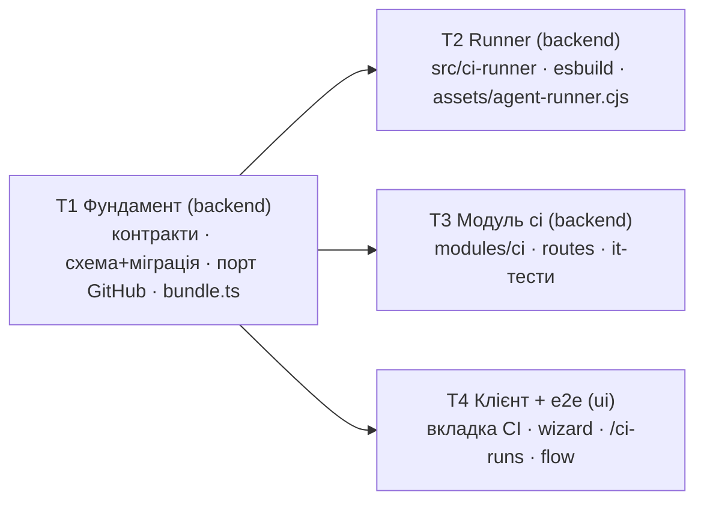

# План імплементації: Export to CI (MVP)

- **Вимоги:** `specs/2026-11-18-export-to-ci.md` (SPEC-2026-11-18-export-to-ci, Status: `draft` — плануємо за поточним текстом за рішенням користувача)
- **Режим виконання:** multi-agent — **4 implementer'и** (T1 першим, потім T2 / T3 / T4 паралельно; ліміт ≤ 5)
- **Статус:** planned

> **Замінено (2026-11-18, після реалізації).** Розділ «T2 Runner» і D-P1 нижче описують власний
> runner у `server/src/ci-runner/` (esbuild → `server/assets/agent-runner.cjs`, `build:runner`).
> **Цього більше немає.** Runner — пакет `agent-runner/` (курс, `lesson-7-lab/agent-runner`), розширений:
> артефакт із полями контракту `CiResultArtifact` (`schema_version`, `status`, `verdict`, `blockers`,
> `model`, `runner_version`), `failed`-артефакт при збої (без findings, нічого не публікується),
> підтримка `.devdigest/memory.jsonl`. Експорт (`modules/ci/runner.ts`) читає всю `agent-runner/dist/`
> і кладе її в `.devdigest/runner/` (entry `index.js`, `version` = хеш вмісту); workflow копіює
> маніфест агента в тимчасовий `DEVDIGEST_DIR` (runner вимагає рівно один маніфест) і має
> `if:`-умову проти fork PR (замість статусу `skipped`). `dist/` у `.gitignore` — збирається в
> `scripts/dev.sh` і CI (`pnpm build` в `agent-runner/`). Решта плану лишається чинною.

## Мета

Агента DevDigest з провайдером `openrouter` можна експортувати в GitHub Actions репозиторію через
wizard на 4 кроки (PR з гілки `devdigest/ci` або zip). Закомічений runner на базі `reviewer-core`
рев'юїть кожен `pull_request`, публікує результат і падає, коли спрацьовує gate. Після ручного
Refresh результати видно на сторінці **CI Runs** і у вкладці **CI** агента (`source='ci'`).
Розділ spec «Deferred / iterate later» **не плануємо**.

## Рішення

Відповіді користувача (2026-11-18) та прийняті рекомендації:

- **D-P1 — Runner усередині пакета `server`.** Вихідний код — `server/src/ci-runner/**`. Це окрема
  точка входу (власний composition root, як `src/server.ts`), **не** модуль у `src/modules/`, тому
  вона може імпортувати чистий `adapters/git/diff-parser.ts` без порушення depcruise-правила
  `module-no-direct-adapter`. Збірка: `esbuild` у devDependencies сервера + скрипт
  `build:runner`. Зібраний `server/assets/agent-runner.cjs` **комітиться**; сервер читає його під
  час експорту. Окремого пакета `agent-runner/` не створюємо (правило `!agent-runner/dist/` у
  кореневому `.gitignore` лишаємо як є — `.gitignore` не чіпаємо).
- **D-P2 — Коди помилок (свідоме відхилення від spec).** Spec хоче `400` для помилок валідації.
  Глобальний обробник (`server/src/app.ts:118-146`) повертає `422 validation_error` для будь-якої
  Zod-помилки; ми це **лишаємо**. Агент не на `openrouter` → `422` з `code: 'unsupported_provider'`.
  Клієнт розрізняє їх за `code`. **Після імплементації запропонувати оновити spec** (розділ
  Contracts → `POST /agents/:id/export-ci`, `POST …/ci/preview`).
- **D-P3 — E2E.** Flow `e2e/specs/12-export-to-ci.flow.json` покриває AC-86 (сайдбар → CI Runs →
  Refresh) і zip-установку (вкладка CI показує рядок інсталяції). Гілку PR (екран успіху з
  посиланням, AC-49) покривають RTL-тест і it-тест сервера з `MockGitHubClient` — e2e-стек ходить
  у справжній GitHub, тому PR-гілку там детерміновано не перевірити.
- **D-P4 — Manifest = JSON у файлі `.yaml`.** Будь-який JSON — валідний YAML 1.2. Сервер пише
  `JSON.stringify(manifest, null, 2)`, runner читає `JSON.parse` + `AgentManifest.parse`. Нових
  залежностей (yaml-бібліотеки) немає. Workflow генерується шаблоном-рядком.
- **D-P5 — `APPROVE` → `COMMENT` у runner'і.** `toReviewPayload` при 0 знахідок дає `APPROVE`
  (`reviewer-core/src/output/to-review.ts:156`), а `GITHUB_TOKEN` за замовчуванням не може
  схвалювати PR (422). Runner підміняє подію; `reviewer-core` не змінюємо (AC-61).
- **D-P6 — `workflow_file` зберігається в інсталяції**, щоб перейменування агента не ламало ingest.
- **D-P7 — `PUT /agents/:id` замість `PATCH`.** Spec посилається на `PATCH`, у коді роут `PUT`
  (`server/src/modules/agents/routes.ts`). Вкладка CI використовує наявний `useUpdateAgent`
  (PUT); сервер агентів не змінюємо (AC-8).
- **D-P8 — Два нові методи порту `GitHubClient`:** `listWorkflowRuns` і `downloadArtifact`
  (+ Octokit + `MockGitHubClient` з ін'єкцією помилок). Клієнтську копію `adapters.ts` **не**
  чіпаємо (клієнт не використовує цей порт; копія вже розходиться, див. `server/INSIGHTS.md`).
- **D-P9 — Zip через `fflate`** (вже залежність сервера): `zipSync` для експорту; для
  артефакту — двопрохідний `unzipSync` з `filter` (захист від zip-бомби, `server/INSIGHTS.md`).
- **D-P10 — `seed.ts` не чіпаємо** (спільний ресурс для всіх it-тестів).
- **D-P11 — `CiFile.version`** — нове необов'язкове поле; для запису runner'а в preview
  `contents = ""`, `editable = false`, `version = RUNNER_VERSION` (AC-25).
- **D-P12 — Схеми не вистачає → змінюємо `server/src/db/schema/ci.ts` і генеруємо міграцію**
  `pnpm db:generate` (лише T1). Файли `server/src/db/migrations/**` руками не редагуємо. Кожна
  нова `NOT NULL` колонка має `DEFAULT`.

## Зачеплені модулі

- **server** — контракти (`vendor/shared/contracts/eval-ci.ts`), порт (`vendor/shared/adapters.ts`),
  адаптери (`adapters/github/octokit.ts`, `adapters/mocks.ts`), схема + міграція, новий модуль
  `modules/ci/**`, новий runner `src/ci-runner/**`, `assets/agent-runner.cjs`, `package.json`
  (esbuild + `build:runner`).
- **client** — вендорна копія `src/vendor/shared/contracts/eval-ci.ts` (у T1, синхронно з
  сервером), вкладка CI, wizard, сторінка `/ci-runs`, пункт сайдбару, i18n `ci`.
- **e2e** — один новий flow.
- **reviewer-core** — **без змін** (імпортується як джерело у runner і бандлиться esbuild'ом).
- **Не чіпаємо:** сервіс мультипрогонів, PR-стрічку / історію запусків PR (`modules/pulls/**`,
  `modules/reviews/**`), `seed.ts`, `server/src/db/migrations/**` вручну, `.gitignore`.

**Shared-contract ripple:** `eval-ci.ts` має дві копії (server і client), які **вже** не
байт-ідентичні (клієнтська не має `AgentManifest` та імпорту `Provider`). T1 редагує кожну копію
у власному місці; нові/змінені схеми (усе, крім `AgentManifest`) мають бути однаковими в обох.

## Граф паралелізації



- Хвиля 1: **T1** (сам).
- Хвиля 2: **T2 ∥ T3 ∥ T4** (одночасно, файли не перетинаються).
- T3 і T4 спираються лише на контракти й інтерфейси з T1 (не на код одне одного). Прогін e2e-flow
  (T4) потребує злитих T3 + T4 — він входить у «Наступні кроки», не в acceptance T4.

## Матриця Owned paths

| Task | Owned paths (створювати/змінювати можна ЛИШЕ їх) |
|---|---|
| T1 | `server/src/vendor/shared/contracts/eval-ci.ts`; `client/src/vendor/shared/contracts/eval-ci.ts`; `server/src/vendor/shared/adapters.ts`; `server/src/adapters/github/octokit.ts`; `server/src/adapters/mocks.ts`; `server/src/db/schema/ci.ts`; `server/src/db/rows.ts`; `server/src/db/migrations/**` (**лише** результат `pnpm db:generate`); `server/src/ci-runner/bundle.ts`; `server/assets/agent-runner.cjs` (заглушка); `server/test/adapters.test.ts`; `server/test/contracts.test.ts` |
| T2 | `server/src/ci-runner/**` **крім** `bundle.ts`; `server/assets/agent-runner.cjs` (справжня збірка, після T1); `server/package.json`; `server/pnpm-lock.yaml` |
| T3 | `server/src/modules/ci/**`; `server/src/modules/index.ts` (лише import + рядок `ci`); `server/test/ci-*.it.test.ts`; `server/test/helpers/ci-*.ts` (якщо потрібні) |
| T4 | `client/src/app/agents/[id]/_components/AgentEditor/AgentEditor.tsx`; `client/src/app/agents/[id]/_components/AgentEditor/constants.ts`; `client/src/app/agents/[id]/_components/AgentEditor/constants.test.ts`; `client/src/app/agents/[id]/_components/AgentEditor/_components/CiTab/**`; `client/src/app/agents/[id]/_components/AgentEditor/_components/ExportCiWizard/**`; `client/src/app/ci-runs/**`; `client/src/lib/hooks/ci.ts`; `client/src/lib/hooks/ci.test.tsx`; `client/src/lib/hooks/index.ts` (один рядок `export * from "./ci"`); `client/src/lib/api.ts` (лише новий хелпер для blob); `client/src/vendor/ui/nav.ts`; `client/src/components/app-shell/helpers.test.ts`; `client/messages/en/ci.json`; `client/messages/en/agents.json` (лише ключ `editor.tabs.ci`); `e2e/specs/12-export-to-ci.flow.json` |

**Доказ відсутності перетину в хвилі 2:** T2 — лише `server/src/ci-runner/**` (без `bundle.ts`),
`server/assets/**`, `server/package.json`, `server/pnpm-lock.yaml`. T3 — лише
`server/src/modules/ci/**`, один рядок у `server/src/modules/index.ts`, `server/test/ci-*`. T4 —
лише `client/**` і `e2e/specs/12-*`. Спільні для T2/T3 речі (`bundle.ts`, контракти, порт, схема)
належать T1 і завершуються до хвилі 2. `server/src/ci-runner/bundle.ts` T3 лише **імпортує**, а T2
**не змінює**.

## Задачі

### T1 — Фундамент: контракти, схема + міграція, порт GitHub, bundle-loader

- **Type:** backend
- **Skills:** `onion-architecture`, `fastify-best-practices`, `drizzle-orm-patterns`,
  `postgresql-table-design`, `zod`, `security`, `typescript-expert`, `engineering-insights`
- **Owned paths:** див. матрицю (рядок T1).
- **Depends-on:** none
- **Relevant insights:**
  - `eval-ci.ts` має дві копії, що вже розходяться (клієнтська без `AgentManifest` / імпорту
    `Provider`); редагувати кожну **у власному місці**, не `git apply` серверного патча на клієнт
    (`server/INSIGHTS.md`, Recurring Errors). `eval-ci.ts` не охоплений тестом синхронізації.
  - Нова `NOT NULL` колонка без `DEFAULT` ламає міграцію на непорожній таблиці; якщо згенерована
    міграція погана — перегенерувати її, а не латати наступною.
  - drizzle-kit 0.30 коректно генерує unique / partial-індекси.
  - Клієнт може лише `import type` з `@devdigest/shared` (value-імпорт ламає Next).
- **Що зробити:**
  1. **Контракти** (`server/src/vendor/shared/contracts/eval-ci.ts`; ті самі зміни дзеркально в
     `client/src/vendor/shared/contracts/eval-ci.ts`, у клієнтській копії додати імпорт
     `CiFailOn` з `./knowledge.js`; `AgentManifest` у клієнт **не** переносити):
     - `CiTriggerEvent = z.enum(['opened','synchronize','reopened'])`;
       `CiPostAs = z.enum(['github_review','pr_comment','none'])`.
     - `CiFile` + `version: z.string().nullish()` (D-P11).
     - `CiRunStatus` + `'skipped'` → `['succeeded','failed','no_findings','running','skipped']`.
     - `CiPreviewInput = { repo: string (regex ^[\w.-]+/[\w.-]+$), triggers: z.array(CiTriggerEvent).min(1).default(['opened','synchronize']), post_as: CiPostAs.default('github_review') }`;
       `CiPreview = { files: z.array(CiFile) }`.
     - `CiExportInput` змінити: `repo` (той самий regex), `target: z.literal('gha').default('gha')`,
       `action: z.enum(['open_pr','zip']).default('open_pr')`, `post_as`, `triggers` (як у preview),
       `workflow_override: z.string().max(100_000).optional()`; **прибрати** `base`.
       `CiExportInputBody = z.input<…>` лишити.
     - `CiInstallation` — без змін. Додати `AgentCiInstallation = CiInstallation.extend({ workflow_file: z.string(), runner_version: z.string(), pr_url: z.string().nullable(), recent_runs: z.array(CiRun) })`
       і `AgentCi = { ci_fail_on: CiFailOn, installations: z.array(AgentCiInstallation) }`
       (оголосити після `CiRun`).
     - `CiRun` + `repo: z.string().nullable()`, `agent_id: z.string().nullable()`,
       `verdict: Verdict.nullable()`, `critical`, `warning`, `suggestion`:
       `z.number().int().nullable()`, `run_attempt: z.number().int().nullable()` (`agent` і
       `duration_s` уже є; `status` лишається `z.string().nullable()`).
     - `CiRunsList = { items: z.array(CiRun) }`;
       `CiRefreshResult = { ingested: z.number().int(), errors: z.array(z.object({ repo: z.string(), reason: z.string() })) }`.
     - `CiResultArtifact`: зберегти наявні поля; додати `schema_version: z.literal(1)`,
       `status: z.enum(['succeeded','no_findings','failed','skipped'])`,
       `reason: z.string().max(2000).nullable()`, `verdict: Verdict.nullable()`,
       `blockers: z.number().int().min(0)`, `model: z.string().max(200)`,
       `runner_version: z.string().max(50)`; `pr_number` → обов'язкове `z.number().int().positive()`;
       лічильники `.min(0)`, `agent` `.max(200)`.
     - Експортувати схеми й `z.infer` типи. Не змінювати barrel, якщо `eval-ci.ts` уже реекспортується.
  2. **Схема** `server/src/db/schema/ci.ts`:
     - `ci_installations` +: `workflowFile text NOT NULL DEFAULT ''`,
       `runnerVersion text NOT NULL DEFAULT ''`, `prUrl text` (null),
       `updatedAt timestamptz NOT NULL DEFAULT now()`;
       `uniqueIndex('ci_installations_agent_repo_uq').on(agentId, repo)`.
     - `ci_runs` +: `agentRunId uuid → agent_runs.id ON DELETE CASCADE` (null),
       `workflowRunId bigint (mode:'number')`, `runAttempt integer`, `repo text`, `verdict text`,
       `critical/warning/suggestion integer`;
       `uniqueIndex('ci_runs_run_uq').on(ciInstallationId, workflowRunId, runAttempt)`,
       `index('ci_runs_ran_at_idx').on(ranAt.desc())`, індекс на `agentRunId`.
     - Типи рядків `CiInstallationRow`, `CiRunRow` у `server/src/db/rows.ts`.
     - `cd server && pnpm db:generate` → один новий файл міграції; переглянути SQL (є `DEFAULT`
       для `NOT NULL`, немає `DROP`).
  3. **Порт** (`server/src/vendor/shared/adapters.ts`, лише серверна копія):
     ```ts
     export interface WorkflowRunMeta { id: number; run_attempt: number; html_url: string; created_at: string; conclusion: string | null }
     // у GitHubClient:
     /** Completed runs of one workflow file (newest first). */
     listWorkflowRuns(repo: RepoRef, workflowFile: string, opts?: { perPage?: number }): Promise<WorkflowRunMeta[]>;
     /** Zip bytes of the named artifact of a run; null if absent/expired. */
     downloadArtifact(repo: RepoRef, runId: number, name: string): Promise<Uint8Array | null>;
     ```
  4. **Octokit** (`adapters/github/octokit.ts`): `actions.listWorkflowRuns({ workflow_id: workflowFile, status: 'completed', per_page })`;
     `actions.listWorkflowRunArtifacts({ run_id, name })` → перший не `expired` →
     `actions.downloadArtifact({ artifact_id, archive_format: 'zip' })` → `new Uint8Array(data as ArrayBuffer)`.
     Обгорнути `withRetry`/`withTimeout`, як у сусідніх методів. Помилки Octokit пробрасувати
     (повідомлення GitHub має дійти до сервісу).
  5. **Mock** (`adapters/mocks.ts`): у `MockGitHubOptions` додати
     `workflowRuns?: Record<string /* "owner/name:file" */, WorkflowRunMeta[]>`,
     `artifacts?: Record<number /* runId */, Uint8Array | null>`,
     `errors?: { commitFiles?: Error; openPullRequest?: Error; listWorkflowRuns?: Record<string /* "owner/name" */, Error> }`;
     публічні лічильники `downloads: number[]`, `listedWorkflows: string[]`. Наявну поведінку
     `commitFiles`/`findOpenPr`/`openPullRequest` не змінювати (лише кидати `errors.*`, якщо задано).
  6. **`server/src/ci-runner/bundle.ts`** (спільний інтерфейс для T2/T3):
     ```ts
     export const RUNNER_VERSION = '1.0.0';
     export const RUNNER_MARKER = `devdigest-agent-runner@${RUNNER_VERSION}`;
     export const RUNNER_REPO_PATH = '.devdigest/runner/agent-runner.cjs';
     export async function loadRunnerBundle(): Promise<string> // читає server/assets/agent-runner.cjs через node:fs/promises відносно import.meta.url
     ```
     Плюс заглушка `server/assets/agent-runner.cjs`: `/* placeholder — run pnpm build:runner */`
     з рядком `RUNNER_MARKER`, щоб T3 могла тестувати експорт до збірки T2.
  7. Тести: `server/test/contracts.test.ts` — нові схеми (`CiResultArtifact` відкидає без
     `schema_version` / з негативним лічильником; `CiExportInput` відкидає `base`-only / порожні
     `triggers`); `server/test/adapters.test.ts` — mock повертає `workflowRuns`/`artifacts` і
     кидає `errors.*`.
- **Test + typecheck:**
  `cd server && pnpm typecheck && pnpm exec vitest run --exclude '**/*.it.test.ts'`;
  `cd client && pnpm typecheck`.
- **Acceptance:** обидві копії `eval-ci.ts` мають однакові нові/змінені схеми; міграцію
  згенеровано drizzle-kit і вона застосовується (`pnpm db:migrate` на порожній і на
  засіяній БД); порт + Octokit + mock компілюються; `loadRunnerBundle()` повертає заглушку.
  **Нові тести обов'язкові** (contracts + adapters). Покриває фундамент для AC-21…AC-94, NFR-11.

### T2 — Runner для GitHub Actions + збірка bundle

- **Type:** backend (окрема точка входу; реюзає чистий `reviewer-core`)
- **Skills:** `onion-architecture`, `fastify-best-practices`, `drizzle-orm-patterns`,
  `postgresql-table-design`, `zod`, `security`, `typescript-expert`, `engineering-insights`
  (фактично важливі: `onion-architecture` — `reviewer-core` лишається чистим, вся I/O тут;
  `zod`, `security`, `typescript-expert`)
- **Owned paths:** див. матрицю (рядок T2). `server/src/ci-runner/bundle.ts` — лише імпорт.
- **Depends-on:** T1
- **Relevant insights:**
  - `reviewer-core` споживається як TS-джерело через alias; `openai` резолвиться з
    `reviewer-core/node_modules` → перед збіркою `cd reviewer-core && npm ci`.
  - `OpenRouterProvider` повертає реальну вартість `usage.cost` (`outcome.costUsd`), null-poisoning
    by design — не «лагодити».
  - `toReviewPayload` при 0 знахідок → `APPROVE` → підмінити на `COMMENT` (D-P5).
  - Для мінімізації ризику ECONNRESET вже є `withTransportRetry` всередині провайдера.
  - Ніколи не логувати токени/ключі (NFR-10).
- **Що зробити:**
  1. `server/src/ci-runner/run.ts` — оркестратор з **інжектованими залежностями** (тестований):
     ```ts
     interface RunnerDeps {
       env: Record<string, string | undefined>;      // GITHUB_EVENT_PATH, GITHUB_REPOSITORY, GITHUB_TOKEN, OPENROUTER_API_KEY, DEVDIGEST_AGENT, DEVDIGEST_POST_AS
       readFile(path: string): Promise<string | null>; // відносно робочої директорії
       gitDiff(base: string, head: string): Promise<string>;
       makeLlm(apiKey: string): LLMProvider;
       github: { postReview(n: number, p: GitHubReviewPayload): Promise<void>; postComment(n: number, body: string): Promise<void> };
       now(): number;
     }
     export async function runCi(deps: RunnerDeps): Promise<{ result: CiResultArtifact; exitCode: number }>
     ```
     Алгоритм:
     - Прочитати подію (`GITHUB_EVENT_PATH`) → `pull_request.number/base.sha/head.sha/body`,
       `isFork = pull_request.head.repo.full_name !== GITHUB_REPOSITORY`.
     - Прочитати `.devdigest/agents/<DEVDIGEST_AGENT>.yaml` → `JSON.parse` → `AgentManifest.parse`;
       для кожного slug — `.devdigest/skills/<slug>.md` (відсутній → пропустити з warning);
       `.devdigest/memory.jsonl` → по рядку `JSON.parse(...).content` (биті рядки пропускати).
     - Немає `OPENROUTER_API_KEY`: fork → `status:'skipped'`, `exitCode 0`, нічого не публікувати
       (AC-67, D6); інакше → `status:'failed'`, `reason:'OPENROUTER_API_KEY is not set'` (AC-69).
     - `parseUnifiedDiff(await gitDiff(base, head))` (імпорт з `../adapters/git/diff-parser.js`) →
       `reviewPullRequest({ systemPrompt, model, diff, llm, strategy, skills, memory, prDescription, task: 'Review PR #n' })`.
     - Виняток LLM/engine → `status:'failed'`, `reason` = повідомлення помилки (обрізати до 500 символів,
       без секретів), публікації немає (AC-69).
     - Успіх: `counts` за severity, `blockers = countBlockers(findings, ci_fail_on)`,
       `gate = gateTriggered(findings, ci_fail_on)`, `status = findings.length ? 'succeeded' : 'no_findings'`,
       `verdict = review.verdict`.
     - Публікація за `DEVDIGEST_POST_AS` (лише якщо не skipped/failed):
       `github_review` → `toReviewPayload(review, { failOn, diff })` з підміною `APPROVE→COMMENT`
       → `postReview` (AC-61); `pr_comment` → один коментар із підсумком (лічильники + список
       `path:line — title`) (AC-62); `none` → жодних викликів (AC-63). Помилку публікації
       логувати в stderr і **не** змінювати статус/код (publish_error — deferred).
     - `exitCode`: `failed` → `ci_fail_on === 'never' ? 0 : 1`; `gate` → 1; інакше 0 (AC-64, AC-69).
     - Результат за `CiResultArtifact` (`schema_version: 1`, `agent` = manifest.name, `model`,
       `runner_version: RUNNER_VERSION`, `pr_number`, `duration_ms`, `cost_usd`, `findings_count`,
       `critical/warning/suggestion`, `blockers`, `verdict`, `status`, `reason`); перед поверненням
       перевірити `CiResultArtifact.parse` (AC-66).
  2. `server/src/ci-runner/github.ts` — мінімальний клієнт на `fetch` до `api.github.com`
     (`POST /repos/{o}/{r}/pulls/{n}/reviews`, `POST /repos/{o}/{r}/issues/{n}/comments`) з
     `GITHUB_TOKEN`; без octokit (менший bundle).
  3. `server/src/ci-runner/main.ts` — точка входу: збирає реальні deps (`node:fs/promises`,
     `execFile('git', ['diff', `${base}...${head}`])` **без shell**, `new OpenRouterProvider(key)`,
     `github.ts`), викликає `runCi`, **завжди** (try/finally) пише `devdigest-result.json`, друкує
     `RUNNER_MARKER` у лог, ставить `process.exitCode`. Навіть неочікуваний виняток → артефакт
     `failed` + код за правилом вище.
  4. `server/package.json`: devDependency `esbuild` (версія, сумісна з уже наявною в lockfile, напр.
     `^0.24`/`^0.25` — перевірити `pnpm add -D esbuild`) і скрипт
     `"build:runner": "esbuild src/ci-runner/main.ts --bundle --platform=node --target=node20 --format=cjs --minify --legal-comments=none --outfile=assets/agent-runner.cjs"`.
     Оновити `pnpm-lock.yaml` тим самим `pnpm add`.
  5. Зібрати: `cd reviewer-core && npm ci` (якщо треба), `cd server && pnpm build:runner`;
     закомітити отриманий `server/assets/agent-runner.cjs` (замінює заглушку з T1). Перевірити
     `node server/assets/agent-runner.cjs` без env → артефакт `failed`, без падіння процесу.
  6. Тести `server/src/ci-runner/run.test.ts` (фікстура diff, mock LLM, фейковий github):
     успіх із CRITICAL + `critical` → exit 1 + `postReview` з `REQUEST_CHANGES` і inline-коментарями;
     лише WARNING + `critical` → exit 0, подія `COMMENT`; 0 знахідок → `no_findings`, подія `COMMENT`
     (не `APPROVE`); `never` → 0; `pr_comment` → рівно 1 коментар; `none` → 0 викликів;
     LLM кидає → `failed` + reason, exit 1 (`critical`) / 0 (`never`); fork без ключа → `skipped`,
     exit 0, 0 викликів; same-repo без ключа → `failed`; кожен результат проходить
     `CiResultArtifact.parse`; результат не містить рядків, схожих на токен (`ghp_`, `sk-or-`,
     значення env-ключа). `server/src/ci-runner/bundle.test.ts`: `assets/agent-runner.cjs` містить
     `RUNNER_MARKER` і **не** є заглушкою (ловить «забули перезібрати»).
- **Test + typecheck:**
  `cd server && pnpm typecheck && pnpm exec vitest run src/ci-runner --exclude '**/*.it.test.ts'`;
  `cd reviewer-core && npm test && npm run typecheck` (контроль, що engine не змінено).
- **Acceptance:** AC-59, AC-61, AC-62, AC-63, AC-64, AC-66, AC-67, AC-69, EC-13, NFR-10 (runner),
  NFR-6 (той самий набір LLM-викликів, що й локально — один `reviewPullRequest`). `git diff
  reviewer-core/` порожній. **Нові тести обов'язкові.**

### T3 — Серверний модуль `ci`: preview, export, ingest, списки

- **Type:** backend
- **Skills:** `onion-architecture`, `fastify-best-practices`, `drizzle-orm-patterns`,
  `postgresql-table-design`, `zod`, `security`, `typescript-expert`, `engineering-insights`
- **Owned paths:** див. матрицю (рядок T3).
- **Depends-on:** T1
- **Relevant insights:**
  - Модуль = Fastify-плагін (`routes` + `service` + `repository`), реєстрація в `modules/index.ts`;
    Drizzle **лише** в `repository.ts`; GitHub — через `await container.github()`, не імпорт адаптера.
  - Транзакції: `this.db.transaction(async (tx) => …)`; ідемпотентність — через unique-індекс +
    `onConflictDoNothing` (`server/INSIGHTS.md`, eval T5).
  - `fflate unzipSync`: два проходи з `filter`, спочатку імена/`originalSize`, потім інфлейт
    лише потрібного файла; ніколи голий `unzipSync(buf)`.
  - Zod response-схема зрізає невідомі ключі — усі поля мають бути в контракті.
  - Workspace-скоупінг кожного запиту (IDOR-урок Conventions): агент і репозиторій перевіряти
    в межах `workspaceId`.
  - it-тести: `buildApp` з `overrides: { github: new MockGitHubClient({...}), secrets: new MockSecretsProvider({}) }`
    (без цього реальний ключ розробника може протекти).
- **Що зробити:**
  1. `modules/ci/bundle.ts` (чисті функції, без I/O):
     `slugify(name)` (kebab, fallback `agent`), `buildManifest(agent, skillSlugs)` → JSON-текст,
     `buildSkillFiles(skills)` (дедуп slug суфіксом `-2`), `buildMemoryJsonl(rows)` (один
     `{kind,scope,content}` на рядок; порожній рядок, якщо записів нема — D8),
     `buildWorkflow({ agentSlug, triggers, postAs })` за шаблоном:
     ```yaml
     name: DevDigest review (<agent-slug>)
     on:
       pull_request:
         types: [<triggers>]
     permissions:
       contents: read
       pull-requests: write        # лише якщо post_as != none
     jobs:
       review:
         runs-on: ubuntu-latest
         steps:
           - uses: actions/checkout@v4
             with:
               fetch-depth: 0
           - uses: actions/setup-node@v4
             with:
               node-version: 22
           - name: DevDigest review
             run: node .devdigest/runner/agent-runner.cjs
             env:
               OPENROUTER_API_KEY: ${{ secrets.OPENROUTER_API_KEY }}
               GITHUB_TOKEN: ${{ secrets.GITHUB_TOKEN }}
               DEVDIGEST_AGENT: <agent-slug>
               DEVDIGEST_POST_AS: <post_as>
           - name: Upload DevDigest result
             if: always()
             uses: actions/upload-artifact@v4
             with:
               name: devdigest-result
               path: devdigest-result.json
               if-no-files-found: ignore
     ```
     У workflow підставляються **лише** slug і значення з enum (без вільного тексту → без
     YAML-ін'єкції). Ніколи `pull_request_target` і `devdigest/review-action@v1` (AC-28).
     `buildFiles(...)` повертає 6 типів шляхів (AC-21): `.devdigest/agents/<slug>.yaml`,
     `.devdigest/skills/<skill-slug>.md` × N увімкнених skills, `.devdigest/memory.jsonl`,
     `.devdigest/runner/agent-runner.cjs`, `.github/workflows/devdigest-review-<slug>.yml`.
  2. `modules/ci/repository.ts` (усі Drizzle-запити): connected repo за `(workspaceId, fullName)`
     (`id`, `owner`, `name`, `defaultBranch`); memory (`scope='global'` + `scope='repo' AND repo_id`),
     workspace-scoped; upsert інсталяції по `(agent_id, repo)` (`onConflictDoUpdate`: `workflowFile`,
     `runnerVersion`, `prUrl`, `updatedAt`); інсталяції агента + до 10 останніх runs кожної
     (newest first); усі інсталяції workspace (join `agents.workspaceId`); множина вже записаних
     `(installationId, workflowRunId, runAttempt)`; транзакційний запис ingest (див. 4); останні 50
     CI runs з join `ci_installations`/`agents`/`agent_runs` (назва агента, `duration_s` з
     `duration_ms`).
  3. `modules/ci/service.ts`:
     - `getAgentCi(ws, agentId)` → `AgentCi` (`container.agentsRepo.getById`, 404 якщо нема).
     - `preview(ws, agentId, input)` → `CiPreview`. Провайдер ≠ `openrouter` →
       `AppError('unsupported_provider', 'Only agents using the OpenRouter provider can run in CI', 422)` (AC-18, D-P2).
       Репозиторій не підключений → `AppError('repo_not_connected', …, 422)`. Skills — увімкнені
       з `container.agentsRepo.linkedSkills(agentId)` у порядку `order`. Runner-запис:
       `contents: ''`, `editable: false`, `version: RUNNER_VERSION`. Workflow — `editable: true`,
       решта `false`. **Нуль LLM-викликів, нуль GitHub-викликів.**
     - `exportCi(ws, agentId, input)`: ті самі перевірки; ті самі файли, але runner = повний
       `loadRunnerBundle()`, workflow = `workflow_override ?? generated`.
       - `open_pr`: `github = await container.github()`; `commitFiles({ branch: 'devdigest/ci', base: repo.defaultBranch, message: 'DevDigest CI: add <slug> review', files })`
         (**лише** в `devdigest/ci`, AC-45); `existing = await findOpenPr(ref, 'devdigest/ci')`;
         `pr_url = existing?.url ?? (await openPullRequest(ref, { title: 'Add DevDigest CI review', head: 'devdigest/ci', base: defaultBranch, body })).url`
         (AC-47, AC-48, EC-7, EC-8). Будь-яка помилка `container.github()` / GitHub → **без запису
         інсталяції** → `ExternalServiceError(<повідомлення GitHub>)` (502) (AC-53, EC-10, EC-25).
         Після успіху — upsert інсталяції (`runnerVersion = RUNNER_VERSION`, `workflowFile`,
         `prUrl`) → `CiExport` (AC-49).
       - `zip`: `zipSync` з шляхами відносно кореня репозиторію (6 типів записів), **жодних
         GitHub-викликів**, upsert інсталяції з `prUrl = null` (AC-50, D9). Повертає `Uint8Array`.
     - `refresh(ws)` → `CiRefreshResult`: `container.github()` один раз (помилка → кожна
       інсталяція отримує `{repo, reason}`). Для кожної інсталяції окремо (try/catch на
       інсталяцію, AC-85): `listWorkflowRuns(ref, workflowFile, { perPage: 20 })` (лише її
       workflow у її репо, AC-73) → відкинути вже записані `(id, run_attempt)` → `downloadArtifact(ref, run.id, 'devdigest-result')`
       → null → пропуск; два проходи `unzipSync` (≤ 10 записів, `devdigest-result.json` ≤ 1 MB) →
       `JSON.parse` у try → `CiResultArtifact.safeParse` → невдача = пропуск без запису (AC-76).
       Прийнятий → **одна транзакція**: insert `agent_runs` (`workspaceId`, `agentId` інсталяції,
       `prId: null`, `source: 'ci'`, `provider: 'openrouter'`, `model`, `durationMs`, `costUsd`,
       `findingsCount`, `blockers`, `status`: succeeded/no_findings → `done`, failed → `failed`,
       skipped → `skipped`, `error: reason`, `ranAt: run.created_at`) + insert `ci_runs`
       (`ciInstallationId`, `agentRunId`, `workflowRunId`, `runAttempt`, `repo`, `prNumber`,
       `ranAt`, `status`, `verdict`, лічильники, `findingsCount`, `costUsd`,
       `githubUrl: run.html_url`, `source: 'ci'`) з `onConflictDoNothing`; якщо `ci_runs` не
       вставився — кинути, щоб відкотити `agent_runs` (AC-77, AC-80, NFR-5). Наявні рядки не
       видаляються ніколи.
     - `listRuns(ws)` → `CiRunsList` (50 newest).
     - Логи: лише `repo`, `run id`, лічильники, ніколи токени.
  4. `modules/ci/routes.ts` (тонкі; `getContext` для `workspaceId`; params `IdParams`):
     - `GET /agents/:id/ci` → `response: { 200: AgentCi }`.
     - `POST /agents/:id/ci/preview` → `body: CiPreviewInput`, `response: { 200: CiPreview }`.
     - `POST /agents/:id/export-ci` → `body: CiExportInput`, **без** response-схеми (два типи
       відповіді): `open_pr` → `CiExport.parse(result)`; `zip` → `reply.header('content-type','application/zip').header('content-disposition', 'attachment; filename="devdigest-ci-<slug>.zip"').send(Buffer.from(bytes))`.
     - `GET /ci/runs` → `CiRunsList`. `POST /ci/runs/refresh` (без body) → `CiRefreshResult`.
     - Зареєструвати `ci` у `server/src/modules/index.ts` (один import + один ключ).
  5. Тести:
     - Unit `modules/ci/bundle.test.ts`: manifest парситься `AgentManifest` і збігається з агентом
       (AC-22); workflow містить вибрані `types`, `contents: read`, `pull-requests: write` лише
       коли `post_as != none`, `node .devdigest/runner/agent-runner.cjs`,
       `secrets.OPENROUTER_API_KEY`, `if: always()` на upload (AC-27); не містить
       `pull_request_target` і `devdigest/review-action@v1` (AC-28); перемикання `reopened`
       з'являється в тексті (AC-37 на рівні генератора); memory порожній → `''`; згенеровані
       файли не містять рядків, схожих на токени (NFR-10).
     - Integration `server/test/ci-export.it.test.ts`: preview для агента з 2 skills → 6 шляхів
       (AC-21), агент без skills → без skill-файлів (EC-3); `openai`-агент → 422
       `unsupported_provider` (AC-18/EC-2); `open_pr` → mock має 1 коміт у `devdigest/ci` з
       `base` = default branch, жодного запису в default branch (AC-45), `openPullRequest` з
       title `Add DevDigest CI review` / head `devdigest/ci` (AC-47); другий експорт → немає
       нового `openPullRequest`, `pr_url` = наявний (AC-48); `workflow_override` потрапляє в
       коміт; `errors.commitFiles` (403) → 502 з повідомленням, рядка інсталяції немає (AC-53);
       `zip` → розпакований архів має 6 типів шляхів, 0 записів у mock GitHub, інсталяція з
       `pr_url = null` (AC-50); `GET /agents/:id/ci` після експорту показує рядок з
       `runner_version` (AC-94, AC-49 серверна частина); `PUT /agents/:id { ci_fail_on }` →
       `GET /agents/:id/ci` повертає нове значення (AC-8); LLM-моки мають 0 викликів (NFR-6).
     - Integration `server/test/ci-ingest.it.test.ts`: 2 завершені run'и потрібного workflow +
       1 іншого → 2 CI runs (AC-73); битий/невалідний артефакт → рядка немає (AC-76); прийнятий →
       рядок `agent_runs` з `source='ci'` + рядок `ci_runs` (AC-77); повторний refresh → кількість
       рядків та сама, артефакти не завантажуються вдруге (AC-80); 403 для репо A, 200 для B → B
       записано, помилка A повернута (AC-85); після ingest `GET /pulls/:id/runs` і список PR не
       змінилися (AC-79, NFR-11); примусова помилка запису `ci_runs` у транзакції → жодного з двох
       рядків, наступний refresh записує (NFR-5); `GET /ci/runs` — newest first, ≤ 50, `cost_usd`
       null зберігається null (AC-87 серверна частина, EC-19).
- **Test + typecheck:**
  `cd server && pnpm typecheck && pnpm exec vitest run --exclude '**/*.it.test.ts'` та
  `cd server && pnpm exec vitest run test/ci-export.it.test.ts test/ci-ingest.it.test.ts` (Docker).
- **Acceptance:** AC-8, AC-18, AC-21, AC-22, AC-27, AC-28, AC-45, AC-47, AC-48, AC-49 (сервер),
  AC-50, AC-53, AC-73, AC-76, AC-77, AC-79, AC-80, AC-85, AC-87 (сервер), AC-94 (сервер),
  EC-2/3/7/8/10/19/25, NFR-5, NFR-6, NFR-10, NFR-11. depcruise-гейт без нових порушень у
  `modules/ci`. **Нові тести обов'язкові.**

### T4 — Клієнт: вкладка CI, wizard Export to CI, сторінка CI Runs, сайдбар, e2e-flow

- **Type:** ui (+ один e2e-файл)
- **Skills:** `frontend-architecture`, `next-best-practices`, `react-best-practices`,
  `react-testing-library`, `security` (DOM sinks), `typescript-expert`, `engineering-insights`;
  для e2e — правила `e2e/CLAUDE.md`.
- **Owned paths:** див. матрицю (рядок T4).
- **Depends-on:** T1 (типи контрактів у клієнтській копії). Код T3 не потрібен: тести мокають
  `fetch`; e2e-прогін — після злиття T3.
- **Relevant insights:**
  - `app/agents/[id]/page.tsx` бере `VALID_TABS` з `AgentEditor/constants.ts` — додати `ci` у
    `TABS`, інакше `?tab=ci` впаде на Config.
  - `Tabs` рендерить звичайні `<button>` (без `role="tab"`) — у тестах `getByRole("button", { name })`.
  - `Modal` має дві кнопки «Close»; `useDialogA11y` вже дає Esc/focus-trap — не дублювати.
  - `@testing-library/user-event` не встановлено — `fireEvent`.
  - Клієнт: лише `import type` з `@devdigest/shared`.
  - `useTranslations` показує сирий ключ для відсутнього повідомлення — перелічити всі ключі.
  - Подвійний клік → `useRef` in-flight guard для Install / Refresh.
  - Глобальний `staleTime: 30_000` — мутації явно інвалідовують `["agent-ci", id]`, `["ci-runs"]`, `["agent", id]`.
  - Сторінка верхнього рівня має власний `s.page`-відступ (AppFrame без padding).
  - Новий маршрут з потенційним throw → `error.tsx`.
  - `MutationCache` уже показує toast для помилок — інлайн-повідомлення додаткове.
- **Що зробити:**
  1. `lib/hooks/ci.ts`: `useAgentCi(agentId)` (`["agent-ci", id]`), `useCiPreview()` (mutation,
     `POST /agents/:id/ci/preview`), `useExportCi()` (open_pr → JSON, інвалідовує
     `["agent-ci", id]`), `useExportCiZip()` (через новий `api.postBlob` → `Blob` → завантаження
     через `URL.createObjectURL` + тимчасовий `<a download>`), `useCiRuns()` (`["ci-runs"]`),
     `useRefreshCiRuns()` (інвалідовує `["ci-runs"]` і `["agent-ci"]`). Додати
     `export * from "./ci"` у `lib/hooks/index.ts`. У `lib/api.ts` — `postBlob(path, body)`
     поверх тієї ж нормалізації помилок (`ApiError`).
  2. Вкладка **CI** (`AgentEditor/_components/CiTab/`): `TABS` + `{ key: "ci", labelKey: "editor.tabs.ci", icon: … }`
     після `evals` (AC-1; іконку взяти з ключів `vendor/ui/icons.tsx`); `case "ci"` в
     `AgentEditor.tsx`. Вміст: заголовок «CI deployment», бейдж «Active in N repos», кнопки
     «Update CI config» і «Add to CI» (AC-2); порожній стан з «Add to CI» (AC-3); рядки
     інсталяцій: `owner/name`, «GitHub Actions», статус і відносний час останнього run (з
     `recent_runs[0]`), «workflow v<runner_version>», посилання на PR, якщо `pr_url` (AC-4, AC-94);
     «+ Add repository» під списком (AC-4); розгортання рядка → до 10 runs (час, PR, verdict,
     знахідки, статус), newest first (AC-7); селект `Fail CI on` (never/critical/warning/any) через
     наявний `useUpdateAgent` (PUT), значення з `agent.ci_fail_on`, повторно використати значення
     `CI_FAIL_ON_VALUES` з ConfigTab-констант (лише імпорт) (AC-8); кнопка Refresh (AC-73).
     Усі три кнопки відкривають wizard (AC-12).
  3. **Wizard** (`AgentEditor/_components/ExportCiWizard/`): kit `Modal` + `ExportWizardSteps`
     (`Target → Preview → Configure → Install`), заголовок «Export to CI», підзаголовок
     «Run <agent name> automatically on pull requests» (AC-12). Стан кроків — у компоненті
     (`useReducer`), логіка — у колокованому хуку (`useExportCiWizard.ts`).
     - **Target:** одна картка «GitHub Actions» («recommended», «Runs on pull_request events»),
       вибрана; жодних CircleCI/Jenkins/CLI (AC-13); `SelectInput` з підключених репозиторіїв
       (`useRepos`), за замовчуванням активний (`useActiveRepo`) (AC-14); провайдер ≠ `openrouter`
       → Continue вимкнено + повідомлення (AC-18, EC-2).
     - **Preview:** виклик preview з поточними triggers/post_as; ліворуч «FILES TO CREATE», праворуч
       шлях + вміст вибраного файла; workflow редагований (`CodeTextarea`, бейдж «editable»),
       решта read-only; для runner'а — «version <version>» замість вмісту (AC-21, AC-25). Вміст
       рендериться лише як текст (без `dangerouslySetInnerHTML`).
     - **Configure:** чипи `pull_request:opened` і `:synchronize` (увімкнені), `:reopened`
       (вимкнений) (AC-35); радіо «Post results as»: «GitHub review» (за замовчуванням,
       «recommended»), «PR comment», «None (exit code only)» (AC-41); зміна будь-чого → новий
       preview, ручні правки workflow замінюються (AC-37); статичний чекліст «Secrets expected»
       (`OPENROUTER_API_KEY` — «Your OpenRouter key — same BYO key from L06», `GITHUB_TOKEN` —
       «Auto-provided by Actions», підказка) без запитів до GitHub (AC-39, EC-1); інфо-блок «To
       block merges: …» (AC-42; ключ `exportWizard.blockMergeDesc` **не** використовувати).
     - **Install:** опції «Open a PR with these files» (за замовчуванням, «recommended», з `repo`,
       заголовком «Add DevDigest CI review» і кількістю файлів) та «Copy files as a zip»; посилання
       «GitHub Action setup docs» (AC-44, EC-3). Install → `open_pr` з `workflow_override` (якщо
       правили) → екран успіху з посиланням на PR і нагадуванням про `OPENROUTER_API_KEY` (AC-49);
       помилка → інлайн-причина з `ApiError.message` + кнопка переключитись на zip (AC-53, EC-10,
       EC-25); zip → завантаження + екран успіху без PR (AC-50).
  4. **Сторінка CI Runs:** `app/ci-runs/page.tsx` (тонкий) + `app/ci-runs/_components/CiRunsView/`
     + `app/ci-runs/error.tsx`. Заголовок «CI Runs», кнопка Refresh (показує помилки
     `errors[]` з причиною, AC-85); таблиця останніх 50: репозиторій, PR (номер, посилання
     `https://github.com/<repo>/pull/<n>`), агент, verdict, знахідки, вартість («—» якщо null,
     `formatCost`), тривалість, статус, посилання на job = `github_url` (AC-87, EC-19); порожній
     стан «No CI runs yet» (AC-90). Посилання — лише `https://github.com/...`, зібрані з `repo`, і
     `github_url`, що починається з `https://github.com/` (інакше текст без лінка).
  5. **Сайдбар:** у `vendor/ui/nav.ts` нова секція `GLOBAL` з `{ key: "ci-runs", label: "CI Runs", icon: …, href: "/ci-runs" }`
     (AC-86; `activeKeyFor` уже знає `/ci-runs`); тест у `components/app-shell/helpers.test.ts`.
  6. **i18n:** усі нові рядки в `messages/en/ci.json` (злити з наявними ключами, не ламаючи
     `runs`/`exportWizard`); `agents.json` — лише `editor.tabs.ci` (NFR-8).
  7. **E2E** `e2e/specs/12-export-to-ci.flow.json` (лише `--url`/`--text`, детермінований,
     засіяна БД): відкрити `/agents` → Security Reviewer → вкладка CI → «Add to CI» → Continue →
     Preview показує `.github/workflows/devdigest-review-` → Continue → Continue → вибрати
     «Copy files as a zip» → Install → екран успіху → вкладка CI показує `acme/payments-api`;
     сайдбар «CI Runs» → `/ci-runs`, видно «CI Runs» і «Refresh» (AC-86, AC-49 у zip-варіанті).
  8. **RTL-тести** (1–3 flow-тести на компонент, `QueryClientProvider` + stub `fetch` за `URL.pathname`):
     - `CiTab.test.tsx`: вкладка після Evals і «CI deployment» (AC-1); 2 інсталяції → «Active in 2
       repos» + обидві кнопки (AC-2); порожній → empty + «Add to CI» (AC-3); рядок з усіма полями і
       «workflow v1.0.0», «+ Add repository» (AC-4, AC-94); розгортання → ≤ 10 runs, newest first
       (AC-7); зміна Fail CI on → `PUT /agents/:id` з `ci_fail_on` (AC-8).
     - `ExportCiWizard.test.tsx`: кожна з трьох кнопок відкриває крок 1/4 (AC-12); одна картка без
       CircleCI/Jenkins/CLI (AC-13); селект репо з активним за замовчуванням (AC-14); `openai` →
       Continue disabled + повідомлення (AC-18); preview-панелі: workflow editable з бейджем, skill
       read-only, runner показує версію (AC-25); стан чипів (AC-35); toggle reopened → новий preview
       з `reopened` (AC-37); чекліст секретів без GitHub-запитів (AC-39); радіо з GitHub review
       (AC-41); інфо-текст (AC-42); Install-опції з репо і кількістю файлів (AC-44); успіх PR →
       посилання на PR + нагадування (AC-49); помилка 502 → причина + кнопка zip (AC-53); zip →
       `postBlob` викликано, екран успіху (AC-50).
     - `CiRunsView.test.tsx`: рядок з усіма колонками, null-вартість → «—», job-лінк = `github_url`
       (AC-87); порожній список → «No CI runs yet» (AC-90); Refresh з `errors` → причина показана (AC-85).
     - Тест i18n: усі використані ключі існують у `ci.json` (NFR-8).
- **Test + typecheck:** `cd client && pnpm typecheck && pnpm test`
  (фільтр за назвою файла, напр. `pnpm exec vitest run CiTab ExportCiWizard CiRunsView ci.test` —
  шляхи з `[id]` фільтр не ловить).
- **Acceptance:** AC-1, AC-2, AC-3, AC-4, AC-7, AC-8, AC-12, AC-13, AC-14, AC-18, AC-21 (UI),
  AC-25, AC-35, AC-37, AC-39, AC-41, AC-42, AC-44, AC-49, AC-50 (UI), AC-53 (UI), AC-85 (UI),
  AC-86, AC-87, AC-90, AC-94; EC-1, EC-2, EC-3, EC-10, EC-25; NFR-8. **Нові тести обов'язкові.**
  Файли PR-стрічки (`app/repos/**`) не змінено.

## Трасування вимог

| Вимога (spec) | Задача(і) |
|---|---|
| AC-1, AC-2, AC-3 | T4 |
| AC-4, AC-94 | T1 (схема `runner_version`), T3 (дані), T4 (UI) |
| AC-7 | T3 (`recent_runs`), T4 |
| AC-8 | T3 (it-тест через наявний PUT), T4 |
| AC-12, AC-13, AC-14 | T4 |
| AC-18 | T3 (422 `unsupported_provider`), T4 |
| AC-21 | T3 (генерація), T4 (список файлів) |
| AC-22 | T3 |
| AC-25 | T1 (`CiFile.version`), T3, T4 |
| AC-27, AC-28 | T3 |
| AC-35, AC-37, AC-39, AC-41, AC-42, AC-44 | T4 (AC-37 також T3-генератор) |
| AC-45, AC-47, AC-48 | T1 (mock), T3 |
| AC-49 | T3 (upsert + `pr_url`), T4 (екран успіху), e2e (zip-варіант) |
| AC-50 | T3 (zip), T4 (завантаження), e2e |
| AC-53 | T1 (ін'єкція помилок mock), T3 (502, без інсталяції), T4 (причина + zip) |
| AC-59, AC-61, AC-62, AC-63, AC-64, AC-66, AC-67, AC-69 | T2 (AC-66 також T1 — контракт) |
| AC-73, AC-76, AC-77, AC-80 | T1 (порт, схема, контракт), T3 |
| AC-79 | T3 (it-тест; PR-код не змінюється, CI-рядки мають `pr_id = NULL`) |
| AC-85 | T3 (помилки по інсталяціях), T4 (показ) |
| AC-86 | T4 (сайдбар + сторінка + e2e) |
| AC-87, AC-90 | T3 (список), T4 |
| EC-1 | T3 (секрет `OPENROUTER_API_KEY`), T4 (чекліст) |
| EC-2 | T3, T4 |
| EC-3 | T3, T4 |
| EC-7, EC-8 | T3 |
| EC-10, EC-25 | T3, T4 |
| EC-13 | T2 |
| EC-19 | T3, T4 |
| NFR-5 | T3 (транзакція ingest, помилки по інсталяціях), T2 (LLM-збій → `failed`) |
| NFR-6 | T3 (0 LLM-викликів у preview/export/refresh), T2 (один `reviewPullRequest`) |
| NFR-8 | T4 |
| NFR-10 | T2 (артефакт, логи), T3 (файли, workflow permissions, без `pull_request_target`) |
| NFR-11 | T1 (адитивні контракти), T3 (it-тест AC-79) |

Кожна задача відповідає щонайменше одній вимозі; кожна з 45 AC, 9 EC і 5 NFR має задачу.

## Пропоновані наступні кроки після імплементації

Порядок: після хвилі 2 → (1) → (2) → (3) → (4) → (5); (6) — фінальний гейт перед PR.

1. **Прогін тестів і e2e (оркестратор, одразу після злиття T1–T4).**
   - `cd server && pnpm typecheck && pnpm exec vitest run --exclude '**/*.it.test.ts'`
   - `cd server && pnpm exec vitest run .it.test` (Docker; відомі флейки `reviews.it.test.ts` /
     `brief.it.test.ts` — перезапустити окремо, перш ніж вважати регресією)
   - `cd server && pnpm db:migrate` на dev-БД (перевірка міграції на непорожніх таблицях)
   - `cd server && pnpm build:runner && git diff --exit-code assets/agent-runner.cjs` (bundle
     свіжий, відповідає джерелу)
   - `cd reviewer-core && npm test && npm run typecheck` (engine не змінено)
   - `cd client && pnpm typecheck && pnpm test`
   - `./scripts/e2e.sh` (ізольований стек; новий flow 12 + регресія 01–11)
   - Ручна smoke-перевірка в справжньому тестовому репозиторії (PR-установка → merge → додати
     `OPENROUTER_API_KEY` → відкрити PR → Refresh) — єдиний спосіб перевірити runner у
     справжніх Actions.
2. **`architecture-reviewer`** — після зеленого (1), на diff `origin/main..HEAD`. Перевіряє: onion і
   напрям залежностей (Drizzle лише в `modules/ci/repository.ts`; GitHub лише через
   `container.github()`; порт у `vendor/shared/adapters.ts`); що `src/ci-runner/**` — окрема точка
   входу і модуль `ci` імпортує з нього лише `bundle.ts`; чистоту `reviewer-core` (нуль змін,
   жодних імпортів з `server/`); межі модулів (жодних правок `pulls`/`reviews`/мультипрогонів);
   структуру фронтенду (колокація `_components`, без нових barrel'ів крім рядка в
   `lib/hooks/index.ts`, хуки замість `fetch` у компонентах). depcruise-гейт запускати з `server/`
   **без** baseline для нових файлів (порівняти з 17 відомими порушеннями).
3. **`test-writer`** — після (2), якщо `architecture-reviewer` або огляд покриття знайшли
   прогалини. Дописує лише тести: межові випадки ingest (прострочений артефакт, zip з > 10
   записами, `run_attempt` 2 того ж run), runner (битий `memory.jsonl`, відсутній skill-файл),
   RTL для подвійного кліку Install/Refresh. Не змінює продуктовий код.
4. **`doc-writer`** — після стабілізації коду. Документує те, що реально зібрано (не план):
   `server/README.md` (5 нових роутів), `server/docs/` (потік export → Actions → refresh з
   Mermaid-діаграмою послідовності; як перезібрати runner — `pnpm build:runner`), `client/README.md`
   (маршрут `/ci-runs`, вкладка CI), записи в `server/INSIGHTS.md` / `client/INSIGHTS.md` (через
   `engineering-insights`). Окремо — **запропонувати користувачу оновити spec** (D-P2: `422` замість
   `400`; D-P7: `PUT` замість `PATCH`; `CiFile.version`; `workflow_file` в інсталяції), сам spec
   doc-writer не редагує.
5. **`pr-self-review`** — перед `git push` / `gh pr create`. Запускає UI-лінзи на `client/**`,
   backend-лінзи на `server/**`, детерміновані гейти (depcruise, typecheck, тести) і блокує PR на
   незнятому CRITICAL. Нагадування з пам'яті: перелічити **невідстежувані** нові файли вручну
   (`server/src/modules/ci/**`, `server/src/ci-runner/**`, `server/assets/agent-runner.cjs`,
   `client/src/app/ci-runs/**`, міграція, flow 12); скоупити на `origin/main..HEAD`; комітити з явним
   pathspec (у робочому дереві вже є чужа зміна `.gitignore`).
6. **`plan-verifier`** — останнім, після pr-self-review. Перевіряє кожну з 45 AC, 9 EC і 5 NFR цього
   плану проти реальних файлів і повторного прогону тестів (не самозвітів implementer'ів):
   наявність коду, тесту з відповідним assert'ом і зеленого прогону. Окремо — що розділ spec
   «Deferred» не імплементовано і що свідомі відхилення D-P2/D-P7 задокументовані.

**Eval-команди з CLAUDE.md:** цей план **не** змінює `.claude/skills/*`, `.claude/agents/*` чи
`CLAUDE.md`/`AGENTS.md`, тож `eval:quality` / `eval:skills` / `eval:agents` / `eval:workflow`
**не потрібні**. Якщо doc-writer (крок 4) змінить будь-який `CLAUDE.md`/`AGENTS.md` (наприклад,
додасть рядок про `pnpm build:runner`) — запустити `cd evals && pnpm eval:workflow`. Скрипти
`verify:l03` / `verify:l06` цей план не зачіпає (можна прогнати як регресію).

## Ризики

- **Застарілий bundle** — runner у `assets/` не перезібрали після зміни `reviewer-core`/runner.
  Пом'якшення: `bundle.test.ts` (маркер, не заглушка) + крок (1) `build:runner && git diff --exit-code`.
- **Права PAT** — для коміту workflow потрібен scope `workflow`, для ingest `actions:read`; без них
  403 → AC-53 / AC-85 з причиною від GitHub.
- **Розмір bundle** (SDK `openai`) — мінімізація esbuild; великий diff у PR очікуваний.
- **PR з того самого репозиторію може змінити runner/skills у своїй гілці** — прийнятий spec'ом
  залишковий ризик MVP.
- **esbuild + tsconfig paths** — `openai` резолвиться з `reviewer-core/node_modules`; без
  `npm ci` у `reviewer-core` збірка впаде (як і сервер на старті).
- **Брудне робоче дерево** (`.gitignore`) — коміти лише з явним pathspec.
