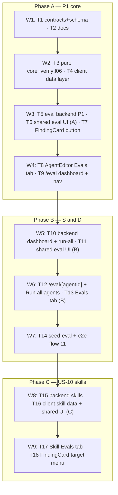

# Implementation Plan: Eval Pipeline — regression evals for reviewer agents and skills

- **Requirements:** `specs/eval-pipeline.md` (SPEC-2026-11-07-eval-pipeline, Status: approved)
- **Execution mode:** multi-agent, in 9 sequential waves (tasks inside a wave run in parallel)
- **Status:** planned

## Goal

One click on an accepted/dismissed finding turns it into an eval case (fixed diff fragment +
`must_find` / `must_not_flag` expectation). `POST /agents/:id/eval-runs` (and
`POST /skills/:id/eval-runs` through a host agent) replays the current config on every case with
the unchanged `reviewPullRequest` engine; every case is scored by pure code (recall, precision,
citation_accuracy, 0 LLM calls). The user sees cases, runs, history, Compare with a prompt / skill
body diff, Promote, a trend chart, an Evals tab on agents and skills, and an Eval Dashboard
(`/eval`, `/eval/<agentId>`). `cd server && pnpm verify:l06` is the homework gate.

## Decisions

User answers (2026-11-07/08):
- **D1 — `verify:l06` location (Q5, AC-67):** a `verify:l06` script in `server/package.json`, run as
  `cd server && pnpm verify:l06`. Verified: `git ls-files -v server/package.json` prints `H` (not
  `S`), the file equals HEAD, and `verify:l03` is already committed there (`9fdec07`) — so the new
  script is committed normally. A separate docs task (T2) fixes the stale "skip-worktree" claims.
- **D2 — delivery order:** waves. Phase A = P1 core (W1–W4), Phase B = [S]/[D] (W5–W7),
  Phase C = US-10 skills (W8–W9). Every wave ends green; nothing from the spec is dropped.
- **D3 — spec open questions Q11–Q15:** all defaults accepted (target menu = currently linked
  skills; skill run passes only the tested skill; host default = last used → first enabled
  linking agent → first enabled agent; no skill runs on `/eval`; `vN` = skill version).
- **D4 — execution mode:** multi-agent in waves.

Accepted planner recommendations:
- **D5 — schema (Q4):** new table `eval_suite_runs` + additive columns on `eval_runs` and
  `eval_cases` (details in T1). Generated with `pnpm db:generate`; `server/src/db/migrations/**`
  is never hand-edited. Every new `NOT NULL` column has a `DEFAULT`.
- **D6 — idempotency guard (EC-2, AC-9, AC-76):** real column `eval_cases.source_finding_id` +
  unique index `(owner_kind, owner_id, source_finding_id)`; insert `ON CONFLICT DO NOTHING`, then
  re-select. `input_meta.source` is still written (spec contract).
- **D7 — one active run per owner (AC-39):** partial unique index on
  `eval_suite_runs (owner_kind, owner_id) WHERE status = 'running'`; a conflicting insert maps to
  `409 eval_run_in_progress` with the active run id.
- **D8 — scoring location (NFR-9):** pure server files under `server/src/modules/eval/core/`
  (no I/O imports, no DB, no LLM, no adapters). Not in reviewer-core (its `shared` alias already
  cycles back into server; and `verify:l06` runs the server's vitest).
- **D9 — background execution (EC-19, NFR-4):** eval runs do NOT use `JobRunner` (2 retries +
  120 s cap). They start fire-and-forget like review runs (`void …catch(log)`, cf.
  `reviews/service.ts:137`) on an eval-owned `PQueue({ concurrency: 3 })`. Each case is wrapped
  in its own 90 s timeout, never throws out of the per-case function, and is persisted exactly
  once — no re-run, no double billing.
- **D10 — reaper (AC-45, EC-18):** runs once at eval plugin registration (pattern:
  onboarding `reapOnBoot`). `running` → `partial` if `cases_done > 0`, else `failed`;
  `error_reason = 'interrupted'`.
- **D11 — cascade on agent/skill delete (EC-8, EC-33):** `eval_cases.owner_id` is polymorphic (no
  FK). `AgentsService.delete` / `SkillsService.delete` call
  `container.evalRepo.deleteByOwner(workspaceId, kind, id)` (cases → results cascade via FK; suite
  runs of that owner deleted too). No DB triggers.
- **D12 — contracts (NFR-8):** new byte-identical file `contracts/eval.ts` in
  `server/src/vendor/shared/` and `client/src/vendor/shared/`, plus edits to `eval-ci.ts`
  (`EvalTrendPoint`, `EvalDashboard`) in both copies at each copy's own anchor. A server unit test
  (pattern: `server/test/brief-contract-sync.test.ts`) asserts `eval.ts` is byte-identical.
- **D13 — line diff (AC-52, AC-84, EC-21):** a small pure LCS line diff in the client
  (`client/src/lib/eval/line-diff.ts`), no new dependency; collapses unchanged runs > 6 lines.
- **D14 — seed (NFR-11):** separate `server/src/db/seed-eval.ts` called from `seed.ts`, owned by a
  single task in a wave with no other server task (every `*.it.test.ts` calls `seed()`).
- **D15 — single owner per hotspot file per wave** (see the Owned-paths matrix):
  `modules/index.ts`, `platform/container.ts`, `db/seed.ts`, `client/src/vendor/ui/nav.ts`,
  `client/src/lib/hooks/index.ts`, `client/src/lib/hooks/eval.ts`, and each `messages/en/*.json`.
- **D16 — INSIGHTS files are not owned by any implementation task** (parallel appends collide).
  Implementers list insight candidates in their final report; the coordinator appends them
  (append-only, `engineering-insights` rules) at each wave gate. Exception: T2 (W1).

Planner design choices (HOW, not new requirements):
- **D17 — `POST /findings/:id/eval-case` response adds `owner_name`** so AC-10's "Added to
  <agent> eval set" needs no extra fetch (`FindingRecord` has no agent id/name).
- **D18 — `GET /findings/:id/eval-targets` (new, Phase C)** returns
  `{ agent: {id, name} | null, skills: {id, name}[] }` (the review's agent + skills currently
  linked to it, workspace-scoped). It powers the AC-74 target menu without threading agent data
  through `FindingsPanel`. Fetched lazily only for an expanded, decided card.
- **D19 — fragment extraction:** an exact-path slicer over `UnifiedDiff.raw` in `core/` (split on
  `diff --git` sections, compare the parsed `b/<path>` exactly). Do NOT reuse reviewer-core
  `sliceDiff` — it matches by substring (`b/a.ts` also captures `b/a.tsx`).
- **D20 — diff parsing in the eval module** uses `parseUnifiedDiff` imported from
  `server/src/adapters/index.ts` (the barrel is allowed by the depcruise rule
  `pathNot: ^src/adapters/(index|mocks)\.ts$`) — only from the service layer, never from `core/`.
  Core functions take an already-parsed `UnifiedDiff`. Diff source for AC-7 reuses
  `reviews/diff-loader.ts#loadDiff` (already a baselined violation; add no new one).
- **D21 — LLM-failure classification:** pass `timeoutMs: 90_000` to the engine/provider and wrap
  with `withTimeout`; any error after the deadline → `timeout` (abort surfaces as
  `APIUserAbortError`/`APIConnectionTimeoutError`, reviewer-core/INSIGHTS.md); a structured-output
  parse failure → `invalid_output`; anything else → `llm_failed`. Container `ConfigError` before
  start → `409 eval_run_unavailable {reason:'llm_not_configured'}`.

## Affected modules

- **server** — new module `server/src/modules/eval/` (routes, service, repository, runner, pure
  `core/`), schema `db/schema/eval.ts` + generated migration, `db/schema.ts` registry,
  `platform/container.ts` (`evalRepo` getter), `modules/index.ts`, `agents/service.ts` and
  `skills/service.ts` (delete cascade), `db/seed-eval.ts` + `db/seed.ts`, `package.json`
  (`verify:l06`).
- **shared contracts** — `vendor/shared/contracts/eval.ts` (new) + `eval-ci.ts` +
  `vendor/shared/index.ts`, **in both** `server/src/vendor/shared` and `client/src/vendor/shared`.
- **client** — `FindingCard`, AgentEditor Evals tab, SkillEditor Evals tab + header button, new
  routes `/eval` and `/eval/[agentId]`, nav, shared `components/eval/**`, `lib/eval/**`,
  `lib/hooks/eval.ts`, i18n (`eval.json`, `prReview.json`, `skills.json`, maybe `agents.json`).
- **e2e** — new flow `e2e/specs/11-eval-pipeline.flow.json`.
- **reviewer-core** — used as is; `ReviewInput` / `ReviewOutcome` unchanged (NFR-8).
- **docs** — `CLAUDE.md`, `server/CLAUDE.md`, `server/AGENTS.md`, `TESTING.md`,
  `server/INSIGHTS.md` (append only).
- **mcp-server** — not touched (NG8).

## Parallelization graph

Task-level `depends-on` (all tasks of wave N also implicitly wait for the wave N-1 gate):
T1, T2 → none · T3 → T1 · T4 → T1 · T5 → T1, T3 · T6 → T4 · T7 → T4 · T8 → T6 · T9 → T6 ·
T10 → T5 · T11 → T6 · T12 → T9, T10, T11 · T13 → T8, T11 · T14 → T10, T12, T13 ·
T15 → T5, T10 · T16 → T11 · T17 → T16 · T18 → T7, T16.

**Wave gate (coordinator, after every wave):**
`cd server && pnpm typecheck && pnpm exec vitest run --exclude '**/*.it.test.ts' && pnpm exec vitest run .it.test`
(Docker) · `cd server && pnpm verify:l06` (from W2 on) · depcruise gate (below) ·
`cd client && pnpm typecheck && pnpm test` · then append the reported insights. Known flakes
(`reviews.it.test.ts`, `brief.it.test.ts`) → re-run in isolation before calling it a regression.

Depcruise gate (from `server/`):
`npx depcruise --config ../.claude/skills/onion-architecture/dependency-cruiser.arch.cjs --ignore-known ../.claude/skills/onion-architecture/known-violations.json src ../reviewer-core/src`
— must exit 0. Do NOT regenerate the baseline (that would absorb new violations, server/INSIGHTS.md).

## Owned-paths matrix

Paths are relative to the repo root. `AE` = `client/src/app/agents/[id]/_components/AgentEditor`,
`FC` = `client/src/app/repos/[repoId]/pulls/[number]/_components/FindingCard`,
`SE` = `client/src/app/skills/_components/SkillEditor`.

| Wave | Task | Owned paths |
|---|---|---|
| W1 | T1 | `server/src/vendor/shared/contracts/eval.ts` (new), `server/src/vendor/shared/contracts/eval-ci.ts`, `server/src/vendor/shared/index.ts`, `client/src/vendor/shared/contracts/eval.ts` (new), `client/src/vendor/shared/contracts/eval-ci.ts`, `client/src/vendor/shared/index.ts`, `server/src/db/schema/eval.ts`, `server/src/db/schema.ts`, `server/src/db/migrations/**` (**generated only**, via `pnpm db:generate`), `server/test/eval-contract-sync.test.ts` (new) |
| W1 | T2 | `CLAUDE.md`, `server/CLAUDE.md`, `server/AGENTS.md`, `TESTING.md`, `server/INSIGHTS.md` (append only) |
| W2 | T3 | `server/src/modules/eval/core/**` (new), `server/package.json` (only the `verify:l06` line) |
| W2 | T4 | `client/src/lib/hooks/eval.ts` (new), `client/src/lib/hooks/eval.test.tsx` (new), `client/src/lib/hooks/index.ts`, `client/src/lib/eval/**` (new), `client/messages/en/eval.json` |
| W3 | T5 | `server/src/modules/eval/**` (incl. amending `core/**`), `server/src/platform/container.ts`, `server/src/modules/index.ts`, `server/src/modules/agents/service.ts`, `server/src/modules/skills/service.ts`, `server/src/modules/agents/routes.ts` + `server/src/modules/skills/routes.ts` (only if the service needs the container passed in), `server/test/eval.it.test.ts`, `server/test/eval-runs.it.test.ts`, `server/test/helpers/eval-fixture.ts` (all new) |
| W3 | T6 | `client/src/components/eval/**` (new) |
| W3 | T7 | `FC/**`, `client/messages/en/prReview.json` |
| W4 | T8 | `AE/**` (incl. `AE/constants.ts`, `AE/AgentEditor.tsx`, new `AE/_components/EvalsTab/**`), `client/messages/en/agents.json` |
| W4 | T9 | `client/src/app/eval/**` (new), `client/src/vendor/ui/nav.ts`, `client/src/components/app-shell/**`, `client/messages/en/eval.json`, `client/messages/en/shell.json` |
| W5 | T10 | `server/src/modules/eval/**`, `server/test/eval-dashboard.it.test.ts` (new) |
| W5 | T11 | `client/src/components/eval/**`, `client/src/lib/eval/**`, `client/messages/en/eval.json` |
| W6 | T12 | `client/src/app/eval/**`, `client/src/lib/hooks/eval.ts`, `client/src/lib/hooks/eval.test.tsx`, `client/messages/en/eval.json` |
| W6 | T13 | `AE/**`, `client/messages/en/agents.json` |
| W7 | T14 | `server/src/db/seed-eval.ts` (new), `server/src/db/seed.ts`, `e2e/specs/11-eval-pipeline.flow.json` (new) |
| W8 | T15 | `server/src/modules/eval/**`, `server/test/eval-skills.it.test.ts` (new) |
| W8 | T16 | `client/src/lib/hooks/eval.ts`, `client/src/lib/hooks/eval.test.tsx`, `client/src/lib/eval/**`, `client/src/components/eval/**`, `client/messages/en/eval.json` |
| W9 | T17 | `SE/**` (incl. `SE/SkillEditor.tsx`, `SE/_components/EvalsTab/**`), `client/messages/en/skills.json` |
| W9 | T18 | `FC/**`, `client/messages/en/prReview.json` |

**Disjointness proof (per wave):**
- W1: T1 = vendor/shared (both copies) + db schema/migrations + 1 test; T2 = 4 docs + server/INSIGHTS.md. No overlap.
- W2: T3 = `server/src/modules/eval/core/**` + `server/package.json`; T4 = `client/src/lib/**` eval files + `hooks/index.ts` + `eval.json`. Server vs client — no overlap.
- W3: T5 = server only; T6 = `client/src/components/eval/**`; T7 = `FC/**` + `prReview.json`. No overlap (`eval.json` owned by nobody in W3; T6 uses keys T4 created and lists any missing key in its report).
- W4: T8 = `AE/**` + `agents.json`; T9 = `client/src/app/eval/**` + nav + app-shell + `eval.json` + `shell.json`. No overlap. T8 may NOT edit `eval.json`; it uses existing keys or adds tab-local strings to `agents.json`.
- W5: T10 server only; T11 client only. No overlap.
- W6: T12 = `app/eval/**` + `hooks/eval*` + `eval.json`; T13 = `AE/**` + `agents.json`. No overlap.
- W7: T14 alone.
- W8: T15 server only; T16 client only. No overlap.
- W9: T17 = `SE/**` + `skills.json`; T18 = `FC/**` + `prReview.json`. No overlap.

Shared read-only inputs every task may READ but not edit: the spec, the design screenshots
(`/private/tmp/claude-502/-Users-ataran-dev-digest/17e37fa1-6954-41ca-9502-915311fb116b/images/{3,4,5,6,7,8,11}.png`),
`client/src/vendor/ui/**` (except `nav.ts` owner), `reviewer-core/**`, other modules.

## Tasks

---------------------------------------------------------------------------------------------------
### Phase A — P1 core
---------------------------------------------------------------------------------------------------

### T1 — Eval contracts (both copies) + additive schema + generated migration
- **Wave:** W1
- **Type:** backend (contracts ripple to client)
- **Skills:** `onion-architecture`, `fastify-best-practices`, `drizzle-orm-patterns`, `postgresql-table-design`, `zod`, `security`, `typescript-expert`, `engineering-insights`
- **Owned paths (create/modify):** see matrix row W1/T1.
- **Depends-on:** none
- **Relevant insights:**
  - server/client `vendor/shared` copies are NOT byte-identical overall (`eval-ci.ts` differs in `AgentManifest`); edit each copy at its own anchor and verify only your block; never `git apply` a server patch onto the client file.
  - Client code may only `import type` from the `@devdigest/shared` barrel — so contracts must not be needed as runtime values on the client (client parses JSON with its own logic or imports the concrete file path, never the barrel, for values).
  - A new `NOT NULL` column without `DEFAULT` breaks migrating a seeded DB; never patch a bad migration with a later one — regenerate.
  - New optional fields on existing contracts → `.nullish()` where an existing literal constructor omits them.
  - Zod `.max(n)` counts UTF-16 code units.
- **What to do:**
  1. Create `server/src/vendor/shared/contracts/eval.ts` with (snake_case wire fields, shapes per spec § Contracts):
     - `EvalExpectation` (`expect: 'must_find'|'must_not_flag'`, `file` 1–500, `start_line` int ≥1, `end_line` int ≥1 optional, `severity` = existing `Severity` optional, `category` = existing `FindingCategory` optional, `title` ≤200 optional; `.strict()` so unknown keys are rejected) and `EvalExpectations = z.array(EvalExpectation).max(50)`.
     - `EvalSourceDecision`, `EvalCaseSource` (`finding_id, review_id, agent_id, decision`), `EvalCaseMeta` (`repo`, `pr_number`, `title` ≤300, `body` ≤4000, `head_sha`, `source: EvalCaseSource | null`), `EvalInputFile` (`path, additions, deletions`).
     - `EvalCaseErrorReason` (`llm_failed|invalid_output|timeout|interrupted`), `EvalCaseError`, `EvalCaseActualOutput` (`kept: Finding[]`, `dropped: {finding, reason}[]`, `expectations: {index, matched, matched_finding_ids}[]`, `finding_verdicts: {finding_id, verdict:'tp'|'fp', hit_must_not_flag}[]`).
     - `EvalCaseResult` (all fields in spec table, incl. `suite_run_id` nullable, `expected_count`, `got_count`, `error`).
     - `EvalCaseView` (id, workspace-free: `owner_kind, owner_id, name, input_diff, input_files: EvalInputFile[], input_meta: EvalCaseMeta, expected_output: EvalExpectation[], notes, source_finding_id nullable, created_at, last_result: EvalCaseResult | null`). It narrows the existing `knowledge.ts` `EvalCase`; do not edit `knowledge.ts`.
     - `EvalSuiteRunStatus`, `EvalConfigSnapshot` (`provider, model, system_prompt, strategy, skills: {id,name,version}[], agent_name, skill_body: string|null`, plus `skill_id`/`skill_version`/`skill_name` nullish for skill runs), `EvalSuiteRun` (all spec fields + `host_agent_name` nullish for history display), metrics typed as the existing `EvalRun` from `knowledge.ts`.
     - Requests: `CreateEvalCaseBody` (name ≤120, input_diff string, input_meta partial `EvalCaseMeta` (title/body), expected_output `EvalExpectations`, notes), `UpdateEvalCaseBody` (same, all optional), `FindingEvalCaseBody` (optional `{owner_kind, owner_id: uuid}`), `RunEvalCaseBody` (optional `{host_agent_id: uuid}`), `StartSkillEvalRunBody` (`{host_agent_id: uuid}`), `RunAllEvalBody` (`{all: z.literal(true)}`), `EvalDaysQuery` (`days` ∈ 7/30/90 via coerce, default 30).
     - Responses: `FindingEvalCaseResponse` (`case, created, owner_name`), `StartEvalRunResponse` (`eval_run`), `EvalRunDetail` (`eval_run, results: EvalCaseResult[]`), `RunAllEvalResponse` (`started`, `skipped: {agent_id, reason}[]`), `EvalOverview` for `GET /eval/dashboard` (`agents: {agent_id, name, model, cases_total, last_run, recall_sparkline}[]`, `recent_runs: (EvalSuiteRun & {agent_name})[]`), `EvalTargets` (D18).
     - Error-detail enums: `EvalCaseUnavailableReason` (`undecided|no_diff|too_large|agent_missing|skill_not_linked`), `EvalRunUnavailableReason` (`no_cases|too_many_cases|no_host_agent|llm_not_configured`).
     - Limits as exported constants: `EVAL_MAX_DIFF_BYTES = 262_144`, `EVAL_MAX_EXPECTATIONS = 50`, `EVAL_MAX_CASES_PER_RUN = 50`, `EVAL_CASE_NAME_MAX = 120`, `EVAL_PR_BODY_MAX = 4000`, `EVAL_CASE_TIMEOUT_MS = 90_000`, `EVAL_RUN_CONCURRENCY = 3`, `EVAL_ALERT_DROP = 0.02`.
  2. Copy the file byte-for-byte to `client/src/vendor/shared/contracts/eval.ts`; add `export * from './contracts/eval.js'` to both `index.ts` barrels (each at its own anchor).
  3. `eval-ci.ts` (both copies, own anchors): `EvalTrendPoint` adds `run_id: string`, `agent_version: int` (plus `cost_usd` nullable if absent); `EvalDashboard.recent_runs` becomes `EvalSuiteRun[]` (import from `./eval.js`); keep `current`/`delta`; `alert: string | null`. There are no consumers today (verify with grep).
  4. `server/src/db/schema/eval.ts` (D5):
     - `evalCases`: add `createdAt timestamptz NOT NULL DEFAULT now()`, `sourceFindingId uuid NULL REFERENCES findings(id) ON DELETE SET NULL`; unique index `(owner_kind, owner_id, source_finding_id)`; index `(workspace_id, owner_kind, owner_id)`.
     - New `evalSuiteRuns` (`eval_suite_runs`): `id uuid pk defaultRandom`, `workspace_id` FK cascade, `owner_kind text NOT NULL` (enum agent|skill), `owner_id uuid NOT NULL`, `owner_version int NOT NULL DEFAULT 1`, `agent_id uuid NULL` (no FK — history survives deletes, EC-31), `agent_version int NOT NULL DEFAULT 1`, `status text NOT NULL DEFAULT 'running'` (+ CHECK in running|done|partial|failed if drizzle 0.38 `check()` is available, else rely on Zod), `started_at timestamptz NOT NULL DEFAULT now()`, `finished_at timestamptz NULL`, `cases_total/cases_done/cases_errored int NOT NULL DEFAULT 0`, `metrics jsonb NULL`, `config_snapshot jsonb NOT NULL DEFAULT '{}'`, `case_ids jsonb NOT NULL DEFAULT '[]'`, `error_reason text NULL`; indexes `(workspace_id, owner_kind, owner_id, started_at desc)`, `(workspace_id, started_at desc)`; partial unique index `(owner_kind, owner_id) WHERE status = 'running'` (D7).
     - `evalRuns`: add `suiteRunId uuid NULL REFERENCES eval_suite_runs(id) ON DELETE CASCADE`, `error jsonb NULL`; indexes `(suite_run_id)` and `(case_id, ran_at desc)`.
     - Register `evalSuiteRuns` in the `schema` object in `server/src/db/schema.ts`.
  5. `cd server && pnpm db:generate` → one new `00xx_*.sql`. Review it: only additive `CREATE TABLE`/`ADD COLUMN`/`CREATE INDEX`, every `NOT NULL` add has a default. Never edit the generated SQL; fix the schema and regenerate.
  6. Add `server/test/eval-contract-sync.test.ts` asserting `contracts/eval.ts` is byte-identical in server and client (copy `brief-contract-sync.test.ts` pattern), plus a few parse assertions (`EvalExpectation` rejects `expect:'maybe'` at path `[0].expect`; `end_line` optional).
- **Test + typecheck:** `cd server && pnpm typecheck && pnpm exec vitest run test/eval-contract-sync.test.ts test/contracts.test.ts` · `cd client && pnpm typecheck` · apply the migration on a dev DB with existing rows (`cd server && pnpm db:migrate`) to prove it runs on non-empty tables.
- **Acceptance:** both copies of `eval.ts` identical (NEW test green); `eval-ci.ts` changes typecheck on both sides; migration is additive and applies on a seeded DB (NFR-8); contracts cover every endpoint used by T5/T10/T15 so later waves need no contract edits.

### T2 — Correct the stale "skip-worktree" documentation
- **Wave:** W1
- **Type:** docs
- **Skills:** `engineering-insights` (append-only rules for INSIGHTS), `typescript-expert` not needed
- **Owned paths (create/modify):** `CLAUDE.md`, `server/CLAUDE.md`, `server/AGENTS.md`, `TESTING.md`, `server/INSIGHTS.md` (append only).
- **Depends-on:** none
- **Relevant insights:** INSIGHTS is append-only — never edit the 2026-07-08 line that says "server/package.json is skip-worktree"; add a new correcting entry that says it supersedes it.
- **What to do:**
  1. Verify again: `git ls-files -v server/package.json` (expect `H`, not `S`) and `git show HEAD:server/package.json | grep verify:l03` (committed).
  2. Replace the skip-worktree claims with the fact: `server/package.json` is a normal tracked file; lesson gate scripts (`verify:l03`, `verify:l06`) live there and are run as `cd server && pnpm verify:lNN`. Keep the CI note that CI invokes the unit/integration split via `pnpm exec vitest run …`. Locations: `CLAUDE.md:52` (Non-default conventions), `server/CLAUDE.md` Gotchas, `server/AGENTS.md:32`, `TESTING.md:91`.
  3. Append to `server/INSIGHTS.md` under **Recurring Errors & Fixes** a dated entry (2026-11-08) correcting the 2026-07-08 note (verified with `git ls-files -v`; `verify:l03` committed in `9fdec07`), and stating `verify:l06` lives in `server/package.json`.
  4. Root `CLAUDE.md` changed → run `cd evals && pnpm eval:workflow` (per the CLAUDE.md "Which change → which eval run" table) and report its result. It needs the evals harness set-up (Claude subscription, see `evals/README.md`); if it cannot run in this environment, say so explicitly in the report — do not claim it passed.
- **Test + typecheck:** `cd evals && pnpm eval:workflow`; `git diff --stat` shows only the 5 owned files.
- **Acceptance:** no doc claims `server/package.json` is skip-worktree; INSIGHTS has a new correcting entry and no existing line changed (`git diff server/INSIGHTS.md` shows only `+` lines); eval:workflow result reported (supports AC-67 / Q5).

### T3 — Pure eval core (scoring, aggregation, case building, diff input, alert) + `verify:l06`
- **Wave:** W2
- **Type:** backend (pure)
- **Skills:** `onion-architecture`, `zod`, `typescript-expert`, `security`, `engineering-insights` (+ `fastify-best-practices`, `drizzle-orm-patterns`, `postgresql-table-design` only as boundary awareness — this task has no routes/DB)
- **Owned paths (create/modify):** `server/src/modules/eval/core/**`, `server/package.json` (add one script line only).
- **Depends-on:** T1
- **Relevant insights:** `vitest related` ignores the unit/integration split — always pass `--exclude '**/*.it.test.ts'`; a "No test files found" exit 0 is not a pass. Zod/string caps count UTF-16 units. `costUsd` is null-poisoning by design — aggregate cost the same way (one unknown → `null`).
- **What to do:** create these files; **no imports** from `drizzle-orm`, `fastify`, `../adapters`, `platform/*`, `node:fs`, network or LLM modules (types from `@devdigest/shared` only):
  1. `core/matching.ts` — `normalizePath` (strip leading `./`, nothing else; case- and Unicode-exact), `normalizeRange(start, end?)`, `findingMatches(finding, expectation)` (AC-27).
  2. `core/scoring.ts` — `scoreCase({ expectations, kept, dropped })` → `{ recall, precision, citation_accuracy, pass, expected_count, got_count, actual_output: EvalCaseActualOutput, counts: {matchedFind, findTotal, tpKept, keptTotal, droppedTotal} }` implementing AC-28–AC-31 and AC-34 (strict precision Q1; vacuous = 1; EC-14/15/16; EC-4 full-file kinds still need line overlap). Finding ids in `finding_verdicts` = the engine finding id if present, else a deterministic `k<index>`.
  3. `core/aggregate.ts` — `aggregateRun(results)` micro-average over non-error results (AC-32), `traces_passed`, `traces_total` (all cases incl. errored), `cost_usd` (null-poisoning), status `done|partial|failed` (AC-41; all errored → metrics `null`). Returns the existing `EvalRun` shape for `metrics`. Never `NaN`.
  4. `core/case-builder.ts` — `slugifyCaseName(title)` (lower-case latin, digits, hyphens, ≤60, collapse/trim hyphens; fallback `case`) and `uniqueCaseName(base, existingNames)` (`-2`, `-3`…; AC-8); `extractFileFragment(diff: UnifiedDiff, path)` exact-path slicer over `diff.raw` that returns the file's sections (merging duplicate `diff --git` sections for the same path, EC-6/AC-7) normalised to `--- a/<path>` / `+++ b/<path>` headers, or `null` when there is no hunk (AC-11); `buildCaseFromFinding({ finding, decision, review, pull, repoFullName, fragment, parsedFragment, ownerKind, ownerId, existingNames })` → insert-ready values: `expected_output = [{expect, file, start_line, end_line, severity, category, title}]` (AC-3/AC-4), `input_files` from the parsed fragment, `input_meta` with body truncated to 4 000 code units and `source` (AC-6), `name`, plus `warnings: ['finding_line_outside_fragment']` when the finding's start line is not in any hunk (EC-5/Q8). Reject fragments > 256 KB with reason `too_large` (EC-7).
  5. `core/diff-input.ts` — `normalizeDiffText` (CRLF→LF, EC-23), `validateDiffInput(raw, parsed)` → field errors for empty / no hunk / > 256 KB (AC-21), `inputFilesFrom(parsed)` (AC-22), `expectationFileWarnings(expectations, parsed)` (EC-24).
  6. `core/alert.ts` — `buildEvalAlert(last, previous, version)` → string like `Precision dipped 2pts on v7` or `null`; threshold `>= 0.02` (AC-65, multiple metrics joined deterministically). Pure template, no LLM.
  7. Tests colocated (`*.test.ts`): every AC-27 example; AC-28/29/30 examples; AC-31 one fixture per clause + extra-unrelated-finding-still-passes; AC-32 3-case hand-computed fixture + a seeded pseudo-random property test (no `NaN`, values in [0,1]); AC-33 determinism (call twice, `toEqual`; pass a context object whose `llm.completeStructured` throws, prove it is never touched; assert via a static import scan of `core/*.ts` that no forbidden module is imported); NFR-1 timing (50×50 under 5 ms, generous CI margin e.g. median of 5 runs); AC-8 slug example `"Hardcoded Stripe secret key in commit"` → `hardcoded-stripe-secret-key-in-commit` and the `-2` suffix; AC-3/AC-4/AC-6 case building from a 3-file diff fixture (build the `UnifiedDiff` in the test with `parseUnifiedDiff` from `../../../adapters/index.js` — test-only import), EC-5 warning, EC-6 duplicate path merge, AC-65 drops 0.02 / 0.019 / multi-metric.
  8. `server/package.json`: add `"verify:l06": "vitest run src/modules/eval/core"` next to `verify:l03`. Do not touch any other line.
- **Test + typecheck:** `cd server && pnpm verify:l06 && pnpm typecheck && pnpm exec vitest run --exclude '**/*.it.test.ts'`; temporarily flip one scoring assertion to confirm `verify:l06` exits non-zero, then revert.
- **Acceptance:** AC-27–AC-33, AC-8, AC-65 (builder), AC-67 green with NEW unit tests; `verify:l06` needs no Docker/network/keys; core has zero I/O imports (NFR-9).

### T4 — Client eval data layer: hooks, pure helpers, i18n keys
- **Wave:** W2
- **Type:** ui
- **Skills:** `frontend-architecture`, `next-best-practices`, `react-best-practices`, `react-testing-library`, `security` (DOM sinks only), `typescript-expert`, `engineering-insights`
- **Owned paths (create/modify):** `client/src/lib/hooks/eval.ts`, `client/src/lib/hooks/eval.test.tsx`, `client/src/lib/hooks/index.ts`, `client/src/lib/eval/**`, `client/messages/en/eval.json`.
- **Depends-on:** T1
- **Relevant insights:** global `staleTime: 30_000` — every mutation must invalidate exactly the keys it affects (test with the same staleTime); `isPending` doesn't stop same-tick double clicks → `useRef` in-flight guard; disabled queries stay `pending` → gate loading UI on `isLoading`; polling tests: fake timers + advance slightly more than the interval (2500 for 2000); `renderHook` tests mocking `../api` must spread `vi.importActual` if `ApiError` is used; `import type` only from `@devdigest/shared`; `user-event` not installed → `fireEvent`.
- **What to do:**
  1. `lib/hooks/eval.ts` (all through `lib/api.ts`; types from `@devdigest/shared` with `import type`) for every **agent-side** endpoint of the spec (Phase A + B): `useAgentEvalCases(agentId)`, `useEvalCase(id)`, `useCreateAgentEvalCase`, `useUpdateEvalCase`, `useDeleteEvalCase`, `useRunEvalCase`, `useCreateEvalCaseFromFinding` (returns `{case, created, owner_name}`; maps `409 eval_case_unavailable` reason), `useAgentEvalRuns(agentId, days)`, `useEvalRun(id)` (`refetchInterval: 2000` only while `status === 'running'`, AC-38), `useStartAgentEvalRun` (maps `409 eval_run_in_progress` → returns `active_run_id`; `409 eval_run_unavailable` → typed reason), `useRunAllEvals`, `useEvalOverview(days?)`, `useAgentEvalDashboard(agentId, days)`. Query keys: `["eval-cases", kind, ownerId]`, `["eval-case", id]`, `["eval-runs", kind, ownerId, days]`, `["eval-run", id]`, `["eval-overview"]`, `["agent-eval-dashboard", agentId, days]`. Invalidate on: case CRUD/run → cases + case; run start/terminal → runs, overview, agent dashboard, cases (last results). When `useEvalRun` sees a terminal status, invalidate the same set once. Export from `lib/hooks/index.ts`.
  2. `lib/eval/` pure helpers + tests: `format.ts` (`pct(0.82) → "82%"`, `deltaPoints(new, old)` → `{points, direction, label:"▲ 4pt", a11y:"up 4 points"}`, cost delta `$`), `line-diff.ts` (LCS line diff → `{kind:'same'|'add'|'del', text}[]`, plus `collapseUnchanged(lines, 6)` → "… N unchanged lines" blocks; D13/AC-52/EC-21/EC-22), `compare.ts` (`snapshotDifferences(a, b)` for model/provider/strategy/skills ids+versions (AC-53), `caseSetChange(a.case_ids, b.case_ids)` → `{added, removed}` (EC-13), `orderRuns(a, b)` older by `started_at` (AC-50)), `case-state.ts` (`caseState(last_result)` → passed|failed|error|never, subtitle data, first-expectation chip data (AC-15), `passingCount(cases)` (AC-16)), `expectations-json.ts` (`parseExpectationsJson(text)` → `{ok, value}` or `{ok:false, path:"[0].expect", message}` using a client-side mirror of `EvalExpectation` rules implemented WITHOUT a value import from the shared barrel — import the concrete schema from `@/vendor/shared/contracts/eval` only if that path is not the barrel and resolves under Next; otherwise hand-written validation; plus `FINDING_SKELETON` (AC-19)).
  3. `messages/en/eval.json`: extend (reuse existing keys; do not rename) with all Phase A + B strings: Evals tab (counter "{passed} / {total} passing", states, subtitles "expected {n, plural…} finding(s), got {m}", "error: {reason}", chips "must not flag", "empty []", run/edit/delete aria labels including the case name, empty state, "Run all evals", "Running… {done}/{total}", "No eval runs yet", "View full dashboard →", llm_not_configured + Settings link), metric tiles (RECALL, PRECISION, CITATION ACCURACY, TRACES PASSED, delta a11y "up/down {n} points"), history table columns + status labels + error badge, Compare modal ("Compare runs · v{a} → v{b}", tiles, "System prompt diff", "System prompt unchanged", "No config changes", "Case set changed: +{a} / −{b} cases", "Promote v{b}", "Close"), run details, trend ("Metric trend", "Run evals at least twice to see a trend", tooltip), dashboard (`/eval` cards "Last run v{n} · {date} · {p}/{t} pass", "Never run", "RECENT EVAL RUNS · ALL AGENTS", empty state, "Run all agents", started/skipped summary with reasons), agent dashboard (breadcrumbs, "← All agents", "{n} runs on the {m}-case set", period options, "Run eval", "No runs in the last {n} days", "Show 90 days"), case editor (all AC-18–AC-24 labels, "valid JSON"/"invalid JSON", "+ Finding skeleton", "Run on save", warnings "file not in diff", "Finding line is outside the diff fragment"). Skill-side strings are added in T16.
- **Test + typecheck:** `cd client && pnpm typecheck && pnpm exec vitest run src/lib/eval src/lib/hooks/eval`.
- **Acceptance:** NEW unit tests for line diff (AC-52 unit), delta formatting (AC-47 text), compare helpers (AC-53, EC-13), JSON validation (AC-19/AC-20 unit), polling stop on terminal status (AC-38 hook test with fake timers), invalidation after start-run (hook test with `staleTime: 30_000`). No component code yet.

### T5 — Eval backend P1: module, repository, runner, reaper, agent endpoints, delete cascade
- **Wave:** W3
- **Type:** backend
- **Skills:** `onion-architecture`, `fastify-best-practices`, `drizzle-orm-patterns`, `postgresql-table-design`, `zod`, `security`, `typescript-expert`, `engineering-insights`
- **Owned paths (create/modify):** see matrix row W3/T5.
- **Depends-on:** T1, T3
- **Relevant insights:**
  - `findingContext` (`reviews/repository/review.repo.ts:103`) is NOT workspace-scoped — check `pull.workspaceId === ctx.workspaceId` (else 404, AC-13).
  - Read `pr_files` via `container.reviewRepo.getPrFiles` (never the `GET /pulls/:id` path, which hits GitHub and rewrites `pr_files`).
  - `UnifiedDiff.files[]` has no per-file patch; slice `diff.raw` (T3 `extractFileFragment`).
  - Reviews run fire-and-forget, not via `JobRunner` (D9). Handler must never throw; persist terminal state itself.
  - A handler deadline must be measured on one clock; `withTimeout(p, ms<=0)` returns `p` UNTIMED.
  - Boot reaper runs on every `buildApp()` → in it-tests await each run to a terminal state before building another app.
  - Assert logs by `vi.spyOn(app.log, 'info')` (services take `logger: () => app.log`); `vi.restoreAllMocks()` in `afterEach`.
  - With no `llm` override, also override `secrets` with `new MockSecretsProvider({})` or a real key leaks into the "no key" test. `MockLLMProvider` cannot throw/hang → write an inline stub (pattern `test/helpers/onboarding-fixture.ts` StubLLM: ok/throw/never/gate modes, call counter, captured messages).
  - Fastify Zod response schemas strip unknown keys — every field you return must be in the response schema.
  - Global error handler maps Zod failures to `422 validation_error`; AC-20/21 require `400` with field paths → validate bodies in the service and throw an `AppError(400, 'invalid_eval_case', {fields:[{path,message}]})` (check `modules/_shared` for the AppError helper and copy how `project-context` does it).
  - Untrusted wrapping: imported (non-manual) skill bodies go through `wrapUntrusted` exactly like `run-executor.ts:209-218`.
  - Seed is additive and lands later (T14): it-tests must create their OWN agents (`POST /agents`) and assert only on those ids, never on global counts, so seeded eval data cannot break them.
- **What to do:**
  1. `modules/eval/repository.ts` (all Drizzle here): case CRUD scoped by `workspace_id`; `listCasesWithLastResult(kind, ownerId)` ordered by name (one query or two, no N+1); `insertCaseFromFinding` with `onConflictDoNothing` on the unique `(owner_kind, owner_id, source_finding_id)` then re-select (D6); case names of an owner (for AC-8); `createSuiteRun` (catch unique violation of the partial index → return `{conflict: activeRunId}`, D7); `incrementCasesDone`, `insertCaseResult`, `finishSuiteRun` (`UPDATE … WHERE id AND status='running'`); `listSuiteRuns(kind, ownerId, sinceDays)` `started_at desc`, `getSuiteRun` + results; `overview(workspaceId)` (agents having ≥1 case with last finished run + last ≤10 finished recalls; recent 20 agent runs desc; **owner_kind='agent' only**, AC-86); `reapRunning()` (D10); `deleteByOwner(workspaceId, kind, id)` (D11); `latestHostAgentFor(skillId)` stub not needed yet.
  2. `platform/container.ts`: `get evalRepo(): EvalRepository` (lazy, like `agentsRepo`).
  3. `modules/eval/snapshot.ts`: build `EvalConfigSnapshot` at run start from the agent row + linked **enabled** skills (id, name, version, body, source) — the bodies are kept in memory for the run, only id/name/version persisted (AC-37); `agent_version`.
  4. `modules/eval/runner.ts`: `runCase({ snapshot, skillBodies, evalCase, llm, timeoutMs })` → parses `input_diff` with `parseUnifiedDiff` (from `adapters/index.ts`, D20), calls `reviewPullRequest({ systemPrompt, model, diff, llm, strategy, skills?, prDescription: meta.body, task: \`Review PR: ${meta.title}\`, sessionId })` and **nothing else** (no callers/repoMap/specs/intent/memory — AC-36, NG4); K = `outcome.review.findings`, D = `outcome.dropped`; scores with T3 `scoreCase`; classifies failures (D21); never throws. `startSuiteRun(...)` creates the run row, responds, then executes cases on a module-level `PQueue({concurrency: 3})` (NFR-1), writes each result + `cases_done`, and finishes with T3 `aggregateRun`; `duration_ms` = start → finish. Log `eval.case` and `eval.run` lines (NFR-7 fields; never diff/prompt/body/model output).
  5. `modules/eval/service.ts`: business rules —
     - `createFromFinding(ctx, findingId, body?)` (Phase A: agent owner only; a `{owner_kind:'skill'}` body returns `400 not_supported_yet` until T15): 404 foreign/missing (AC-13); 409 `undecided` (AC-5), `agent_missing` (review `agent_id` null or agent gone, AC-12); decision from `accepted_at`/`dismissed_at`; diff via `loadDiff` (AC-7) then `extractFileFragment`; `no_diff`/`too_large` (AC-11, EC-7); idempotent 200 `created:false` (AC-9, EC-3 returns the existing case unchanged); log `eval.case.create`.
     - case CRUD for agent owners (AC-20–AC-22, AC-26): normalise CRLF, validate with T3, recompute `input_files`, keep id + results on update; `400` with field paths.
     - `runSingleCase` (AC-24/25): synchronous ≤90 s, `suite_run_id: null`, model failure still `200` with `error`; `409 llm_not_configured` on `ConfigError`.
     - `startAgentRun` (AC-35, AC-39, AC-43, AC-44, EC-26 cap 50, EC-10 disabled agents still runnable from here): resolve `container.llm(provider)` BEFORE creating the run so a missing key is `409`, not `500`.
  6. `modules/eval/routes.ts` (thin, Zod params/body/response from `@devdigest/shared`, uuid ids, workspace ctx via `modules/_shared/context.ts`): `POST /findings/:id/eval-case`; `GET|POST /agents/:id/eval-cases`; `GET|PUT|DELETE /eval-cases/:id`; `POST /eval-cases/:id/run` (`config: { rateLimit: { max: 10, timeWindow: '1 minute' } }`); `POST /agents/:id/eval-runs` (rate limit 5/min; `202`); `GET /agents/:id/eval-runs?days=`; `GET /eval-runs/:id`; `GET /eval/dashboard`. Every agent/case/run lookup is workspace-scoped → 404 (AC-46). Register `eval` in `modules/index.ts`; call the reaper at registration.
  7. Delete cascade: `AgentsService.delete` and `SkillsService.delete` call `container.evalRepo.deleteByOwner(...)` (D11). If the services have no container reference, pass it from their `routes.ts` (owned for that purpose only).
  8. it-tests (`test/eval.it.test.ts`, `test/eval-runs.it.test.ts`, helper `test/helpers/eval-fixture.ts` with a gated/slow/throwing/capturing LLM stub and a factory that seeds a PR with 3 `pr_files`, a review with `agent_id`, accepted/dismissed/undecided findings, and a foreign-workspace finding): AC-3, 4, 5, 6, 7 (no clone → `pr_files`), 9 (+ concurrent double POST → 1 case), 11, 12, 13, 20 (PUT invalid → 400), 21 (empty/garbage/300 KB → 400 with path), 22, 24, 25, 26, 33 (stub call count = N for single-pass), 34 (`actual_output` parses with `EvalCaseActualOutput`), 35 (`202` within 1 s with slow stub), 36 (captured messages contain the case diff + system prompt and none of the repo-map/callers/project-context/intent section markers — use the real marker strings from `reviewer-core/src/prompt.ts`), 37 (PUT new prompt mid-run → snapshot + captured prompt are old), 38 (monotonic `cases_done`), 39, 40 (throw on case 2 of 4), 41 (one test per status), 43, 44 (no key → 409), 45 (insert `running` row, build app → terminal `interrupted`), 46, 49 order, 60/61 (`GET /eval/dashboard` limit 20 desc, cards only for agents with cases), NFR-1 (concurrency ≤ 3 observed, caps), NFR-4 (no re-run on repeated terminal handling), NFR-7 (log fields, fixture diff marker absent), EC-8 (delete agent → cases/results/runs gone).
- **Test + typecheck:** `cd server && pnpm typecheck && pnpm exec vitest run --exclude '**/*.it.test.ts' && pnpm exec vitest run test/eval` (Docker) + depcruise gate (exit 0).
- **Acceptance:** all listed ACs covered by NEW integration tests; `verify:l06` still green; no new depcruise violation; `reviewer-core` untouched.

### T6 — Shared eval UI components (Phase A set)
- **Wave:** W3
- **Type:** ui
- **Skills:** `frontend-architecture`, `next-best-practices`, `react-best-practices`, `react-testing-library`, `security` (DOM sinks only), `typescript-expert`, `engineering-insights`
- **Owned paths (create/modify):** `client/src/components/eval/**`.
- **Depends-on:** T4
- **Relevant insights:** `Modal`/`Drawer` already provide Esc, focus trap, restore and `aria-labelledby` via `kit/useDialogA11y.ts` — use them, don't hand-roll; no barrels per component (import files directly); `Icon` names are the keys of `vendor/ui/icons.tsx`; no `--text` CSS var (use `--text-primary`…); colored left-accent borders must use per-side longhands; `Button active` only works for `tertiary`; keys from server lists must be unique ids; no Prettier reflow of whole files; all styling per the repo's `styles.ts` pattern; tests providing `NextIntlClientProvider` must include the `eval` namespace (and `common` if used).
- **What to do:** presentational components (data + callbacks via props; NO data fetching inside, so agent tab, dashboards and skill tab can all reuse them), each with `styles.ts` and an RTL test. Read screenshots 5, 6, 7.
  1. `EvalCaseList/` — header "P / T passing" (AC-16), "Run all evals" (disabled when empty, AC-17; shows "Running… done/total" when a run is active, AC-38) and "New eval case" buttons, empty state (AC-17), rows: name, state icon with text (passed/failed/error/never — not colour only, NFR-5), subtitle, first-expectation chip (AC-15), Run/Edit/Delete buttons whose accessible names include the case name, Delete behind a confirm step (AC-26), optional `highlightCaseId` (scroll + focus row, for `?case=`). Fixture of 5 cases in all 4 states.
  2. `EvalMetricTiles/` — RECALL/PRECISION/CITATION ACCURACY integer % + delta vs previous finished run ("▲ 4pt", accessible name "up 4 points"), TRACES PASSED; "No eval runs yet" when none (AC-47/48). Uses `vendor/ui/charts/MetricCard` if it fits, else own tile.
  3. `EvalRunHistory/` — table (ran at, `vN`, three bars + %, `passed/total`, cost via `@/lib/format` `formatCost`, status) newest first (AC-49); checkboxes labelled "Select run v7, <date>" (NFR-5), max 2 checked, third disabled (AC-51), Compare enabled only with exactly 2 (AC-50); `partial`/`failed` badge with errored count + reasons (AC-42); row expand → `EvalRunDetails`.
  4. `EvalRunDetails/` — per-case breakdown from `EvalRunDetail` (pass/fail/error, expected/got, unmatched expectations, FP findings, grounding-dropped with reason) (AC-55).
  5. `CompareRunsModal/` (on `Modal`) — title "Compare runs · vA → vB" (older by `started_at`), 4 tiles old → new + delta (points; cost in $) (AC-50), case-set-change note (EC-13), `PromptDiffView` (AC-52/53, EC-21: bounded scroll, collapsed unchanged runs, `+`/`−` markers + new/old styling), "System prompt unchanged" + `snapshotDifferences` list or "No config changes" (AC-53), Close. Leave a `footerExtra?: ReactNode` slot for Promote (T11) and a `mode: 'agent'|'skill'` prop placeholder (T16).
  6. `PromptDiffView/` — renders `line-diff` output as plain text only.
  7. `RunEvalButton/` — start/progress button with the `llm_not_configured` inline message + link to `/settings/api-keys` (AC-44) and in-progress handling (AC-39 shows the active run).
  8. All model/case text rendered as plain text (AC-71): RTL test with case name `` and finding title `[x](javascript:alert(1))` rendering literally.
- **Test + typecheck:** `cd client && pnpm typecheck && pnpm exec vitest run src/components/eval`.
- **Acceptance:** NEW RTL tests for AC-15, AC-16, AC-17, AC-26 (confirm), AC-42, AC-47, AC-48, AC-49, AC-50, AC-51, AC-52, AC-53, AC-55, AC-71, NFR-5 names.

### T7 — FindingCard: "Turn into eval case" (agent target)
- **Wave:** W3
- **Type:** ui
- **Skills:** `frontend-architecture`, `next-best-practices`, `react-best-practices`, `react-testing-library`, `security` (DOM sinks only), `typescript-expert`, `engineering-insights`
- **Owned paths (create/modify):** `FC/**`, `client/messages/en/prReview.json`.
- **Depends-on:** T4
- **Relevant insights:** strings go in the existing `prReview` namespace, not a new namespace in this shared card (FileCard i18n lesson); `FindingCard/styles.ts` must stay fully per-side for borders; the global `MutationCache` toasts every error, so inline 409 messages are additive; double-click guard via `useRef`; RTL: await `findBy…` before asserting call counts.
- **What to do:** read screenshot 3. In the expanded card's action row next to Accept/Dismiss add the "Turn into eval case" button (AC-1). Disabled with an accessible hint "Accept or dismiss this finding first" (`aria-describedby`) while both timestamps are null (AC-2). On click call `useCreateEvalCaseFromFinding` with only the finding id. On success show "Added to {owner} eval set" / "Already in {owner} eval set" (using `owner_name`, D17) with a link to `/agents/<owner_id>?tab=evals&case=<caseId>` (AC-10). On 409 show a human message per reason (`no_diff`, `too_large`, `agent_missing`, `undecided`) inline (AC-11). Learn/Reply are out of scope (NG7). Extend `FindingCard.test.tsx`.
- **Test + typecheck:** `cd client && pnpm typecheck && pnpm exec vitest run FindingCard`.
- **Acceptance:** NEW RTL tests for AC-1, AC-2, AC-10, AC-11 (inline message); existing FindingCard tests still green.

### T8 — AgentEditor "Evals" tab (Phase A)
- **Wave:** W4
- **Type:** ui
- **Skills:** `frontend-architecture`, `next-best-practices`, `react-best-practices`, `react-testing-library`, `security` (DOM sinks only), `typescript-expert`, `engineering-insights`
- **Owned paths (create/modify):** `AE/**`, `client/messages/en/agents.json`.
- **Depends-on:** T6
- **Relevant insights:** `VALID_TABS` is now derived from `TABS` (`AE/constants.ts:17`, used by `app/agents/[id]/page.tsx:27`) — adding the tab there is enough (the spec's "separate VALID_TABS" note is stale); tab label key `editor.tabs.evals` already exists in `agents.json`; reset-on-agent-change via `key={agent.id}` remount, not effects; page stays thin.
- **What to do:** read screenshot 7. Add `{ key: "evals", labelKey: "editor.tabs.evals", icon: "FlaskConical" }` after Context (AC-14; verify the icon key exists in `icons.tsx`). New container `AE/_components/EvalsTab/EvalsTab.tsx` (+ `styles.ts`, test) composing T6 components with T4 hooks: metric tiles from the latest two finished runs (AC-47/48), case list (AC-15–17), row Run → `useRunEvalCase` and refresh (AC-24 result shown in the row subtitle), Delete with confirm (AC-26), "Run all evals" → `useStartAgentEvalRun` + polling progress (AC-35, AC-38, AC-39, AC-44), history (AC-49) + Compare modal (AC-50–53) + run details (AC-55). `?case=<id>` highlights that row (Phase A; the editor opens it in T13). Do not add the Edit/New modal yet (T13). In Phase A the "New eval case" / Edit buttons are **hidden** via props on `EvalCaseList` (`onNew`/`onEdit` undefined → not rendered); T13 wires them.
- **Test + typecheck:** `cd client && pnpm typecheck && pnpm exec vitest run AgentEditor EvalsTab`.
- **Acceptance:** NEW RTL tests: AC-14 (`?tab=evals` selects the tab, no fallback to Config), AC-17, AC-35/38 progress with fake timers, AC-47 integration of tiles, AC-50 compare from the tab; existing AgentEditor tests green.

### T9 — Eval Dashboard page `/eval` + sidebar item
- **Wave:** W4
- **Type:** ui
- **Skills:** `frontend-architecture`, `next-best-practices`, `react-best-practices`, `react-testing-library`, `security` (DOM sinks only), `typescript-expert`, `engineering-insights`
- **Owned paths (create/modify):** `client/src/app/eval/**`, `client/src/vendor/ui/nav.ts`, `client/src/components/app-shell/**`, `client/messages/en/eval.json`, `client/messages/en/shell.json`.
- **Depends-on:** T6
- **Relevant insights:** `activeKeyFor` already maps `/eval*` → `eval` (`app-shell/helpers.ts:35`), verify ordering against earlier `includes()` branches; top-level pages own their padding (`s.page` pattern from `AgentsListView`); add `app/eval/error.tsx` (render throws need a route boundary); `shell.json nav.eval` exists; global page, no `[repoId]`.
- **What to do:** read screenshot 4. Add nav item `{ key: "eval", label: "Eval Dashboard", icon: <existing chart-like icon key>, href: "/eval" }` after Conventions in SKILLS LAB (AC-59). `app/eval/page.tsx` (thin) → `_components/EvalDashboardView/` using `useEvalOverview`: agent cards (name, model chip, "Last run vN · <date time> · P/T pass" or "Never run", recall sparkline from `vendor/ui/charts/Sparkline` (≤10 points), RECALL/PREC/CITE) — in Phase A the card links to `/agents/<id>?tab=evals` (no dead link); T12 switches it to `/eval/<agentId>` (AC-60); table "RECENT EVAL RUNS · ALL AGENTS" (agent, ran at, version, three bars, pass, status; 20 newest) (AC-61); empty state explaining how to create a case from a PR finding (AC-62). Loading/error states.
- **Test + typecheck:** `cd client && pnpm typecheck && pnpm exec vitest run EvalDashboardView app-shell`.
- **Acceptance:** NEW RTL tests: AC-59 (nav item exists, active on `/eval` and `/eval/x`), AC-60 (3-agent fixture), AC-61 (order, 20 cap respected from data), AC-62.

**Phase A gate (after W4):** wave gate commands + manual check on the dev stack: accept and dismiss a finding → two cases (must_find + must_not_flag), run the agent, see metrics/history, compare two runs, `/eval` lists the agent; `cd server && pnpm verify:l06` green. AC-68/AC-69/AC-70 (manual experiment) can be performed from here on.

---------------------------------------------------------------------------------------------------
### Phase B — [S] trend + [D] design items
---------------------------------------------------------------------------------------------------

### T10 — Backend: agent eval dashboard, trend, alert, "run all agents"
- **Wave:** W5
- **Type:** backend
- **Skills:** `onion-architecture`, `fastify-best-practices`, `drizzle-orm-patterns`, `postgresql-table-design`, `zod`, `security`, `typescript-expert`, `engineering-insights`
- **Owned paths (create/modify):** `server/src/modules/eval/**`, `server/test/eval-dashboard.it.test.ts`.
- **Depends-on:** T5
- **Relevant insights:** response schemas strip unknown keys; `GET` endpoints must be DB-only (no LLM, no GitHub) with ≤300 ms p95 for 50 cases × 100 runs (NFR-1) — use the indexes from T1, no N+1; it-tests use their own agents.
- **What to do:** `modules/eval/dashboard.ts` (service-level composition) + repository queries: `GET /agents/:id/eval-dashboard?days=` → `EvalDashboard` (current = last finished run metrics, delta vs previous finished run in fractions, `trend` = finished `done|partial` runs `started_at asc` within the period with `run_id`, `agent_version`, cost; failed runs excluded from trend and deltas (EC-17); `recent_runs` = `EvalSuiteRun[]` in period; `alert` via T3 `buildEvalAlert` (AC-65)). `POST /eval-runs {all:true}` (AC-63): for each agent of the workspace — skip `disabled`, `no_cases`, `in_progress`, `llm_not_configured` — start runs through the same `startAgentRun` path; `202 {started, skipped}`; rate limit 5/min. Skill runs never appear (AC-86 — filter `owner_kind='agent'`). Add a perf smoke (50 cases × 100 runs inserted directly, assert the GET finishes well under 300 ms locally; tolerant threshold).
- **Test + typecheck:** `cd server && pnpm typecheck && pnpm exec vitest run --exclude '**/*.it.test.ts' && pnpm exec vitest run test/eval` + depcruise gate.
- **Acceptance:** NEW it-tests: AC-63 (3 agents, one running → 2 started, 1 skipped `in_progress`), AC-64 data side (`days=7` excludes older runs), AC-65 (alert non-null only on ≥0.02 drop), AC-56 data (trend asc, failed excluded), NFR-1 GET budget.

### T11 — Shared eval UI components (Phase B set): trend chart, case editor modal, Promote, tile sparkline
- **Wave:** W5
- **Type:** ui
- **Skills:** `frontend-architecture`, `next-best-practices`, `react-best-practices`, `react-testing-library`, `security` (DOM sinks only), `typescript-expert`, `engineering-insights`
- **Owned paths (create/modify):** `client/src/components/eval/**`, `client/src/lib/eval/**`, `client/messages/en/eval.json`.
- **Depends-on:** T6
- **Relevant insights:** `CodeTextarea` (wrap off, synced gutter) is the repo's code editor — use it for Diff and Expected JSON; Recharts in jsdom: assert the data passed / the accessible fallback table rather than SVG geometry; `Modal` handles a11y; JSON must be parsed in try/catch; render everything as text.
- **What to do:** read screenshots 5, 6, 8.
  1. `EvalTrendChart/` — 3 series (recall, precision, citation), Y 0..1, points = finished runs asc (AC-56), tooltip on hover AND keyboard focus with `vN`, date, three % values, cost (AC-57; built on `vendor/ui/charts/LineChart` if it supports a custom tooltip, else Recharts directly), "Run evals at least twice to see a trend" for exactly one run (AC-58), visually hidden table of points (NFR-5). Tooltip content provider prop so T16 can show skill version + host.
  2. `EvalCaseEditorModal/` (on `Modal`) — subtitle prop (T16 passes "<skill> · simulate a PR…"); Name; Input tabs Diff (editable `CodeTextarea` + read-only preview through the existing `DiffViewer` for parsed files) / Files (read-only) / PR meta (title, body); Expected output JSON editor with live "valid JSON"/"invalid JSON" + first error path/message (AC-20), "+ Finding skeleton" (AC-19); non-blocking warnings (EC-24 "file not in diff", EC-5 line outside fragment); server `400` field errors shown next to the Diff tab (AC-21); last-result strip "Last run passed/failed · expected N finding(s), got M · <duration>s · $<cost>" (AC-24); "Run on save" toggle → save then run (AC-23); Cancel / Run case / Save (Save and Run disabled while invalid). Edit pre-fills (AC-18). Props-only: `onSave`, `onRun`, `initialCase`.
  3. `CompareRunsModal` — fill the `footerExtra` slot API with a `PromoteButton` component: visible only when the newer run's snapshot differs from the passed current config (provider, model, system_prompt, strategy) (AC-54), calls `onPromote`, shows confirmation.
  4. `EvalMetricTiles` — optional sparkline per metric (screenshot 5).
- **Test + typecheck:** `cd client && pnpm typecheck && pnpm exec vitest run src/components/eval src/lib/eval`.
- **Acceptance:** NEW RTL tests: AC-18, AC-19, AC-20 (`[{"expect":"maybe"}]` → error at `[0].expect`, Save disabled), AC-21 message, AC-23 (save then run order), AC-24 strip, AC-54 (button absent when equal), AC-56, AC-57 (hover shows "v7", "$0.23", three %), AC-58, EC-24 warning.

### T12 — Agent dashboard `/eval/[agentId]` + "Run all agents"
- **Wave:** W6
- **Type:** ui
- **Skills:** `frontend-architecture`, `next-best-practices`, `react-best-practices`, `react-testing-library`, `security` (DOM sinks only), `typescript-expert`, `engineering-insights`
- **Owned paths (create/modify):** `client/src/app/eval/**`, `client/src/lib/hooks/eval.ts`, `client/src/lib/hooks/eval.test.tsx`, `client/messages/en/eval.json`.
- **Depends-on:** T9, T10, T11
- **Relevant insights:** Next 15 async `params` in `page.tsx`; period = URL search param (view state in URL); `error.tsx` for the new route; e2e waits on non-uppercased text (SectionLabel uppercases).
- **What to do:** read screenshots 4, 5. `app/eval/[agentId]/page.tsx` (thin) → `_components/AgentEvalDashboardView/`: "← All agents", breadcrumbs "Skills Lab › Eval Dashboard › <agent>", name + model chip, "N runs on the M-case set", agent selector (navigates), period 7/30/90 (default 30, `?days=`), "Run eval" (`RunEvalButton`), alert banner when `alert` non-null (AC-65), tiles with sparkline + delta, trend chart (AC-56), RECENT RUNS with checkboxes + Compare + Promote (`useUpdateAgent` with the snapshot's provider/model/system_prompt/strategy, AC-54) (AC-64); "No runs in the last N days" + widen link (EC-28). On `/eval`: "Run all agents" → `useRunAllEvals`, show started/skipped counts with reasons (AC-63); switch agent card links to `/eval/<agentId>` (AC-60).
- **Test + typecheck:** `cd client && pnpm typecheck && pnpm exec vitest run EvalDashboardView AgentEvalDashboardView`.
- **Acceptance:** NEW RTL tests: AC-64 (switching 30→7 refetches with `days=7`; older runs disappear), AC-65 banner only when `alert`, AC-63 summary, AC-60 click → `/eval/<id>`, EC-28.

### T13 — AgentEditor Evals tab (Phase B): editor modal, trend, Promote, full-dashboard link
- **Wave:** W6
- **Type:** ui
- **Skills:** `frontend-architecture`, `next-best-practices`, `react-best-practices`, `react-testing-library`, `security` (DOM sinks only), `typescript-expert`, `engineering-insights`
- **Owned paths (create/modify):** `AE/**`, `client/messages/en/agents.json`.
- **Depends-on:** T8, T11
- **Relevant insights:** a mutation that creates a new agent version must invalidate the agent + versions queries (`useUpdateAgent` — check what it invalidates; if it misses versions, invalidate locally in this container after Promote); `key` remount for agent switches.
- **What to do:** wire "New eval case" / Edit → `EvalCaseEditorModal` (create via `useCreateAgentEvalCase`, update via `useUpdateEvalCase`, Run case via `useRunEvalCase`, Run on save) (AC-18–AC-24); `?case=<id>` opens that case in the editor (AC-10 target); add the trend chart (AC-56–58); Promote in Compare (AC-54); "View full dashboard →" link to `/eval/<agentId>` (AC-66).
- **Test + typecheck:** `cd client && pnpm typecheck && pnpm exec vitest run AgentEditor EvalsTab`.
- **Acceptance:** NEW RTL tests: AC-66 link, AC-23 within the tab, `?case=` opens the modal, Promote calls `PUT /agents/:id` with snapshot fields.

### T14 — Seed eval data + e2e flow 11
- **Wave:** W7 (alone — no concurrent server task)
- **Type:** backend + e2e
- **Skills:** `onion-architecture`, `drizzle-orm-patterns`, `postgresql-table-design`, `zod`, `security`, `typescript-expert`, `engineering-insights` (e2e: rules in `e2e/CLAUDE.md`)
- **Owned paths (create/modify):** `server/src/db/seed-eval.ts`, `server/src/db/seed.ts`, `e2e/specs/11-eval-pipeline.flow.json`.
- **Depends-on:** T10, T12, T13
- **Relevant insights:** `seed()` runs in every it-test's `beforeAll` — it must stay idempotent and additive (`seed.ts` is `onConflict…`, no deletes); seeded timestamps must be **relative to now** (e.g. now−2d, now−1d), or the default 30-day period hides them later; e2e: flows run in lexical order on one shared browser session; a failed `wait` aborts the flow; don't wait on uppercased `SectionLabel` text; nested scroll containers need `scrollintoview` before click; use `./scripts/e2e.sh` (isolated DB) — local `npm test` against a dirty dev DB fails.
- **What to do:**
  1. `seed-eval.ts` exporting `seedEval(db, workspaceId)` called at the end of `seed()`: for the seeded "Security Reviewer" agent create (if absent by `(owner, name)`) ≥2 eval cases — one `must_find`, one `must_not_flag` — with small fixed diffs, and ≥2 finished `eval_suite_runs` (`done`) with different `agent_version` (e.g. 1 and 2) and different `config_snapshot.system_prompt` (multi-line so a diff renders), plus per-case `eval_runs` rows with consistent metrics (compute them with T3 `scoreCase`/`aggregateRun` — import from `modules/eval/core` is allowed for the seed since core is pure). No LLM, no API key (NFR-11).
  2. `e2e/specs/11-eval-pipeline.flow.json`: open `/eval` → wait for "Security Reviewer" → open its dashboard (`/eval/<id>` via card click; scoped CSS locator) → check both run checkboxes (by label) → click Compare → wait for a distinctive line text from the seeded prompt diff (not the uppercased heading) (AC-59 flow, NFR-11).
  3. Re-run all eval it-tests to prove seeding didn't break them.
- **Test + typecheck:** `cd server && pnpm typecheck && pnpm exec vitest run .it.test` (Docker) · `./scripts/e2e.sh` (all 11 flows; `03-agents`, `04-pr-findings` still pass, NFR-8).
- **Acceptance:** fresh seeded DB shows cases, two runs, trend and Compare with no key (NFR-11); e2e 11 green; existing flows green.

**Phase B gate (after W7):** wave gate + `./scripts/e2e.sh` green.

---------------------------------------------------------------------------------------------------
### Phase C — US-10 skill eval sets
---------------------------------------------------------------------------------------------------

### T15 — Backend: skill eval sets, host-agent runs, skill targets from findings
- **Wave:** W8
- **Type:** backend
- **Skills:** `onion-architecture`, `fastify-best-practices`, `drizzle-orm-patterns`, `postgresql-table-design`, `zod`, `security`, `typescript-expert`, `engineering-insights`
- **Owned paths (create/modify):** `server/src/modules/eval/**`, `server/test/eval-skills.it.test.ts`.
- **Depends-on:** T5, T10
- **Relevant insights:** imported (non-manual) skill bodies must be wrapped with `wrapUntrusted` exactly as in `run-executor.ts` (EC-35); `wrapUntrusted` label must be sanitised (`["<>\r\n]` → `_`) for user names; `GET/POST /agents/:id/skills` returns bare links (ids only); workspace-scope every skill and host-agent lookup (uuid validation); it-tests own their agents/skills.
- **What to do:**
  - `POST /findings/:id/eval-case` with `{owner_kind:'skill', owner_id}`: 404 foreign skill; `409 skill_not_linked` unless the skill is currently linked to the review's agent (AC-77); same input/expectation as the agent variant (AC-75); idempotent per (finding, owner) (AC-76).
  - `GET /findings/:id/eval-targets` (D18): review agent + its currently linked skills (AC-74 data; EC-29).
  - `GET|POST /skills/:id/eval-cases` (AC-72/73); `PUT/DELETE/GET /eval-cases/:id` already generic — make sure skill cases work.
  - `POST /skills/:id/eval-runs {host_agent_id}` (AC-79): `409 no_host_agent` when missing/foreign/disabled (AC-82, EC-30), `llm_not_configured`, `no_cases`, `too_many_cases`, `eval_run_in_progress` (one per skill). Snapshot (AC-81): host provider/model/system_prompt/strategy + host id/version/name + skill id/version/name/body; `owner_version` = `skills.version`, `agent_id`/`agent_version` = host. Engine `skills` = ONLY the tested skill's body (wrapped if non-manual) (AC-80). Disabled skill still runnable (EC-32). Rate limit 5/min.
  - `GET /skills/:id/eval-runs?days=` (AC-83) incl. `host_agent_name` from the snapshot (EC-31).
  - `POST /eval-cases/:id/run` for skill cases requires `host_agent_id` (same validation).
  - Assert AC-86: skill runs absent from `GET /eval/dashboard`, `GET /agents/:hostId/eval-runs`, `GET /agents/:hostId/eval-dashboard`, and from "run all".
  - EC-33: skill delete cascade (T5's `deleteByOwner`) covered by a test.
- **Test + typecheck:** `cd server && pnpm typecheck && pnpm exec vitest run --exclude '**/*.it.test.ts' && pnpm exec vitest run test/eval` + depcruise gate.
- **Acceptance:** NEW it-tests: AC-73, AC-75, AC-76, AC-77, AC-79, AC-80 (captured "Skills / rules" block contains only the tested body though the host links 2 others), AC-81 (body edited mid-run → old body used, `config_snapshot.skill_body` old), AC-82 (one per reason), AC-84 server side (`PUT /skills/:id` with body bumps `skills.version`), AC-86, EC-33.

### T16 — Client: skill eval data + shared UI (Phase C set)
- **Wave:** W8
- **Type:** ui
- **Skills:** `frontend-architecture`, `next-best-practices`, `react-best-practices`, `react-testing-library`, `security` (DOM sinks only), `typescript-expert`, `engineering-insights`
- **Owned paths (create/modify):** `client/src/lib/hooks/eval.ts`, `client/src/lib/hooks/eval.test.tsx`, `client/src/lib/eval/**`, `client/src/components/eval/**`, `client/messages/en/eval.json`.
- **Depends-on:** T11
- **Relevant insights:** a mutation that creates a new skill version must invalidate `["skill-versions", id]` as well as `["skills"]`/`["skill", id]` (mirror `useRestoreSkill`); the agent-skill link endpoint returns ids only — join names against `useSkills()`.
- **What to do:**
  - Hooks: `useSkillEvalCases`, `useCreateSkillEvalCase`, `useSkillEvalRuns(skillId, days)`, `useStartSkillEvalRun(hostAgentId)`, `useRunEvalCase` host param, `useEvalTargets(findingId, enabled)`, `useCreateEvalCaseFromFinding` with `{owner_kind, owner_id}`, `usePromoteSkillBody` (PUT `/skills/:id` `{body}`, invalidates skills + skill + skill-versions + skill eval runs).
  - `lib/eval/host-agent.ts`: `defaultHostAgent({ enabledAgents, skillRuns, linkedAgentIds })` implementing AC-78 rules 1→2→3 (by name), falling back when the last host is gone/disabled (EC-31) (+ unit tests per rule).
  - Components: `HostAgentSelect/` (enabled agents only; hint "Enable an agent to host skill evals" when none, EC-30); `CompareRunsModal` `mode='skill'`: "Skill body diff" with `PromptDiffView`, host differences list ("host agent changed", model, prompt changed), "Skill body unchanged" (EC-36), "Different host agents — metrics are not directly comparable" warning above tiles (AC-85), Promote applies the skill body (AC-84); `EvalRunHistory` optional host column showing "v5 · Security Reviewer" (AC-83); trend tooltip with skill version + host (AC-83).
  - `eval.json`: skill-side strings.
- **Test + typecheck:** `cd client && pnpm typecheck && pnpm exec vitest run src/components/eval src/lib/eval src/lib/hooks/eval`.
- **Acceptance:** NEW tests: AC-78 unit per rule, AC-83 row + tooltip, AC-84 (heading "Skill body diff" + "host agent changed"), AC-85, EC-36, Promote skill invalidates skill-versions.

### T17 — Skill editor "Evals" tab + header "Run on evals"
- **Wave:** W9
- **Type:** ui
- **Skills:** `frontend-architecture`, `next-best-practices`, `react-best-practices`, `react-testing-library`, `security` (DOM sinks only), `typescript-expert`, `engineering-insights`
- **Owned paths (create/modify):** `SE/**`, `client/messages/en/skills.json`.
- **Depends-on:** T16
- **Relevant insights:** the skill editor tab list is derived from `SE/constants.ts` `TABS` (Evals already present); `?tab=evals` works today; skills strings stay in the `skills` namespace (shared components carry their own `eval` strings).
- **What to do:** read screenshot 11. Replace the "coming soon" stub (`SE/_components/EvalsTab/EvalsTab.tsx`) with a container composing T6/T11/T16 components: host-agent selector (AC-78), case list with "P / T passing", Run all evals, New eval case, row Run/Edit/Delete (AC-72), editor modal with subtitle "<skill name> · simulate a PR and assert the expected output" creating `owner_kind:'skill'` cases (AC-73), tiles + history with host column + trend + Compare (skill mode) + Promote skill body (AC-83, AC-84, AC-85). Add the "Run on evals" button to the skill editor header in `SE/SkillEditor.tsx` (AC-79), disabled with the hint when no enabled agent exists (EC-30). Remove now-unused `evals.comingSoon*` usages (keep or delete the keys — your file).
- **Test + typecheck:** `cd client && pnpm typecheck && pnpm exec vitest run SkillEditor EvalsTab`.
- **Acceptance:** NEW RTL tests: AC-72 (5-case fixture, stub gone), AC-73 subtitle, AC-78 default shown, AC-79 header button starts a run with the selected host, EC-30.

### T18 — FindingCard: eval-set target menu (agent + linked skills)
- **Wave:** W9
- **Type:** ui
- **Skills:** `frontend-architecture`, `next-best-practices`, `react-best-practices`, `react-testing-library`, `security` (DOM sinks only), `typescript-expert`, `engineering-insights`
- **Owned paths (create/modify):** `FC/**`, `client/messages/en/prReview.json`.
- **Depends-on:** T7, T16
- **Relevant insights:** click-based `Dropdown` is `position:absolute` (fine inside the card's action row; if clipped, use the portal pattern of `HoverCard`); fetch targets lazily only when the card is expanded AND decided (avoid N requests for a long findings list).
- **What to do:** when the finding is decided and `useEvalTargets` returns ≥1 linked skill, show a menu next to "Turn into eval case": "<agent> (agent)" first and default, then each linked skill "<skill> (skill)" (AC-74); selecting a skill calls the mutation with `{owner_kind:'skill', owner_id}` (AC-75); confirmation link for skill targets goes to `/skills/<id>?tab=evals` (AC-10 analogue); `skill_not_linked` 409 shows an inline message (AC-77). No menu when the agent links no skills (EC-29).
- **Test + typecheck:** `cd client && pnpm typecheck && pnpm exec vitest run FindingCard`.
- **Acceptance:** NEW RTL tests: AC-74 (2 linked skills → 3 targets, agent first), AC-75 request body, AC-77 inline message; T7's tests still green.

**Phase C gate (after W9):** wave gate + `./scripts/e2e.sh` + manual: create a skill case from a finding, run it through a host agent, compare two skill runs, promote a body.

## Requirement traceability

| Requirement (from spec) | Task(s) |
|---|---|
| AC-1, AC-2 | T7 |
| AC-3, AC-4, AC-6, AC-8 | T3 (builder + unit), T5 (endpoint + it) |
| AC-5, AC-7, AC-9, AC-12, AC-13 | T5 |
| AC-10 | T7 (message + link), T13 (`?case=` opens editor), T18 (skill target link) |
| AC-11 | T3 (no_diff/too_large), T5 (409), T7 (inline UI) |
| AC-14 | T8 |
| AC-15, AC-16, AC-17 | T4 (helpers), T6 (components), T8 (wiring) |
| AC-18, AC-19 | T4 (skeleton/validation), T11 (modal), T13 (wiring) |
| AC-20 | T1 (schema), T4 (client validation), T5 (400), T11 (UI) |
| AC-21, AC-22 | T3 (validation, input_files), T5 (400 / PUT), T11 (message) |
| AC-23 | T11, T13 |
| AC-24, AC-25 | T5 (endpoint), T6/T8 (row run), T11 (strip) |
| AC-26 | T5 (delete), T6 (confirm) |
| AC-27–AC-33 | T3 (pure + `verify:l06`), T5 (AC-33 integration call count) |
| AC-34 | T1 (contract), T3 (actual_output), T5 (persisted + parsed) |
| AC-35–AC-41, AC-43–AC-46 | T5 (+ T6/T8 UI for 35, 38, 39, 44) |
| AC-42 | T6 |
| AC-47, AC-48 | T4, T6, T8 |
| AC-49 | T5 (order), T6, T8 |
| AC-50, AC-51, AC-52, AC-53 | T4 (diff/compare helpers), T6 (modal), T8 |
| AC-54 | T11 (button), T12, T13 (Promote wiring) |
| AC-55 | T6, T8 |
| AC-56, AC-57, AC-58 | T10 (trend data), T11 (chart), T12, T13 |
| AC-59 | T9, T14 (e2e) |
| AC-60, AC-61, AC-62 | T5 (`GET /eval/dashboard`), T9, T12 (card link) |
| AC-63 | T10, T12 |
| AC-64, AC-65 | T3 (alert builder), T10, T12 |
| AC-66 | T13 |
| AC-67 | T3 (`verify:l06`), T2 (docs) |
| AC-68, AC-69, AC-70 | Phase A gate manual experiment (enabled by T5–T9; T6/T8 Compare) |
| AC-71 | T6 (+ plain-text rendering in T11, T16) |
| AC-72, AC-73 | T15, T16, T17 |
| AC-74, AC-75, AC-76, AC-77 | T15, T16, T18 |
| AC-78 | T16 (pure fn), T17 |
| AC-79, AC-80, AC-81, AC-82 | T15, T17 (AC-79 UI) |
| AC-83, AC-84, AC-85 | T15 (data, Promote bump), T16, T17 |
| AC-86 | T5 (agent-only filters), T10, T15 (tests) |
| NFR-1 | T3 (scoring timing), T5 (concurrency, caps), T10 (GET budget) |
| NFR-2 | T5 (errors, 409 no key, reaper), T6/T8 (read-only UI without key) |
| NFR-3 | T3 |
| NFR-4 | T5 (D9, call count), T6/T11 (cost shown) |
| NFR-5 | T6, T11, T16 (names, labels, modal a11y, chart text alternative) |
| NFR-6 | T4, T7, T9, T11, T12, T16, T17, T18 |
| NFR-7 | T5 |
| NFR-8 | T1 (additive schema, contract sync test), T14 (existing e2e green), all (reviewer-core untouched) |
| NFR-9 | T3 (no I/O in core), T5/T10/T15 (depcruise gate) |
| NFR-10 | T5, T15 (404/400/caps), T6 (AC-71) |
| NFR-11 | T14 |
| EC-1 | T5, T7 · EC-2 T1 (unique index), T5 · EC-3 T5 · EC-4 T3 · EC-5 T3, T11 · EC-6 T3 · EC-7 T3, T5 · EC-8 T5 · EC-9 T5 · EC-10 T5, T10 · EC-11 T5 · EC-12 T4 (snapshot diff), T6 · EC-13 T4, T6 · EC-14–EC-16 T3 · EC-17 T3, T10 · EC-18 T5 · EC-19 T5 (D9) · EC-20 Phase A gate (run ids recorded) · EC-21 T4, T6 · EC-22 T3, T4 · EC-23 T3, T11 · EC-24 T3, T11 · EC-25 T6 (compare within one history) · EC-26 T5 · EC-27 T5 (never logged) · EC-28 T12 · EC-29 T15, T18 · EC-30 T15, T16, T17 · EC-31 T15, T16 · EC-32 T15 · EC-33 T5, T15 · EC-34 T15 (case stays) · EC-35 T15 · EC-36 T16 |
| Q5 / docs correctness | T2 |

Every task maps to ≥1 requirement: T1 (contracts/schema, NFR-8), T2 (AC-67/Q5), T3 (AC-27–33, 67), T4 (NFR-6, AC-38/52), T5 (AC-3–46), T6 (AC-15–55, 71), T7 (AC-1–2, 10–11), T8 (AC-14), T9 (AC-59–62), T10 (AC-56–65), T11 (AC-18–24, 54, 56–58), T12 (AC-63–65), T13 (AC-66, 23, 54), T14 (NFR-11), T15 (AC-73–86), T16 (AC-78, 83–85), T17 (AC-72, 79), T18 (AC-74–77).

## Remaining risks

- **Model non-determinism (EC-20):** AC-69/AC-70 are manual; a single run pair may not show the expected direction. Use a sharply contrasting "broken" prompt and record both run ids.
- **AC-68 needs real decisions:** ≥8 accepted/dismissed findings must exist in the user's DB; creating them is manual product use, not code.
- **Dev-server restarts kill in-flight eval runs** (`tsx watch`); the reaper marks them `interrupted`. Don't run evals on the dev stack while implementers edit server/reviewer-core.
- **Seeded data vs it-tests:** T14 adds eval rows to every test DB; T5/T10/T15 tests must assert only on their own agents (stated in each task).
- **`eval:workflow` (T2)** needs the harness environment; if it can't run, the task reports that instead of claiming success.
- **Flaky integration tests** (`reviews.it.test.ts`, `brief.it.test.ts`) — re-run in isolation before blocking a wave.
