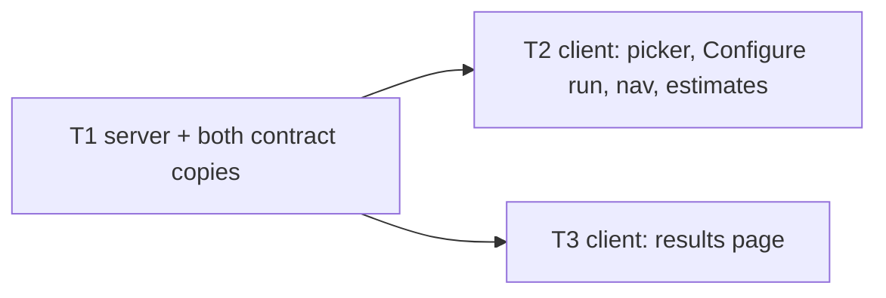

# Implementation Plan: Multi-Agent Review

- **Requirements:** `specs/2026-11-18-multi-agent-review.md` (SPEC-2026-11-18-multi-agent-review).
  **Spec status is still `draft`.** The user asked for a plan anyway. The spec was not edited.
- **Execution mode:** multi-agent (3 implementer slices, hard cap respected)
- **Status:** planned (revised: no tests by implementers; fix loop capped at 2 subagents)

## Workflow overrides (user decision, supersede everything below)

1. **Implementers do NOT write tests in this workflow.** No new or changed test files, no
   test helpers, no fixtures. Every "Tests", `*.test.ts(x)`, `*.it.test.ts` and "sync test"
   item below is **out of scope for T1-T3** and must be skipped. The test names in the
   traceability table are only a record of what a later, separate test-writing step could
   cover. They are not deliverables of this workflow.
   **Single exception (user decision):** T2 may update the existing
   `RunReviewDropdown/RunReviewDropdown.test.tsx` (it is inside T2's `RunReviewDropdown/**`
   owned path), only as far as needed so it matches the replaced picker. T2 adds no other
   test and changes no other test file.
2. **What implementers still run:** `pnpm typecheck` (server and/or client) and the
   **EXISTING** test suites, to prove nothing regressed (e.g. `test/reviews.it.test.ts`
   unchanged, client `pnpm test`). They must NOT edit an existing test to make it pass; a
   failing existing test is reported, not fixed by editing the test.
3. **Contract copy check** (T1 step 1) uses `cmp` on the two `observability.ts` files instead
   of a sync test.
4. **Phase D (plan-verifier)** verifies by **code evidence (file:line)** only. The "named
   test" requirement is dropped. It still re-runs typecheck and the existing suites.
5. **Fix loop is capped at 2 subagents in total** (see Phase E). No more iterations.

## Goal

Let a reviewer start 2 or more chosen agents on one PR in one action, from the PR page or a
new Configure run screen. Show estimates before launch. Run the agents in parallel. Show a
results page for the PR's latest multi-run: Columns/Tabs, 2 s polling, finding groups,
"Where agents disagree" with a "Show only conflicts" toggle, finding actions, and the existing
Run trace panel for each agent. This is the minimal scope: items marked **Removed** and the
Non-goals are not planned.

## Decisions

- **Open question 1 (AC-14):** Configure run cards show the agent's **description** (spec default).
- **Open question 2 (AC-8):** "Configure agents…" opens Configure run with the current PR
  preselected: `/repos/:repoId/multi-agent?pr=<number>` (spec default).
- **Open question 3 (AC-54 b):** a severity difference counts as a conflict (spec default).
- **Parent link:** a nullable column `agent_runs.multi_run_id` → `multi_agent_runs.id`
  (`ON DELETE SET NULL`) plus an index. Existing rows stay valid (NFR-13). Generate the
  migration with `pnpm db:generate`. Never hand-edit files in `migrations/`.
- **New server module** `server/src/modules/multi-agent/` (routes, service, repository and a
  pure `core.ts`). It reuses `ReviewRunExecutor`, `ReviewRepository.getPull/getRepo`,
  `findingRowToDto`, `container.priceBook.resolve` and the pure `eval/core/matching.ts`
  helpers. It does not add a new port or adapter.
- **Parallel only on the multi-run path:** `ReviewRunExecutor.executeRuns` gets an optional
  `opts?: { parallel?: boolean }`. When it is `true`, the per-agent loop becomes
  `await Promise.allSettled(jobs.map(...))`. The default stays the sequential `for … await`,
  so `POST /pulls/:id/review` (including `{all:true}`) does not change (NFR-13).
- **The multi-run and its child `agent_runs` rows are inserted in ONE Drizzle transaction**
  in the multi-agent repository, after all validation. This way the 400 and 404 errors create
  nothing (AC-24 to AC-26). `reviews/repository/run.repo.ts` is not touched.
- **Groups and conflicts are computed on read** in `core.ts` (AC-53). The client renders the
  "Where agents disagree" rows from `groups`, and filters them by `is_conflict` when the toggle
  is on. A small pure client helper builds each row's per-agent cells from `columns` (done
  only) and `group.finding_ids`. The server still fills `conflicts` as the contract requires.
- **Trace panel reuse (wiring only):** the results page imports `RunTraceDrawer` directly
  from `app/repos/[repoId]/pulls/[number]/_components/RunTraceDrawer/RunTraceDrawer`. Nothing
  is moved and no file in the drawer changes. Promoting it to `components/` is deferred.
- **`FindingCard` gets one additive optional prop, `extraActions?: React.ReactNode`.** It is
  rendered between Dismiss and Turn into eval case, so the results page can add the disabled
  **Learn** button (AC-46, AC-67). The prop adds no `useTranslations` call, and the PR page
  behaves as before.
- **i18n:** the two client slices each get their own new namespace, `multiAgent` (T2) and
  `multiAgentResults` (T3), so their files don't overlap. NFR-10 still holds: the strings are
  new, live in new namespaces, and no translation call is added to a shared component.
- **Client hooks:** two new files that are **not** added to the `lib/hooks/index.ts` barrel.
  Import them directly.
- **Configure run with exactly 1 agent ticked:** the launch button stays disabled until 2 or
  more agents are ticked. The spec doesn't cover this case; see Spec gaps. The 1-agent →
  `/review` path (AC-5) applies to the PR-page picker only.
- **e2e-verified ACs (AC-7, AC-8, AC-71, AC-81)** are verified with RTL instead (router push,
  preselect, reload = same query result, drawer opens on Live log while running). No new e2e
  flow, per the user's instruction.
- **Removed ACs and Non-goals are out:** AC-9, 20, 21, 31, 35, 37, 42, 43, 49, 56, 58–64, 73,
  76, 77, 86, 87; NFR-3, 5, 6; EC-9, 12, 18–20, 22, 26, 28, 29, 34.

## Affected modules

- **server:** new `modules/multi-agent`; `db/schema/runs.ts` (new column);
  `modules/reviews/run-executor.ts` (parallel option); `modules/index.ts` (register);
  generated migration.
- **client:** PR-page `RunReviewDropdown`; sidebar `vendor/ui/nav.ts`; new routes under
  `app/repos/[repoId]/multi-agent/**`; additive `FindingCard` prop; new hooks and messages.
- **Shared contracts ripple:** `vendor/shared/contracts/observability.ts` changes in **both**
  copies (server and client), byte-identical. A new sync test guards this.
- **Unchanged:** reviewer-core, mcp-server, e2e, `ci/`, `agent-runner/`, agent prompts,
  `POST /pulls/:id/review`.

## Parallelization graph

- **Phase A:** T1 runs alone.
- **Phase B:** T2 and T3 run in parallel after T1 is green.
- **Contract hand-off:** T1 writes `observability.ts` byte-identically into
  `server/src/vendor/shared/contracts/` AND `client/src/vendor/shared/contracts/` as its
  **first step**. It then proves the hand-off with `cd client && pnpm typecheck` and the new
  sync test. T2 and T3 only **read** the client copy and never edit it.
- **Optional speed-up for the caller:** T2 and T3 may start as soon as T1 reports
  "contracts landed, client typecheck green", before T1's server work finishes. They depend
  only on the contract types. They need the live endpoints only for manual checks, never for
  their RTL tests, which stub `fetch`.
- **Then:** Phase C (architecture-reviewer), then Phase D (plan-verifier). Both are below.

## Owned-paths matrix

| Task | Owned paths (create/modify) |
|---|---|
| T1 | `server/src/vendor/shared/contracts/observability.ts`, `client/src/vendor/shared/contracts/observability.ts`, `server/src/db/schema/runs.ts`, `server/src/db/migrations/**` (**generated by `pnpm db:generate` only**), `server/src/modules/multi-agent/**`, `server/src/modules/reviews/run-executor.ts`, `server/src/modules/index.ts`, `server/INSIGHTS.md` (append only) |
| T2 | `client/src/app/repos/[repoId]/pulls/[number]/_components/RunReviewDropdown/**`, `client/src/app/repos/[repoId]/multi-agent/page.tsx`, `client/src/app/repos/[repoId]/multi-agent/error.tsx`, `client/src/app/repos/[repoId]/multi-agent/_components/**`, `client/src/vendor/ui/nav.ts`, `client/src/lib/hooks/multi-agent.ts`, `client/src/lib/multi-agent-estimates.ts`, `client/messages/en/multiAgent.json`, `client/INSIGHTS.md` (append only, **T2 writes after T3 finishes** or the caller merges; see note) |
| T3 | `client/src/app/repos/[repoId]/multi-agent/[prNumber]/**`, `client/src/app/repos/[repoId]/pulls/[number]/_components/FindingCard/FindingCard.tsx` (additive prop only), `client/src/lib/hooks/multi-agent-run.ts`, `client/messages/en/multiAgentResults.json` |

**Disjointness proof:**
- T2 owns `multi-agent/page.tsx`, `multi-agent/error.tsx` and `multi-agent/_components/**`.
  T3 owns only the `multi-agent/[prNumber]/**` subtree. No file is in both.
- T2 owns only the `RunReviewDropdown/**` folder inside the PR route. T3 owns only
  `FindingCard/FindingCard.tsx` there.
- `RunTraceDrawer/**`, `TurnIntoEvalCase.tsx`, `lib/hooks/index.ts`, `lib/hooks/reviews.ts`,
  `components/app-shell/helpers.ts` and both `vendor/shared` copies are **read-only** for T2
  and T3.
- `client/INSIGHTS.md` is the only file both client slices could want. **Only T2 may append
  to it.** T3 reports its insights in its final message, and the caller appends them after
  Phase B.

## Tasks

### T1 — Server: contracts, multi-run link, service, routes, parallel path, grouping

- **Type:** backend
- **Skills:** `onion-architecture`, `fastify-best-practices`, `drizzle-orm-patterns`,
  `postgresql-table-design`, `zod`, `security`, `typescript-expert`, `engineering-insights`
- **Owned paths:** see the matrix (T1 row).
- **Depends-on:** none
- **Relevant insights** (`server/INSIGHTS.md`):
  - The `vendor/shared` copies drift. Edit **each copy at its own anchor**, then check
    `diff server/src/vendor/shared/contracts/observability.ts client/src/vendor/shared/contracts/observability.ts`.
    Today the two files are identical. Add a byte-identical sync test, like
    `test/eval-contract-sync.test.ts`.
  - Fastify Zod response schemas **strip unknown keys**. Every field returned must be in the
    schema.
  - The global handler turns every Zod failure into `422 validation_error`. The 400
    `invalid_multi_run_request` must therefore be an `AppError` thrown in the service after
    de-duplication.
  - Cost goes through `container.priceBook.resolve(costUsd, model, tokensIn, tokensOut)`. Do
    not re-inline the fallback.
  - `completeAgentRun` flips status to `done` **before** `saveRunTrace`. In it-tests, poll
    until the expected data is present.
  - The boot reaper `reapStaleRunningRuns` sets `failed` without `error`. Every `buildApp()`
    reaps, so let gated runs settle before building another app on the same DB.
  - `MockLLMProvider` can't throw or gate. Use a stub like `StubLLM` in
    `test/helpers/onboarding-fixture.ts` (modes ok/throw/gate), and also override `secrets`
    with `new MockSecretsProvider({})`.
  - Spy on `app.log` for structured-log assertions. The service takes the logger per call, and
    tests call `vi.restoreAllMocks()` in `afterEach`.
  - A new column on an existing table must be nullable or have a default. `multi_run_id` is
    nullable.
  - Drizzle transactions are available (`this.db.transaction(async (tx) => …)`). The
    `row_number()` subquery pattern exists for "last N per group" (eval dashboard).
  - The unit lane must exclude it-tests. Use `--exclude '**/*.it.test.ts'`.
- **What to do:**
  1. **Contracts first (hand-off checkpoint).** In BOTH `observability.ts` copies, make the
     identical change:
     - **`AgentColumn`:**
       - `agent_id: z.string().nullable()`
       - `status: z.enum(['running','done','failed','cancelled'])`
       - add `error: z.string().nullable()`
       - `findings: z.array(FindingRecord)`, importing `FindingRecord` from
         `./review-api.js`. Delete `AgentColumnFinding`; nothing uses it.
     - **`ConflictTake`:**
       - `agent_id: z.string().nullable()`
       - `persona: z.string()` (agent name)
       - `verdict: z.union([Severity, z.literal('not_flagged')])`
       - `note: z.string().nullable()`
     - **`FindingGroup` (new):** `{ file, start_line: int, end_line: int, title, severity: Severity, finding_ids: string[], agent_ids: (string|null)[], is_conflict: boolean }`.
     - **`MultiAgentRunStatus` (new):** `z.enum(['running','done','failed'])`.
     - **`MultiAgentRun`:** add `status: MultiAgentRunStatus` and
       `groups: z.array(FindingGroup)`. `total_duration_ms` is the longest child duration.
     - **`MultiAgentRunRequest` (new):** `z.object({ agent_ids: z.array(z.string().uuid()).min(1).max(50) })`.
     - **`AgentEstimate` (new):** `{ agent_id, mean_duration_ms: number|null, mean_cost_usd: number|null, sample_size: int 0..5 }`.

     Leave the `AgentStats` and `CuratorResult` sections alone. Add
     `server/test/observability-contract-sync.test.ts`, which asserts the two files are
     byte-equal. Run `cd server && pnpm typecheck` and `cd client && pnpm typecheck`. **Report
     "contracts landed" in your notes** so the caller can start T2/T3 early.
  2. **Schema.** In `db/schema/runs.ts`, add
     `multiRunId: uuid('multi_run_id').references(() => multiAgentRuns.id, { onDelete: 'set null' })`
     to `agentRuns`, plus an index on it (Drizzle's third-arg index builder). Run
     `cd server && pnpm db:generate` and keep the generated SQL as is.
  3. **Parallel path.** In `reviews/run-executor.ts`, add the optional last parameter
     `opts?: { parallel?: boolean }` to `executeRuns`:
     - When `parallel`, run the same per-agent body (log + `runOneAgent` + catch) through
       `Promise.allSettled(jobs.map(async ...))`.
     - Otherwise keep the existing loop byte-for-byte.
     - The diff and intent are still loaded once (AC-28), and `failAll` is unchanged (AC-30).
  4. **`modules/multi-agent/core.ts`** (pure: no Drizzle, no Fastify, no container):
     - `groupFindings(columns)` (AC-48, AC-50, AC-51, EC-14 to EC-17):
       - Use only `done` columns.
       - Iterate findings sorted by normalized file, then `start_line`, then the column's
         agent order.
       - A finding joins the first group whose **first** finding is in the same file
         (`normalizePath`), overlaps it (`normalizeRange` + `rangesOverlap` from
         `../eval/core/matching.js`), and has no finding of the same run yet. Otherwise it
         opens a new group.
       - The group's `title` comes from its first member. `severity` is the highest, ranked
         CRITICAL > WARNING > SUGGESTION. `start_line`/`end_line` is the first member's
         normalized range.
     - `isConflict(group, doneColumns)` (AC-54): true when the group is flagged by fewer than
       all done runs, or its members' severities differ.
     - `buildConflicts(groups, doneColumns)`: one `Conflict` per conflicting group, with
       `line = start_line` and one take per done column. A take is the severity plus the
       member's title, or `not_flagged` with `note: null`.
     - `deriveStatus(childStatuses)` (AC-75): `running` if any child is `running`, `failed`
       if none is `done`, else `done`.
     - `meanEstimate(runs)` (AC-17, AC-18): the mean of duration and resolved cost over the
       given done runs. It returns nulls and `sample_size: 0` when there are no runs.
  5. **`modules/multi-agent/repository.ts`** (all Drizzle lives here):
     - `createMultiRun(workspaceId, prId, agents[])`: one transaction that inserts the
       `multi_agent_runs` row plus one `agent_runs` row per agent (`status 'running'`,
       `source 'local'`, `multiRunId`, provider/model).
     - `latestMultiRun(workspaceId, prId)`: the newest by `ran_at`.
     - `childRuns(multiRunId)`: `agent_runs` left-joined to `agents` for the name.
     - `reviewsWithFindingsForRuns(runIds)`.
     - `recentDoneRunsPerAgent(workspaceId, limit 5)`: a `row_number()` partition by
       `agent_id` ordered by `ran_at desc`, with `status = 'done'` and
       `agent_id is not null`.
  6. **`modules/multi-agent/service.ts`:**
     - **`startMultiRun(workspaceId, prId, agentIds, logger)`:**
       1. De-duplicate the ids (AC-23). Fewer than 2 → `AppError('invalid_multi_run_request', …, 400)` (AC-24).
       2. Load the pull with `ReviewRepository.getPull(workspaceId, prId)` → `NotFoundError` (AC-26, NFR-12).
       3. Load each agent with `container.agentsRepo.getById(workspaceId, id)`. A missing
          one → `AppError('agent_not_found', …, 404)` (AC-25). All checks happen before any
          insert.
       4. Call `createMultiRun`.
       5. Log `multi_run.start` with `{ multi_run_id, pr_id, agent_count }` (NFR-11).
       6. Fire and forget `new ReviewRunExecutor(container, reviewRepo, container.agentsRepo).executeRuns(…, jobs, logger, { parallel: true })`.
       7. In `.then`, read the child statuses and log `multi_run.done` with
          `{ multi_run_id, pr_id, agent_count, status, duration_ms }`. Never log keys or the
          diff.
       8. Return the `MultiAgentRun` with every column `running`, empty findings, groups and
          conflicts (AC-22).
     - **`getLatest(workspaceId, prId)`:**
       - The pull is workspace-scoped, else 404. No multi-run →
         `AppError('no_multi_run', …, 404)` (EC-36).
       - Build the columns:
         - `agent_name` falls back to `'Deleted agent'` (EC-11).
         - `cost_usd` goes through `priceBook.resolve`.
         - `findings` go through `findingRowToDto`.
         - `verdict`, `score` and `summary` come from the run's review.
       - `total_duration_ms` = the max child duration; `total_cost_usd` = the sum of known
         costs, or null if none is known.
       - Fill `status`, `groups` and `conflicts` from `core`. This is read-only (AC-53).
     - **`estimates(workspaceId)`:** one `AgentEstimate` per workspace agent
       (`agentsRepo.list`), cost resolved per run, then `meanEstimate`.
  7. **`modules/multi-agent/routes.ts`** (thin; Zod params/body/response):
     - `POST /pulls/:id/multi-agent-run`: body `MultiAgentRunRequest`, response
       `MultiAgentRun`, `config: { rateLimit: { max: 10, timeWindow: '1 minute' } }` (AC-32).
     - `GET /pulls/:id/multi-agent`: response `MultiAgentRun`.
     - `GET /agents/estimates`: response `z.array(AgentEstimate)`. The static route beats
       `/agents/:id` in find-my-way. Confirm that with a test.
     - Use `getContext(container, req)` for `workspaceId`.
     - Register `multiAgent` in `modules/index.ts`.
  8. **Tests - NOT WRITTEN in this workflow (see Workflow overrides)** (NEW):
     - **`modules/multi-agent/core.test.ts`** (unit):
       - same file and overlap → one group; another file or disjoint lines → two groups;
       - `./src/x.ts` == `src/x.ts`; a missing `end_line` is a one-line range;
       - two overlapping findings of one agent → two groups;
       - shuffled input → identical groups (AC-51); chained overlap A–B–C (EC-15);
       - conflicts: flagged by 1 of 3 → conflict; all 3 with equal severity → not;
         WARNING/CRITICAL → conflict;
       - `deriveStatus` over every combination;
       - `meanEstimate` with 4 s/$0.04, 6 s/$0.06, 8 s/$0.08 → 6 s/$0.06, and empty → nulls;
       - failed or cancelled columns are ignored for grouping.
     - **`test/multi-agent.it.test.ts`** (Docker), with a gated/throwing stub in
       `test/helpers/multi-agent-fixture.ts`. The stub throws per agent by matching
       `req.model` or the `sessionId` suffix. Cases:
       - AC-22: response arrives while the gate is closed; 1 multi-run row; N linked rows.
       - AC-23: `[a,a,b]` → 2 children.
       - AC-24: `[a]` and `[a,a]` → 400, no rows.
       - AC-25: unknown or other-workspace agent → 404, no rows.
       - AC-26: unknown PR → 404.
       - AC-27 + NFR-1: 3 agents with a 1 000 ms stub delay → all `running` together;
         wall-clock < 2 000 ms.
       - AC-28: the diff source is called once for 3 agents.
       - AC-29 + NFR-4: B throws → A and C `done`, B `failed` with its error.
       - AC-30: a failing diff → every child `failed` with the same error.
       - AC-32: the 11th POST in a minute → 429.
       - AC-53: findings rows are unchanged after GET.
       - AC-72: 2 launches → 2 multi-runs; GET returns the second.
       - AC-74: `GET /pulls/:id/runs` includes the children.
       - AC-84: a failed child's `GET /runs/:id/trace` log contains the error line.
       - AC-17: estimates via the route, including a 6th-oldest run and a failed run being
         ignored.
       - NFR-2: 10 agents × 50 findings inserted directly → GET ≤ 500 ms.
       - NFR-7: LLM call count = agent count.
       - NFR-11: `app.log.info` spy sees start/done with the fields and no secrets.
       - NFR-12: other-workspace PR → 404.
       - `GET /agents/estimates` doesn't collide with `/agents/:id`.
     - **`test/observability-contract-sync.test.ts`** (unit).
     - Existing `test/reviews.it.test.ts` must pass unchanged (NFR-13, AC-5's
       `/review` path).
- **Typecheck + EXISTING tests only (write no tests):**
  - `cd server && pnpm typecheck`
  - `cd server && pnpm exec vitest run --exclude '**/*.it.test.ts'`
  - `cd server && pnpm exec vitest run test/multi-agent.it.test.ts test/reviews.it.test.ts test/run-executor-skills.it.test.ts test/run-executor-project-context.it.test.ts`
    (Docker)
  - `cd client && pnpm typecheck`, for the contract copy.
- **Acceptance:**
  - All the tests above are green.
  - The contract copies are byte-identical.
  - `POST /pulls/:id/review` behaviour is unchanged.
  - Traces to AC-17, 18 (server half), 22–30, 32, 48, 50, 51, 53, 54, 72, 74, 75, 84 (server
    half); NFR-1, 2, 4, 7, 11, 12, 13.

### T2 — Client: PR-page agent picker, Configure run page, GLOBAL nav, estimates

- **Type:** ui
- **Skills:** `frontend-architecture`, `next-best-practices`, `react-best-practices`,
  `react-testing-library`, `security` (DOM sinks only), `typescript-expert`,
  `engineering-insights`
- **Owned paths:** see the matrix (T2 row).
- **Depends-on:** T1 (at least its contract step: the client copy of `observability.ts`
  updated and `cd client && pnpm typecheck` green).
- **Relevant insights** (`client/INSIGHTS.md`):
  - Client code may only `import type` from `@devdigest/shared`. A value import 500s under
    Next webpack.
  - `@testing-library/user-event` is NOT installed. Use `fireEvent`.
  - A same-tick double click fires 2 POSTs despite `isPending`. Guard with a `useRef`
    in-flight flag (EC-30).
  - The `Checkbox` from `@devdigest/ui` has no `disabled` prop. Use a native
    `<input type="checkbox">` where needed.
  - `Button`'s `active` prop only affects `kind="tertiary"`.
  - A disabled TanStack query sits in `pending`. Gate the UI on `isLoading`.
  - A view using `useSearchParams` needs `<Suspense>` in `page.tsx`. A route-level
    `error.tsx` in `multi-agent/` covers child segments.
  - vitest path filters don't match bracketed dirs. Filter by test file name.
  - New `useTranslations` calls go only in feature components. Tests must register the
    `multiAgent` namespace in their `NextIntlClientProvider`.
  - The `Icon` names are the `vendor/ui/icons.tsx` map keys.
  - The page root needs its own `s.page` padding wrapper.
  - A static `/repos/<segment>` would collide with `repoIdFromPath`. Not an issue here: the
    routes are `/repos/:repoId/multi-agent…`.
- **What to do:**
  1. **`lib/hooks/multi-agent.ts`:**
     - `useAgentEstimates()` → `GET /agents/estimates`, key `["agent-estimates"]`.
     - `useStartMultiAgentRun()` → `POST /pulls/:id/multi-agent-run {agent_ids}`. It returns
       `MultiAgentRun` and invalidates `["multi-agent", prId]` and `["pr-runs", prId]`.
     - Use `api` from `@/lib/api`, `import type` for the contracts. Don't touch
       `hooks/index.ts`.
  2. **`lib/multi-agent-estimates.ts`** (pure):
     - `formatDurationShort(ms)` → `~6s` (6 120 ms → `~6s`) or `—`.
     - `formatCardEstimate(e)` → `"<d>s · $<cost>"` or `—`, using `formatCost` from
       `@/lib/format`.
     - `estimateTotal(selected, estimates)` → `{ maxMs, sumUsd }` over known values only.
     - `formatTotal` → `"≈ 8.2s · $0.20 · parallel fan-out"` (AC-19). An agent with `—`
       doesn't change the total (AC-18).
  3. **`RunReviewDropdown`:** rewrite it into a "Pick agents to run" checklist popover.
     - One checkbox per agent from `useAgents()` with the name and `~Ns` or `—` (AC-1, AC-2).
       Disabled agents are listed with a "disabled" mark and are still selectable (EC-27).
     - No "Run all" item.
     - **Clear** unticks all (AC-3).
     - The launch button:
       - 0 ticked → disabled (AC-6).
       - 1 ticked → "Run review", which uses the existing `useRunReview` `{agentId}` and the
         existing `onRunStart/onRunsStarted/onRunSettled` callbacks (AC-5).
       - 2 or more ticked → "Run multi-agent review (N)" plus the total (AC-4, AC-19). It
         calls `useStartMultiAgentRun`, then
         `router.push(/repos/${repoId}/multi-agent/${number})`, taking `repoId`/`number`
         from `useParams()` (AC-7).
     - The merged/closed warning row stays, and the run stays enabled (AC-10).
     - **"Configure agents…"** → `/repos/${repoId}/multi-agent?pr=${number}` (AC-8).
     - The button is disabled while a request is in flight, plus the ref guard (EC-30).
     - Keep the component's props unchanged, so `PrDetailHeader`/`page.tsx` need no edit.
     - Update `RunReviewDropdown.test.tsx`.
  4. **Configure run:** `app/repos/[repoId]/multi-agent/page.tsx` is thin (Suspense +
     `AppShell` + view). Add `error.tsx` (copy the pattern of `pulls/[number]/error.tsx`).
     Build `_components/ConfigureRunView/**` (view, `useConfigureRun` hook, styles, test):
     - PR `<select>` from `usePulls(repoId)` as `#<number> · <title>`, preselected from
       `?pr=` (AC-12, AC-8). A repo switch (new `repoId`) resets it via a `key` remount
       (EC-25).
     - No PR → the "Pick a pull request first" empty state, launch disabled (AC-13).
     - No repo, or no agents → an empty state with a link to the repo picker or `/agents`
       (AC-16).
     - Agent cards with checkbox, name, description and `formatCardEstimate` (AC-14).
     - **Select all** (AC-15). The total line appears when 2 or more are ticked (AC-19).
     - Launch is enabled only when a PR is chosen and 2 or more agents are ticked. It posts,
       then pushes to the results URL. Same ref guard.
  5. **Sidebar:** in `vendor/ui/nav.ts`, append a group
     `{ section: "GLOBAL", items: [{ key: "multi-agent", label: "Multi-Agent Review", icon: <existing icon key, e.g. "Layers">, href: "/repos/:repoId/multi-agent" }] }`
     (AC-11). `activeKeyFor` already maps `/multi-agent`. Add assertions to
     `components/app-shell/helpers.test.ts` for both new URL shapes.
  6. **`messages/en/multiAgent.json`:** every new string from steps 3–5.
- **Tests - NOT WRITTEN in this workflow (see Workflow overrides)** (NEW/updated, RTL with `fireEvent`, a real `QueryClientProvider`, `fetch`
  stubbed by pathname):
  - **`RunReviewDropdown.test.tsx`:**
    - one checkbox per agent, no "Run all";
    - `~6s` and `—`;
    - Clear;
    - 0 → disabled;
    - 1 → POST `/review {agentId}` and no multi-agent call;
    - 2 → "Run multi-agent review (2)" + total, POST `multi-agent-run`, and `router.push` to
      the results URL;
    - double click → 1 POST;
    - merged warning with the run still enabled;
    - "Configure agents…" pushes `?pr=`.
  - **`ConfigureRunView.test.tsx`:**
    - PR options equal the pulls response; `?pr=` preselects;
    - no PR → empty state with launch disabled;
    - no agents → link to `/agents`;
    - card shows name, description and estimate;
    - Select all;
    - total, including a `—` agent being excluded;
    - launch posts and navigates;
    - smoke render with no `MISSING_MESSAGE` (NFR-10).
  - **`lib/multi-agent-estimates.test.ts`:** AC-19's example → `"≈ 8.2s · $0.20 · parallel fan-out"`.
  - **`vendor/ui/nav.test.ts`:** the GLOBAL section has exactly one item, `multi-agent`.
  - **`helpers.test.ts`:** `activeKeyFor` → `multi-agent` on both routes.
  - **NFR-9:** checkboxes and buttons are found by role + accessible name.
- **Typecheck + EXISTING tests only (write no tests):**
  - `cd client && pnpm typecheck`
  - `cd client && pnpm test`
  - Targeted: `cd client && pnpm exec vitest run RunReviewDropdown ConfigureRunView multi-agent-estimates nav helpers`
- **Acceptance:**
  - All the tests above pass, and the full client suite is green.
  - Traces to AC-1–8, 10–16, 18 (UI half), 19; NFR-9 (picker/configure parts), NFR-10.

### T3 — Client: results page

- **Type:** ui
- **Skills:** `frontend-architecture`, `next-best-practices`, `react-best-practices`,
  `react-testing-library`, `security` (DOM sinks only), `typescript-expert`,
  `engineering-insights`
- **Owned paths:** see the matrix (T3 row). Read-only: `RunTraceDrawer/**`,
  `TurnIntoEvalCase.tsx`, `lib/hooks/reviews.ts` (`useFindingAction`), both `vendor/shared`
  copies.
- **Depends-on:** T1 (same contract hand-off as T2). It runs in parallel with T2.
- **Relevant insights** (`client/INSIGHTS.md`):
  - `import type` only from `@devdigest/shared`.
  - `fireEvent`, not user-event.
  - Polling-hook tests use `vi.useFakeTimers({ shouldAdvanceTime: true })` +
    `act(() => vi.advanceTimersByTimeAsync(2500))` for a 2 000 ms interval.
  - Global `staleTime: 30_000`. Group actions must explicitly invalidate
    `["multi-agent", prId]`.
  - Any test rendering `FindingCard` needs a `QueryClientProvider` plus the `prReview` and
    `eval` namespaces, which it and `TurnIntoEvalCase` already use.
  - The `Tabs` primitive renders plain `<button>`s. Assert via
    `getByRole("button", { name })`.
  - The trace drawer's Prompt assembly section is collapsed by default. Drawer tests need the
    `runs` namespace.
  - The `MutationCache` toasts every mutation error, which serves AC-88.
  - 4xx are silent by design. Handle `404 no_multi_run` as an inline empty state.
  - Don't add `useTranslations` to `FindingCard`. Pass pre-formatted nodes instead.
  - Use `borderLeft*` longhands for accent borders.
  - The page needs its own `s.page` padding wrapper.
- **What to do:**
  1. **`lib/hooks/multi-agent-run.ts`:**
     - `useMultiAgentRun(prId)` → `GET /pulls/:id/multi-agent`, key `["multi-agent", prId]`,
       `enabled: !!prId`. Use
       `refetchInterval: (q) => q.state.data?.status === 'running' ? 2000 : false` (AC-38).
       Don't retry a 404.
     - `useGroupFindingAction(prId)`: a mutation over `{ findingIds, action }`. It runs
       `Promise.allSettled` of `api.post('/findings/:id/<action>')`, then **one**
       invalidation of `["multi-agent", prId]` (AC-65). If any call is rejected, it throws
       after invalidating, so the global toast fires and the refetched state shows (AC-88).
     - The single-finding Accept/Dismiss in a tab uses the same mutation with one id (AC-66).
  2. **Route:** `app/repos/[repoId]/multi-agent/[prNumber]/page.tsx` is thin. Add
     `_components/MultiAgentResultsView/**`:
     - **View hook `useMultiAgentResults`:**
       - Resolve `prId` via `usePulls(repoId)` + number, like `usePrDetailPage`.
       - Mode state `'tabs' | 'columns'`, default `tabs` (AC-34).
       - Selected agent tab, defaulting to the first column (AC-44).
       - `showOnlyConflicts`.
       - `traceRunId`.
     - **Header:** `#<number> · <title>` and `"<N> agents · <x.x>s total · $<sum>"`
       (AC-33, NFR-8).
     - **Columns mode** (AC-36, AC-39, AC-40, AC-78):
       - one column per `columns[]` entry with name, a status text label, duration, cost and
         a **View trace** button;
       - `done` → score, verdict and the finding list, or "No findings" (EC-13);
       - `failed`/`cancelled` → status plus `error`, or a fallback "No reason recorded"
         (EC-10).
     - **Tabs mode:**
       - one tab per column, labelled "<name> <score>" (AC-44);
       - an agent card with score, summary, duration, cost and View trace (AC-45, AC-79);
       - the finding list uses the existing `FindingCard`, passing
         `extraActions={<LearnButton/>}` (AC-46);
       - an "Also found by: <agents>" line when the finding belongs to a group with other
         agents (AC-47);
       - Accept/Dismiss → `useGroupFindingAction` with `[f.id]` (AC-66).
     - **"Where agents disagree" block:**
       - rows come from `groups`, filtered by `is_conflict` when **Show only conflicts** is
         on (AC-57);
       - each row shows `file:line`, title, the highest-severity badge with a text label and
         the flagging agents (AC-52);
       - one cell per `done` column: "<Agent> · <SEVERITY>" + finding title, or
         "<Agent> · did not flag" (AC-55). The cells come from the pure helper
         `cellsForGroup(group, columns)` in a colocated `helpers.ts`;
       - group actions: Accept/Dismiss over all of `finding_ids` (AC-65, EC-24), and
         `TurnIntoEvalCase` with `findingId = finding_ids[0]` and `decided` from that
         finding's timestamps (AC-69, AC-70).
     - **LearnButton:** a native disabled button plus visible or `aria-describedby` hint text
       "Available with Memory" (AC-67, NFR-9). There is no Reply to author anywhere (AC-68).
     - **Trace panel:** when `traceRunId` is set, mount `RunTraceDrawer`, imported from the
       PR route's `_components/RunTraceDrawer/RunTraceDrawer`. Pass:
       - `runId`
       - `prNumber`
       - `agentName` = the column's name
       - `findings` = the column's findings
       - `running` = `column.status === 'running'`
       - `key={traceRunId}`, so switching A→B remounts and resubscribes only B (AC-41,
         AC-80–AC-85, EC-31).
     - **Empty/error states:**
       - unknown PR number → not-found state;
       - `404 no_multi_run` → an empty state linking to `/repos/:repoId/multi-agent?pr=<n>`
         (EC-36);
       - loading skeleton.
  3. **`FindingCard.tsx`:** add the optional `extraActions?: React.ReactNode` prop, rendered
     between Dismiss and `TurnIntoEvalCase`. Nothing else changes. The existing
     `FindingCard.test.tsx` must pass unchanged.
  4. **`messages/en/multiAgentResults.json`:** every new string.
- **Tests - NOT WRITTEN in this workflow (see Workflow overrides)** (NEW, RTL with `fireEvent`, a real `QueryClientProvider`, `fetch` stubbed by
  pathname, `vi.mock("next/navigation")`):
  - **`MultiAgentResultsView.test.tsx`:**
    - fixture header "4 agents · 8.2s total · $0.20";
    - Tabs active on load, and the toggle switches to Columns;
    - Columns: names, status labels, duration, cost; a failed column shows its error text;
      a done column shows score, verdict and findings; "No findings";
    - tabs "Security 38", "Performance 64"; the agent card fields;
    - expanding a finding shows "98% conf", "Suggested fix" and 4 buttons (Accept, Dismiss,
      Learn disabled with hint text, Turn into eval case); no "Reply to author";
    - "Also found by";
    - a group row shows location, title, highest severity and agents; cells
      "Junior Mentor · SUGGESTION" and "Security · did not flag";
    - Show only conflicts filters the list;
    - group Accept → 3 POSTs then 1 refetch;
    - the 2nd POST fails → error toast + refetched state (AC-88);
    - tab Accept → 1 POST with that id;
    - Turn into eval case on a group uses `finding_ids[0]`, and is disabled with "accept or
      dismiss first" when that finding is undecided;
    - View trace in column B → drawer title/findings are B's and the SSE is subscribed to B
      only. Then open A → only A's data (AC-41, AC-78, AC-79, AC-85);
    - a running column opens the drawer on Live log; a terminal column opens it on Trace
      (AC-81, AC-83);
    - `404 no_multi_run` → empty state with the Configure link;
    - smoke render with no `MISSING_MESSAGE` (NFR-10).
  - **`multi-agent-run.test.tsx`** (`renderHook`, fake timers): it refetches every 2 s while
    `status: 'running'`, and makes no further fetch after the status becomes `done` (AC-38).
  - **`helpers.test.ts`** for `cellsForGroup`.
  - The existing `RunTraceDrawer.test.tsx`, `TraceBody.test.tsx` and `FindingCard.test.tsx`
    pass **unchanged** (AC-80, AC-82, AC-84 client half).
- **Typecheck + EXISTING tests only (write no tests):**
  - `cd client && pnpm typecheck`
  - `cd client && pnpm test`
  - Targeted: `cd client && pnpm exec vitest run MultiAgentResultsView multi-agent-run RunTraceDrawer TraceBody FindingCard`
- **Acceptance:**
  - All the tests above pass, and the full client suite is green.
  - Traces to AC-33, 34, 36, 38–41, 44–47, 52, 55, 57, 65–71, 78–85, 88; NFR-8, NFR-9
    (results parts), NFR-10.

## Phase C — architecture-reviewer (after T1–T3 are green)

Launch the `architecture-reviewer` agent with this prompt:

> Read-only architectural review of the Multi-Agent Review feature. **Scope: ONLY the diff
> `git diff origin/main...HEAD` plus any untracked files under `server/src/modules/multi-agent/`,
> `client/src/app/repos/[repoId]/multi-agent/`, `client/src/lib/hooks/multi-agent*.ts` (list
> them with `git status --porcelain`). Do NOT review the whole tree.** Run
> `git fetch origin main` first. The plan is `docs/plans/multi-agent-review.md` and the spec is
> `specs/2026-11-18-multi-agent-review.md`. Check:
> 1. **Onion:**
>    - Drizzle only in `modules/multi-agent/repository.ts` and `db/schema`.
>    - `modules/multi-agent/core.ts` is pure and imports only `eval/core/matching.ts` and
>      types.
>    - Routes are thin.
>    - No adapter is imported directly.
>    - `reviewer-core` is untouched.
> 2. `run-executor.ts`: the parallel path is opt-in, and the default sequential path is
>    byte-equivalent.
> 3. The cross-module use of `reviews` classes from `multi-agent` (acceptable, or should it go
>    through a narrower seam?).
> 4. The shared contract copies are byte-identical.
> 5. Frontend:
>    - the feature folder layout;
>    - the cross-route import of `RunTraceDrawer` from `pulls/[number]/_components`;
>    - the `FindingCard.extraActions` prop;
>    - no barrel additions;
>    - only `import type` from `@devdigest/shared`.
>
> Report findings by severity with file:line. Run the onion depcruise gate per
> `.claude/skills/onion-architecture/enforcement.md` WITHOUT a baseline and report only edges
> from changed files. The known pre-existing violations are 17.

## Phase D — plan-verifier (after Phase C findings are fixed or waived)

Launch the `plan-verifier` agent with this prompt:

> Verify that `docs/plans/multi-agent-review.md` was delivered. Requirements source:
> `specs/2026-11-18-multi-agent-review.md`. **Active requirements only.** Ignore every item
> marked "Removed" and every Non-goal. For EVERY row of the plan's "Requirement traceability"
> table:
> - find concrete file:line evidence in code (tests are NOT written in this workflow, so do not require a named test);
> - mark it Delivered / Partial / Missing.
>
> Confirm that the owned-paths rule held: `git diff --name-only origin/main...HEAD` plus
> untracked files ⊆ the union of the Owned paths in the matrix. Re-run and report the real
> results of:
> - `cd server && pnpm typecheck`
> - `cd server && pnpm exec vitest run --exclude '**/*.it.test.ts'`
> - `cd server && pnpm exec vitest run test/multi-agent.it.test.ts test/reviews.it.test.ts` (Docker)
> - `cd client && pnpm typecheck`
> - `cd client && pnpm test`
>
> If Docker is unavailable, say so explicitly; do not count skipped it-tests as passing.
> Also check:
> - the contract copies are byte-identical
>   (`cmp server/src/vendor/shared/contracts/observability.ts client/src/vendor/shared/contracts/observability.ts`);
> - `POST /pulls/:id/review` and `RunTraceDrawer` content are unchanged
>   (`git diff origin/main...HEAD -- client/src/app/repos/[repoId]/pulls/[number]/_components/RunTraceDrawer` is empty).

## Phase E - fix loop (HARD CAP: 2 subagents total, ONE pass)

Runs only if Phase C or D reports CRITICAL findings or Missing/Partial requirements.

- Launch **at most 2** `implementer` subagents in total, in a single message (parallel), each
  with a disjoint Owned-paths subset taken from the matrix above (e.g. one for T1 paths, one
  for client paths). If all fixes fit in one slice, launch only one.
- **One pass only.** No second round, no re-spawning. After the fixes, the caller (not a
  subagent) re-runs `pnpm typecheck` and the existing suites inline.
- Fixers do not write tests either (Workflow overrides).
- Anything still open after that single pass is reported to the user as-is, not looped on.
- Waived: LOW/INFO findings and the known pre-existing depcruise violations.

## Requirement traceability

| Requirement | Task(s) | Verified by |
|---|---|---|
| AC-1 picker checkboxes, no "Run all" | T2 | `RunReviewDropdown.test.tsx` |
| AC-2 `~Ns` / `—` per agent | T2 (+T1 estimates) | `RunReviewDropdown.test.tsx`, `multi-agent-estimates.test.ts` |
| AC-3 Clear | T2 | `RunReviewDropdown.test.tsx` |
| AC-4 "Run multi-agent review (N)" | T2 | `RunReviewDropdown.test.tsx` |
| AC-5 1 agent → `/review` | T2 (T1 keeps `/review` unchanged) | `RunReviewDropdown.test.tsx`, `reviews.it.test.ts` |
| AC-6 0 agents → disabled | T2 | `RunReviewDropdown.test.tsx` |
| AC-7 multi-run POST + navigate | T2 | `RunReviewDropdown.test.tsx` (router.push; RTL instead of e2e) |
| AC-8 Configure agents… → preselected PR | T2 | `RunReviewDropdown.test.tsx` + `ConfigureRunView.test.tsx` |
| AC-10 merged warning, run allowed | T2 | `RunReviewDropdown.test.tsx` |
| AC-11 GLOBAL nav, one item | T2 | `nav.test.ts`, `helpers.test.ts` |
| AC-12 PR options of current repo | T2 | `ConfigureRunView.test.tsx` |
| AC-13 "Pick a pull request first" | T2 | `ConfigureRunView.test.tsx` |
| AC-14 agent cards (name, description, estimate) | T2 | `ConfigureRunView.test.tsx` |
| AC-15 Select all | T2 | `ConfigureRunView.test.tsx` |
| AC-16 no repo / no agents empty state | T2 | `ConfigureRunView.test.tsx` |
| AC-17 mean of last 5 done runs | T1 | `core.test.ts`, `multi-agent.it.test.ts` |
| AC-18 no done runs → `—`, excluded | T1 + T2 | `core.test.ts`, `multi-agent-estimates.test.ts`, `ConfigureRunView.test.tsx` |
| AC-19 total line | T2 | `multi-agent-estimates.test.ts`, `RunReviewDropdown.test.tsx` |
| AC-22 1 multi-run + N children, early response | T1 | `multi-agent.it.test.ts` |
| AC-23 de-dup | T1 | `multi-agent.it.test.ts` |
| AC-24 < 2 → 400, nothing created | T1 | `multi-agent.it.test.ts` |
| AC-25 agent_not_found | T1 | `multi-agent.it.test.ts` |
| AC-26 PR not_found | T1 | `multi-agent.it.test.ts` |
| AC-27 all children concurrent | T1 | `multi-agent.it.test.ts` |
| AC-28 diff/intent loaded once | T1 | `multi-agent.it.test.ts` |
| AC-29 per-agent isolation | T1 | `multi-agent.it.test.ts` |
| AC-30 diff failure → all failed | T1 | `multi-agent.it.test.ts` |
| AC-32 rate limit 10/min | T1 | `multi-agent.it.test.ts` |
| AC-33 header totals | T3 | `MultiAgentResultsView.test.tsx` |
| AC-34 Columns/Tabs toggle, Tabs default | T3 | `MultiAgentResultsView.test.tsx` |
| AC-36 column contents + View trace | T3 | `MultiAgentResultsView.test.tsx` |
| AC-38 poll every 2 s while running | T3 (+T1 status) | `multi-agent-run.test.tsx` |
| AC-39 done column: score, verdict, findings | T3 | `MultiAgentResultsView.test.tsx` |
| AC-40 failed/cancelled shows error | T3 (+T1 `error`) | `MultiAgentResultsView.test.tsx` |
| AC-41 View trace opens panel for that run | T3 | `MultiAgentResultsView.test.tsx` |
| AC-44 tabs per agent with score | T3 | `MultiAgentResultsView.test.tsx` |
| AC-45 agent card | T3 | `MultiAgentResultsView.test.tsx` |
| AC-46 finding detail + 4 buttons | T3 | `MultiAgentResultsView.test.tsx` |
| AC-47 "Also found by" | T3 (+T1 groups) | `MultiAgentResultsView.test.tsx` |
| AC-48 file + overlap grouping, done only | T1 | `core.test.ts` |
| AC-50 same agent never merged | T1 | `core.test.ts` |
| AC-51 deterministic grouping | T1 | `core.test.ts` |
| AC-52 group row display | T3 | `MultiAgentResultsView.test.tsx` |
| AC-53 computed on read, rows unchanged | T1 | `multi-agent.it.test.ts` |
| AC-54 conflict rule | T1 | `core.test.ts` |
| AC-55 per-agent cells / "did not flag" | T3 | `MultiAgentResultsView.test.tsx`, `helpers.test.ts` |
| AC-57 Show only conflicts | T3 | `MultiAgentResultsView.test.tsx` |
| AC-65 group Accept/Dismiss loop + 1 refetch | T3 | `MultiAgentResultsView.test.tsx` |
| AC-66 single-finding action | T3 | `MultiAgentResultsView.test.tsx` |
| AC-67 Learn disabled + hint | T3 | `MultiAgentResultsView.test.tsx` |
| AC-68 no Reply to author | T3 | `MultiAgentResultsView.test.tsx` |
| AC-69 eval case (group → first finding) | T3 | `MultiAgentResultsView.test.tsx` |
| AC-70 undecided → eval case disabled | T3 | `MultiAgentResultsView.test.tsx` |
| AC-71 latest multi-run, same after reload | T1 (GET latest) + T3 | `multi-agent.it.test.ts`, `MultiAgentResultsView.test.tsx` (RTL instead of e2e) |
| AC-72 new multi-run, old unchanged | T1 | `multi-agent.it.test.ts` |
| AC-74 children in run history | T1 | `multi-agent.it.test.ts` |
| AC-75 multi-run status rule | T1 | `core.test.ts` |
| AC-78 View trace in column | T3 | `MultiAgentResultsView.test.tsx` |
| AC-79 View trace in agent card | T3 | `MultiAgentResultsView.test.tsx` |
| AC-80 same drawer, unchanged content | T3 | existing `RunTraceDrawer.test.tsx`, `TraceBody.test.tsx` unchanged |
| AC-81 running → Live log tab (replay) | T3 | `MultiAgentResultsView.test.tsx` + existing drawer tests (RTL instead of e2e) |
| AC-82 live end → trace (existing) | T3 (reuse) | existing `RunTraceDrawer.test.tsx` |
| AC-83 terminal → Trace tab | T3 | `MultiAgentResultsView.test.tsx` |
| AC-84 failed child log has error | T1 + T3 | `multi-agent.it.test.ts`, existing drawer tests |
| AC-85 panel shows only agent X's data | T3 | `MultiAgentResultsView.test.tsx` |
| AC-88 partial group failure → toast + refetch | T3 | `MultiAgentResultsView.test.tsx` |
| NFR-1 parallel wall-clock | T1 | `multi-agent.it.test.ts` |
| NFR-2 GET ≤ 500 ms | T1 | `multi-agent.it.test.ts` |
| NFR-4 provider degradation | T1 + T3 | `multi-agent.it.test.ts`, `MultiAgentResultsView.test.tsx` |
| NFR-7 no extra LLM calls | T1 | `multi-agent.it.test.ts` |
| NFR-8 per-agent + total cost | T3 | `MultiAgentResultsView.test.tsx` |
| NFR-9 accessibility | T2 + T3 | RTL role/name queries in both slices |
| NFR-10 i18n in new namespaces | T2 + T3 | smoke renders in `ConfigureRunView.test.tsx`, `MultiAgentResultsView.test.tsx` |
| NFR-11 start/done logs | T1 | `multi-agent.it.test.ts` |
| NFR-12 workspace scoping | T1 | `multi-agent.it.test.ts` |
| NFR-13 compatibility | T1 | `reviews.it.test.ts` unchanged + default executor path unchanged |

Every task maps to at least one requirement: T1 → AC-17, 22–32, 48–54, 72–75, NFR-1/2/4/7/11–13;
T2 → AC-1–19; T3 → AC-33–47, 52–71, 78–88.

## Spec gaps (noted, not changed in the spec)

1. **Configure run with exactly 1 agent ticked** is not specified. The plan disables the
   launch button until 2 or more are ticked.
2. **EC-11 "agent name saved for the run":** `agent_runs` has no name column. The plan uses
   the joined agent name, or "Deleted agent".
3. **EC-10:** the boot reaper writes `failed` with `error = null`, so AC-40 shows a fallback
   "No reason recorded".
4. **AC-55 with the toggle off:** the spec doesn't say what cells non-conflict groups show.
   The plan uses the same per-done-agent cells for every group.
5. **NFR-10 says "a new namespace" (singular).** The plan uses two (`multiAgent`,
   `multiAgentResults`) to keep the slices file-disjoint.
6. **e2e-verified ACs (7, 8, 71, 81)** are covered by RTL, per the user. No e2e flow is added.
