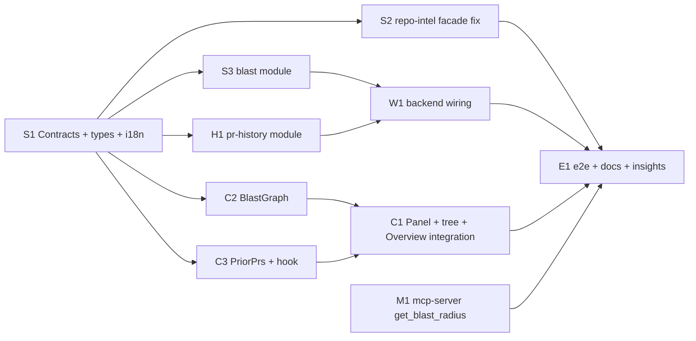

# Dev Spec: Blast Radius (PR Overview block, PR history, MCP `get_blast_radius`)

## Goal
Show each PR's **blast radius** on the Overview tab: the symbols declared in changed files, their callers (`file:line`, linked to GitHub), and the HTTP endpoints and crons that may depend on them. Data is read from the repo-intel index that was built at clone time, with no LLM call and no re-parsing. The block has a Tree/Graph toggle and a lazily loaded "Prior PRs touching these files" section. The same map is served to Claude Code through a real `get_blast_radius` tool in `mcp-server`.

## Affected modules
- **server**:
  - new shared contract file `contracts/blast-api.ts` (mirrored into the client)
  - repo-intel facade fix: per-symbol cap, declaring-file exclusion, depth-2 endpoint/cron reach, accurate degraded reasons
  - new `blast` module (`GET /pulls/:id/blast`)
  - new `pr-history` module (`GET /pulls/:id/history`)
  - registration in `modules/index.ts`
- **client**: hooks, `BlastRadiusPanel` (tree, stats, degraded badge + Resync), nested `BlastGraph`, nested `PriorPrs`, 2-column Overview layout, `?blast=graph` URL state, new i18n keys in `messages/en/blast.json`.
- **mcp-server**: port method, adapter, use case, output schema, render and messages for `get_blast_radius`; contract test; `docs/spec/mcp-server.md`.
- **e2e**: flow 02 asserts that the block renders.
- **Shared-contract ripple**: `server/src/vendor/shared/contracts/blast-api.ts` plus one barrel line, mirrored **byte-identically** into `client/src/vendor/shared/` (new file, so it is identical by construction). Note: the two vendored trees **already diverge** in `adapters.ts`, `eval-ci.ts`, `knowledge.ts`, `productionize.ts` and `trace.ts` (verified with `diff -r`). Don't "fix" that drift here. `index.ts` is identical on both sides, so append the same line to both. `mcp-server` must **not** import `@devdigest/shared` (zod 4 vs 3, per `docs/spec/mcp-server.md` §0). It keeps its own lenient local schema.

## Key design decisions (justified)
1. **New response contract instead of editing `BlastRadius`.**
   - `BlastRadiusResponse = BlastRadius.extend({...})` lives in a new file. This follows the barrel rule "extend shared with new files" and the precedent of `SmartDiffResponse` in `contracts/review-api.ts`.
   - `PrBrief.blast` keeps the stable base type.
   - Fastify + Zod strips unknown keys, so every field the UI needs (`degraded`, `reason`, `stats`, limits) **must** be in the response schema.
2. **Fix the facade (`repo-intel/service.ts`).**
   - **Cap per symbol.** Today the persistent path does `callers.slice(0, MAX_CALLERS_PER_SYMBOL)`, which caps the **total** list at 20. The constant's own comment and the homework both say *per symbol*.
   - **Exclude the declaring file.** The persistent path does not exclude it explicitly. Fix: return `declFile` from `getResolvedCallers` and drop rows where `fromPath === declFile`.
   - **Depth-2 endpoint/cron reach.** Without it the P1 scenario fails. Verified: `server/src/modules/reviews/helpers.ts` (`reviewToDto`/`findingRowToDto`/`taskLine`) is called by `reviews/service.ts`, `findings.ts` and `run-executor.ts`. Those are not route files, so the endpoints in `reviews/routes.ts` sit at hop 2. `BFS_DEPTH = 2` is exported but unused today.
   - **Accurate `reason` values.** `index_partial` when the status is `partial`; `flag_off`; `index_failed`. Today every non-persistent case reports `no_data`, and `partial` reports nothing.
   - `getBlastRadius` has **no other consumer** (verified by grep), so changing it is safe.
3. **Logging.** Neither the container nor the services have a logger. The route passes `req.log` into the service as a minimal local interface `{ info(obj, msg) }`, so `service.ts` never imports Fastify. There is one structured line per request: `blast.read_index` with `source: 'index'|'fallback'`.
4. **Pure mapper** (`blast/mapper.ts`) turns the flat facade output into grouped `downstream`. It is unit-tested and also validated against `BlastRadiusResponse.parse`.
5. **Graph needs caller→endpoint edges.** So the contract carries **per-caller** `endpoints`/`crons` (reach from the caller's file within `bfs_depth`) as well as per-symbol unions. If a symbol endpoint is not reached through any *shown* caller (a capped caller, or the fallback flat list), the graph draws it as a dashed symbol→endpoint edge.
6. **Link SHA.** Caller line numbers come from the **indexed snapshot**, so the response carries `indexed_sha` (`repo_index_state.last_indexed_sha`). The UI links with `githubBlobUrl(repoFullName, indexed_sha ?? headSha, file, line)`. Callers are not in the diff, so the indexed SHA is the one whose line numbers are exact. `headSha` is the fallback.
7. **Prior PRs source: local git clone, not an LLM and not a new GitHub port.**
   - **Verified:** clones are **shallow** (`repos/constants.ts` `CLONE_DEPTH = 1`); a resync fetches `--depth 50` (`simple-git.ts` `RESYNC_FETCH_DEPTH = 50`).
   - A path-filtered `git log -- file` would also miss "Merge pull request" commits, because git's history simplification prunes TREESAME merges.
   - **Algorithm:**
     1. `git.log(ref)` without a path (≤50 commits).
     2. Parse PR numbers from the subjects (`Merge pull request #N` / `… (#N)`).
     3. For each matching commit, `git.diffNameOnly(ref, sha^1, sha)`, intersected with the PR's files.
     4. Enrich from the DB `pull_requests` table, then (bounded, optional) from `container.github().getPullRequest`, then from the commit subject and author.
   - Only existing ports are used (`GitClient.log`, `GitClient.diffNameOnly`, `GitHubClient.getPullRequest`).
   - With a depth-1 clone it degrades honestly to `reason: 'shallow_history'` ("Resync to load history").
   - `notes` = first line of the PR body (≤200 chars), else `""`. When notes is empty the UI renders `history.touched` from `files_overlap`, so the server builds no English strings and makes no LLM call.
8. **Client composition.**
   - `BlastGraph` and `PriorPrs` are only used by the panel, so they are colocated as nested `BlastRadiusPanel/_components/*` (precedent: `AgentEditor/_components/SkillsTab`).
   - No per-component `index.ts`.
   - No graph dependency exists in `client/package.json` (verified), so the graph is hand-rolled SVG with a pure, tested `layout.ts`.
9. **i18n vocabulary is created once, up front, in S1.** `blast.json` is the only collision point between C1, C2 and C3. The panel uses **only** the `blast` namespace (adds `title`), so tests need one provider namespace.

## Parallelization graph



- **Wave 0:** S1 ∥ M1. M1 needs no code from the others; it codes against the contract in this spec.
- **Wave 1:** S2 ∥ S3 ∥ H1 ∥ C2 ∥ C3.
- **Wave 2:** W1 ∥ C1.
- **Wave 3:** E1.

## Owned-paths matrix

| Task | Owned paths |
|---|---|
| S1 | `server/src/vendor/shared/contracts/blast-api.ts` (new), `server/src/vendor/shared/index.ts`, `client/src/vendor/shared/contracts/blast-api.ts` (new), `client/src/vendor/shared/index.ts`, `server/src/modules/repo-intel/types.ts`, `client/src/lib/types.ts`, `client/messages/en/blast.json` |
| S2 | `server/src/modules/repo-intel/service.ts`, `server/src/modules/repo-intel/repository.ts`, `server/src/modules/repo-intel/README.md`, `server/test/repo-intel-blast.test.ts` (new), `server/test/repo-intel-facade-degraded.test.ts` |
| S3 | `server/src/modules/blast/**` (new: `routes.ts`, `service.ts`, `mapper.ts`, `mapper.test.ts`, `service.test.ts`) |
| H1 | `server/src/modules/pr-history/**` (new: `routes.ts`, `service.ts`, `repository.ts`, `parse.ts`, `constants.ts`, `parse.test.ts`, `service.test.ts`) |
| W1 | `server/src/modules/index.ts`, `server/test/blast-routes-smoke.test.ts` (new) |
| C2 | `client/src/app/repos/[repoId]/pulls/[number]/_components/BlastRadiusPanel/_components/BlastGraph/**` (new) |
| C3 | `client/src/app/repos/[repoId]/pulls/[number]/_components/BlastRadiusPanel/_components/PriorPrs/**` (new), `client/src/lib/hooks/pr-history.ts` (new) |
| C1 | `client/src/app/repos/[repoId]/pulls/[number]/_components/BlastRadiusPanel/*.ts(x)` (top-level files only, new), `.../_components/OverviewTab/OverviewTab.tsx`, `.../_components/OverviewTab/styles.ts`, `.../pulls/[number]/page.tsx`, `.../pulls/[number]/usePrDetailPage.ts`, `client/src/lib/hooks/blast.ts` (new), `client/src/lib/hooks/index.ts` |
| M1 | `mcp-server/src/domain/{types,ports}.ts`, `mcp-server/src/domain/use-cases/get-blast-radius.ts`, `mcp-server/src/adapters/http/devdigest-api.ts`, `mcp-server/src/adapters/mocks.ts`, `mcp-server/src/composition/container.ts`, `mcp-server/src/delivery/mcp/{schemas,render,messages}.ts`, `mcp-server/src/delivery/mcp/tools/get-blast-radius.ts`, `mcp-server/test/server.contract.test.ts`, `mcp-server/test/tools/get-blast-radius.test.ts`, `mcp-server/test/domain/get-blast-radius.test.ts` (new), `mcp-server/test/adapters/devdigest-api.test.ts`, `mcp-server/test/helpers/fixtures.ts`, `docs/spec/mcp-server.md`, `mcp-server/INSIGHTS.md` |
| E1 | `e2e/specs/02-repo-pulls-detail.flow.json`, `README.md`, `TESTING.md` (only if needed), `server/INSIGHTS.md`, `client/INSIGHTS.md`, `e2e/INSIGHTS.md` |

**Disjointness proof:**
- **Server:** `repo-intel/types.ts` belongs to S1 only; `service.ts`/`repository.ts` to S2 only. `modules/index.ts` belongs to W1 only, so neither S3 nor H1 touches it. S3 and H1 own separate new directories.
- **Client:** C1 owns only the **top-level** files in `BlastRadiusPanel/`. C2 and C3 own distinct nested `_components/` subtrees. `blast.json` and `lib/types.ts` belong to S1 only. `hooks/index.ts` belongs to C1 only; C3 does not export through the barrel and imports directly from `@/lib/hooks/pr-history`.
- **INSIGHTS files:** all owned by E1 except `mcp-server/INSIGHTS.md` (M1). Every other task reports insight candidates in its final message for E1 to append.
- **Dependency-ordered tasks** (S1 before its dependents) never share a file with a task in the same wave.

## Contracts

### `contracts/blast-api.ts` (server and client copies byte-identical, zod 3)
```ts
import { z } from 'zod';
import { BlastRadius, BlastCaller, DownstreamImpact, PrHistory } from './brief.js';

/** Mirrors repo-intel DegradedReason. */
export const BlastDegradedReason = z.enum(['flag_off', 'index_failed', 'index_partial', 'repo_too_large', 'no_data']);
export type BlastDegradedReason = z.infer<typeof BlastDegradedReason>;

/** A direct (hop-1) caller. endpoints/crons = reach from this caller's file within bfs_depth hops. */
export const BlastCallerNode = BlastCaller.extend({
  rank: z.number(),
  endpoints: z.array(z.string()),
  crons: z.array(z.string()),
});
export type BlastCallerNode = z.infer<typeof BlastCallerNode>;

export const BlastDownstreamEntry = DownstreamImpact.extend({
  callers: z.array(BlastCallerNode),          // ≤ max_callers_per_symbol, rank DESC
  file: z.string(),                           // declaring file
  kind: z.string(),
  rank: z.number(),                           // max caller rank (0 on fallback)
  callers_total: z.number().int().nonnegative(), // distinct callers before the cap
  truncated: z.boolean(),                     // callers_total > callers.length
});
export type BlastDownstreamEntry = z.infer<typeof BlastDownstreamEntry>;

export const BlastStats = z.object({
  symbols: z.number().int().nonnegative(),
  callers: z.number().int().nonnegative(),
  endpoints: z.number().int().nonnegative(),
  crons: z.number().int().nonnegative(),
});
export type BlastStats = z.infer<typeof BlastStats>;

export const BlastRadiusResponse = BlastRadius.extend({
  downstream: z.array(BlastDownstreamEntry),  // sorted rank DESC, callers_total DESC, symbol ASC
  impacted_endpoints: z.array(z.string()),    // flat union (only source on the fallback path)
  stats: BlastStats,
  degraded: z.boolean(),
  reason: BlastDegradedReason.nullable(),
  max_callers_per_symbol: z.number().int().positive(), // = MAX_CALLERS_PER_SYMBOL
  bfs_depth: z.number().int().positive(),              // = BFS_DEPTH
  indexed_sha: z.string().nullable(),
});
export type BlastRadiusResponse = z.infer<typeof BlastRadiusResponse>;

export const PrHistoryReason = z.enum(['no_clone', 'shallow_history', 'git_failed']);
export type PrHistoryReason = z.infer<typeof PrHistoryReason>;

export const PrHistoryResponse = PrHistory.extend({
  degraded: z.boolean(),
  reason: PrHistoryReason.nullable(),
});
export type PrHistoryResponse = z.infer<typeof PrHistoryResponse>;
```
Barrel (both copies): append `export * from './contracts/blast-api.js';` after the `review-api.js` line.

### API example: `GET /pulls/:id/blast` → 200
```json
{
  "changed_symbols": [{ "name": "reviewToDto", "file": "server/src/modules/reviews/helpers.ts", "kind": "function" }],
  "downstream": [{
    "symbol": "reviewToDto", "file": "server/src/modules/reviews/helpers.ts", "kind": "function", "rank": 0.82,
    "callers": [
      { "name": "listReviews", "file": "server/src/modules/reviews/service.ts", "line": 57, "rank": 0.82,
        "endpoints": ["GET /pulls/:id/reviews"], "crons": [] },
      { "name": "executeRun", "file": "server/src/modules/reviews/run-executor.ts", "line": 211, "rank": 0.61,
        "endpoints": ["POST /pulls/:id/review"], "crons": ["job:review-run"] }
    ],
    "callers_total": 2, "truncated": false,
    "endpoints_affected": ["GET /pulls/:id/reviews", "POST /pulls/:id/review"],
    "crons_affected": ["job:review-run"]
  }],
  "impacted_endpoints": ["GET /pulls/:id/reviews", "POST /pulls/:id/review"],
  "summary": "1 changed symbol(s), 2 caller(s), 2 endpoint(s), 1 cron(s)",
  "stats": { "symbols": 1, "callers": 2, "endpoints": 2, "crons": 1 },
  "degraded": false, "reason": null,
  "max_callers_per_symbol": 20, "bfs_depth": 2,
  "indexed_sha": "0992d59…"
}
```
(The values are illustrative.)

**Errors:**
- 404 `{error:{code:'not_found'}}` for an unknown PR or one outside the workspace.
- 422 for a non-uuid id.

### `GET /pulls/:id/history` → 200 `PrHistoryResponse`
```json
{ "history": [{ "pr_number": 401, "title": "Add token bucket", "merged_at": "2026-09-30T10:12:00Z",
  "author": "alina", "files_overlap": ["server/src/modules/reviews/helpers.ts"], "notes": "Introduces per-key buckets." }],
  "degraded": false, "reason": null }
```

### `RepoIntel` `BlastResult` additions (`repo-intel/types.ts`, all optional, so existing paths and tests still compile)
```ts
/** Distinct hop-1 callers per changed symbol name, BEFORE the per-symbol cap. */
callerTotals?: Record<string, number>;
/** Endpoints/crons reachable from each hop-1 caller FILE within BFS_DEPTH hops (own facts ∪ hop-2 callers' facts). */
impactByCallerFile?: Record<string, { endpoints: string[]; crons: string[] }>;
/** Union of impactByCallerFile over ALL (uncapped) callers of each changed symbol name. */
impactBySymbol?: Record<string, { endpoints: string[]; crons: string[] }>;
/** Which path produced the result. */
source?: 'index' | 'fallback';
```

## Tasks

### S1 — Shared contracts, repo-intel types, client type re-exports, i18n vocabulary
- **Type:** backend (contracts), plus a few ui data files (types, messages)
- **Skills:** `zod`, `onion-architecture`, `typescript-expert`, `security`, `engineering-insights`
- **Owned paths (create/modify):** listed in the S1 row of the matrix.
- **Depends-on:** none
- **Relevant insights:**
  - Shared-contract changes must be mirrored into `client/src/vendor/shared` **byte-for-byte**. The trees already diverge in other files; do not touch those.
  - Extend `shared` with a **new file**; do not edit `brief.ts`.
  - New optional fields should be `.nullish()` when an existing literal constructor might omit them. Here every field is required because only the new mapper constructs this type.
- **What to do:**
  1. Create `contracts/blast-api.ts` exactly as in "Contracts" above, in both trees. Append the barrel export line to both `index.ts` files. Confirm with `diff server/src/vendor/shared/contracts/blast-api.ts client/src/vendor/shared/contracts/blast-api.ts` (empty output) and `diff` of both `index.ts` files (empty).
  2. In `server/src/modules/repo-intel/types.ts`, add the four optional `BlastResult` fields with their doc comments. Behavior is not changed here.
  3. In `client/src/lib/types.ts`, add `export type { BlastRadiusResponse, BlastDownstreamEntry, BlastCallerNode, BlastStats, BlastDegradedReason, PrHistoryResponse, PrHistoryItem, PrHistoryReason } from "@devdigest/shared";`.
  4. In `client/messages/en/blast.json`, keep **every existing key byte-for-byte** and **add**:
     ```json
     "title": "Blast radius",
     "view": { "tree": "tree", "graph": "graph", "toggleLabel": "Blast radius view" },
     "noCallers": "No callers found in the indexed code.",
     "noSymbols": "No symbols are declared in the changed files.",
     "showingFirst": "Showing top {shown} of {total} callers by rank (limit {max} per symbol).",
     "depthNote": "Endpoints and crons traced up to {depth} call hops.",
     "endpoints": "Endpoints",
     "crons": "Cron / jobs",
     "unattributed": "Endpoints reachable from the changed code",
     "expand": "Expand {name}",
     "collapse": "Collapse {name}",
     "openCaller": "Open {location} on GitHub",
     "error": { "title": "Couldn't load blast radius", "body": "The repo-intel index could not be read. Try again." },
     "degraded": {
       "badge": "Index incomplete",
       "reason": {
         "flag_off": "Repo intelligence is turned off on this server.",
         "index_failed": "Indexing failed for this repo.",
         "index_partial": "Index is partial (indexing budget hit) — some callers may be missing.",
         "repo_too_large": "Repo is too large to index fully.",
         "no_data": "Repo is not indexed yet — showing a best-effort text search."
       }
     },
     "resync": { "button": "Resync", "running": "Resyncing…", "started": "Resync started — the map refreshes when indexing finishes.", "timeout": "Resync is still running. Check back in a minute.", "failed": "Couldn't start resync." },
     "history": {
       "title": "Prior PRs touching these files",
       "empty": "No prior PRs touched these files.",
       "error": { "title": "Couldn't load PR history", "body": "Git history could not be read." },
       "touched": "Touched: {files}",
       "merged": "merged {date}",
       "openPr": "Open PR #{number} on GitHub",
       "reason": {
         "no_clone": "Repo isn't cloned locally, so history is unavailable.",
         "shallow_history": "Only the latest commit is available locally — Resync to load history.",
         "git_failed": "Couldn't read git history for these files."
       }
     }
     ```
     Merge the graph keys into the existing `graph` object (keep `empty`/`ariaLabel`):
     ```json
     "legend": { "symbol": "changed symbol", "caller": "callers", "endpoint": "endpoints affected", "cron": "cron/jobs" },
     "more": "+{count} more",
     "nodeSymbol": "Changed symbol {name}",
     "nodeCaller": "Caller {name} at {location}",
     "nodeEndpoint": "Endpoint {name}",
     "nodeCron": "Cron {name}"
     ```
     The existing `view` object already has `tree`/`graph`; only add `toggleLabel`.
- **Test + typecheck:** `cd server && pnpm typecheck`; `cd client && pnpm typecheck && pnpm test`.
- **Acceptance:**
  - Both copies of `blast-api.ts` and `index.ts` are identical.
  - Both typechecks pass.
  - `blast.json` is valid JSON, and every pre-existing key is unchanged.
  - No new tests are required.

### S2 — repo-intel facade: per-symbol cap, declaring-file exclusion, depth-2 reach, reasons
- **Type:** backend
- **Skills:** `onion-architecture`, `fastify-best-practices`, `drizzle-orm-patterns`, `postgresql-table-design`, `zod`, `security`, `typescript-expert`, `engineering-insights`
- **Owned paths:** listed in the S2 row.
- **Depends-on:** S1
- **Relevant insights:**
  - `repo-intel` already appears in the depcruise known-violations (direct adapter imports). Don't add new ones.
  - The facade must **never throw**; the degraded contract is documented at the top of `types.ts`.
  - The flag-off test (`repo-intel-facade-degraded.test.ts`) asserts that `reason` is one of the enum values; `flag_off` satisfies it.
- **What to do:**
  1. `repository.ts`: add `declFile: string` to `ResolvedCallerRow` and select `t.references.declFile` in `getResolvedCallers`. No schema change, so no migration.
  2. `getBlastRadius` reasons:
     - flag off → fall back with `reason: 'flag_off'`.
     - Else read `tryGetIndexState`:
       - `full` → persistent, `degraded:false`.
       - `partial` → persistent data, plus `degraded:true, reason:'index_partial'`.
       - `failed` → fallback with `index_failed`.
       - `degraded` with `degradedReason` → fallback with that reason.
       - Absent → fallback with `no_data`.
     - Set `source`.
     - The fallback (ripgrep) path keeps its current behavior but takes the computed reason.
  3. `tryPersistentBlast`, hop 1:
     - Drop caller rows with `fromPath === declFile`.
     - Dedupe by `file|enclosing|viaSymbol`.
     - Group by `viaSymbol`; sort each group by rank DESC, then file, then line.
     - Set `callerTotals[name] = group.length`.
     - Keep the first `MAX_CALLERS_PER_SYMBOL` **per group**. Return all groups concatenated (rank DESC overall).
  4. Hops 2..`BFS_DEPTH`:
     - The frontier is the set of `(callerFile, enclosingName)` pairs from **all** hop-1 callers, before the cap.
     - Query `getResolvedCallers(repoId, frontierFiles, frontierNames)` and drop `fromPath === declFile`.
     - Map each row back to the hop-1 caller file(s) whose enclosing name equals `row.toSymbol` and whose file equals `row.declFile`.
     - Stop at `BFS_DEPTH` (import the constant; never use a literal `2`).
     - Load `getFileFacts` once for hop-1 ∪ hop-2 files.
     - `impactByCallerFile[f]` = facts(f) ∪ facts of its hop-2 callers.
     - `impactBySymbol[name]` = union over that symbol's uncapped caller files.
     - `impactedEndpoints` = union of all.
     - Keep `factsByFile` populated (hop-1 files) for backward compatibility.
  5. Update the `getBlastRadius` docstring and the repo-intel `README.md` line.
- **Test + typecheck:** `cd server && pnpm exec vitest run --exclude '**/*.it.test.ts' && pnpm typecheck`
- **Acceptance (NEW tests in `test/repo-intel-blast.test.ts`, patch `svc.repo` as in the degraded test):**
  - (a) 25 callers of symbol A plus 3 of symbol B → 20 A and 3 B returned; `callerTotals = {A:25, B:3}`.
  - (b) A row whose `fromPath` equals its `declFile` never appears.
  - (c) A helper's caller in `service.ts`, called from `routes.ts`, which has endpoint facts → the endpoint appears in `impactBySymbol` and `impactByCallerFile['service.ts']`.
  - (d) Status `partial` → `degraded:true, reason:'index_partial', source:'index'`.
  - (e) Flag off → `reason:'flag_off'`.
  - The existing degraded test still passes.

### S3 — `blast` module: mapper, service, route
- **Type:** backend
- **Skills:** `onion-architecture`, `fastify-best-practices`, `drizzle-orm-patterns`, `postgresql-table-design`, `zod`, `security`, `typescript-expert`, `engineering-insights`
- **Owned paths:** `server/src/modules/blast/**`
- **Depends-on:** S1
- **Relevant insights:**
  - Read PR data with `container.reviewRepo.getPull(workspaceId, prId)` (workspace-scoped; missing → `NotFoundError`) and `getPrFiles(prId)`.
  - **Never** use `GET /pulls/:id` or the pulls service: it re-fetches GitHub and rewrites `pr_files`.
  - `pr_files` is not unique per path, so dedupe paths.
  - IDOR: take `repoId` **only** from the scoped `getPull` row, never from client input.
  - The response schema strips unknown keys.
  - Don't register in `modules/index.ts`; W1 does that.
- **What to do:**
  1. **`mapper.ts`**: pure function, no imports beyond types.
     ```ts
     mapBlast(r: BlastResult, opts: { maxCallersPerSymbol: number; bfsDepth: number; indexedSha: string | null }): BlastRadiusResponse
     ```
     Algorithm:
     1. Dedupe `changed_symbols` by `file:name` (sorted by file, then name).
     2. Build `declFilesByName`.
     3. Group callers by `viaSymbol`. Drop any caller whose file is in `declFilesByName[name]` (defensive; covers the fallback path). Dedupe by `file:line`. Sort by rank DESC, file, line. Slice to `maxCallersPerSymbol` (the fallback path has no cap). Set `callers_total = max(r.callerTotals?.[name] ?? 0, deduped.length)` and `truncated = callers_total > shown`.
     4. Per caller: `endpoints/crons = r.impactByCallerFile?.[file] ?? r.factsByFile?.[file] ?? {[],[]}`, sorted and deduped.
     5. Per symbol: `endpoints_affected/crons_affected = r.impactBySymbol?.[name] ??` the union of its callers' lists, sorted and deduped.
     6. One downstream entry per unique symbol name. `file`/`kind` come from the first declaration. `rank` = max caller rank, or 0. Symbols with zero callers are **kept**.
     7. Sort downstream by rank DESC, `callers_total` DESC, symbol ASC.
     8. `impacted_endpoints` = sorted unique (`r.impactedEndpoints` ∪ all `endpoints_affected`).
     9. `stats`:
        - `symbols` = changed_symbols length
        - `callers` = Σ `callers_total`
        - `endpoints` = `impacted_endpoints` length
        - `crons` = unique crons across downstream
     10. `summary` = `` `${symbols} changed symbol(s), ${callers} caller(s), ${endpoints} endpoint(s), ${crons} cron(s)` ``. Deterministic; no LLM.
     11. `degraded = r.degraded ?? false`; `reason = r.reason ?? (degraded ? 'no_data' : null)`.
     12. `max_callers_per_symbol`, `bfs_depth` and `indexed_sha` come from `opts`.
  2. **`service.ts`**:
     - Define `interface BlastLog { info(obj: Record<string, unknown>, msg: string): void }` locally (no Fastify import).
     - `class BlastService { constructor(private container: Container) {} async build(workspaceId, prId, log?: BlastLog): Promise<BlastRadiusResponse> }`. Steps:
       1. Call `getPull`; if missing, throw `NotFoundError('Pull request not found')`.
       2. Dedupe paths from `getPrFiles`.
       3. `t0 = Date.now()`.
       4. `Promise.all([container.repoIntel.getBlastRadius(pull.repoId, files), container.repoIntel.getIndexState(pull.repoId)])`.
       5. `indexedSha = (state.status === 'full' || state.status === 'partial') && state.lastIndexedSha ? state.lastIndexedSha : null`.
       6. `mapBlast(result, { maxCallersPerSymbol: MAX_CALLERS_PER_SYMBOL, bfsDepth: BFS_DEPTH, indexedSha })`. Import both constants from `../repo-intel/constants.js`.
       7. Log once: `log?.info({ event: 'blast.read_index', prId, repoId, files: files.length, source: result.source ?? (result.degraded ? 'fallback' : 'index'), degraded, reason, ...stats, ms }, 'blast radius read from repo-intel index (no re-parse, no LLM)')`.
     - **No** `container.llm()` and **no** `container.github()`.
  3. **`routes.ts`**: copy `smart-diff/routes.ts`:
     ```ts
     app.get('/pulls/:id/blast', { schema: { params: IdParams, response: { 200: BlastRadiusResponse } } }, async (req) => {
       const { workspaceId } = await getContext(app.container, req);
       return service.build(workspaceId, req.params.id, req.log);
     });
     ```
- **Test + typecheck:** `cd server && pnpm exec vitest run src/modules/blast && pnpm typecheck`
- **Acceptance (NEW tests):**
  - `mapper.test.ts`:
    - flat callers of 2 symbols are grouped under the right symbol
    - a declaring-file caller is excluded
    - the cap is applied with `truncated` and `callers_total`
    - endpoints and crons are attributed per caller and per symbol, separately
    - a zero-caller symbol is kept
    - sort order (rank, then count, then name)
    - degraded fallback input (no `factsByFile`) still produces flat `impacted_endpoints`, plus `degraded`/`reason` passthrough
    - stats and summary
    - `BlastRadiusResponse.parse(output)` succeeds
  - `service.test.ts` (fake `{ reviewRepo:{getPull,getPrFiles}, repoIntel:{getBlastRadius,getIndexState}, llm: () => { throw } } as unknown as Container`):
    - an unknown PR gives `NotFoundError` and no repoIntel call
    - duplicate `pr_files` paths reach the facade deduped
    - `repoId` comes from the pull
    - the log spy receives `blast.read_index` with `source`
    - `indexed_sha` is null when the state is `degraded`

### H1 — `pr-history` module: prior PRs touching the changed files
- **Type:** backend
- **Skills:** `onion-architecture`, `fastify-best-practices`, `drizzle-orm-patterns`, `postgresql-table-design`, `zod`, `security`, `typescript-expert`, `engineering-insights`
- **Owned paths:** `server/src/modules/pr-history/**`
- **Depends-on:** S1
- **Relevant insights:**
  - Clones are shallow: `CLONE_DEPTH = 1`; resync fetches depth 50.
  - Use ports only: `container.git` (`log`, `diffNameOnly`) and `await container.github()`, which can throw with no token, so wrap it in try/catch and degrade to null.
  - Workspace-scoped `getPull`, plus the IDOR rule (all lookups AND `workspaceId` + `repoId` from the pull row).
  - Drizzle only in `repository.ts`.
  - Don't register in `modules/index.ts`; W1 does that.
- **What to do:**
  1. **`constants.ts`**: `MAX_PRIOR_PRS = 5`, `MAX_LOG_SCAN = 50`, `NOTES_MAX = 200`, `MAX_GITHUB_ENRICH = 5`.
  2. **`parse.ts`** (pure):
     - `parsePrNumber(subject): number | null` matches `/^Merge pull request #(\d+)\b/` or `/\(#(\d+)\)\s*$/`.
     - `cleanTitle(subject)` strips the `(#N)` suffix.
     - `firstLine(body, max)` returns the first non-empty trimmed line, ellipsized at `max`, else `''`.
  3. **`repository.ts`**: `findPullsByNumbers(workspaceId, repoId, numbers): Promise<{number,title,author,body}[]>`, a select on `pullRequests` with `inArray`.
  4. **`service.ts`**: `build(workspaceId, prId, log?)`:
     1. `getPull`, else 404.
     2. `repo = container.reviewRepo.getRepo(pull.repoId)`. If there is no `clonePath`, return `{history:[], degraded:true, reason:'no_clone'}`.
     3. `files` = deduped paths from `getPrFiles`.
     4. `ref = {owner, name}`; `commits = (await git.log(ref)).slice(0, MAX_LOG_SCAN)`. On error, return `git_failed`.
     5. If `commits.length <= 1`, return `{history:[], degraded:true, reason:'shallow_history'}`.
     6. For each commit whose parsed `n` is not null and not `pull.number`: `changed = await git.diffNameOnly(ref, `${sha}^1`, sha)` (catch → skip; the shallow boundary has no parent). Compute the overlap with `files`; keep it if non-empty. Group by `n` (union overlap; `merged_at` = latest commit date as ISO; `subject`/`author` from the newest commit).
     7. Sort by `merged_at` DESC; take `MAX_PRIOR_PRS`.
     8. Enrich in order: DB `findPullsByNumbers`, then for numbers still missing (≤ `MAX_GITHUB_ENRICH`) `gh?.getPullRequest(ref, n)` with try/catch per call, then the commit's `cleanTitle(subject)` and commit author.
     9. `notes = firstLine(body, NOTES_MAX)`.
     10. Return `{history, degraded:false, reason:null}`.
     11. Log `history.read` with prId, commitsScanned, found, enrichedFromGithub, ms.
     - Never call an LLM. Don't log the PR body.
  5. **`routes.ts`**: `GET /pulls/:id/history`, `{ params: IdParams, response: {200: PrHistoryResponse} }`, thin, mirroring S3.
- **Test + typecheck:** `cd server && pnpm exec vitest run src/modules/pr-history && pnpm typecheck`
- **Acceptance (NEW tests):**
  - `parse.test.ts`:
    - "Merge pull request #12 from x/y" gives 12
    - "feat: z (#34)" gives 34
    - "fix #5 in text" gives null
    - `firstLine` with an empty body, a multiline body and the length cap
  - `service.test.ts` (fake `reviewRepo`, `git`, `github`, and a patched repository):
    - the current PR is excluded
    - no overlap means the PR is dropped
    - the result is capped at 5 and sorted by date
    - DB enrichment wins over GitHub, and GitHub wins over the commit
    - `github()` throwing still yields items
    - no clone → `no_clone`
    - a one-commit log → `shallow_history`
    - `git.log` throwing → `git_failed`
    - `BlastLog` receives `history.read`

### W1 — Backend wiring and route smoke tests
- **Type:** backend
- **Skills:** `onion-architecture`, `fastify-best-practices`, `zod`, `security`, `typescript-expert`, `engineering-insights`
- **Owned paths:** `server/src/modules/index.ts`, `server/test/blast-routes-smoke.test.ts`
- **Depends-on:** S3, H1
- **Relevant insights:** register statically (one import plus one map entry per module); see the comment in `index.ts`.
- **What to do:**
  - Add `import blast from './blast/routes.js'` and `import prHistory from './pr-history/routes.js'`, and the entries `blast` and `prHistory`.
  - New no-DB smoke test, mirroring `test/routes-smoke.test.ts` (`buildApp({config})` + `inject`): `GET /pulls/not-a-uuid/blast` and `GET /pulls/not-a-uuid/history` both return **422** with the structured error envelope. That proves registration and param validation.
- **Test + typecheck:** `cd server && pnpm exec vitest run --exclude '**/*.it.test.ts' && pnpm typecheck`, then the depcruise gate (see Verification).
- **Acceptance:** both routes resolve (422, not 404); the full unit suite and typecheck are green; depcruise reports no new edges from `modules/blast/**` or `modules/pr-history/**`.

### C2 — `BlastGraph` (layered SVG)
- **Type:** ui
- **Skills:** `frontend-architecture`, `next-best-practices`, `react-best-practices`, `react-testing-library`, `security`, `typescript-expert`, `engineering-insights`
- **Owned paths:** `client/src/app/repos/[repoId]/pulls/[number]/_components/BlastRadiusPanel/_components/BlastGraph/**`
- **Depends-on:** S1
- **Relevant insights:**
  - Inline styles in a co-located `styles.ts` (`s = {...} as const`, CSS vars `--border --bg-elevated --text-muted --warn --warn-bg`). No Tailwind.
  - Dedupe before using values as keys.
  - No per-component `index.ts`.
  - Tests wrap `NextIntlClientProvider` with `{ blast }` messages and use `cleanup` in `afterEach`.
  - No graph library is installed; don't add one.
- **What to do:**
  - **Files:** `BlastGraph.tsx`, `layout.ts`, `layout.test.ts`, `styles.ts`, `BlastGraph.test.tsx`.
  - **Props:** `{ data: BlastRadiusResponse }`.
  - **`layout.ts`** (pure): `layoutBlastGraph(data, { maxPerColumn = 12 }) → { nodes: {id, kind:'symbol'|'caller'|'endpoint'|'cron'|'more', label, x, y, w, title}[], edges: {id, from, to, dashed}[], width, height }`.
    - **Columns:** col 1 = downstream symbols (label `name()`); col 2 = callers deduped by `file:name` (label = caller `name`, title = `file:line`); col 3 = endpoints, then crons.
    - **Edges:**
      - symbol→caller.
      - caller→endpoint/cron for each item in `caller.endpoints/crons`.
      - A dashed symbol→endpoint/cron edge for items in `endpoints_affected/crons_affected` that no shown caller reaches.
      - A dashed edge from an unattributed `impacted_endpoints` item to every symbol only when downstream is empty of endpoints (the fallback case).
    - **Overflow:** a `more` node using `graph.more`.
    - Labels are ellipsized to a fixed char budget.
    - Deterministic ids.
  - **`BlastGraph.tsx`:**
    - `<svg role="img" aria-label={t("graph.ariaLabel")}>`.
    - Nodes are rounded rects with a `<title>` (`graph.nodeSymbol/nodeCaller/nodeEndpoint/nodeCron`).
    - Edges are cubic Bézier paths.
    - Symbol and endpoint nodes have a blue border; callers are neutral; crons use the warn tint.
    - Legend below: four dots with `graph.legend.*`.
    - With no callers and no endpoints, render `graph.empty`.
    - Labels are rendered as SVG text children (React-escaped). Never use `dangerouslySetInnerHTML`.
- **Test + typecheck:** `cd client && pnpm test && pnpm typecheck`
- **Acceptance (NEW tests):**
  - `layout.test.ts`: column assignment; a shared caller deduped; caller→endpoint edges from per-caller lists; dashed symbol→endpoint edges for unreached endpoints; the `more` node past the cap.
  - `BlastGraph.test.tsx`:
    - `getByRole('img', {name: 'Blast radius graph'})`
    - node titles are present
    - legend texts are present
    - empty data renders "No downstream callers to graph."

### C3 — `PriorPrs` section and `usePrHistory` hook
- **Type:** ui
- **Skills:** `frontend-architecture`, `next-best-practices`, `react-best-practices`, `react-testing-library`, `security`, `typescript-expert`, `engineering-insights`
- **Owned paths:** `.../BlastRadiusPanel/_components/PriorPrs/**`, `client/src/lib/hooks/pr-history.ts`
- **Depends-on:** S1
- **Relevant insights:**
  - Gate loading on `isLoading`, not `isPending`, because a disabled query stays pending forever.
  - Don't touch `hooks/index.ts` (owned by C1); import from `@/lib/hooks/pr-history`.
  - Tests mock the hook module with `vi.mock`.
  - `Icon` names are map keys (`History`, `Clock`, `ChevronDown`, `ChevronRight` verified).
- **What to do:**
  - **`lib/hooks/pr-history.ts`**: `usePrHistory(prId, enabled)` → `useQuery({ queryKey: ["pr-history", prId], queryFn: () => api.get<PrHistoryResponse>(`/pulls/${prId}/history`), enabled: prId != null && enabled, staleTime: 5 * 60_000 })`. It is **lazy**: fetched only once the section is expanded.
  - **`PriorPrs.tsx`** (props `{ prId: string | null; repoFullName: string | null }`):
    - A collapsible bordered box. The header is a `<button aria-expanded>` with the `History` icon, `history.title`, a count badge (only once data is loaded) and a chevron. Collapsed by default.
    - **Expanded states:**
      - skeleton while `isLoading`
      - `ErrorState` (`history.error.*`) with retry
      - `degraded` → muted reason text `history.reason.<reason>`
      - an empty list → `history.empty`
      - otherwise the items
  - **`PriorPrItem.tsx`:**
    - `#N` is an anchor to `githubPrUrl(repoFullName, n)` (`target="_blank" rel="noreferrer"`, aria `history.openPr`), or plain text when `repoFullName` is null. Then the title.
    - `<Avatar name={author}/>` with author · `history.merged` with `date = merged_at.slice(0,10)` (a pure helper in `helpers.ts`).
    - The notes line, or `history.touched` with `files_overlap.join(", ")` when notes is empty.
    - Key by `pr_number`; dedupe first.
- **Test + typecheck:** `cd client && pnpm test && pnpm typecheck`
- **Acceptance (NEW `PriorPrs.test.tsx`):**
  - (1) Collapsed: there is no fetch (the hook is called with `enabled=false`). Clicking the header shows the items: link href `https://github.com/o/r/pull/401`, date `2026-09-30`, notes; and the "Touched: …" fallback when notes is empty.
  - (2) Degraded `shallow_history` shows the resync hint; an empty list shows `history.empty`; an error shows ErrorState.

### C1 — `BlastRadiusPanel` (tree, stats, degraded, Resync, toggle) and Overview integration
- **Type:** ui
- **Skills:** `frontend-architecture`, `next-best-practices`, `react-best-practices`, `react-testing-library`, `security`, `typescript-expert`, `engineering-insights`
- **Owned paths:** listed in the C1 row of the matrix.
- **Depends-on:** S1, C2, C3
- **Relevant insights:**
  - Copy the `IntentPanel` template (Card + SectionLabel + ghost Button + Skeleton + ErrorState; `isLoading` gate; a mutation spinner on the button, not the body).
  - URL params hold view state (`client/AGENTS.md`): use `?blast=graph`.
  - `MonoLink` without `href` is not clickable.
  - Dedupe before keys.
  - Components stay ≤200 lines and get split.
  - No per-component `index.ts`.
  - Tests mock hook modules with `vi.mock` and wrap `NextIntlClientProvider` with `{ blast }` (the panel uses **only** `useTranslations("blast")`; C2/C3 also use `blast`).
- **What to do:**
  1. **`lib/hooks/blast.ts`** (export from `hooks/index.ts`):
     - `useBlastRadius(prId)` → `["blast-radius", prId]`, `GET /pulls/${prId}/blast`, `enabled: prId != null`.
     - `useBlastResync(prId, repoId)`:
       - Wraps the existing `useResyncRepoIntel(repoId)`.
       - On click, capture `useRepoIntelStatus(repoId).data?.updatedAt` as the baseline. Set `resyncing=true`, which enables `useRepoIntelStatus(repoId, true)` polling.
       - When the polled `updatedAt !== baseline`: invalidate `["blast-radius", prId]` and `["pr-history", prId]`, and stop. This effect synchronizes the external query cache; that is the legitimate `useEffect` use.
       - After 120 s, stop with `timedOut`.
       - Returns `{ start, isResyncing, timedOut, isError }`.
  2. **`usePrDetailPage.ts`**: expose `blastView: "tree" | "graph"` (from the search param `blast`, default `tree`) and `setBlastView(v)` via the existing `setParam("blast", v === "tree" ? null : v)`.
  3. **`page.tsx`**: render `<OverviewTab prId={p.prId} prBody={pr.body} repoId={p.repoId} repoFullName={p.repoFullName} headSha={pr.head_sha} blastView={p.blastView} onBlastViewChange={p.setBlastView} />`.
  4. **`OverviewTab`**: a `s.topGrid` of `display:"grid", gridTemplateColumns:"repeat(auto-fit, minmax(420px, 1fr))", gap:16, alignItems:"start"`. Intent goes left and Blast right; they stack on narrow screens without media queries. The Description section stays below.
  5. **`BlastRadiusPanel/` top-level files:**
     - **`BlastRadiusPanel.tsx`** (container). Props: `prId, repoId, repoFullName, headSha, view, onViewChange`.
       - `SectionLabel icon="Boxes"` with `t("title")`.
       - Body states: see the state table below.
       - Data → `<BlastStatsRow/>`, then `<DegradedBanner/>` if degraded, then tree or `<BlastGraph data/>`, then a divider and `<PriorPrs prId repoFullName/>`.
     - **`BlastStatsRow.tsx`**:
       - Four stats with icons `Code`, `CornerDownRight`, `Globe`, `Clock`: bold number plus muted `stat.*`.
       - On the right, a segmented toggle: two buttons in a `role="group" aria-label={t("view.toggleLabel")}` with `aria-pressed`.
       - Stats come from `data.stats` only (no client recount).
     - **`DegradedBanner.tsx`**:
       - A warn-tint `Badge icon="AlertTriangle"` with `degraded.badge`.
       - The reason text `degraded.reason.<reason>`.
       - A Resync `Button kind="ghost" icon="RefreshCw" loading={isResyncing}` labelled `resync.button` / `resync.running`, plus the `resync.started` / `resync.timeout` / `resync.failed` text.
       - Hidden when `repoId` is null.
     - **`SymbolTree.tsx`**:
       - Renders downstream in server order (sorted by rank).
       - Expanded state is a `Set<string>`, initialised lazily: all expanded when there are ≤3 symbols, else only the first. Mount it with `key={prId}`.
       - If `stats.callers === 0`, show `noDownstream({count: stats.symbols})` above the tree.
       - If `changed_symbols` is empty, show `noSymbols`.
       - When `impacted_endpoints` has items not attributed to any symbol (the fallback path), show an `unattributed` chip row.
       - Footer `depthNote({depth: data.bfs_depth})`.
     - **`SymbolNode.tsx`**:
       - Row on `--bg-elevated`: a chevron `<button aria-expanded aria-label={expand/collapse}>`, a blue `Code` icon, mono `{symbol}()`, and right-aligned muted `callerCount({count: callers_total})`.
       - Expanded, with a left guide line:
         - Callers: `CornerDownRight` plus `MonoLink href={repoFullName ? githubBlobUrl(repoFullName, data.indexed_sha ?? headSha, c.file, c.line) : undefined}` showing `file:line` (and the caller name muted). Keys are `file:line:name`.
         - Zero callers: `noCallers`.
         - `truncated`: `showingFirst({shown, total: callers_total, max: data.max_callers_per_symbol})`.
         - Endpoint chips (blue tint, `Globe`, mono).
         - **Separate** cron chips (warn tint, `Clock`, mono, raw label).
     - **`ImpactChips.tsx`**: a presentational chip list `{ items, tone: "endpoint" | "cron" }`.
     - `helpers.ts` (pure: `callerHref`, `dedupeBy`) and `styles.ts`.
     - Tests: `BlastRadiusPanel.test.tsx` and `helpers.test.ts`.
  - Every label comes from `blast.json`; there are no hard-coded strings and no numeric limits in the UI.

  **UI state table:**

  | Condition | Render |
  |---|---|
  | `query.isLoading` | Skeleton stack (stats row plus 3 rows) |
  | `query.isError` | `ErrorState` (`error.title` / `error.body`, retry → `refetch`) |
  | data, `degraded=true` | `DegradedBanner` (badge + reason + Resync) above the map; the map still renders whatever data exists |
  | data, no changed symbols | `noSymbols` |
  | data, `stats.callers=0` | `noDownstream({count})` plus the symbol rows each showing `noCallers` |
  | data, `view=tree` | Stats + tree (+ `showingFirst` notes where truncated) |
  | data, `view=graph` | Stats + `BlastGraph` |
  | always (once loaded) | Divider + `PriorPrs` (lazy) |
- **Test + typecheck:** `cd client && pnpm test && pnpm typecheck`
- **Acceptance (NEW tests):**
  - `BlastRadiusPanel.test.tsx` (`vi.mock("@/lib/hooks/blast")`, and also mock `@/lib/hooks/pr-history`):
    - (1) Happy path: stats row numbers, symbols, a caller link `href` that equals the `githubBlobUrl` with `indexed_sha` and `#L57`, endpoint chips and cron chips in separate groups, collapse/expand through the chevron, and toggling to graph calls `onViewChange("graph")`.
    - (2) Degraded `index_partial`: the badge and reason are shown; clicking Resync calls `start`; zero callers shows the `noDownstream` text.
    - (3) Error state with retry.
  - `helpers.test.ts`: the `callerHref` fallback to `headSha` and the null repo case.
  - The `smoke.test.tsx` suite stays green.

### M1 — mcp-server: real `get_blast_radius`
- **Type:** backend (own onion; npm; SDK v2; zod 4). Per the routing table it isn't `server/**`, so use the onion/zod/TS lens.
- **Skills:** `onion-architecture`, `zod`, `typescript-expert`, `security`, `engineering-insights`
- **Owned paths:** listed in the M1 row.
- **Depends-on:** none (codes against this spec's contract; live check after W1)
- **Relevant insights (`mcp-server/INSIGHTS.md`):**
  - This package uses **npm**. Never run `pnpm install` here.
  - Don't import `@devdigest/shared`.
  - The domain returns structured hints; only `delivery/mcp/messages.ts` renders text.
  - Expected states (degraded, no callers) are **not** `isError`.
  - zod 4 nullable strings must use `nullableText()` (the contract test fails on array-valued `type`).
  - Abort signal comes from `ctx.mcpReq.signal`.
  - `lint:arch` needs `tsPreCompilationDeps`. It is already configured; keep the domain free of adapter and SDK imports.
- **What to do:**
  1. **`domain/types.ts`**:
     - Remove the `BLAST_STUB` hint. Add `| { code: 'BLAST_DEGRADED'; repo: string; repo_id: string; pr: number; reason: string | null } | { code: 'BLAST_TRUNCATED'; shown: number; total: number }`.
     - Add the domain `Blast` input shape (the subset read from the API: `stats`, `downstream[{symbol,file,kind,callers_total,callers[{name,file,line}],endpoints_affected,crons_affected}]`, `impacted_endpoints`, `degraded`, `reason`).
     - Replace `BlastRadiusResult` with `{ repo, pr, degraded, reason: string|null, stats:{symbols,callers,endpoints,crons}, symbols: BlastSymbolOut[], impacted_endpoints: string[], truncated: boolean, hint?: Hint }`.
     - `BlastSymbolOut = { name, kind, file, callers_total, callers: {name, at: "file:line"}[], endpoints: string[], crons: string[] }`.
  2. **`ports.ts`**: `getBlast(prId: string, signal?: AbortSignal): Promise<Blast>`.
  3. **Adapter**: `getBlast: (prId, signal) => request('GET', `/pulls/${id(prId)}/blast`, blastSchema, signal)` with a lenient local zod 4 schema for the read fields only.
  4. **`mocks.ts`**: `FakeDevDigestApi.blasts: Record<prId, Blast>` plus `getBlast` through `this.run('getBlast', …)`; a missing entry throws a `DomainError('API_VALIDATION', {status:404, message:'Pull request not found'})`, mirroring how the fake reports errors.
  5. **Use case**:
     - `createGetBlastRadius({api})` → `async ({repo, pr}, signal) =>`:
       1. `resolveRepo` (REPO_NOT_FOUND / REPO_AMBIGUOUS lead forward).
       2. `resolvePr` (PR_NOT_FOUND lists known PRs).
       3. `api.getBlast(pull.id)`.
       4. Map, keeping server order and caps (≤20 callers per symbol, as the UI). Cap symbols at `MAX_SYMBOLS = 30` with `truncated` + BLAST_TRUNCATED.
       5. Add BLAST_DEGRADED when `degraded`.
     - Update `composition/container.ts`: `createGetBlastRadius(deps)`, and the tool handler passes `signal`.
     - Stats are passed through **unchanged**, so they equal the UI.
  6. **`schemas.ts`** output:
     ```ts
     z.object({
       repo: z.string(), pr: z.number().int(), degraded: z.boolean(), reason: nullableText('Why the index is incomplete'),
       stats: z.object({ symbols: z.number().int(), callers: z.number().int(), endpoints: z.number().int(), crons: z.number().int() }),
       symbols: z.array(z.object({ name: z.string(), kind: z.string(), file: z.string(), callers_total: z.number().int(),
         callers: z.array(z.object({ name: z.string(), at: z.string() })), endpoints: z.array(z.string()), crons: z.array(z.string()) })),
       impacted_endpoints: z.array(z.string()), truncated: z.boolean(), next: z.string().optional(),
     })
     ```
     The input is unchanged (`repo`, `pr`, existing describes).
  7. **Tool metadata (VERBATIM):**
     - title `Get PR blast radius`
     - description `Get the blast radius of a GitHub PR from DevDigest: changed symbols, their callers (file:line), affected endpoints and crons. Same map as the PR Overview tab.`
     - annotations `READ_ONLY_ANNOTATIONS` (readOnlyHint true, idempotentHint true, openWorldHint false)
  8. **`render.ts`**: `toBlastRadiusOutput = withNext`. `renderBlastRadius` produces compact text, with at most 5 caller lines per symbol in the text (full list in `structuredContent`):
     ```
     Blast radius acme/payments-api#482 (repo-intel index)
     1 symbols · 2 callers · 2 endpoints · 1 crons
     - reviewToDto (function) server/src/modules/reviews/helpers.ts — 2 callers
         server/src/modules/reviews/service.ts:57 listReviews
         server/src/modules/reviews/run-executor.ts:211 executeRun
         endpoints: GET /pulls/:id/reviews, POST /pulls/:id/review
         crons: job:review-run
     - parseX (function) src/x.ts — no callers
     Index incomplete (index_partial): <BLAST_DEGRADED text>
     ```
  9. **`messages.ts`**: remove `BLAST_STUB`. Add:
     - `BLAST_DEGRADED` → `Index for {repo} is incomplete ({reason|unknown}); callers may be missing. Open {webUrl}/repos/{repo_id}/pulls/{pr}, click Resync in the Blast radius block, wait ~1 min, then call get_blast_radius again.`
     - `BLAST_TRUNCATED` → `Showing {shown} of {total} changed symbols (highest-ranked first). Open the PR Overview in DevDigest for the full map.`
  10. **Tests:**
      - Rewrite `test/tools/get-blast-radius.test.ts`:
        - happy path: structured output equals the expected map, text has `file:line`, API calls are `listRepos` → `listPulls` → `getBlast`
        - degraded → `next` contains "Resync" and `isError` falsy
        - unknown PR → `isError` with "Known PRs"
        - `pr: 0` rejected
      - New `test/domain/get-blast-radius.test.ts`: mapping, caps and truncation, stats passthrough.
      - Adapter test: `/pulls/:id/blast` happy path, 404 → API_VALIDATION, bad body → BAD_RESPONSE.
      - Contract test: the new verbatim title and description.
      - `fixtures.ts`: a blast fixture.
  11. **Docs**: update `docs/spec/mcp-server.md` §0 bullet, §4.1 row (verbatim), §4.3 output, §4.4 algorithm, §5 catalog (remove BLAST_STUB, add the two hints). `mcp-server/AGENTS.md` has no stub mention (verified), so no change there.
- **Test + typecheck:** `cd mcp-server && npm test && npm run typecheck && npm run lint:arch`
- **Acceptance:** all three gates are green; there is no `BLAST_STUB` anywhere (`grep -rn BLAST_STUB mcp-server docs` is empty); the contract test asserts the new texts.

### E1 — e2e assertion, docs, insights
- **Type:** e2e (+ docs)
- **Skills:** (rules in `e2e/CLAUDE.md`), `typescript-expert` only if `.ts` changes, `security`, `engineering-insights`
- **Owned paths:** listed in the E1 row.
- **Depends-on:** S2, W1, C1, M1
- **Relevant insights:**
  - The e2e flow runs on a freshly seeded DB (PR #482 of `acme/payments-api`), which is likely **not indexed**, so assert on stable text only (the title and the Prior PRs header). Don't assert on counts.
  - Port 3000 can be shadowed by another dev server; see `e2e/INSIGHTS.md` before running.
- **What to do:**
  - In `02-repo-pulls-detail.flow.json`, after the detail title wait, add `{ "cmd": ["wait", "--text", "Blast radius"], "label": "Blast radius block renders on Overview" }` and `{ "cmd": ["wait", "--text", "Prior PRs touching these files"], "label": "Prior PRs section header renders" }`.
  - `README.md`: replace the "`get_blast_radius` (stub, not implemented yet)" line (~141) with the real behavior. Mention `GET /pulls/:id/blast` and `/history` near the L04 row.
  - `TESTING.md` only if a new test lane was introduced (none is expected).
  - Append the insight candidates reported by S2, S3, H1, W1, C1, C2 and C3 to `server/INSIGHTS.md` / `client/INSIGHTS.md` (append-only, under the right headings). Expected entries:
    - the facade per-symbol cap and BFS depth
    - shallow clones defeating `git log -- path`, and how merge commits get pruned
    - `blast.json` as the single i18n owner
- **Test + typecheck:** `cd e2e && npm test` (needs the full seeded stack via `./scripts/dev.sh`)
- **Acceptance:** flow 02 passes; the README no longer says "stub"; the insights are appended without editing existing lines.

## Traceability

| Requirement | Tasks | Evidence / test |
|---|---|---|
| P1 Block on Overview | C1 | `BlastRadiusPanel.test.tsx` #1; e2e flow 02 `wait --text "Blast radius"` |
| P1 Summary row (symbols, callers, endpoints, crons) | S3 (stats), C1 | mapper test (stats); panel test #1 |
| P1 Callers as `file:line` under each symbol, endpoints below | S3, C1 | mapper grouping test; panel test #1 |
| P1 Test PR: shared helper → ≥2 callers, ≥1 endpoint | S2 (depth 2), S3, C1 | S2 test (c); manual scenario A |
| P1 Click `file:line` opens the exact GitHub line | C1 | panel test #1 (`href` `…/blob/<sha>/…#L57`); manual |
| P1 Clear text when there are no callers | C1 | panel test #2 (`noDownstream`, `noCallers`) |
| P1 Separate badge with reason when the index is incomplete | S2 (reasons), S3, C1 | S2 tests (d)(e); panel test #2 |
| P1 Working MCP `get_blast_radius`, same map as the UI | M1 (+S3) | tool test happy path; manual scenario C |
| P1 Open PR with description and demo video | E1 + orchestrator | PR body template below |
| P2 Logs show reading the ready index, not re-parsing | S2 (`source`), S3 | service test log spy `blast.read_index`, `source:'index'`; manual server log |
| P2 Route response validated by contract | S1, S3, W1 | `response:{200: BlastRadiusResponse}`; mapper `parse` test; W1 422 smoke |
| P2 Unit test: flat callers → grouped downstream | S3 | `mapper.test.ts` |
| P2 No LLM call | S3, H1 | service tests: `llm` throws if invoked; no `container.llm` in either module (grep) |
| P2 Declaring file never among its own callers | S2, S3 | S2 test (b); mapper exclusion test |
| P2 Limits 20/symbol and BFS 2 from `constants.ts`, not hard-coded in UI | S2, S3, C1 | S2 test (a); response `max_callers_per_symbol`/`bfs_depth`; UI reads them (`showingFirst`, `depthNote`) |
| P2 `degraded`+`reason` reach the UI | S1, S3, C1 | contract fields; panel test #2 |
| P2 MCP lab rules (description, flat args, concise, unknown-PR error, readOnlyHint) | M1 | contract test; tool tests |
| P2 PR description lists subagents | orchestrator | template below |
| P3 Collapsible symbol tree | C1 | panel test #1 (expand/collapse) |
| P3 Crons separate from endpoints | S2, S3, C1, C2 | mapper per-symbol crons; panel separate chip groups; graph cron nodes |
| P3 Symbols sorted by rank | S3 | mapper sort test |
| P3 Resync next to the badge (POST /repos/:id/resync) | C1 | panel test #2 (`start` called); manual scenario B |
| P3 Labels from `blast.json` | S1, C1, C2, C3 | all components use `useTranslations("blast")`; no literals (reviewer check) |
| Scope update: Graph view + toggle in URL | C1 (toggle, `?blast=`), C2 | panel test #1 toggle; `layout.test.ts`; `BlastGraph.test.tsx` |
| Scope update: Prior PRs (lazy, no LLM) | S1, H1, W1, C3 | `parse.test.ts`, H1 `service.test.ts`, `PriorPrs.test.tsx`, W1 smoke |
| Scope update: 2-column Overview layout | C1 | visual (manual) |

## Verification
1. **server:** `cd server && pnpm exec vitest run --exclude '**/*.it.test.ts' && pnpm typecheck`.
   **Depcruise gate** (no baseline, because the whole feature is uncommitted):
   ```
   cd server && npx depcruise --config ../.claude/skills/onion-architecture/dependency-cruiser.arch.cjs --output-type err src ../reviewer-core/src
   ```
   Scope the reported edges to the changed files. Expect **0** new violations in `modules/blast/**`, `modules/pr-history/**` and `repo-intel/{service,repository}.ts`; the existing repo-intel adapter edges are pre-existing.
2. **client:** `cd client && pnpm test && pnpm typecheck`.
3. **mcp-server:** `cd mcp-server && npm test && npm run typecheck && npm run lint:arch`.
4. **Shared mirror:** `diff server/src/vendor/shared/contracts/blast-api.ts client/src/vendor/shared/contracts/blast-api.ts` and `diff server/src/vendor/shared/index.ts client/src/vendor/shared/index.ts` both print nothing.
5. **No LLM:** `grep -rn "llm\|github()" server/src/modules/blast` is empty (`github()` is allowed only in `pr-history`).
6. **e2e:** `./scripts/dev.sh`, then `cd e2e && npm test`.
7. **Manual:**
   - **A (happy path):** with the repo indexed (`GET /repos/:id/index-state` shows `status:"full"`), open a test PR that changes an exported function in `server/src/modules/reviews/helpers.ts` (e.g. `reviewToDto`; callers in `reviews/service.ts`, `findings.ts`, `run-executor.ts`; endpoints in `reviews/routes.ts` at hop 2). Alternatively change `client/src/components/diff-viewer/helpers.ts` `dedupeFilesByPath` (callers only, no endpoints). Check:
     - ≥2 callers and ≥1 endpoint
     - clicking `file:line` opens the exact line
     - the server log has `blast.read_index … source:"index"`
     - no LLM traffic
   - **B (degraded):** a repo with no index, or `REPO_INTEL_ENABLED=false`. Check:
     - the badge and reason are shown
     - Resync gets a 202 and the map refreshes when `index-state.updatedAt` changes
     - Prior PRs on a depth-1 clone shows `shallow_history`; after Resync, history appears
   - **C (MCP):** in Claude Code, ask for `get_blast_radius repo=<owner/name> pr=<n>`. The counts and per-symbol callers must equal the UI; an unknown PR returns the known-PRs error.

## Demo video script
Official homework script, in this order:
1. Open the test PR → Overview → Blast radius block → show the summary row (symbols, callers, endpoints, crons).
2. Under a changed symbol, show its callers as `file:line` and the endpoints below them.
3. Open one or two callers in the code and show that they really use the changed function (not its own dependencies).
4. Click `file:line` → that line opens on GitHub.
5. Show the no-callers state and the incomplete-index state.
6. In Claude Code, ask for the blast radius of the same PR → the answer matches the block.
7. One sentence on why the map neither calls the model nor re-parses the repo: it only reads the symbols, references, rank and facts that repo-intel already stored in Postgres at clone/index time, and maps them deterministically.

**Extra (P3):**
- Switch the Tree/Graph toggle (the URL shows `?blast=graph`), then back.
- In the incomplete-index state, click Resync; after it finishes, expand "Prior PRs touching these files" and open one PR link.
- Show the server terminal line `blast.read_index … source:"index"` as proof of the index read.

## PR description: subagent table template
```markdown
## Built by subagents
| Stage | Subagent | What it did |
|---|---|---|
| Plan | planner | Wrote docs/spec/blast-radius.md (tasks S1–E1, owned paths, traceability) |
| Implement | implementer (S1) | Shared contract blast-api.ts (both copies), repo-intel types, i18n keys |
| Implement | implementer (S2) | repo-intel facade: per-symbol cap, declaring-file exclusion, BFS depth-2 reach, reasons |
| Implement | implementer (S3) | blast module: mapper + service + GET /pulls/:id/blast + tests |
| Implement | implementer (H1) | pr-history module: git-log parser + service + GET /pulls/:id/history + tests |
| Implement | implementer (W1) | Route registration + no-DB smoke tests |
| Implement | implementer (C2) | BlastGraph SVG + layout tests |
| Implement | implementer (C3) | PriorPrs section + usePrHistory |
| Implement | implementer (C1) | BlastRadiusPanel tree/stats/degraded/Resync + Overview layout |
| Implement | implementer (M1) | mcp-server get_blast_radius (port, adapter, use case, schema, tests, spec) |
| Implement | implementer (E1) | e2e flow assertion, README, INSIGHTS |
| Review | architecture-reviewer | <findings / verdict> |
| Verify | plan-verifier | <requirements covered / gaps> |

🤖 Generated with [Claude Code](https://claude.com/claude-code)
```

## Risks and open points
- **Shallow clones:** Prior PRs is empty (`shallow_history`) until a Resync fetches depth 50, so the demo must run Resync first. History older than 50 commits is never shown. This is by design: there is no network deepening on the read path.
- **Same-name symbols** declared in two changed files are merged into one downstream entry, because the facade attributes callers by name only (`viaSymbol`). This is documented in the mapper.
- **Depth-2 attribution matches by `(declFile, toSymbol)`.** It is precise when `decl_file` is resolved; unresolved references are skipped, which favors precision over recall (the same policy as the existing facade).
- **`indexed_sha` links:** if the indexed commit was never pushed to GitHub, the link 404s. The fallback to `headSha` only applies when there is no index.
