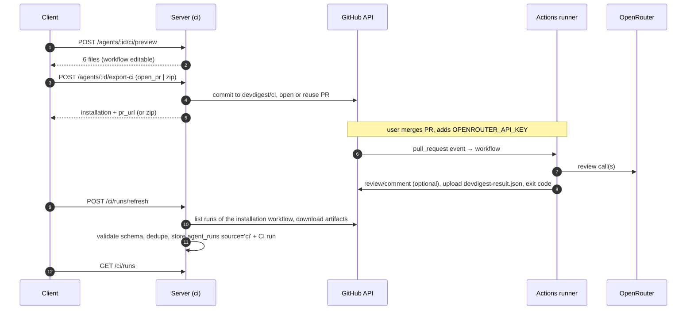

# Spec: Export to CI — run a DevDigest agent on pull requests in GitHub Actions
Spec ID: SPEC-2026-11-18-export-to-ci
Status: draft
Supersedes: —

> **Scope note (2026-11-18):** this is a deliberately **minimal MVP**, per the user's
> instruction: *"a very simple implementation; we'll iterate once we see what users need"*.
> Everything beyond the core loop (export → run in CI → see results) is listed under
> **Deferred / iterate later** and has no acceptance criteria. IDs are stable. Removed
> requirements are marked *Removed* in place, and their numbers are never reused.

## Problem and user

**Who:** a developer or team lead who has tuned a reviewer **Agent** in DevDigest (for example
"Security Reviewer") and wants it to review **every** PR in a repository automatically, not only
the PRs someone imports and runs by hand in the local studio.

**Why it matters:** today a review run only happens in the studio. Getting the agent into CI
means copying the prompt and skills by hand, and the existing `ci_fail_on` gate affects nothing.
The CI schema and contracts already exist but nothing uses them.

**What the MVP adds:**
1. A **CI** tab on the agent page: installations, workflow version, recent runs, `Fail CI on`.
2. An **Export to CI wizard** (Target → Preview → Configure → Install). It generates the bundle
   and either opens a PR from branch `devdigest/ci` or offers a zip download.
3. A bundled **agent-runner** committed into the repo and run by a GitHub Actions workflow on
   `pull_request`.
4. A **CI Runs** page. A manual Refresh pulls result artifacts from GitHub and records them as
   runs with `source='ci'`.

**Terms** (on top of `specs/README.md`):
- **Installation** — one (agent, repo) deployment to GitHub Actions created by the wizard.
- **Bundle** — the 6 generated files (AC-21).
- **Runner** — the single bundled JS program wrapping `reviewer-core`.
- **Result artifact** — `devdigest-result.json`, uploaded by the runner as a workflow artifact.
- **CI run** — one ingested result artifact. It is stored as a **Review run** with `source='ci'`.
- **Agent slug** — kebab-case agent name, e.g. `security-reviewer`.

**Already in code (verified 2026-11-18):**
- Tables `ci_installations` and `ci_runs`: `server/src/db/schema/ci.ts`.
- `agent_runs.source` (`local`/`ci`), `blockers`, `cost_usd`: `server/src/db/schema/runs.ts:8-33`.
- `agents.ci_fail_on`, editable on the Config tab.
- Contracts `AgentManifest`, `CiExportInput`, `CiExport`, `CiRun`, `CiRunStatus`,
  `CiResultArtifact`: `server/src/vendor/shared/contracts/eval-ci.ts:132-260`.
- `GitHubClient.commitFiles` / `findOpenPr` / `openPullRequest` / `postReview`:
  `server/src/vendor/shared/adapters.ts:121-166`.
- Engine `reviewPullRequest` / `toReviewPayload` / `gateTriggered` / `OpenRouterProvider`:
  `reviewer-core/src/index.ts`.
- BYO key `OPENROUTER_API_KEY`: `server/src/modules/settings/constants.ts:11`.
- Sidebar key `ci-runs` and i18n namespace `ci`: `client/messages/en/ci.json`.
- No API auth: `LocalNoAuthProvider`, local studio.

## Goals / Non-goals

### Goals
- **G1** — From the agent page, install the agent into a connected repo's GitHub Actions in 4
  wizard steps. The files land via a PR from `devdigest/ci` and never directly on the default
  branch.
- **G2** — On the selected `pull_request` events, the workflow reviews the PR with the exported
  agent, publishes the result as chosen, and exits non-zero when the gate trips.
- **G3** — After a Refresh, completed CI runs are visible on CI Runs with repo, PR, agent,
  verdict, findings, cost, duration and a job link.

### Non-goals
- CircleCI, Jenkins and Generic CLI. Only GitHub Actions; the other cards are not shown.
- A published `devdigest/review-action@v1`, a push/ingest endpoint, webhooks or a GitHub App.
- CI findings in the PR findings timeline or the PR list ("PR-стрічка"); the multi-agent run
  service. Both stay untouched (worktree B boundary).
- Writing GitHub secrets, and uninstalling from the UI.
- The Stats tab, Memory page and Agent Performance page shown in the mock sidebar.

### Deferred / iterate later
- Checking whether a secret is set via the GitHub API (`secrets:read`). The MVP shows a static checklist.
- "Update CI config" bulk re-export dialog. The MVP re-runs the wizard, which adds a commit to `devdigest/ci`.
- Installation states `pending_merge` / `outdated` / `workflow_missing`, drift detection and version comparison.
- Auto-refresh, pagination and filters on CI Runs.
- Secret scanning of exported files; a "files become public" notice.
- YAML validation of the edited workflow; marking files as "new" / "will be updated".
- Mapping `openai`/`anthropic` models to OpenRouter slugs. The MVP blocks agents not on `openrouter`.
- Limits on `memory.jsonl` size and entry count.
- `concurrency` / cancel handling, separate handling of re-runs, tamper/forgery detection beyond the schema check, agent-slug collisions.
- Upserting a single PR comment. The MVP posts a new comment per run.
- Job summary output, `publish_error` reporting, map-reduce `skipped_files` reporting.
- `running` status for in-progress workflow runs; `no_artifact` records for runs without an artifact.
- Linking CI runs to imported PRs (`pr_id`). The MVP stores repo + PR number only.
- Runner/ingest performance limits, rate-limit back-off, structured observability.
- Removed-repo / deleted-agent / disabled-agent special handling.

### Decisions (user, 2026-11-18)
- **D1 — Ingest = pull through GitHub (the simpler option).** The runner uploads
  `devdigest-result.json` as an artifact, and DevDigest downloads it with the user's PAT on
  Refresh. The source requirement *"accept the result only through an authenticated endpoint or
  another verified channel"* is met by a **verified channel**: the authenticated GitHub API.
  DevDigest reads only runs of the installation's own workflow file in the installation's repo,
  and accepts an artifact only if it passes schema validation. No new endpoint, no extra repo
  secret.
- **D2 — Runner = the `agent-runner/` package's ncc bundle**, committed as files under
  `.devdigest/runner/` (entry `index.js`, plus any chunks ncc emits — all of `agent-runner/dist/`).
  Read-only in the wizard, which lists it as one `index.js` entry shown by version (a content hash of
  the bundle). *Revised 2026-11-18: replaces the earlier single `agent-runner.cjs` built by esbuild
  from `server/src/ci-runner/`; the course's `agent-runner/` is the one runner.*
- **D3 — One workflow per agent:** `.github/workflows/devdigest-review-<agent-slug>.yml`.
- **D4 — GitHub Actions only.**
- **D5 — Secret `OPENROUTER_API_KEY` everywhere.** The mock's `OPENAI_API_KEY` /
  `devdigest/review-action@v1` are not used.
- **D6 — Fork PRs:** the generated workflow's job carries
  `if: github.event.pull_request.head.repo.full_name == github.repository`, so it is never scheduled
  for a fork (no secrets are available there). No runner runs and no artifact is produced.
  *Revised 2026-11-18: previously the runner exited 0 with status `skipped`.*
- **D7 — Only agents whose provider is `openrouter`** can be exported. Others are blocked with a
  message.
- **D8 — `memory.jsonl`:** workspace memory with scope `global` plus scope `repo` for the target
  repo, one JSON object per line. The file is empty when there are no entries.
- **D9 — A zip install also records the installation** (without a PR link).
- **D10 — Missing key on a same-repo PR or an LLM failure** → status `failed`, non-zero exit,
  except when `ci_fail_on = never`.
- **D11 — `Fail CI on`** is the existing agent field. It is baked into the manifest at export
  time, so a change reaches CI only after re-exporting.
- **D12 — Workflow version** = the runner version string written into the bundle, shown as is.

## User stories

- **US-1** — As an agent owner, I want a **CI tab** listing the repos where the agent runs in CI,
  with the last run and the workflow version, so that I know where it is deployed.
- **US-2** — As an agent owner, I want to **export the agent to GitHub Actions through a 4-step
  wizard**, so that I don't copy prompts and skills by hand.
- **US-3** — As an agent owner, I want to **preview the generated files and edit the workflow**
  before anything is written, so that I control what lands in the repo.
- **US-4** — As an agent owner, I want to **choose PR events and how results are published**, and
  see which secrets to add, so that CI behaves the way my team works.
- **US-5** — As an agent owner, I want DevDigest to **open a PR from `devdigest/ci`** or
  **give me a zip**, so that the change goes through normal review and never lands directly on
  the default branch.
- **US-6** — As a PR author or reviewer, I want the agent to **review my PR in CI**, publish
  findings, and **fail the check when the gate trips**, so that merges can be blocked with a
  required status check.
- **US-7** — As a DevDigest user, I want a **CI Runs page** with repo, PR, agent, verdict,
  findings, cost, duration and a job link, so that I can watch the agent in production.
- **US-8** — As an agent owner, I want to **see and change `Fail CI on` from the CI tab**, so
  that I control when CI blocks.
- **US-9** — As a DevDigest user, I want CI results accepted **only through a verified channel**,
  so that arbitrary data can't be injected as a CI run.

## Acceptance criteria (EARS)

### CI tab (US-1, US-8)

- **AC-1** (US-1) — Система повинна (shall) показувати на сторінці агента вкладку **CI** після
  вкладок Config / Skills / Context / Evals.
  → verify: unit (RTL) — the CI tab renders after Evals; selecting it shows "CI deployment".
- **AC-2** (US-1) — Система повинна (shall) показувати у вкладці CI заголовок "CI deployment",
  бейдж "Active in N repos" (N — кількість інсталяцій агента) і кнопки "Update CI config" та
  "Add to CI".
  → verify: unit — 2 installations → "Active in 2 repos"; both buttons present.
- **AC-3** (US-1) — ДЕ в агента немає жодної інсталяції, система повинна (shall) показувати
  порожній стан із кнопкою "Add to CI" замість списку.
  → verify: unit — empty list → empty-state text + "Add to CI"; no rows.
- **AC-4** (US-1) — Система повинна (shall) показувати для кожної інсталяції рядок із
  репозиторієм `owner/name`, міткою "GitHub Actions", статусом і відносним часом останнього CI
  run та версією workflow, а під списком — кнопку "+ Add repository".
  → verify: unit — row fixture renders all fields; "+ Add repository" present.
- **AC-5, AC-6** — *Removed 2026-11-18: installation states deferred (MVP).*
- **AC-7** (US-1) — КОЛИ користувач розгортає рядок інсталяції, система повинна (shall) показати
  до 10 останніх CI runs цієї інсталяції (час, PR, verdict, кількість знахідок, статус).
  → verify: unit — expanded row lists ≤ 10 runs, newest first.
- **AC-8** (US-8) — Система повинна (shall) показувати у вкладці CI поточне значення `Fail CI on`
  (never / critical / warning / any) і зберігати змінене значення в агента так само, як вкладка
  Config.
  → verify: integration — change via CI tab → GET agent returns new `ci_fail_on`; Config tab shows it.
- **AC-9, AC-10, AC-11** — *Removed 2026-11-18: merged into AC-8 / drift deferred / generic error
  handling (MVP).*

### Wizard — Target step (US-2)

- **AC-12** (US-2) — КОЛИ користувач натискає "Add to CI", "Update CI config" або
  "+ Add repository", система повинна (shall) відкрити модальне вікно "Export to CI" з
  підзаголовком "Run <agent name> automatically on pull requests" і степпером Target → Preview →
  Configure → Install на кроці Target.
  → verify: unit — each button opens the dialog at step 1 of 4.
- **AC-13** (US-2) — Система повинна (shall) показувати на кроці Target лише одну картку "GitHub
  Actions" (мітка "recommended", опис "Runs on pull_request events"), вибрану за замовчуванням.
  → verify: unit — exactly one target card; no CircleCI/Jenkins/CLI text.
- **AC-14** (US-2) — Система повинна (shall) показувати на кроці Target вибір цільового
  репозиторію зі списку підключених до DevDigest репозиторіїв, з активним репозиторієм за
  замовчуванням.
  → verify: unit — select lists connected repos; default = active repo.
- **AC-15, AC-16, AC-17** — *Removed 2026-11-18: MVP simplification (re-export behaviour is AC-48).*
- **AC-18** (US-2) — ЯКЩО провайдер агента не `openrouter`, ТОДІ система повинна (shall)
  заблокувати Continue і показати повідомлення, що в CI підтримуються лише агенти з провайдером
  OpenRouter.
  → verify: unit — `provider: 'openai'` → Continue disabled + message.
- **AC-19, AC-20** — *Removed 2026-11-18: MVP simplification.*

### Preview step (US-3)

- **AC-21** (US-3) — КОЛИ користувач переходить на крок Preview, система повинна (shall)
  показати в "FILES TO CREATE" файли `.devdigest/agents/<agent-slug>.yaml`, по одному
  `.devdigest/skills/<skill-slug>.md` на кожен увімкнений skill агента,
  `.devdigest/memory.jsonl` (вміст за D8), файли runner'а `.devdigest/runner/*` (D2) і
  `.github/workflows/devdigest-review-<agent-slug>.yml`.
  → verify: integration — preview for an agent with 2 skills returns those 6 paths.
- **AC-22** (US-3) — Система повинна (shall) генерувати manifest агента у форматі `AgentManifest`
  з поточними name, model, system prompt, slugs skills, strategy і `ci_fail_on` агента.
  → verify: unit — generated YAML parses with `AgentManifest` and matches the agent.
- **AC-23, AC-24** — *Removed 2026-11-18: folded into D8 / AC-25.*
- **AC-25** (US-3) — КОЛИ користувач вибирає файл у списку, система повинна (shall) показати
  праворуч його шлях і вміст; лише workflow-файл позначений "editable" і редагується, решта —
  лише для читання (для runner'а замість вмісту — його версія).
  → verify: unit — workflow pane editable with badge; skill pane read-only; runner pane shows version.
- **AC-26** — *Removed 2026-11-18: folded into AC-25.*
- **AC-27** (US-3, US-4) — Система повинна (shall) генерувати workflow з тригером `pull_request`
  для вибраних типів подій, `permissions` `contents: read` (плюс `pull-requests: write`, якщо
  спосіб публікації не "None"), кроком checkout, кроком `node .devdigest/runner/index.js`
  (маніфест саме цього агента копіюється в тимчасовий `DEVDIGEST_DIR`, бо runner вимагає рівно один
  маніфест) з `OPENROUTER_API_KEY` із secrets і `GITHUB_TOKEN`, і кроком завантаження result artifact, що
  виконується навіть після ненульового коду виходу runner'а.
  → verify: unit — parse YAML; assert types, permissions per post-as, runner command, secret name, `if: always()` upload.
- **AC-28** (US-3) — Система повинна (shall) ніколи не використовувати в згенерованому workflow
  `pull_request_target` і `devdigest/review-action@v1`.
  → verify: unit — generated YAML contains neither string.
- **AC-29 … AC-34** — *Removed 2026-11-18: permissions folded into AC-27; YAML validation,
  new/updated marks, secret scan, publicity notice, preview-error UI deferred (MVP).*

### Configure step (US-4, US-6)

- **AC-35** (US-4) — Система повинна (shall) показувати в секції Trigger чипи
  `pull_request:opened` і `pull_request:synchronize` (вибрані за замовчуванням) та
  `pull_request:reopened` (не вибраний).
  → verify: unit — initial chip state matches.
- **AC-36** — *Removed 2026-11-18: MVP simplification.*
- **AC-37** (US-4) — КОЛИ користувач змінює тригери або спосіб публікації, система повинна
  (shall) перегенерувати workflow-файл із цими значеннями; ручні правки workflow при цьому
  замінюються.
  → verify: unit — toggle reopened → workflow text includes `reopened`.
- **AC-38** — *Removed 2026-11-18: MVP simplification.*
- **AC-39** (US-4) — Система повинна (shall) показувати статичний чекліст "Secrets expected":
  `OPENROUTER_API_KEY` ("Your OpenRouter key — same BYO key from L06") і `GITHUB_TOKEN`
  ("Auto-provided by Actions") з підказкою "Add these to your repo's Actions secrets before the
  workflow runs.", без перевірки їхньої наявності.
  → verify: unit — both rows + hint render; no GitHub request is made.
- **AC-40** — *Removed 2026-11-18: secret status check deferred.*
- **AC-41** (US-4) — Система повинна (shall) показувати в "Post results as" варіанти "GitHub
  review" (за замовчуванням, "recommended"), "PR comment" і "None (exit code only)".
  → verify: unit — radio group with GitHub review checked.
- **AC-42** (US-6) — Система повинна (shall) показувати на Configure інфо-блок "To block merges:
  set Fail CI on (CI tab) so the run exits non-zero, then add a required status check in the
  repo's GitHub branch protection. No GitHub App needed."
  → verify: unit — info text present.
- **AC-43** — *Removed 2026-11-18: MVP simplification.*

### Install step (US-5)

- **AC-44** (US-5) — Система повинна (shall) показувати на кроці Install опції "Open a PR with
  these files" (за замовчуванням, "recommended", з назвою репозиторію, заголовком "Add DevDigest
  CI review" і кількістю файлів) та "Copy files as a zip", а також посилання "GitHub Action setup
  docs".
  → verify: unit — both options; PR text includes repo and file count.
- **AC-45** (US-5) — КОЛИ користувач натискає Install з опцією PR, система повинна (shall)
  закомітити всі файли bundle (з ручними правками workflow) одним комітом лише в гілку
  `devdigest/ci`, створивши її від default branch репозиторію, якщо її немає, і ніколи не
  записувати в default branch.
  → verify: integration — mock GitHub gets one commit on `devdigest/ci` (base = default branch); no write to the default branch.
- **AC-46** — *Removed 2026-11-18: folded into AC-45.*
- **AC-47** (US-5) — КОЛИ коміт успішний і відкритого PR з `devdigest/ci` немає, система
  повинна (shall) відкрити PR у default branch із заголовком "Add DevDigest CI review".
  → verify: integration — `openPullRequest` called with that title, head `devdigest/ci`.
- **AC-48** (US-5) — ЯКЩО відкритий PR з `devdigest/ci` вже існує (наприклад, повторний експорт
  або інший агент у тому ж репозиторії), ТОДІ система повинна (shall) лише додати коміт у гілку й
  повернути посилання на наявний PR.
  → verify: integration — `findOpenPr` returns URL → no `openPullRequest`; response `pr_url` = that URL.
- **AC-49** (US-5) — КОЛИ Install з опцією PR успішний, система повинна (shall) створити (або
  оновити, якщо пара агент+репозиторій уже є) інсталяцію з версією workflow і показати екран
  успіху з посиланням на PR і нагадуванням додати `OPENROUTER_API_KEY`.
  → verify: e2e flow — install → success screen with PR link; CI tab shows the repo row.
- **AC-50** (US-5) — КОЛИ користувач натискає Install з опцією zip, система повинна (shall)
  завантажити zip з усіма файлами bundle за їхніми шляхами в репозиторії, не виконувати записів
  у GitHub і створити (або оновити) інсталяцію без посилання на PR.
  → verify: integration — zip has 6 repo-relative entries; no GitHub writes; installation row exists.
- **AC-51, AC-52** — *Removed 2026-11-18: folded into AC-50 / AC-53.*
- **AC-53** (US-5) — ЯКЩО Install з опцією PR не вдався (недостатні права токена, мережа,
  GitHub недоступний), ТОДІ система повинна (shall) показати причину з GitHub, запропонувати
  варіант zip і не створювати інсталяцію.
  → verify: integration — mock 403 on commit → error shown; no installation row.
- **AC-54 … AC-58** — *Removed 2026-11-18: "Update CI config" dialog deferred; the button reopens the wizard (AC-12).*

### Runner in CI (US-6)

- **AC-59** (US-6) — КОЛИ workflow запускається на події `pull_request`, runner повинен (shall)
  прочитати manifest, skills і memory з `.devdigest/`, обчислити diff між base і head PR і
  виконати review рушієм `reviewer-core` (як у студії, з його grounding gate).
  → verify: unit — runner with fixture repo + mock LLM returns a Review via the engine.
- **AC-60** — *Removed 2026-11-18: covered by AC-59.*
- **AC-61** (US-6) — ДЕ спосіб публікації = "GitHub review", runner повинен (shall) опублікувати
  одне GitHub review з inline-коментарями знахідок і подією `REQUEST_CHANGES`, коли gate
  спрацював, інакше `COMMENT`.
  → verify: unit — gate tripped → `postReview` event `REQUEST_CHANGES` with comments.
- **AC-62** (US-6) — ДЕ спосіб публікації = "PR comment", runner повинен (shall) додати в PR
  один коментар із підсумком знахідок.
  → verify: unit — one comment created per run.
- **AC-63** (US-6) — ДЕ спосіб публікації = "None (exit code only)", runner повинен (shall) не
  робити записів у PR.
  → verify: unit — no GitHub write calls.
- **AC-64** (US-6) — КОЛИ є знахідки з severity ≥ `ci_fail_on` з manifest, runner повинен
  (shall) завершитися з ненульовим кодом виходу; інакше — з кодом 0.
  → verify: unit — critical + `critical` → exit 1; warnings only + `critical` → 0; `never` → 0.
- **AC-65** — *Removed 2026-11-18: job summary deferred.*
- **AC-66** (US-6, US-9) — Runner повинен (shall) після кожного запуску, включно з невдалим і
  пропущеним, записати `devdigest-result.json` за контрактом `CiResultArtifact` зі статусом
  `succeeded`, `no_findings`, `failed` або `skipped`.
  → verify: unit — success / no findings / LLM failure / fork each yield a schema-valid artifact.
- **AC-67** (US-6) — ЯКЩО PR створено з форку, ТОДІ згенерований workflow не повинен (shall)
  запускати job (умова `if` на рівні job, D6): нічого не публікується, артефакту немає.
  → verify: unit — workflow містить `if: github.event.pull_request.head.repo.full_name == github.repository`.
  *Ревізія 2026-11-18: раніше runner завершувався з кодом 0 і статусом `skipped`.*
- **AC-68** — *Removed 2026-11-18: folded into AC-69.*
- **AC-69** (US-6) — ЯКЩО ключ відсутній для PR з того самого репозиторію або виклик моделі не
  вдався, ТОДІ runner повинен (shall) записати статус `failed` з причиною і завершитися з
  ненульовим кодом, крім `ci_fail_on = never` (тоді код 0).
  → verify: unit — mock LLM throws → `failed` + reason; exit 1 (critical) / 0 (never).
- **AC-70 … AC-72** — *Removed 2026-11-18: publish-error, no-findings special case (in AC-66), large-diff reporting deferred.*

### Ingest (US-7, US-9)

- **AC-73** (US-7, US-9) — КОЛИ користувач натискає Refresh на сторінці CI Runs або у вкладці CI,
  система повинна (shall) для кожної інсталяції отримати через GitHub API завершені запуски
  лише її workflow-файлу `devdigest-review-<agent-slug>.yml` у її репозиторії та завантажити
  result artifact кожного нового запуску.
  → verify: integration — mock 2 completed runs of that workflow + 1 of another → 2 CI runs stored.
- **AC-74, AC-75** — *Removed 2026-11-18: auto-refresh deferred; workflow-scoping folded into AC-73.*
- **AC-76** (US-9) — ЯКЩО result artifact відсутній або не проходить валідацію схемою, ТОДІ
  система повинна (shall) пропустити цей запуск, не записуючи CI run.
  → verify: integration — malformed artifact → no row.
- **AC-77** (US-7) — КОЛИ artifact прийнято, система повинна (shall) записати review run з
  `source='ci'` (агент, модель, тривалість, вартість, кількість знахідок, blockers, статус) і CI
  run (репозиторій, номер PR, verdict, кількості за severity, посилання на job, час).
  → verify: integration — accepted artifact → `agent_runs.source='ci'` row + CI run row.
- **AC-78** — *Removed 2026-11-18: PR linking deferred.*
- **AC-79** (US-7) — Система повинна (shall) не показувати CI runs в історії запусків PR і в списку
  PR; ці подання рахують лише `source='local'`.
  → verify: integration — after ingest, PR run history and PR list are unchanged.
- **AC-80** (US-7) — Система повинна (shall) записувати кожну трійку (інсталяція, workflow run id,
  attempt) не більше одного разу.
  → verify: integration — refresh twice → row count unchanged.
- **AC-81 … AC-84** — *Removed 2026-11-18: running / no-artifact / cancelled / state transitions deferred.*
- **AC-85** (US-7) — ЯКЩО GitHub повертає помилку для якоїсь інсталяції, ТОДІ система повинна
  (shall) зберегти наявні CI runs, показати повідомлення з причиною і продовжити з іншими
  інсталяціями.
  → verify: integration — 403 for repo A, 200 for repo B → B ingested; A's error returned.

### CI Runs page (US-7)

- **AC-86** (US-7) — Система повинна (shall) відкривати сторінку **CI Runs** (`/ci-runs`) з пункту
  сайдбару GLOBAL → "CI Runs" з кнопкою Refresh.
  → verify: e2e flow — click "CI Runs" → heading and Refresh visible.
- **AC-87** (US-7) — Система повинна (shall) показувати останні 50 CI runs від найновішого з
  колонками: репозиторій, PR (номер з посиланням на GitHub), агент, verdict, знахідки, вартість
  ("—", якщо невідома), тривалість, статус, посилання на job.
  → verify: unit — fixture row renders all columns; null cost → "—"; job link = `github_url`.
- **AC-88, AC-89** — *Removed 2026-11-18: filters deferred; cost "—" folded into AC-87.*
- **AC-90** (US-7) — ДЕ CI runs немає, система повинна (shall) показувати порожній стан "No CI
  runs yet".
  → verify: unit — empty list → empty-state copy.
- **AC-91 … AC-93** — *Removed 2026-11-18: pagination deferred; error/status details simplified.*

### Workflow version (US-1)

- **AC-94** (US-1) — Система повинна (shall) зберігати в інсталяції версію runner'а з bundle на
  момент останнього експорту і показувати її як "workflow v<version>" у рядку інсталяції.
  → verify: unit — row shows `workflow v1.0.0`.
- **AC-95, AC-96** — *Removed 2026-11-18: drift detection deferred.*

## Edge cases

- **EC-1** — **The mock's key name** is `OPENAI_API_KEY` on Preview but `OPENROUTER_API_KEY` on
  Configure → the workflow uses `OPENROUTER_API_KEY` (D5, AC-27, AC-39).
- **EC-2** — **Agent provider is not `openrouter`** → Continue is blocked (AC-18).
- **EC-3** — **Agent has zero skills** → no skill files; the file count on Install reflects that
  (AC-21, AC-44).
- **EC-4 … EC-6** — *Removed 2026-11-18 (deferred).*
- **EC-7** — **Branch `devdigest/ci` exists**: with an open PR → AC-48. Without one (merged or
  closed) → a commit on the branch and a new PR (AC-45, AC-47).
- **EC-8** — **Several agents exported to one repo** → each gets its own workflow (D3). All the
  files go to the same `devdigest/ci` branch and PR (AC-48).
- **EC-9** — *Removed 2026-11-18 (deferred).*
- **EC-10** — **Token can't write workflow files** (missing `workflow` scope) → AC-53 shows the
  GitHub error and offers the zip.
- **EC-11, EC-12** — *Removed 2026-11-18 (deferred).*
- **EC-13** — **PR from a fork** → the job is not scheduled (D6, AC-67); no run is recorded.
- **EC-14 … EC-18** — *Removed 2026-11-18 (deferred).*
- **EC-19** — **PR not imported into DevDigest** → the CI run stores repo + PR number and links to
  GitHub (AC-77, AC-87).
- **EC-20 … EC-24** — *Removed 2026-11-18 (deferred).*
- **EC-25** — **No GitHub token in DevDigest** → the PR install fails per AC-53 (the zip still
  works); Refresh reports the error per AC-85.
- **EC-26 … EC-28** — *Removed 2026-11-18 (deferred).*

## Cross-module interactions

Modules: **client** (CI tab, wizard, CI Runs), **server** (`ci` module: preview, install, ingest,
list), **reviewer-core** (bundled into the runner, contract unchanged), **runner** (in GitHub
Actions), **GitHub**, **OpenRouter**. `mcp-server` is not involved.

The client never calls GitHub. The server writes only to `devdigest/ci`. The runner never
contacts DevDigest, and results come back only through the pull in step 10 (D1). The PR timeline,
the PR list and the multi-agent service ignore CI runs (AC-79).

## Contracts

"new" = to add; "changed" = exists in `@devdigest/shared`, must change; "existing" = verified,
used unchanged.

- **`GET /agents/:id/ci` — new.** Response: `ci_fail_on`, `installations[]` = existing
  `CiInstallation` + `runner_version: string`, `pr_url: string | null`, `recent_runs: CiRun[]`
  (≤ 10). `404` for an unknown agent.
- **`POST /agents/:id/ci/preview` — new**, no side effects. Request: `repo` (`owner/name`, a
  connected repo), `triggers` (subset of `opened`/`synchronize`/`reopened`), `post_as`
  (`github_review`/`pr_comment`/`none`). Response: `files: CiFile[]` (existing; the runner entry
  carries a version instead of contents). `422` when the agent's provider is not `openrouter`.
- **`POST /agents/:id/export-ci` — changed** (`CiExportInput` / `CiExport` exist, no route yet).
  `action`: `open_pr | zip` (replaces `files`); **add** `workflow_override?: string`; `target`
  fixed to `gha`; **drop** `base` (the repo's default branch is used). Response for `open_pr` =
  `CiExport` (`installation`, `files`, `pr_url`); for `zip` = an `application/zip` attachment.
  Errors: `400` validation, `422` non-openrouter agent, `502` GitHub error with GitHub's message.
- **`GET /ci/runs` — new.** Response: `items: CiRun[]`, the latest 50, newest first.
- **`POST /ci/runs/refresh` — new.** Response: `{ ingested: int, errors: { repo, reason }[] }`.
- **`CiRun` — changed.** Add `repo`, `agent_id`, `verdict` (`Verdict | null`), `critical`,
  `warning`, `suggestion`, `duration_s` (already present), `run_attempt`.
- **`CiRunStatus` — changed.** Add `skipped`.
- **`CiResultArtifact` (`devdigest-result.json`) — changed.** Keep the existing fields; add
  `schema_version: 1`, `status`, `reason: string | null`, `verdict`, `blockers`, `model`,
  `runner_version`. `pr_number` becomes required.
- **`AgentManifest` — existing**, used unchanged (`eval-ci.ts`).
- **Generated workflow — new.** Path, trigger, permissions and steps per AC-27.
- **Existing, unchanged:** `PATCH /agents/:id` with `ci_fail_on`
  (`server/src/modules/agents/routes.ts:54`); `GitHubClient.commitFiles` / `findOpenPr` /
  `openPullRequest` / `postReview`; engine `reviewPullRequest` / `toReviewPayload` /
  `gateTriggered` / `OpenRouterProvider`. Listing workflow runs and downloading artifacts are new
  GitHub capabilities; how they are added is for the planner.

## Non-functional requirements

- **NFR-1 … NFR-4** — *Removed 2026-11-18: performance and limit thresholds deferred.*
- **NFR-5 — Degradation.** GitHub errors fail only the affected action and show the reason
  (AC-53, AC-85). An LLM failure in CI produces `failed`, not a crash (AC-69). A CI run's review
  run and CI run record are written together or not at all.
  → verify: integration — DB write failure during ingest → neither row exists; the next refresh retries.
- **NFR-6 — Cost.** The wizard, export and ingest make **zero** LLM calls. A CI run makes the
  same LLM calls as a local run of the same agent. Cost comes from OpenRouter `usage.cost`.
  → verify: unit — mock LLM call count = 0 on the preview/export/refresh paths.
- **NFR-7** — *Removed 2026-11-18: no extra accessibility work beyond the existing modal and
  primitives (deferred).*
- **NFR-8 — i18n.** All new UI strings come from `next-intl` (namespace `ci`). Generated files and
  the PR title are English. The stub `exportWizard.blockMergeDesc` ("Requires a GitHub App") is
  not used.
  → verify: unit — keys exist in `messages/en/ci.json`; no hard-coded UI strings.
- **NFR-9** — *Removed 2026-11-18: observability beyond existing logging deferred.*
- **NFR-10 — Security.** Least-privilege workflow permissions and no `pull_request_target`
  (AC-27, AC-28). Results are accepted only per D1 (AC-73, AC-76). The PAT, `GITHUB_TOKEN` and
  `OPENROUTER_API_KEY` never appear in generated files, artifacts, API responses or logs. The
  runner is pinned in the repo, never downloaded at run time.
  → verify: unit — generated files and the artifact contain no token-shaped strings.
- **NFR-11 — Compatibility.** Local runs keep `source='local'`, and every existing screen shows
  the same numbers after ingest (AC-79). The Config tab's `Fail CI on` keeps working.
  Contract changes are additive except `CiExportInput.action` / `base`, which have no callers.
  → verify: integration — local run + CI ingest → PR endpoints return only the local run.
- **NFR-12** — *Removed 2026-11-18: runner portability limits deferred.*

## Traceability

| US | AC / NFR | Edge cases | Contract | Verification |
|---|---|---|---|---|
| US-1 | AC-1, AC-2, AC-3, AC-4, AC-7, AC-94 | — | `GET /agents/:id/ci` (new) | unit |
| US-2 | AC-12, AC-13, AC-14, AC-18 | EC-2 | `POST …/ci/preview` (new) | unit |
| US-3 | AC-21, AC-22, AC-25, AC-27, AC-28 | EC-1, EC-3 | `POST …/ci/preview` (new), `AgentManifest` (existing), workflow (new) | unit + integration |
| US-4 | AC-27, AC-35, AC-37, AC-39, AC-41 | EC-1 | workflow (new) | unit |
| US-5 | AC-44, AC-45, AC-47, AC-48, AC-49, AC-50, AC-53 | EC-7, EC-8, EC-10, EC-25 | `POST /agents/:id/export-ci` (changed) | integration + e2e flow |
| US-6 | AC-42, AC-59, AC-61, AC-62, AC-63, AC-64, AC-66, AC-67, AC-69 | EC-13 | `CiResultArtifact` (changed) | unit |
| US-7 | AC-73, AC-77, AC-79, AC-80, AC-85, AC-86, AC-87, AC-90 | EC-19, EC-25 | `POST /ci/runs/refresh`, `GET /ci/runs` (new), `CiRun`/`CiRunStatus` (changed) | integration + unit + e2e flow |
| US-8 | AC-8 | — | `PATCH /agents/:id` (existing) | integration |
| US-9 | AC-66, AC-73, AC-76 | — | `CiResultArtifact` (changed) | integration |
| — | NFR-5, NFR-6, NFR-8, NFR-10, NFR-11 | — | all | unit + integration |

## Inputs and provenance

| Source | Requirements |
|---|---|
| Screenshot — CI tab | AC-1, AC-2, AC-4, AC-12, AC-86 (sidebar) |
| Screenshot — Target | AC-13 (only GHA kept per user text + D4) |
| Screenshot — Preview | AC-21, AC-25, AC-27; EC-1 (`OPENAI_API_KEY` and `review-action@v1` overridden by D5/D2) |
| Screenshot — Configure | AC-35, AC-39, AC-41, AC-42 |
| Screenshot — Install | AC-44, AC-47, AC-50 |
| User text spec | wizard steps, `devdigest/ci` + PR (AC-45…AC-48), zip, bundled runner, CI Runs columns (AC-87), CI tab content (AC-4, AC-7, AC-8, AC-94), worktree-B scope (Non-goals, AC-79), `source='ci'` via a verified channel (D1, AC-73, AC-77) |
| User decisions 2026-11-18 | D1–D4 (answers), D5–D12 (accepted defaults), the MVP cut and the Deferred list |
| Code (see *Already in code*) | contracts, `ci_fail_on` values, `commitFiles`/`findOpenPr`, engine gate, key name |
| **Inferences (mine, accepted by the user)** | repo selector (AC-14), static secrets checklist (AC-39), success screen (AC-49), idempotency key (AC-80), fork → `skipped` (AC-67), permissions (AC-27) |

## Untrusted inputs

| Input | Handling |
|---|---|
| Result artifact | Read only from runs of the installation's own workflow in its repo (AC-73); strict schema validation, invalid ones skipped (AC-76); strings rendered as text. Residual risk: a same-repo PR can modify the runner on its branch. Accepted for the MVP |
| GitHub API data (PR numbers, URLs) | Rendered as text; links built from the installation's `owner/name` |
| Edited workflow text | Committed as-is only to `devdigest/ci` via the GitHub API; never executed by the server |
| `repo` in wizard requests | Must be a connected repo of the workspace |
| PR diff / content in CI | Engine prompt-injection hardening + grounding (AC-59); no `pull_request_target` (AC-28) |
| LLM output in CI | Structured schema; the gate is computed deterministically from severities (AC-64) |
| Secrets | Never written into files, artifacts, responses or logs (NFR-10) |

## Open questions

None blocking. All earlier questions were resolved on 2026-11-18 with the user's defaults (see
*Decisions* D6–D12) or moved to *Deferred / iterate later*.
