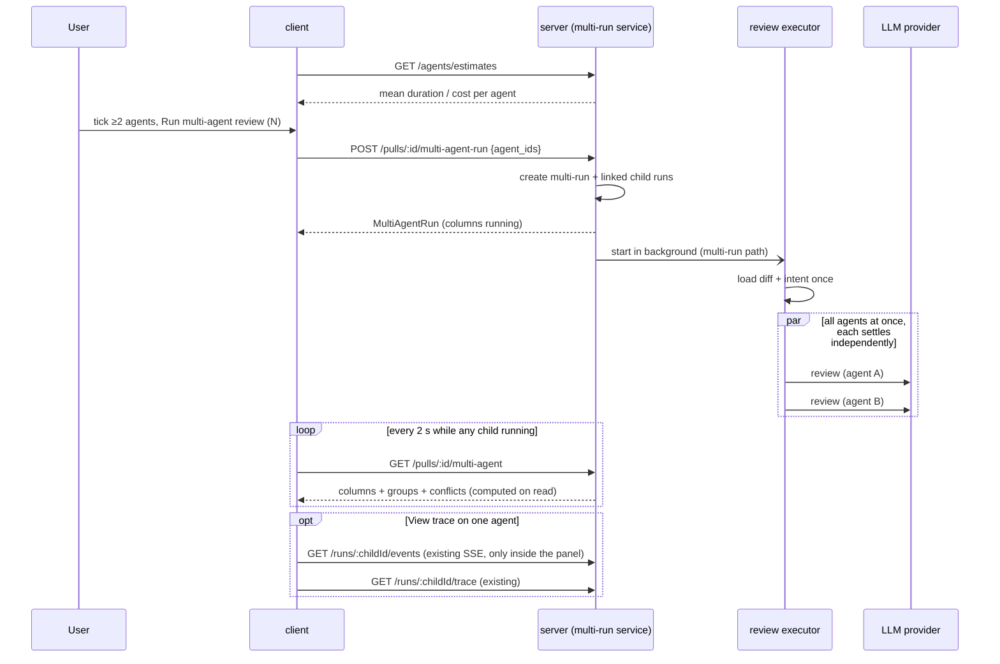
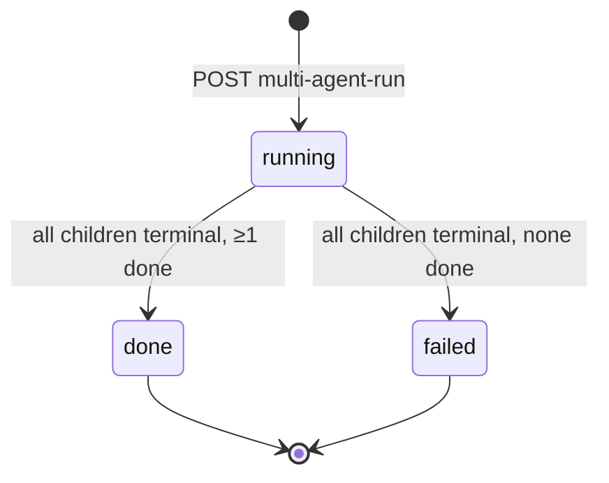
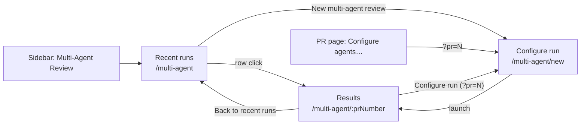

# Spec: Multi-Agent Review
Spec ID: SPEC-2026-11-18-multi-agent-review
Status: draft
Supersedes: — (replaces the PR page's "Run all / one agent" `RunReviewDropdown` UI; the
`POST /pulls/:id/review` route itself stays unchanged)

> **Revision 2026-11-18 — minimal scope.** At the user's request this spec was rewritten in
> place to the **simplest implementation that still meets the original requirements**, with
> maximum reuse.
> - **Dropped:** LLM "did not flag" notes, the multi-run history list, the "stale" badge, the
>   "All agents" tab, remembered selection, per-agent cancel, partial / "no verdict" handling,
>   the trace-reload fix, making `/review {all:true}` parallel, and lexical grouping.
> - **IDs are stable:** removed requirements stay as `Removed` markers so nothing silently
>   points at a different requirement.
>
> **Revision 2026-11-18 (2) — way back to results.** The user reported that once they leave the
> results page there is no UI path back to it. Added US-12 (a fixed-size **Recent runs** landing
> page), AC-89–AC-101, EC-38–EC-45, NFR-14, the `GET /repos/:id/multi-agent-runs` endpoint and
> the `MultiAgentRunSummary` shape. Configure run moved to `/repos/:repoId/multi-agent/new`;
> AC-8, AC-11, EC-36 and the client URLs were updated to match.

## Problem and user

**Who:** a reviewer who wants more than one point of view on a **PR**: a security pass, a
performance pass, a mentoring pass, and so on.

**Situation today:**
- The PR page's **Run Review** dropdown can start **one** agent, or **all enabled** agents.
  It cannot start a chosen subset (`RunReviewDropdown.tsx`; `RunRequest { agentId?, all? }`,
  `contracts/platform.ts:274`).
- Several agents run **one after another** (`run-executor.ts:128-155`, `for … await`), so
  four agents take about the sum of their times.
- When three agents find the same obvious bug, the user sees three near-identical findings
  and stops trusting the tool. Nothing shows where agents **disagree**.
- Nothing tells the user how long a run will take or what it will cost before it starts.
- While several agents run, there is no single view of who has finished, who is still
  working and who failed.

**Why now:** the pieces exist but are not connected:
- a draft `multi_agent_runs` table that nothing uses;
- draft `MultiAgentRun` / `AgentColumn` / `Conflict` contracts that have no route;
- per-agent failure isolation;
- the file + line-overlap matcher from the eval pipeline;
- the Run trace panel (`RunTraceDrawer` + `LiveLogStream`).

Per-agent attribution kept by this feature is raw material for the later **Per-Agent Stats**
homework.

**Terms used in this spec** (glossary terms **Agent**, **Review run**, **Finding**, **PR**
as in `specs/README.md`):
- **Multi-run** — one launch of ≥ 2 agents on one PR. It is the parent record of its child
  runs.
- **Child run** — an ordinary review run (`agent_runs` row) linked to a multi-run.
- **Finding group** — findings from **different** agents of one multi-run whose file is the
  same and whose line ranges overlap (AC-48). A group with one member is valid.
- **Location** — the file and line range of a finding group.
- **Conflict** — a location that some finished agents flagged and other finished agents did
  not, or that they flagged with different severities (AC-54).
- **Estimate** — an agent's predicted duration and cost, taken from its past runs (AC-17).

### What exists in the code (verified on `hm-7`, 2026-11-18)

| Piece the requirements assume | In the code? | Evidence / note |
|---|---|---|
| `multi_agent_runs` table, unused | **Yes** — read/written nowhere | `server/src/db/schema/runs.ts:43-52`: only `id, workspace_id, pr_id, ran_at`. `agent_runs` has **no** link to a parent; one is needed |
| `POST /pulls/:id/review` handles a chosen set of agents | **No** | `{agentId}` or `{all:true}` only (`reviews/service.ts:46-57`). Rate limit 10/min (`reviews/routes.ts:29`) |
| `run-executor` runs agents **in parallel** | **No — sequential** | `run-executor.ts:128` loops `for … await`. Per-agent failure isolation **is** real (`:146-154`). Diff and intent load once for all agents (`:100-126`) |
| Draft contracts `MultiAgentRun`, `AgentColumn`, `Conflict`, `ConflictTake` | **Yes, unused** | `server/src/vendor/shared/contracts/observability.ts:22-86` (client copy identical). They name `POST /pulls/:id/multi-agent-run` and `GET /pulls/:id/multi-agent`, and **neither route exists** |
| Overlap heuristic | **File + line-range only** | `server/src/modules/eval/core/matching.ts:26-40` (`normalizePath` strips one `./`, `normalizeRange`, `rangesOverlap`). No semantic similarity exists, and this spec doesn't add one |
| SSE with replay buffer | **Yes, in-memory** | `GET /runs/:id/events` (`reviews/routes.ts:48`), `platform/sse.ts`. Used here only inside the trace panel |
| Accept / Dismiss | **Yes, per finding** | `POST /findings/:id/(accept\|dismiss)` (`reviews/routes.ts:143`) |
| Turn into eval case | **Yes, per finding; finding must be decided first** | `POST /findings/:id/eval-case` (`eval/routes.ts:28,54`); UI `FindingCard/TurnIntoEvalCase.tsx` |
| Learn / Reply | **Enum values only** | `FindingActionKind` (`contracts/findings.ts:82`); no routes |
| Confidence + suggested fix | **On `Finding` / `FindingRecord`**, missing on draft `AgentColumnFinding` | `contracts/findings.ts:56-57`; `contracts/review-api.ts` |
| Sidebar "GLOBAL" section | **No** | `client/src/vendor/ui/nav.ts`. `activeKeyFor` already maps `/multi-agent` → `multi-agent` (`components/app-shell/helpers.ts:28`) |

### Run trace panel — what is reused (verified 2026-11-18)

The PR page mounts `RunTraceDrawer` from the Agent runs tab and run history (`page.tsx:142-150`)
with `runId`, `prNumber`, `agentName`, that run's `findings` and `running`. It is a 720 px
drawer with two tabs and a footer.

- **Trace tab** (`TraceBody.tsx`) shows the persisted trace from `GET /runs/:id/trace`. Its
  sections:
  - **Configuration** — model, provider, memory pulled, specs read with tokens, specs
    missing.
  - **Stats** — grounding `x/y passed`, duration, tokens, cost (one total), findings count.
  - **Findings** — the caller passes them in.
  - **Prompt assembly** — system / skills / memory / repo map / specs / callers / user. The
    diff is part of the user block.
  - **Tool calls** — duration and mode per chunk.
  - **Raw output.**
- **Live log tab** — `LiveLogStream` with a filter. While `running`, it streams that run's
  existing SSE; otherwise it shows the saved log.
- **Footer** — **Copy raw output**.

**Not in the panel today**, though the user's description mentions them: a list of findings
rejected by the grounding gate with reasons, and per-call cost. They stay out of scope
(reuse, no content change).

**Coupling to handle (wiring only):**
- The panel lives in the PR route's private `_components` folder, so the new page must be
  able to reach it.
- The caller decides `running`.
- The caller supplies full `FindingRecord`s.
- Strings come from the `runs` i18n namespace.
- The trace and events endpoints are keyed by run id only, so the panel opens for any child
  run.

## Goals / Non-goals

**Goals**
1. Start **2 or more** chosen agents on one PR in one action, from the PR page or the
   Configure run screen.
2. Agents of a multi-run run **in parallel**. The wall-clock time is about the slowest agent's
   time (NFR-1).
3. Before launch, show each agent's estimated time and cost, and a total (time = slowest,
   cost = sum).
4. During the run, show each agent's status, refreshed every ~2 s, with a link to that
   agent's trace and live log.
5. Show duplicate findings as one location, with every agent that flagged it. Original
   findings and attribution are never changed.
6. Show **where agents disagree**, with a "Show only conflicts" toggle.
7. Accept / Dismiss / Turn into eval case from the results page.
8. Open the **existing** Run trace panel for any one agent's run (reuse, no content change).
9. Get back to any of the repo's 10 latest multi-runs from the sidebar in at most 2 clicks
   (sidebar item → row).

**Non-goals**
- The Compose Review drawer.
- Reply to author (hidden) and a working Learn (shown disabled; it arrives with Memory).
- Memory, Agent Performance and CI Runs pages or sidebar items.
- Per-Agent Stats.
- Any change to `ci/`, `agent-runner/`, or the agents' prompts.
- Any change to `POST /pulls/:id/review`: its request, its response, or its current
  one-after-another execution.
- Model-written explanations, lexical or semantic grouping, a grouping threshold.
- Any multi-run history beyond the fixed-size **Recent runs** landing page (US-12): it lists
  the repo's **latest 10** multi-runs across all PRs, with no pagination, filters or search.
  There is no history of a single PR's earlier multi-runs: the results page always shows the
  PR's **latest** multi-run.
- Per-agent cancel on the new pages, remembered agent selection, a "stale" badge.
- Any change to the Run trace panel's content.

**Scope note — file outside the original worktree-A boundaries.** Parallel execution needs a
small change in `server/src/modules/reviews/run-executor.ts`, **for the multi-run path only**:
child runs start together, and each settles independently. The user approved this on
2026-11-18.

## User stories

- **US-1** — As a reviewer on a PR page, I want to tick several agents in the Run Review
  dropdown and start them together, so that I get several viewpoints in one action.
- **US-2** — As a reviewer, I want a Multi-Agent Review → Configure run screen where I pick a
  PR and agents, so that I can set up a run outside the PR page.
- **US-3** — As a reviewer, I want to see before launch how long and how much each agent and
  the whole run will likely cost, so that I can decide which agents are worth running.
- **US-4** — As a reviewer, I want the chosen agents to run in parallel and in isolation, so
  that the run takes about as long as the slowest agent and one failure doesn't spoil the
  rest.
- **US-5** — As a reviewer, I want a Columns view with one column per agent showing its
  status, duration and cost, so that I can see who finished, who is still working and who
  failed.
- **US-6** — As a reviewer, I want a Tabs + detail view with confidence, suggested fix and
  actions per finding, so that I can work through findings agent by agent.
- **US-7** — As a reviewer, I want findings that several agents raised at the same place
  shown as one location with all the agents that flagged it, so that I don't triage the same
  bug several times.
- **US-8** — As a reviewer, I want a "Where agents disagree" block with every agent's verdict
  per location, and a "Show only conflicts" toggle, so that I can judge contested issues
  quickly.
- **US-9** — As a reviewer, I want to Accept, Dismiss or turn a finding into an eval case
  from the results page, so that I can act without leaving it.
- **US-10** — As a reviewer, I want the results page to show the PR's latest multi-run after a
  reload or a re-run, so that results are not lost.
- **US-11** — As a reviewer, I want to open any single agent's logs and trace from the
  results page, in the same panel as the PR page's Agent runs tab, so that I can see what that
  agent is doing now or why it produced (or failed to produce) its findings.
- **US-12** — As a reviewer who left a results page, I want the Multi-Agent Review sidebar item
  to open a list of the repo's recent multi-runs, so that I can return to a run's results
  instead of only being able to start a new one.

## Acceptance criteria (EARS)

### Agent picker on the PR page (US-1)

- **AC-1** (US-1) — КОЛИ користувач відкриває кнопку **Run Review** на сторінці PR, система
  повинна (shall) показати список «Pick agents to run» з чекбоксом для кожного агента
  робочого простору замість пунктів «Run all enabled agents» / «один агент».
  → verify: unit (RTL) — one checkbox per agent from `GET /agents`; no "Run all" item.
- **AC-2** (US-1, US-3) — Система повинна (shall) показувати біля кожного агента у списку
  орієнтовну тривалість `~<N>s` з оцінки (AC-17) або «—», якщо оцінки немає.
  → verify: unit (RTL) — 6 120 ms → "~6s"; no estimate → "—".
- **AC-3** (US-1) — КОЛИ користувач натискає **Clear**, система повинна (shall) зняти всі
  позначки.
  → verify: unit (RTL).
- **AC-4** (US-1) — ПОКИ вибрано N ≥ 2 агентів, система повинна (shall) показувати кнопку
  «Run multi-agent review (N)».
  → verify: unit (RTL) — 2 ticked → "Run multi-agent review (2)".
- **AC-5** (US-1) — ПОКИ вибрано рівно 1 агента, система повинна (shall) показувати кнопку
  «Run review» і запускати звичайний run через існуючий `POST /pulls/:id/review {agentId}` без
  створення multi-run.
  → verify: unit (RTL) + integration — request goes to `/review`; no `multi_agent_runs` row.
- **AC-6** (US-1) — ПОКИ не вибрано жодного агента, система повинна (shall) показувати кнопку
  запуску неактивною.
  → verify: unit (RTL) — button `disabled`.
- **AC-7** (US-1) — КОЛИ користувач запускає multi-run зі списку, система повинна (shall)
  викликати `POST /pulls/:id/multi-agent-run` з вибраними `agent_ids` і перейти на сторінку
  результатів цього PR.
  → verify: e2e flow — tick 2 agents, Run → results page of the PR.
- **AC-8** (US-1, US-2) — КОЛИ користувач натискає **Configure agents…**, система повинна
  (shall) відкрити екран Configure run (`/repos/:repoId/multi-agent/new?pr=<number>`) з уже
  вибраним поточним PR.
  → verify: e2e flow — URL ends with `/multi-agent/new?pr=<number>`; the PR is preselected.
- **AC-9** — *Removed 2026-11-18: remembered agent selection is out of the minimal scope.*
- **AC-10** (US-1) — ДЕ PR уже merged/closed, система повинна (shall) показувати в списку
  неблокуюче попередження (як сьогодні) і дозволяти запуск.
  → verify: unit (RTL) — warning row visible; Run enabled.

### Configure run screen and navigation (US-2)

- **AC-11** (US-2) — Система повинна (shall) показувати в боковій панелі секцію **GLOBAL**
  рівно з одним пунктом **Multi-Agent Review**, який веде на сторінку **Recent runs**
  (`/repos/:repoId/multi-agent`, US-12) для поточно вибраного репозиторію; екран Configure run
  відкривається з неї за адресою `/repos/:repoId/multi-agent/new`.
  → verify: unit (RTL) — one item in the section; its href is `/repos/<id>/multi-agent`; active
  key `multi-agent` on its routes (AC-98).
- **AC-12** (US-2) — Система повинна (shall) пропонувати в полі «Pull request» лише PR поточно
  вибраного репозиторію у форматі «#<number> · <title>».
  → verify: unit (RTL) — options equal `GET /repos/:id/pulls` of the selected repo.
- **AC-13** (US-2) — ПОКИ PR не вибрано, система повинна (shall) показувати порожній стан
  «Pick a pull request first» замість списку агентів, а кнопка запуску повинна бути неактивною.
  → verify: unit (RTL).
- **AC-14** (US-2, US-3) — КОЛИ PR вибрано, система повинна (shall) показати картку для кожного
  агента з чекбоксом, назвою, описом агента та оцінкою «<duration>s · $<cost>» (AC-17) або
  «—».
  → verify: unit (RTL) — card shows name, description, estimate.
- **AC-15** (US-2) — КОЛИ користувач натискає **Select all**, система повинна (shall) позначити
  всіх агентів у списку.
  → verify: unit (RTL).
- **AC-16** (US-2) — ПОКИ репозиторій не вибрано або в робочому просторі немає агентів, система
  повинна (shall) показувати порожній стан із посиланням на вибір репозиторію або на сторінку
  Agents.
  → verify: unit (RTL).
- **AC-102** (US-2, US-10) — КОЛИ користувач натискає **Configure run** на сторінці результатів
  PR, система повинна (shall) відкрити `/repos/:repoId/multi-agent/new?pr=<prNumber>` з уже
  вибраним цим PR.
  → verify: unit (RTL) — link href; e2e flow — Configure run opens with the PR preselected.

### Estimates (US-3)

- **AC-17** (US-3) — Система повинна (shall) обчислювати оцінку агента як середнє `duration_ms`
  і середню вартість (фактична, інакше оцінка з прайс-листа, як в історії runs) по його
  останніх 5 run зі статусом `done` на будь-якому PR робочого простору.
  → verify: unit — runs 4 s/$0.04, 6 s/$0.06, 8 s/$0.08 → 6 s / $0.06; a 6th-oldest run and
  failed runs are ignored.
- **AC-18** (US-3) — ЯКЩО агент не має жодного run зі статусом `done`, ТОДІ система повинна
  (shall) показати «—» замість оцінки й не враховувати агента в підсумку.
  → verify: unit (RTL).
- **AC-19** (US-3) — ПОКИ вибрано N ≥ 2 агентів, система повинна (shall) показувати біля кнопки
  запуску підсумок «≈ <max duration>s · $<sum cost> · parallel fan-out» лише з відомих оцінок.
  → verify: unit — 8.2 s/$0.06, 7.4 s/$0.05, 6.9 s/$0.04, 7.1 s/$0.05 → "≈ 8.2s · $0.20 ·
  parallel fan-out"; an agent with "—" doesn't change the total.
- **AC-20** — *Removed 2026-11-18: "partial estimate" label dropped; the total uses only known
  values (AC-19).*
- **AC-21** — *Removed 2026-11-18: LLM disagreement notes dropped, so they have no cost note.*

### Launch and parallel execution (US-4)

- **AC-22** (US-4) — КОЛИ сервер отримує `POST /pulls/:id/multi-agent-run` з ≥ 2 унікальними
  `agent_ids`, система повинна (shall) створити один multi-run і по одному child run на
  агента, пов'язаному з ним, і відповісти до завершення будь-якого агента.
  → verify: integration — 1 multi-run, N linked child runs; response before any child is
  `done` (gated stub LLM).
- **AC-23** (US-4) — Система повинна (shall) відкидати дублікати в `agent_ids` до перевірки
  кількості.
  → verify: integration — `[a, a, b]` → 2 child runs.
- **AC-24** (US-4) — ЯКЩО після відкидання дублікатів залишилось менше 2 агентів, ТОДІ система
  повинна (shall) відповісти `400 invalid_multi_run_request` і нічого не створювати.
  → verify: integration — `[a]`, `[a, a]` → 400; no rows.
- **AC-25** (US-4) — ЯКЩО будь-який `agent_id` не знайдено в робочому просторі, ТОДІ система
  повинна (shall) відповісти `404 agent_not_found` і нічого не створювати.
  → verify: integration.
- **AC-26** (US-4) — ЯКЩО PR не знайдено, ТОДІ система повинна (shall) відповісти
  `404 not_found` і нічого не створювати.
  → verify: integration.
- **AC-27** (US-4) — Система повинна (shall) запускати всі child runs одного multi-run
  одночасно, без обмеження паралельності.
  → verify: integration — 3 agents, stub LLM delay 1 000 ms each → all 3 `running` at once;
  wall-clock < 2 000 ms.
- **AC-28** (US-4) — Система повинна (shall) завантажувати diff і intent PR один раз на
  multi-run для всіх агентів.
  → verify: integration — diff loader called once for 3 agents.
- **AC-29** (US-4) — ЯКЩО один агент завершився помилкою, ТОДІ система повинна (shall)
  довести інші агенти до завершення й зберегти їхні результати.
  → verify: integration — B's stub throws → A and C `done` with findings, B `failed` with its
  error.
- **AC-30** (US-4) — ЯКЩО завантаження diff не вдалося, ТОДІ система повинна (shall) позначити
  всі child runs як `failed` з причиною.
  → verify: integration — every child `failed`, same `error`.
- **AC-31** — *Removed 2026-11-18: `/review {all:true}` keeps its current sequential
  behaviour (see NFR-13).*
- **AC-32** (US-4) — Система повинна (shall) обмежувати `POST /pulls/:id/multi-agent-run` до
  10 запитів на хвилину, як `POST /pulls/:id/review`.
  → verify: integration — 11th call within a minute → 429.

### Results page — header and Columns mode (US-5)

- **AC-33** (US-5, US-6) — Система повинна (shall) показувати на сторінці результатів номер і
  назву PR, кількість агентів, загальну тривалість (тривалість найповільнішого child run) і
  загальну вартість (сума child runs).
  → verify: unit (RTL) — "4 agents · 8.2s total · $0.20" for a fixture.
- **AC-34** (US-5, US-6) — Система повинна (shall) мати перемикач **Columns | Tabs** і
  відкривати сторінку в режимі Tabs.
  → verify: unit (RTL) — Tabs active on load; toggle switches view.
- **AC-35** — *Removed 2026-11-18: Columns is no longer auto-selected while running; Tabs is
  the default (AC-34).*
- **AC-36** (US-5) — У режимі Columns система повинна (shall) показувати по колонці на агента
  з назвою, статусом (`running` / `done` / `failed` / `cancelled`), тривалістю, вартістю і дією
  **View trace** у заголовку.
  → verify: unit (RTL).
- **AC-37** — *Removed 2026-11-18: no live-log lane in columns; the live log is only in the
  trace panel (AC-81).*
- **AC-38** (US-5) — ПОКИ хоча б один child run останнього multi-run має статус `running`,
  система повинна (shall) перезапитувати `GET /pulls/:id/multi-agent` кожні 2 с і оновлювати
  статуси без перезавантаження. Коли всі child runs завершені, система повинна (shall)
  припинити опитування.
  → verify: unit (fake timers) — refetch every 2 s while running; none after all terminal.
- **AC-39** (US-5) — КОЛИ child run переходить у `done`, система повинна (shall) показувати в
  його колонці бал, вердикт і його findings.
  → verify: unit (RTL).
- **AC-40** (US-5) — ЯКЩО child run у статусі `failed` або `cancelled`, ТОДІ система повинна
  (shall) показувати в його колонці (і вкладці) статус, причину з поля `error` та View trace.
  → verify: unit (RTL) — failed fixture shows its error text.
- **AC-41** (US-5, US-11) — КОЛИ користувач натискає **View trace** в колонці або вкладці,
  система повинна (shall) відкривати Run trace panel для run цього агента (AC-78–AC-85).
  → verify: unit (RTL) — drawer opens with that run id.
- **AC-42** — *Removed 2026-11-18: per-agent cancel dropped from the new pages.*
- **AC-43** — *Removed 2026-11-18: polling is the main mechanism (AC-38), so no SSE fallback
  is needed.*

### Results page — Tabs + detail mode (US-6)

- **AC-44** (US-6) — У режимі Tabs система повинна (shall) показувати по вкладці на кожного
  агента multi-run з його назвою та балом; першою вибрано вкладку першого агента.
  → verify: unit (RTL) — tabs "Security 38", "Performance 64", …
- **AC-45** (US-6) — КОЛИ вибрано вкладку агента, система повинна (shall) показувати картку
  агента (бал, підсумок, тривалість, вартість, View trace) і список його findings.
  → verify: unit (RTL).
- **AC-46** (US-6) — КОЛИ користувач розгортає finding, система повинна (shall) показати
  обґрунтування, впевненість у відсотках, запропоноване виправлення (якщо є) і кнопки Accept,
  Dismiss, Learn, Turn into eval case.
  → verify: unit (RTL) — "98% conf", "Suggested fix", 4 buttons; no "Reply to author".
- **AC-47** (US-6, US-7) — ДЕ finding входить у групу з findings інших агентів, система
  повинна (shall) показувати на ньому значок «Also found by: <agents>».
  → verify: unit (RTL).

### Cross-agent grouping (US-7)

- **AC-48** (US-7) — Система повинна (shall) об'єднувати в одну групу findings різних агентів
  одного multi-run (лише child runs зі статусом `done`), коли шлях файлу однаковий після
  відкидання одного початкового `./` і діапазони рядків перетинаються хоча б на один рядок
  (відсутній `end_line` = `start_line`), за тими самими правилами, що й існуючий eval matcher.
  → verify: unit — same file and overlapping lines → grouped; another file or disjoint lines →
  not grouped.
- **AC-49** — *Removed 2026-11-18: lexical similarity and thresholds dropped.*
- **AC-50** (US-7) — Система повинна (shall) ніколи не об'єднувати в одну групу два findings
  одного агента.
  → verify: unit — two overlapping findings of one agent → two groups.
- **AC-51** (US-7) — Система повинна (shall) формувати групи детерміновано: findings
  перебираються за файлом, потім `start_line`, потім порядком агентів. Finding приєднується до
  першої групи, з першим finding якої він перетинається і де ще немає finding його агента;
  інакше він відкриває нову групу.
  → verify: unit — shuffled input → identical groups.
- **AC-52** (US-7) — Система повинна (shall) показувати групу з location, заголовком першого
  finding, найвищою severity членів і списком агентів, що її позначили.
  → verify: unit (RTL).
- **AC-53** (US-7) — Система повинна (shall) обчислювати групи під час читання й не змінювати
  та не видаляти збережені findings, їхню severity чи прив'язку до агента й run.
  → verify: integration — after GET, findings rows unchanged, links intact.

### Where agents disagree (US-8)

- **AC-54** (US-8) — Система повинна (shall) вважати групу конфліктом, якщо серед child runs
  зі статусом `done` (а) хоча б один агент її позначив і хоча б один інший не позначив, або
  (б) агенти, що її позначили, дали різну severity.
  → verify: unit — flagged by 1 of 3 → conflict; by all 3 with equal severity → not; by all 3
  with WARNING/CRITICAL → conflict.
- **AC-55** (US-8) — Система повинна (shall) показувати в блоці «Where agents disagree» для
  кожної location шлях:рядок, заголовок і по клітинці на кожен child run зі статусом `done`:
  severity і заголовок finding цього агента, або простий текст «did not flag».
  → verify: unit (RTL) — "Junior Mentor · SUGGESTION", "Security · did not flag".
- **AC-56** — *Removed 2026-11-18: no separate "no verdict" cell. Failed or cancelled agents
  simply have no cell (AC-55 covers only `done`).*
- **AC-57** (US-8) — ПОКИ перемикач **Show only conflicts** вимкнено, система повинна (shall)
  показувати всі групи; КОЛИ увімкнено — лише конфлікти (AC-54).
  → verify: unit (RTL) — toggle changes the list to conflicts only.
- **AC-58** — *Removed 2026-11-18: LLM disagreement notes dropped.*
- **AC-59** — *Removed 2026-11-18: LLM disagreement notes dropped (caching).*
- **AC-60** — *Removed 2026-11-18: LLM disagreement notes dropped (cap).*
- **AC-61** — *Removed 2026-11-18: LLM disagreement notes dropped (failure handling).*
- **AC-62** — *Removed 2026-11-18: LLM disagreement notes dropped (loading state).*
- **AC-63** — *Removed 2026-11-18: LLM disagreement notes dropped (cost).*
- **AC-64** — *Removed 2026-11-18: LLM disagreement notes dropped (feature model).*

### Finding actions (US-9)

- **AC-65** (US-9) — КОЛИ користувач натискає **Accept** або **Dismiss** на групі, система
  повинна (shall) застосувати дію до кожного оригінального finding групи через існуючі
  `POST /findings/:id/(accept|dismiss)` і потім оновити дані сторінки.
  → verify: unit (RTL) — group of 3 → 3 calls, then one refetch.
- **AC-66** (US-9) — КОЛИ користувач натискає Accept або Dismiss на finding у вкладці агента,
  система повинна (shall) застосувати дію лише до цього finding.
  → verify: unit (RTL) — 1 call with that id.
- **AC-67** (US-9) — Система повинна (shall) показувати кнопку **Learn** неактивною з підказкою,
  що вона з'явиться разом із Memory.
  → verify: unit (RTL) — `disabled`, tooltip text present.
- **AC-68** (US-9) — Система повинна (shall) не показувати кнопку **Reply to author** на
  сторінках Multi-Agent Review.
  → verify: unit (RTL).
- **AC-69** (US-9) — КОЛИ користувач натискає **Turn into eval case** на рішеному finding,
  система повинна (shall) створити eval case через існуючий `POST /findings/:id/eval-case`; на
  групі — для першого finding групи.
  → verify: unit (RTL) — the call uses the finding's (or the group's first finding's) id.
- **AC-70** (US-9) — ЯКЩО finding ще не рішений, ТОДІ система повинна (shall) показувати Turn
  into eval case неактивною з поточною підказкою «accept or dismiss first».
  → verify: unit (RTL) — same as `TurnIntoEvalCase` today.
- **AC-88** (US-9) — ЯКЩО хоча б один із викликів для групи (AC-65) не вдався, ТОДІ система
  повинна (shall) показати помилку й відобразити фактичний стан кожного finding після
  оновлення даних.
  → verify: unit (RTL) — 2nd call fails → error toast; refetched state shown.

### Re-run and reload (US-10)

- **AC-71** (US-10) — Система повинна (shall) показувати на сторінці результатів PR його
  останній multi-run і той самий стан після перезавантаження сторінки.
  → verify: e2e flow — reload → same columns/tabs and statuses.
- **AC-72** (US-10) — КОЛИ користувач запускає новий multi-run на тому самому PR, система
  повинна (shall) створити новий multi-run, не змінюючи попередні та їхні findings, і показувати
  на сторінці новий.
  → verify: integration — 2 launches → 2 multi-runs, first unchanged; GET returns the second.
- **AC-73** — *Removed 2026-11-18: no multi-run history list.*
- **AC-74** (US-10) — Система повинна (shall) показувати child runs також в існуючій історії
  runs PR (вкладка Agent runs) як звичайні runs.
  → verify: integration — `GET /pulls/:id/runs` includes every child run.

### Multi-run status (US-4, US-5)

- **AC-75** (US-4, US-5) — Система повинна (shall) виводити статус multi-run із child runs:
  `running`, поки хоча б один `running`; `failed`, якщо жоден не `done`; інакше `done`.
  → verify: unit — every combination.
- **AC-76** — *Removed 2026-11-18: no "partial" status or badge. Grouping uses only `done`
  runs (AC-48).*
- **AC-77** — *Removed 2026-11-18: no "updating" marker. Groups refresh with the 2 s polling.*

### Per-agent trace and logs panel — REUSE (US-11)

**Reuse, not a rebuild.** These criteria only **open** the existing Run trace panel from the
results page. Its sections, layout, texts and behaviour are not changed. **Design gap:** the
Multi-Agent designs show "View trace" but never show the panel on this page; it is taken
from the PR page's Agent runs tab as it is.

- **AC-78** (US-11) — У режимі Columns система повинна (shall) показувати в заголовку кожної
  колонки дію **View trace**, яка відкриває Run trace panel для child run цього агента.
  → verify: unit (RTL) — click in column B → drawer with B's `run_id`.
- **AC-79** (US-11) — У режимі Tabs + detail система повинна (shall) показувати в картці агента
  дію **View trace**, яка відкриває той самий Run trace panel для child run цього агента.
  → verify: unit (RTL).
- **AC-80** (US-11) — Система повинна (shall) відкривати той самий компонент панелі, що й на
  вкладці Agent runs сторінки PR, з тими самими розділами (Configuration, Stats, Findings,
  Prompt assembly, Tool calls, Raw output, Live log, Copy raw output) без змін їхнього вмісту.
  → verify: unit (RTL) — same section titles; existing `RunTraceDrawer.test.tsx` and
  `TraceBody.test.tsx` pass unchanged.
- **AC-81** (US-11) — ПОКИ child run у статусі `running`, система повинна (shall) відкривати
  панель на вкладці Live log, що транслює події саме цього run, включно з подіями до відкриття
  панелі.
  → verify: e2e flow — open mid-run → earlier events replayed, new ones appended.
- **AC-82** (US-11) — КОЛИ child run, панель якого відкрита, завершується, система повинна
  (shall) перейти в панелі до збереженого trace без повторного відкриття (поточна поведінка
  панелі).
  → verify: unit (RTL) — live stream ends → Trace tab loads `GET /runs/:id/trace`.
- **AC-83** (US-11) — ПОКИ child run у кінцевому статусі, система повинна (shall) відкривати
  панель на вкладці Trace, а Live log повинен показувати збережений лог.
  → verify: unit (RTL).
- **AC-84** (US-11) — ЯКЩО child run завершився `failed` або `cancelled`, ТОДІ система повинна
  (shall) показувати в панелі збережений лог із причиною помилки.
  → verify: integration + unit (RTL) — failed child → log contains the error line.
- **AC-85** (US-11) — Система повинна (shall) показувати в панелі агента X лише дані child run
  агента X: його лог, trace, findings і назву.
  → verify: unit (RTL) — open A, then B → only B's events, findings and title; SSE subscribed
  to B only.
- **AC-86** — *Removed 2026-11-18: extra focus/background-update criterion dropped
  (accessibility stays in NFR-9).*
- **AC-87** — *Removed 2026-11-18: no trace-reload fix; the existing panel behaviour stays
  (EC-33).*

### Recent runs landing page (US-12)

The landing page is the **entry point** of the sidebar item. It is a fixed-size list, not a
history browser (see Non-goals).

- **AC-89** (US-12) — КОЛИ користувач відкриває `/repos/:repoId/multi-agent`, система повинна
  (shall) показати сторінку **Recent runs** зі списком до 10 останніх multi-runs поточного
  репозиторію (з усіх його PR), впорядкованих від найновішого `ran_at` до найстарішого.
  → verify: unit (RTL) — 12 fixture runs → 10 rows, newest first; integration — order and cap.
- **AC-90** (US-12) — Система повинна (shall) показувати в кожному рядку `#<номер PR>` і назву
  PR, чип статусу multi-run (`running` / `done` / `failed`, AC-75) з текстовою міткою, кількість
  агентів, відносний час старту, загальну тривалість і загальну вартість.
  → verify: unit (RTL) — "#42 · Fix auth", "done", "3 agents", "5 min ago", "8.2s", "$0.20".
- **AC-91** (US-12) — КОЛИ користувач натискає будь-де на рядку, система повинна (shall)
  перейти на сторінку результатів цього PR `/repos/:repoId/multi-agent/<prNumber>`.
  → verify: unit (RTL) — the row is one link with that href; e2e flow — click → results page.
- **AC-92** (US-12, US-2) — Система повинна (shall) показувати на сторінці Recent runs помітну
  кнопку **New multi-agent review**, яка веде на `/repos/:repoId/multi-agent/new`.
  → verify: unit (RTL) — button href.
- **AC-93** (US-12) — ЯКЩО в репозиторії немає жодного multi-run, ТОДІ система повинна (shall)
  показати порожній стан із коротким текстом і кнопкою **Start your first multi-agent review**,
  що веде на `/repos/:repoId/multi-agent/new`.
  → verify: unit (RTL) — empty list → empty-state text and button; no table.
- **AC-94** (US-12) — Система повинна (shall) включати у відповідь
  `GET /repos/:id/multi-agent-runs` лише multi-runs цього репозиторію (records із ≥ 2 child
  runs) і ніколи не включати звичайні runs одного агента.
  → verify: integration — repo with 1 multi-run and 3 single runs → exactly 1 summary; another
  repo's multi-runs absent.
- **AC-95** (US-12) — Система повинна (shall) обчислювати кожне summary з існуючих multi-run і
  його child runs: `status` за AC-75, `agent_count` = кількість child runs, `duration_ms` =
  найдовша тривалість child run, `cost_usd` = сума відомих вартостей child runs, `pr_number` і
  `pr_title` з PR.
  → verify: integration — fixture 3 children 4 s/$0.04, 8 s/$0.08, failed → `agent_count` 3,
  `duration_ms` 8000, `cost_usd` 0.12, `status` "done".
- **AC-96** (US-12) — ПОКИ хоча б один child run multi-run має статус `running`, система повинна
  (shall) показувати в його рядку чип `running` і «—» замість загальної тривалості.
  → verify: unit (RTL) — running fixture → "running", "—".
- **AC-97** (US-12) — ЯКЩО репозиторій не знайдено в робочому просторі запиту, ТОДІ система
  повинна (shall) відповісти на `GET /repos/:id/multi-agent-runs` `404 not_found`.
  → verify: integration — unknown id and another workspace's repo → 404.
- **AC-98** (US-12, US-2) — ПОКИ відкрита будь-яка сторінка під `/repos/:repoId/multi-agent`
  (Recent runs, `/new`, `/<prNumber>`), система повинна (shall) підсвічувати активним єдиний
  пункт **Multi-Agent Review** у секції GLOBAL.
  → verify: unit — `activeKeyFor` returns `multi-agent` for all three paths.
- **AC-99** (US-12, US-10) — Система повинна (shall) показувати на сторінці результатів PR
  посилання **Back to recent runs**, що веде на `/repos/:repoId/multi-agent`.
  → verify: unit (RTL) — link href; e2e flow — results → back → Recent runs lists the run.
- **AC-100** (US-12) — ЯКЩО запит списку не вдався, ТОДІ система повинна (shall) показати на
  сторінці Recent runs повідомлення про помилку з кнопкою повтору, а кнопка **New multi-agent
  review** повинна лишатися доступною.
  → verify: unit (RTL) — 500 → error text + Retry; New button still enabled.
- **AC-101** (US-12) — КОЛИ користувач відкриває сторінку Recent runs, система повинна (shall)
  щоразу запитувати свіжий список, без автоматичного опитування, поки сторінка відкрита.
  → verify: unit (fake timers) — one request per mount; none after 10 s idle.

## Edge cases

- **EC-1** — **1 agent selected** → ordinary single run, no parent (AC-5). The server also
  rejects a 1-agent multi-run (AC-24).
- **EC-2** — **Duplicate agent ids** → de-duplicated (AC-23).
- **EC-3** — **Agent without past done runs** → "—", left out of the total (AC-18, AC-19).
- **EC-4** — **Agent whose past runs all failed** → same as EC-3 (AC-17 counts only `done`).
- **EC-5** — **Provider rate limit (429) or quota** because all agents call at once with no
  limit → only the affected agents fail, with the provider's reason in their column (AC-29,
  AC-40). No automatic retry; the user starts a new multi-run.
- **EC-6** — **Agent missing its provider API key** → that child fails at provider
  resolution; the others continue (AC-29).
- **EC-7** — **Diff load fails** → every child `failed` with one reason; multi-run `failed`
  (AC-30, AC-75).
- **EC-8** — **All agents fail** → multi-run `failed`; no groups, no conflicts (AC-48, AC-75).
- **EC-9** — *Removed 2026-11-18: no per-agent cancel on the new pages. A run cancelled
  elsewhere shows as `cancelled` (AC-40).*
- **EC-10** — **Server restarts during a multi-run** → the boot reaper marks running child runs
  `failed`. Polling (AC-38) shows them failed, then stops.
- **EC-11** — **Agent deleted after the run** (`agent_runs.agent_id` is set null) → the column
  shows the agent name saved for the run (or "Deleted agent"); its findings stay attributed to
  that column.
- **EC-12** — *Removed 2026-11-18 (estimate reset on model change).*
- **EC-13** — **Agent finishes with 0 findings** → "No findings" in its column or tab; "did
  not flag" for every location (AC-55).
- **EC-14** — **One agent reports two overlapping findings** → never merged together (AC-50).
- **EC-15** — **Chained overlap** (A overlaps B, B overlaps C, A does not overlap C) →
  resolved deterministically by comparing with each group's first finding (AC-51).
- **EC-16** — **`./src/x.ts` vs `src/x.ts`** → same file; renamed paths are not matched
  (AC-48).
- **EC-17** — **Finding without `end_line`** → one-line range (AC-48).
- **EC-18** — *Removed 2026-11-18 (note cap at scale).*
- **EC-19** — *Removed 2026-11-18 (note failures).*
- **EC-20** — *Removed 2026-11-18 (note loading).*
- **EC-21** — **New multi-run started while the previous one still runs** → allowed; the page
  shows the newest (AC-72). The older one finishes in the background and its runs appear in the
  Agent runs tab (AC-74).
- **EC-22** — *Removed 2026-11-18 (stale badge).*
- **EC-23** — **Merged/closed PR** → warning, run allowed (AC-10).
- **EC-24** — **Accept on a group where some findings are already dismissed** → each call sets
  the new state; the latest action wins, as for single findings today (AC-65).
- **EC-25** — **Repo switched in the sidebar on Configure run** → the PR selection resets and
  the picker reloads (AC-12).
- **EC-26** — *Removed 2026-11-18 (remembered selection).*
- **EC-27** — **Disabled agents** → listed, marked "disabled" and selectable, like today's
  dropdown.
- **EC-28** — *Removed 2026-11-18 (lexical tokenisation).*
- **EC-29** — *Removed 2026-11-18 (long-title truncation; existing select behaviour).*
- **EC-30** — **Double click on Run** → one multi-run; the button is disabled while the request
  is in flight.
- **EC-31** — **Switching the panel from agent A to agent B** → A's stream ends, B's starts;
  nothing from A shows in B (AC-85).
- **EC-32** — **Panel opened for a run reaped after a restart** → the live buffer is gone; the
  panel shows the saved trace or log, or its existing "No trace" state (AC-84).
- **EC-33** — **Trace not yet saved right after `done`** (status is written before the trace)
  → the existing panel may show "No trace"; reopening it loads the trace. This is a known
  limitation, accepted for the minimal scope.
- **EC-34** — *Removed 2026-11-18 (merged into EC-11).*
- **EC-35** — **User expects grounding-rejected findings or per-call cost in the panel** → not
  shown, because the panel has neither today and its content is out of scope.
- **EC-36** — **No multi-run yet for the PR** (results URL opened directly) → empty state with a
  link to Configure run at `/repos/:repoId/multi-agent/new?pr=<prNumber>` (`404 no_multi_run`),
  plus **Back to recent runs** (AC-99).
- **EC-37** — **Child run still `running` but its process died without the reaper** → polling
  continues until the next server boot reaps it. No client timeout is added.
- **EC-38** — **A multi-run still `running` in the Recent runs list** → `running` chip, "—" for
  duration, cost = sum known so far (AC-95, AC-96). The row does not update by itself; a revisit
  or the results page (which polls, AC-38) shows progress (AC-101).
- **EC-39** — **PR deleted after its multi-run** → `multi_agent_runs.pr_id` cascades on PR
  delete (`server/src/db/schema/runs.ts`), so the multi-run disappears from the list; the
  next-newest one moves up. The child runs stay in the run history as ordinary runs.
- **EC-40** — **Some agents failed** → counted in `agent_count`; status follows AC-75 (`done`
  if ≥ 1 child is `done`, `failed` if none); failed children add no duration or cost if they
  have none (AC-95).
- **EC-41** — **Repo has zero multi-runs** (only single-agent runs, or none) → empty state with
  **Start your first multi-agent review** (AC-93, AC-94).
- **EC-42** — **Repo switched in the sidebar while on Recent runs** → the page follows the new
  `repoId` and shows only that repo's multi-runs; nothing from the previous repo is shown (AC-89,
  AC-94).
- **EC-43** — **More than 10 multi-runs in the repo** → only the latest 10 are listed; older ones
  are not reachable from this page (Non-goals).
- **EC-44** — **Two multi-runs on the same PR in the list** → both rows link to the same results
  page, which shows the PR's **latest** multi-run (AC-71). Accepted limitation of the minimal
  scope: an older multi-run's own results are not viewable.
- **EC-45** — **Agent deleted after the run** → still counted in `agent_count` (the child run
  row remains, EC-11).

## Cross-module interactions

Modules involved:
- **client** — the PR page dropdown, the sidebar, the Recent runs landing page, the Configure
  run page and the results page.
- **server** — a new multi-run service and routes, a small parallel path in
  `reviews/run-executor.ts` for multi-runs only, grouping and conflicts computed on read, and
  estimates.

Unchanged: **reviewer-core** (agents review through the existing `reviewPullRequest`),
**mcp-server**, `ci/` and `agent-runner/`. The feature makes **no extra LLM calls**.

**Walk-through.**
1. The client loads estimates.
2. The client sends the chosen agent ids. The server creates the parent and the linked child
   runs and answers at once.
3. The executor's multi-run path loads the diff and intent once and starts every agent
   together. Each agent settles on its own, so one failure doesn't affect the others.
4. The client polls the PR's latest multi-run every 2 s until no child is running. Groups and
   conflicts are computed from the stored findings on every read.
5. View trace opens the existing panel, which uses its own existing SSE and trace endpoints
   for that one child run.
6. The sidebar item opens **Recent runs**, which loads `GET /repos/:id/multi-agent-runs` once per
   visit. A row leads to that PR's results page; **New multi-agent review** leads to Configure
   run; the results page links back.

## Contracts

Shape only. Both copies of the shared contracts (server and client) stay identical. Only what
the minimal scope needs is changed.

### `POST /pulls/:id/multi-agent-run` — **new** (named in the draft, never implemented)
- Request: `{ agent_ids: string[] }`. Workspace agent ids; 2 or more after de-duplication.
- Response `200`: `MultiAgentRun` (changed), with every column `status: "running"` and empty
  findings, groups and conflicts.
- Errors:
  - `400 invalid_multi_run_request` — fewer than 2 unique agents;
  - `404 agent_not_found`;
  - `404 not_found` — the PR;
  - `422 validation_error` — malformed body;
  - `429` — more than 10 calls per minute.

### `GET /pulls/:id/multi-agent` — **new** (named in the draft)
- Response `200`: the PR's **latest** `MultiAgentRun`. `404 no_multi_run` if the PR has none.

### `GET /repos/:id/multi-agent-runs` — **new**
- Query: `limit` — optional integer 1–10, default 10.
- Response `200`: `MultiAgentRunSummary[]`, the repo's latest multi-runs, newest `ran_at` first;
  `[]` when there are none. Only multi-runs, never single-agent runs (AC-94).
- Errors: `404 not_found` — repo not in the caller's workspace; `422 validation_error` — bad
  `limit`.
- Computed from existing data (multi-run records, their child runs, the PR); no new tables or
  columns.

### `MultiAgentRunSummary` — **new**
- `{ id: string, pr_number: int, pr_title: string, status: "running" | "done" | "failed",
  agent_count: int (≥ 2), ran_at: ISO datetime, duration_ms: number|null` (null while running),
  `cost_usd: number|null }` (null when no child cost is known).

### `GET /agents/estimates` — **new**
- Response `200`: `AgentEstimate[]`, one per workspace agent: `{ agent_id,
  mean_duration_ms: number|null, mean_cost_usd: number|null, sample_size: int (0..5) }`.

### `MultiAgentRun` — **changed** (draft)
- Keep `id, pr_id, pr_number, ran_at, agent_count, total_cost_usd, columns, conflicts`.
- `total_duration_ms` = the longest child duration.
- Add `status: "running" | "done" | "failed"` (AC-75).
- Add `groups: FindingGroup[]`.

### `AgentColumn` — **changed** (draft)
- `status` adds `"cancelled"`.
- Add `error: string | null`.
- `agent_id` becomes nullable (EC-11).
- `findings` becomes the existing `FindingRecord[]` instead of the draft `AgentColumnFinding`
  subset. The full record carries confidence, suggestion, rationale, `end_line` and
  `accepted_at`/`dismissed_at`, which the finding detail, the actions and the reused trace
  panel need. The draft `AgentColumnFinding` is then unused and can be dropped.

### `FindingGroup` — **new**
- `{ file, start_line, end_line, title` (first member's), `severity` (highest), `finding_ids:
  string[]`, `agent_ids: (string|null)[]`, `is_conflict: boolean }`.

### `Conflict` / `ConflictTake` — **changed** (draft)
- `ConflictTake.verdict`: `"ignored"` is **renamed** `"not_flagged"`, to match the UI's "did
  not flag".
- `ConflictTake.note`: the agent's finding title when it flagged the location; `null` when
  `not_flagged`.
- `agent_id` becomes nullable.

### Existing, used unchanged
- `POST /pulls/:id/review` — used for the 1-agent case; behaviour unchanged.
- The trace panel's endpoints: `GET /runs/:id/events`, `GET /runs/:id/trace`.
- Finding actions: `POST /findings/:id/(accept|dismiss)`, `POST /findings/:id/eval-case`.
- Lists: `GET /pulls/:id/runs`, `GET /repos/:id/pulls`, `GET /agents`.

### Client URLs — **new**
- Recent runs (landing, sidebar target): `/repos/:repoId/multi-agent`.
- Configure run: `/repos/:repoId/multi-agent/new`, with an optional `?pr=<number>` to preselect.
- Results (latest multi-run of a PR): `/repos/:repoId/multi-agent/:prNumber`.
- All three contain `/multi-agent`, which `activeKeyFor` already maps to the one GLOBAL sidebar
  item (AC-98).

## Non-functional requirements

- **NFR-1 Performance — parallel.** КОЛИ multi-run запускає N агентів, система повинна (shall)
  завершити його не пізніше ніж за (час найповільнішого агента + 2 с).
  → verify: integration — stub delays 1 / 1.5 / 2 s → total ≤ 4 s and not ≈ 4.5 s.
- **NFR-2 Performance — read.** Система повинна (shall) відповідати на
  `GET /pulls/:id/multi-agent` за ≤ 500 мс для 10 агентів × 50 findings на локальній БД.
  → verify: integration — timed fixture.
- **NFR-3** — *Removed 2026-11-18 (separate estimates latency target).*
- **NFR-4 Degradation — provider.** ЯКЩО провайдер LLM недоступний або повертає 429 для частини
  агентів, ТОДІ система повинна (shall) показати результати решти агентів і причину помилки для
  кожного невдалого.
  → verify: integration — see AC-29.
- **NFR-5** — *Removed 2026-11-18 (note degradation).*
- **NFR-6** — *Removed 2026-11-18 (SSE fallback).*
- **NFR-7 Cost.** Система повинна (shall) не робити жодних викликів LLM, крім самих review
  агентів: групування, конфлікти й оцінки обчислюються детерміновано.
  → verify: integration — LLM stub call count = number of agents.
- **NFR-8 Cost transparency.** Система повинна (shall) показувати вартість кожного агента й
  загальну суму (AC-33, AC-36).
  → verify: unit (RTL).
- **NFR-9 Accessibility.**
  - Every checkbox, toggle and action is keyboard-operable with an accessible name.
  - Statuses and severities always have a text label, not colour alone.
  - The disabled Learn button exposes its tooltip text.

  → verify: unit (RTL) — roles/names; manual UI check — keyboard only.
- **NFR-10 i18n.** Система повинна (shall) брати всі нові тексти з повідомлень `next-intl` у
  новому namespace і не додавати нові `useTranslations` у спільні компоненти з кількома
  викликачами.
  → verify: unit — smoke render without `MISSING_MESSAGE`.
- **NFR-11 Observability.** Система повинна (shall) логувати старт і завершення multi-run з
  `multi_run_id`, `pr_id`, кількістю агентів, статусом і тривалістю, без ключів API та тексту
  diff.
  → verify: integration — spy on `app.log`.
- **NFR-12 Security.** Система повинна (shall) обмежувати всі нові маршрути робочим простором
  запиту (див. Untrusted inputs).
  → verify: integration — ids from another workspace → 404.
- **NFR-13 Compatibility.**
  - `POST /pulls/:id/review` (including `{all:true}`), run history, the Agent runs tab, the
    trace panel and existing finding actions behave exactly as before.
  - Existing `agent_runs` rows without a parent stay valid.

  → verify: integration — existing `reviews.it.test` passes unchanged.
- **NFR-14 Performance — recent runs.** Система повинна (shall) відповідати на
  `GET /repos/:id/multi-agent-runs` за ≤ 300 мс для репозиторію зі 100 multi-runs по 5 агентів
  на локальній БД, повертаючи не більше 10 summaries.
  → verify: integration — timed fixture; response length ≤ 10.

## Traceability

| US | AC / NFR | Edge cases | Contract | Verification |
|---|---|---|---|---|
| US-1 | AC-1–AC-8, AC-10 | EC-1, EC-23, EC-27, EC-30 | `POST /pulls/:id/multi-agent-run` (new), `POST /pulls/:id/review` (existing) | unit (RTL) + integration + e2e flow |
| US-2 | AC-8, AC-11–AC-16, AC-92, AC-98, AC-102, NFR-10 | EC-25 | `GET /repos/:id/pulls`, `GET /agents` (existing); client URLs (new) | unit (RTL) + e2e flow |
| US-3 | AC-2, AC-14, AC-17–AC-19, NFR-7 | EC-3, EC-4 | `GET /agents/estimates` (new) | unit + integration |
| US-4 | AC-22–AC-30, AC-32, AC-75, NFR-1, NFR-4, NFR-11, NFR-12, NFR-13 | EC-1, EC-2, EC-5, EC-6, EC-7, EC-8, EC-10 | `POST /pulls/:id/multi-agent-run` (new), `MultiAgentRun.status` (changed) | integration |
| US-5 | AC-33, AC-34, AC-36, AC-38–AC-41, AC-75, NFR-8, NFR-9 | EC-10, EC-11, EC-13, EC-37 | `GET /pulls/:id/multi-agent` (new), `AgentColumn` (changed) | unit (RTL) + integration |
| US-6 | AC-33, AC-34, AC-44–AC-47, NFR-9 | EC-13 | `AgentColumn.findings` → `FindingRecord` (changed) | unit (RTL) |
| US-7 | AC-47, AC-48, AC-50–AC-53, NFR-2, NFR-7 | EC-14, EC-15, EC-16, EC-17 | `FindingGroup` (new) | unit + integration |
| US-8 | AC-54, AC-55, AC-57 | EC-8, EC-13 | `Conflict` / `ConflictTake` (changed) | unit |
| US-9 | AC-65–AC-70, AC-88 | EC-24 | `POST /findings/:id/(accept\|dismiss)`, `POST /findings/:id/eval-case` (existing) | unit (RTL) |
| US-10 | AC-71, AC-72, AC-74, AC-99, AC-102 | EC-21, EC-36 | `GET /pulls/:id/multi-agent` (new), `GET /pulls/:id/runs` (existing) | integration + e2e flow |
| US-11 | AC-41, AC-78–AC-85, NFR-9 | EC-31, EC-32, EC-33, EC-35 | `GET /runs/:id/trace`, `GET /runs/:id/events` (existing) | unit (RTL) + integration + e2e flow |
| US-12 | AC-89–AC-101, NFR-9, NFR-10, NFR-12, NFR-14 | EC-36, EC-38–EC-45 | `GET /repos/:id/multi-agent-runs` (new), `MultiAgentRunSummary` (new); client URLs (changed: Configure run → `/new`) | unit (RTL) + integration + e2e flow |

## Inputs and provenance

| Source | Used for |
|---|---|
| User requirements (Ukrainian screenshot `emdash-drop-f62a6e7d…png` + coordinator translation) | Goals, US-1–US-10, REUSE/BUILD split, boundaries (no `ci/`, `agent-runner/`), rationale for live status and dedup, Per-Agent Stats attribution |
| Design 1 — PR page "Pick agents to run" (`emdash-drop-a69bd337…png`) | AC-1–AC-4, AC-8 |
| Design 2 — Configure run, empty (`emdash-drop-9d679c59…png`) | AC-13 |
| Design 3 — Configure run, filled (`emdash-drop-639602cf…png`) | AC-11, AC-12, AC-14, AC-15, AC-19. **Deviation:** the per-card last-run summary in the design is replaced by the agent's description (Open question 1). |
| Design 4 — Results, Tabs + detail (`emdash-drop-6c9325fe…png`) | AC-33, AC-34, AC-44–AC-46, AC-55, AC-57. **Not carried over:** the per-agent note under "did not flag", Reply to author, and the "fan-out via worktrees" text (agents don't run in worktrees). **Gap:** no Columns-mode design and no trace panel shown on this page |
| User decisions 2026-11-18, first round | 1 agent = ordinary run (AC-5); new route aligned with the draft contracts; GLOBAL nav with one item and a repo-scoped picker (AC-11, AC-12); Learn disabled, Reply hidden, group Accept/Dismiss applies to all originals (AC-65–AC-68) |
| User follow-up 2026-11-18: reuse the PR page's Agent-runs trace panel | US-11, AC-78–AC-85, the "Run trace panel" section |
| User decision 2026-11-18: **minimal rewrite** | Full parallel only on the multi-run path (AC-27, AC-31 removed, NFR-13); overlap-only grouping with the eval matcher (AC-48); polling every 2 s (AC-38); mean of last 5 runs (AC-17); client-side loop for group actions (AC-65); group eval case = first finding (AC-69); plain "did not flag" (AC-55); Tabs default (AC-34); all Removed markers |
| User gap report + decisions 2026-11-18 (second round): no way back to results | US-12, AC-89–AC-100, AC-102, the `/new` route, changed AC-8 / AC-11 / EC-36, the Non-goals line, `GET /repos/:id/multi-agent-runs` + `MultiAgentRunSummary`, EC-38–EC-42 |
| Code: `multi_agent_runs.pr_id` `onDelete: cascade`, `agent_runs.multi_run_id` (`server/src/db/schema/runs.ts`); existing `/repos/:id/...` route style (`pulls/routes.ts:27`) | EC-39, endpoint naming |
| Code (see "What exists" tables) | Contract statuses, EC-10, EC-11, EC-32, EC-33, AC-70, AC-74, NFR-13 |
| `server/INSIGHTS.md`, `client/INSIGHTS.md` | EC-10 (restart reaper), EC-33 (status written before trace), NFR-10, NFR-11, cost resolution in AC-17 |
| **My inference** | AC-51 ordering rule, AC-88 partial-failure handling, AC-75 status rule, EC-36, EC-37, the `GET /agents/estimates` shape, the client URLs, the NFR-1/NFR-2 thresholds; for US-12: no polling on Recent runs (AC-101), "—" duration while running (AC-96), the error state (AC-100), the `limit` bounds, NFR-14, EC-43–EC-45 |

## Untrusted inputs

| Input | Who controls it | Required handling |
|---|---|---|
| `agent_ids` in `POST /pulls/:id/multi-agent-run` | API caller | Zod-validated string array; de-duplicated; every id must belong to the caller's workspace (else 404, nothing created) |
| Route params and `?pr=` | User / URL | Validated; unknown → 404 / empty state; never rendered as HTML |
| `:id` and `limit` in `GET /repos/:id/multi-agent-runs` | API caller | `limit` Zod-validated integer 1–10 (else 422); repo must belong to the caller's workspace (else 404); the result is always capped at 10 |
| PR title in Recent runs rows | GitHub / PR author | Displayed as escaped text; long titles truncated visually only |
| Finding text (title, rationale, suggestion) | LLM output, steered by PR content | Rendered as escaped text or sanitised markdown, as `FindingCard` does today; no raw HTML, no `javascript:` links |
| File paths in groups and conflicts | PR content | Compared as plain strings, displayed as text |
| Agent names and descriptions | Workspace user | Displayed as text |
| Live log events in the panel | Server (may quote model output) | Rendered as text by `LiveLogStream` (existing) |

## Open questions

1. **Agent card text on Configure run (AC-14):** the design shows each agent's last-run summary
   for that PR. — Default: show the agent's **description**, which needs no extra data. The
   summary would need a per-PR lookup.
2. **"Configure agents…" in the PR dropdown (AC-8):** open Configure run, or go to `/agents`?
   — Default: **Configure run** with the PR preselected.
3. **Severity difference as a conflict (AC-54 b):** keep it? — Default: **yes**. It is a
   trivial comparison and matches the draft `Conflict` comment.

### Resolved (user-confirmed 2026-11-18)
- Minimal scope (this revision).
- Multi-run path fully parallel with per-agent isolation; `/review` unchanged.
- New `POST /pulls/:id/multi-agent-run` + `GET /pulls/:id/multi-agent` (latest only),
  aligned with the draft contracts.
- 1 agent = ordinary single run.
- Grouping = same file + line overlap (existing eval matcher), same-agent findings never merged,
  computed on read.
- Live status by polling every ~2 s; the live log only inside the trace panel.
- Estimates = mean of the last 5 done runs; "—" when unknown; total time = slowest, cost = sum.
- "Did not flag" is plain text; no LLM notes.
- Accept / Dismiss on a group = client loop over existing endpoints; Turn into eval case on a
  group = first finding; Learn disabled; Reply hidden.
- GLOBAL nav with only Multi-Agent Review; PR picker = current repo.
- Reuse the PR page's Run trace panel; wiring only; the design gap is recorded.
- Tabs is the default mode; Columns is minimal.
- Second round (user gap report): `/repos/:repoId/multi-agent` = Recent runs landing (latest 10
  of the repo, newest first, no pagination/filters/search); Configure run at `/new?pr=`; rows
  link to the PR's results page; "Back to recent runs" on results; new
  `GET /repos/:id/multi-agent-runs` computed from existing data; only ≥ 2-agent runs listed.
