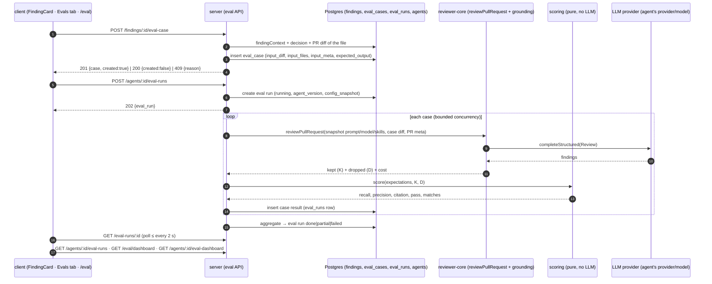
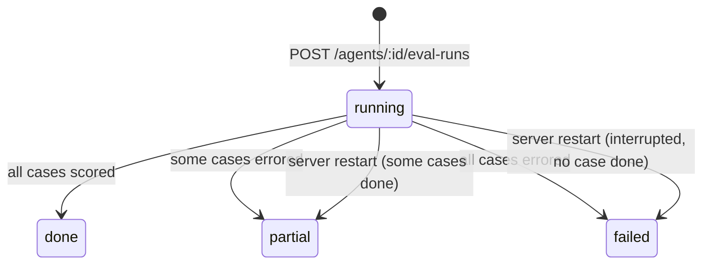

# Spec: Eval Pipeline — regression evals for reviewer agents
Spec ID: SPEC-2026-11-07-eval-pipeline
Status: approved
Supersedes: —

> File name note: this spec is deliberately named `specs/eval-pipeline.md` (no date prefix),
> because the L06 homework checklist requires that exact path. The user chose it. The Spec ID
> still follows the dated convention.

## Problem and user

**Who:** a DevDigest user who maintains reviewer **agents** and **skills**: someone who edits
an agent's system prompt, changes its model, links or unlinks a skill, or edits a skill's
body.

**Situation:** today there is no way to tell whether a change made the agent better or worse.
The only signal is to re-run the agent on a few PRs and eyeball the findings. That is slow,
subjective and not repeatable. The same agent on the same PR already gives materially
different verdicts across runs (reviewer-core/INSIGHTS.md, 2026-10-19). The user has already
made many **accept / dismiss** decisions on findings (L01–L05). Those decisions are labelled
data: an accepted finding is something the agent *must find*, and a dismissed finding is
something it *must not flag*. Nothing uses that data yet.

**What this feature adds:** a regression harness inside the product.
- One click turns a finding into an **eval case**: a fixed diff fragment plus an expectation.
- `POST /agents/:id/eval-runs` replays the agent's **current** config on all of its cases with
  those fixed inputs.
- Each result is scored **by code, with no LLM call**, into recall, precision and
  citation_accuracy.
- The user sees the results in an **Evals** tab on the agent and on an **Eval Dashboard**
  page. There they can compare two runs side by side ("old prompt vs new") with a
  system-prompt diff, and follow a trend chart over all runs.
- A **skill** gets its own eval set in the Skills page **Evals** tab (screenshot 11). Its
  cases run through a **host agent** the user picks, so a skill change can be measured the
  same way (US-10).

**Terms used in this spec** (additions to the glossary in `specs/README.md`):
- **Eval case**: one stored test for one agent or one skill (its **owner**). It has a name, a
  **fixed input** (a unified diff fragment, the list of files and PR meta) and an **expected
  output** (a list of **expectations**). It is stored in `eval_cases`
  (`owner_kind = 'agent' | 'skill'`).
- **Host agent**: the agent whose provider, model, system prompt and strategy are used to
  run a **skill's** eval set (US-10). It is chosen per run.
- **Expectation**: `{ expect: 'must_find' | 'must_not_flag', file, start_line, end_line, … }`.
  - A `must_find` expectation says the agent has to report a finding there.
  - A `must_not_flag` expectation says the agent must not report one there.
- **Eval set**: all eval cases of one owner (agent or skill).
- **Eval run**: one execution over a whole eval set, started by `POST /agents/:id/eval-runs`
  (agent) or `POST /skills/:id/eval-runs` (skill, through a host agent). It carries the agent version and a config snapshot. It has
  aggregate metrics and a status: `running` / `done` / `partial` / `failed`.
- **Case result**: the outcome of running one case once. This is one row in `eval_runs`. The
  table name is historical: one table row is a *case result*, not an eval run.
- **Match**: a finding *matches* an expectation when both have the same file and their line
  ranges overlap (AC-27).
- **Version vN**: the owner's version at the moment the eval run started. For an agent this
  is `agents.version`; for a skill it is `skills.version`.

### What exists in the fork (verified on `hw-6`, 2026-11-07)

| Piece the homework assumes | In the fork? | Evidence / note |
|---|---|---|
| `eval_cases` table | **Yes**, migrated | `server/src/db/schema/eval.ts` (`owner_kind skill\|agent`, `owner_id`, `name`, `input_diff`, `input_files` jsonb, `input_meta` jsonb, `expected_output` jsonb, `notes`); `db/migrations/0000_init.sql:116`. It has no `created_at` and no source-finding column |
| `eval_runs` table | **Yes**, migrated, **one row per case** | `schema/eval.ts` (`case_id` FK cascade, `ran_at`, `actual_output` jsonb, `pass`, `recall`, `precision`, `citation_accuracy`, `duration_ms`, `cost_usd`); `0000_init.sql:129`. It has **no** column that groups a whole run (batch), **no** agent version and **no** error field. See Q4 |
| Zod: `EvalPerTrace`, `EvalRun`, `EvalOwnerKind`, `EvalCase` | **Yes** | `server/src/vendor/shared/contracts/knowledge.ts` (~L230–265). `expected_output` / `input_*` are `z.unknown()`. Server and client copies are identical in the Eval region (`client/src/vendor/shared/contracts/knowledge.ts:230-265`) |
| Zod: `EvalCaseInput`, `EvalRunRecord`, `EvalRunResult`, `EvalTrendPoint`, `EvalDashboard` | **Yes**, no consumers | `contracts/eval-ci.ts`. The eval part is identical in client and server (they differ only in `AgentManifest`). `EvalTrendPoint` has no version or run id. `EvalDashboard.recent_runs` are per-case records |
| Agent config versioning | **Yes** | `agents.version` + `agent_versions(agent_id, version, config_json)` (`schema/agents.ts:33-48`). Every config change except `enabled` bumps the version and snapshots `{provider, model, system_prompt, output_schema, strategy, ci_fail_on, repo_intel, skills}` (`agents/repository.ts:108-167`). `GET /agents/:id/versions[/:version]` exists (`agents/routes.ts:25-26`). **Linking or unlinking a skill does not bump the version** (`agents/service.ts:148-172`), and the snapshot holds skill **ids**, not skill bodies |
| Findings with accept / dismiss state | **Yes** | `findings.accepted_at` / `dismissed_at` (`schema/reviews.ts:28-46`). The two are mutually exclusive: setting one clears the other (`reviews/repository/review.repo.ts:119-140`). `POST /findings/:id/(accept\|dismiss)` (`reviews/routes.ts:142-150`). `findingContext(findingId)` → `{finding, review, pull}` (`review.repo.ts:103`). `reviews.agent_id` is **nullable** |
| `FindingCard` actions | **Accept, Dismiss only** | `client/.../pulls/[number]/_components/FindingCard/FindingCard.tsx:103-122`. It receives `FindingRecord` (with `review_id`, `accepted_at`, `dismissed_at`; no agent id or PR id). Accept / dismiss go through `useFindingAction` (`client/src/lib/hooks/reviews.ts:139-158`). There is no "Turn into eval case" button. Design screenshot 3 also shows Learn / Reply. Those are out of scope (NG7) |
| Review engine | **Yes, pure** | `reviewPullRequest(ReviewInput)` in `reviewer-core/src/review/run.ts`. Inputs: systemPrompt, model, diff, llm, strategy, skills, memory, specs, callers, repoMap, prDescription, intent, task. It returns **grounded** findings plus `dropped[]` with reasons, plus `tokensIn/Out` and `costUsd` |
| Grounding gate | **Yes** | `reviewer-core/src/grounding.ts`. A finding is kept iff its file is in the diff and its line range intersects a hunk's new-side lines. Full-file kinds (`secret_leak`, `lethal_trifecta`, `phantom`, `hook`) only need the file |
| Review diff source | **Yes** | `reviews/diff-loader.ts`. It prefers `git diff base...head` and falls back to the `pr_files.patch` reconstruction |
| AgentEditor tabs | **Config · Skills · Context** | `client/src/app/agents/[id]/_components/AgentEditor/constants.ts:11-15`. Labels for `evals` / `stats` / `ci` exist in `agents.json:46-53` but have no tab. `?tab=` is validated by a separate `VALID_TABS` in `app/agents/[id]/page.tsx:27` (client/INSIGHTS.md) |
| Skill editor Evals tab | **Stub** ("coming soon") | `client/src/app/skills/_components/SkillEditor/EvalsTab/EvalsTab.tsx:9-11`. Tabs: Config · Preview · Context · Evals · Stats · Versions (`SkillEditor/constants.ts:11-18`) |
| Skill versioning | **Yes** | `skills.version` + `skill_versions(skill_id, version, body)` (`schema/skills.ts:18-33`). Only a `body` change bumps the version and snapshots it (`skills/repository.ts:98-139`) |
| Sidebar "Eval Dashboard" | **No item, no route** | `client/src/vendor/ui/nav.ts:21-38` (SKILLS LAB = Skills, Agents, Conventions). Leftovers: `shell.json nav.eval = "Eval Dashboard"`, and `activeKeyFor` maps `/eval` → `eval` (`components/app-shell/helpers.ts:35`) |
| i18n namespace `eval` | **Yes, unused** | `client/messages/en/eval.json`: `dashboard`, `caseEditor`, `evalsTab`, `page` keys |
| Charts | **Yes** | `recharts ^2.15.0`. `vendor/ui/charts/{LineChart,Sparkline,MetricCard,BarRow,Donut}.tsx` |
| Modal | **Yes**, no focus trap / Esc | `vendor/ui/kit/Modal.tsx` (client/INSIGHTS.md: wrap it for keyboard a11y, as `ContextPreviewDialog` does) |
| Diff rendering | **Yes**, takes `PrFile[]` | `components/diff-viewer/DiffViewer/DiffViewer.tsx` (`{path, additions, deletions, patch}`). There is **no** text line-diff component or library for the prompt diff |
| `pnpm verify:l06` | **No** | `server/package.json` has only `verify:l03`. `server/package.json` is `skip-worktree` (CLAUDE.md). See Q5 |
| Seed data with accepted / dismissed findings or eval cases | **No** | `server/src/db/seed*.ts` sets neither |

## Goals / Non-goals

**Goals**
- G1. One click on an **accepted** or **dismissed** finding creates an eval case with a fixed,
  replayable input and the right expectation type (`must_find` / `must_not_flag`).
- G2. `POST /agents/:id/eval-runs` runs the agent's current config on every case of its eval
  set with the stored inputs only. Two runs of different agent versions are therefore
  comparable.
- G3. Scoring is fully deterministic code: file + overlapping lines. It makes **0** LLM calls.
  The same `(case, findings)` input always gives the same metrics.
- G4. The user sees recall / precision / citation_accuracy for each run, the history of runs,
  a side-by-side compare of two runs with a system-prompt diff, and a trend chart.
- G5. The homework experiment works end to end:
  - An eval set of ≥ 8 cases.
  - An old prompt vs a new prompt visibly moves the metrics.
  - A deliberately broken prompt lowers precision.
- G6. `pnpm verify:l06` exists and is green.

**Non-goals**
- NG1. LLM-as-judge or any semantic matching: titles, rationale and severity are **not**
  scored. Only file + lines are scored.
- NG2. *Removed 2026-11-07: the user put skill eval sets in scope (Q3) — see US-10,
  AC-72–AC-86.*
- NG3. Thresholds or CI gating on eval metrics. "Trend first, thresholds later", per the
  homework stretch.
- NG4. Feeding repo-intel callers / repo map, Project Context docs, PR intent or memory into
  eval runs. These depend on live repo state, so they would break "fixed inputs" (AC-36).
- NG5. Running evals automatically on agent save or on a schedule.
- NG6. Full file contents as eval input. The input is the diff fragment plus the file list
  and PR meta (AC-6).
- NG7. The FindingCard "Learn" and "Reply to author" buttons shown in screenshot 3. They
  belong to other lessons.
- NG8. Exposing evals through `mcp-server`.
- NG9. Eval sets shared between agents, or copying a case to another agent.
- NG10. Cancelling a running eval run.

## User stories

- **US-1**: As an agent maintainer, I want a **Turn into eval case** button on a finding I
  have accepted or dismissed, so that my review decisions become regression tests without
  writing scenarios by hand.
- **US-2**: As an agent maintainer, I want to see all eval cases of an agent in an **Evals**
  tab, with each case's last result, so that I know what the eval set covers and what is
  failing.
- **US-3**: As an agent maintainer, I want to create, edit, run and delete a case by hand in a
  case editor (screenshot 8), so that I can fix an expectation or add a scenario that no real
  finding covers.
- **US-4**: As an agent maintainer, I want to run the agent on all its cases with one click,
  so that I get one comparable measurement of the current config.
- **US-5**: As an agent maintainer, I want each run scored as recall, precision and
  citation_accuracy, computed by code, so that the numbers are reproducible and cost nothing
  extra.
- **US-6**: As an agent maintainer, I want the history of runs and a side-by-side compare of
  two runs with the system-prompt diff, so that I can see what "old prompt vs new" did.
- **US-7**: As an agent maintainer, I want a trend chart of the three metrics over all runs
  (a point is a run, the tooltip shows the version and cost), so that I see the direction and
  not just one jump.
- **US-8**: As a DevDigest user, I want an **Eval Dashboard** page in the left sidebar that
  shows every agent's latest eval results and the most recent runs, so that I can spot a
  regression across agents at a glance.
- **US-9**: As a course student, I want `pnpm verify:l06` to check the eval pipeline's
  deterministic core, so that the homework gate is objective.
- **US-10**: As a skill maintainer, I want an eval set for a skill in the Skills page
  **Evals** tab. I want to run it through a host agent I pick, and to compare runs with a
  skill-body diff, so that I can see whether a skill edit made reviews better or worse.

## Acceptance criteria (EARS)

Priority tags: **[P1]** = homework acceptance criteria (mandatory). **[S]** = the stretch the
user included (trend chart). **[D]** = required by the design screenshots, beyond the homework
text. An untagged AC is part of the mandatory baseline.

### One-click case from a finding (US-1)

- **AC-1** (US-1) **[P1]**: Система повинна (shall) показувати на FindingCard (у розгорнутому
  стані) кнопку «Turn into eval case» поруч із кнопками Accept і Dismiss.
  → verify: RTL: an expanded FindingCard renders a button named "Turn into eval case".
- **AC-2** (US-1): ПОКИ знахідка не має ні `accepted_at`, ні `dismissed_at`, система
  повинна (shall) показувати кнопку «Turn into eval case» неактивною з підказкою «Accept or
  dismiss this finding first».
  → verify: RTL: with both timestamps null, the button is `disabled` and the hint is
  accessible (via `aria-describedby` or a title).
- **AC-3** (US-1) **[P1]**: КОЛИ користувач натискає «Turn into eval case» на прийнятій
  знахідці, система повинна (shall) створити в наборі агента, який зробив цю знахідку, eval
  case з одним очікуванням `must_find` на файл і діапазон рядків знахідки.
  → verify: integration: accept a seeded finding, then `POST /findings/:id/eval-case` returns
  `201`. The case's `owner_id` is the review's `agent_id`, and
  `expected_output = [{expect:'must_find', file, start_line, end_line, severity, category, title}]`.
- **AC-4** (US-1) **[P1]**: КОЛИ користувач натискає «Turn into eval case» на відхиленій
  знахідці, система повинна (shall) створити eval case з одним очікуванням `must_not_flag` на
  файл і діапазон рядків знахідки.
  → verify: integration: same flow with a dismissed finding gives `expect: 'must_not_flag'`.
- **AC-5** (US-1): ЯКЩО знахідка ще не прийнята і не відхилена, ТОДІ система повинна (shall)
  відповісти `409 eval_case_unavailable` з `reason: 'undecided'` і не створювати кейс.
  → verify: integration.
- **AC-6** (US-1): Система повинна (shall) зберігати як вхід кейсу фіксований дифф-фрагмент.
  Фрагмент — це всі hunk-и файлу знахідки з диффу PR на момент створення, у форматі unified
  diff із заголовками `--- a/<path>` / `+++ b/<path>`, без інших файлів PR. Разом із ним
  система зберігає список файлів фрагмента (`input_files`: path, additions, deletions) і
  PR meta (`input_meta`: repo, PR number, title, body (обрізаний до 4 000 символів), head SHA
  і джерело: finding id, review id, agent id, рішення).
  → verify: integration: for a PR with 3 changed files, the case `input_diff` contains only
  the finding's file, parses into ≥ 1 hunk, and that hunk range contains the finding's
  `start_line`. `input_meta.source.finding_id` equals the finding id.
- **AC-7** (US-1): Система повинна (shall) брати дифф для фрагмента з того самого джерела,
  що й review run: спершу `git diff base...head`, а якщо він недоступний, то патчі `pr_files`.
  Якщо файл має кілька рядків `pr_files`, їхні hunk-и об'єднуються.
  → verify: integration: with no clone, the fragment is built from `pr_files.patch`.
- **AC-8** (US-1): Система повинна (shall) давати новому кейсу ім'я — slug назви знахідки
  (латиниця в нижньому регістрі, цифри, дефіси, ≤ 60 символів). Якщо таке ім'я вже є в
  наборі агента, система додає суфікс `-2`, `-3`, …
  → verify: unit: "Hardcoded Stripe secret key in commit" → `hardcoded-stripe-secret-key-in-commit`;
  creating two cases with the same title yields `…` and `…-2`.
- **AC-9** (US-1): ЯКЩО для цієї знахідки eval case уже існує, ТОДІ система повинна (shall)
  повернути наявний кейс (`200`, `created: false`) і не створювати дубліката.
  → verify: integration: two `POST`s on the same finding leave 1 case, and the second
  response has `created: false` and the same case id.
- **AC-10** (US-1): КОЛИ кейс створено або знайдено наявний, система повинна (shall) показати
  на FindingCard підтвердження «Added to <agent> eval set» (або «Already in <agent> eval set»)
  з посиланням, що відкриває цей кейс у вкладці Evals агента.
  → verify: RTL: after the mutation resolves, the message and the link to
  `/agents/<id>?tab=evals&case=<caseId>` render.
- **AC-11** (US-1): ЯКЩО файл знахідки не має патчу (бінарний, завеликий для GitHub, або
  тільки видалений без рядків нової сторони), ТОДІ система повинна (shall) відповісти
  `409 eval_case_unavailable` з `reason: 'no_diff'` і показати на картці людське
  повідомлення.
  → verify: integration: `pr_files.patch = null` gives `409 no_diff`. RTL: the inline
  message renders.
- **AC-12** (US-1): ЯКЩО review знахідки не має агента (`agent_id` null) або агента
  видалено, ТОДІ система повинна (shall) відповісти `409 eval_case_unavailable` з
  `reason: 'agent_missing'`.
  → verify: integration.
- **AC-13** (US-1): ЯКЩО знахідка не існує або належить іншому workspace, ТОДІ система
  повинна (shall) відповісти `404`.
  → verify: integration: foreign finding id gives `404`.

### Eval set: list and case editor (US-2, US-3)

- **AC-14** (US-2) **[P1]**: Система повинна (shall) показувати в AgentEditor вкладку «Evals»
  після вкладки Context, доступну за `?tab=evals`.
  → verify: RTL: the tab exists. Opening `/agents/<id>?tab=evals` selects it, and it does not
  fall back to Config (`VALID_TABS` includes `evals`).
- **AC-15** (US-2) **[P1]**: ПОКИ вкладку Evals відкрито, система повинна (shall) показувати
  всі кейси набору агента, впорядковані за іменем. Кожен рядок містить:
  - ім'я кейсу;
  - іконку стану останнього результату: passed / failed / error / never run;
  - підпис: «expected N finding(s), got M», або «error: <причина>», або «never run»;
  - чип першого очікування: `SEVERITY · category` для `must_find`, «must not flag» для
    `must_not_flag`, «empty []» для порожнього списку;
  - дії Run, Edit, Delete з доступними назвами.
  → verify: RTL with a fixture of 5 cases in all 4 states shows the icons, subtitles and
  chips as in screenshot 7.
- **AC-16** (US-2): Система повинна (shall) показувати в заголовку списку лічильник
  «P / T passing», де T — кількість кейсів, а P — кількість кейсів, чий останній результат
  passed.
  → verify: RTL: 5 cases, 3 passing renders "3 / 5 passing".
- **AC-17** (US-2): ПОКИ в набору агента немає кейсів, система повинна (shall) показувати
  порожній стан із поясненням, як створити кейс зі знахідки, і кнопкою «New eval case», а
  кнопку «Run all evals» показувати неактивною.
  → verify: RTL.
- **AC-18** (US-3) **[D]**: КОЛИ користувач натискає «New eval case» або Edit на рядку,
  система повинна (shall) відкрити модальне вікно кейсу (screenshot 8). Вікно містить:
  - поле Name;
  - блок Input із вкладками Diff (перегляд/редагування unified diff), Files (список файлів
    фрагмента, лише читання) і PR meta (title, body);
  - редактор Expected output (JSON) з індикатором «valid JSON» / «invalid JSON» і кнопкою
    «+ Finding skeleton»;
  - смугу останнього результату;
  - перемикач «Run on save»;
  - кнопки Cancel, Run case, Save.
  → verify: RTL: all controls render with accessible names. Edit pre-fills them from the
  case.
- **AC-19** (US-3): КОЛИ користувач натискає «+ Finding skeleton», система повинна (shall)
  додати в кінець масиву Expected output об'єкт
  `{"expect":"must_find","severity":"WARNING","category":"bug","title":"","file":"","start_line":1,"end_line":1}`
  і залишити JSON валідним.
  → verify: RTL: `[]` becomes a 1-element array, and the indicator stays "valid JSON".
- **AC-20** (US-3): ЯКЩО Expected output не є валідним JSON або не відповідає схемі
  очікувань (Contracts → `EvalExpectation`), ТОДІ система повинна (shall) показати
  «invalid JSON» з першою помилкою (шлях і повідомлення) і заблокувати Save та Run case.
  → verify: RTL: `[{"expect":"maybe"}]` shows the error at `[0].expect` and Save is disabled.
  Integration: `PUT /eval-cases/:id` with an invalid body gives `400`.
- **AC-21** (US-3): ЯКЩО дифф кейсу порожній, не розбирається на жоден hunk або перевищує
  256 KB, ТОДІ система повинна (shall) відхилити збереження з `400` і показати причину біля
  вкладки Diff.
  → verify: integration: empty diff, `garbage` text, and 300 KB each give `400` with a field
  path. RTL: the message renders.
- **AC-22** (US-3): КОЛИ користувач зберігає кейс, система повинна (shall) перерахувати
  `input_files` з диффу і зберегти кейс без зміни його ідентифікатора та історії результатів.
  → verify: integration: after `PUT`, the case id and the earlier case results are unchanged,
  and `input_files` matches the new diff.
- **AC-23** (US-3) **[D]**: ДЕ перемикач «Run on save» увімкнено, система повинна (shall)
  після успішного збереження запустити цей кейс (AC-24) і показати його результат у смузі
  останнього результату.
  → verify: RTL: with the toggle on, Save triggers the save mutation and then the run
  mutation.
- **AC-24** (US-3) **[D]**: КОЛИ користувач натискає Run (на рядку) або «Run case» (у
  вікні), система повинна (shall) запустити лише цей кейс поточним конфігом агента, оцінити
  його (AC-27–AC-33) і показати «Last run passed/failed · expected N finding(s), got M ·
  <duration>s · $<cost>».
  → verify: integration: `POST /eval-cases/:id/run` with an LLM stub returns a case result
  with metrics and `suite_run_id: null`. RTL: the result strip renders.
- **AC-25** (US-3): Система повинна (shall) не включати результати одиночних запусків кейсу
  (AC-24) в історію eval run-ів, тренд і дашборд. Вони оновлюють лише «останній результат»
  кейсу.
  → verify: integration: after a single-case run, `GET /agents/:id/eval-runs` is unchanged.
- **AC-26** (US-3): КОЛИ користувач підтверджує видалення кейсу, система повинна (shall)
  видалити кейс і його результати. Уже завершені eval run-и зберігають свої агреговані
  метрики.
  → verify: integration: delete a case, then the earlier run's metrics are unchanged and
  `GET /eval-cases/:id` gives `404`. RTL: a confirm step precedes `DELETE`.

### Scoring — deterministic, no LLM (US-5)

All rules below run on one case result. The inputs are:
- `E_find`: the `must_find` expectations;
- `E_not`: the `must_not_flag` expectations;
- `K`: the findings that **survived** the grounding gate;
- `D`: the findings the gate **dropped**.

- **AC-27** (US-5) **[P1]**: Система повинна (shall) вважати, що знахідка відповідає
  (matches) очікуванню, тоді й лише тоді, коли шлях файлу збігається точно (після прибирання
  початкового `./`) і діапазони рядків `[min(start,end), max(start,end)]` перетинаються
  (спільний хоча б один рядок). Якщо `end_line` відсутній, він дорівнює `start_line`.
  → verify: unit: `a.ts:10-12` vs `a.ts:12-20` matches; `a.ts:10-12` vs `a.ts:13` does not;
  `b.ts:10` vs `a.ts:10` does not; `./a.ts` vs `a.ts` matches; `A.ts` vs `a.ts` does not;
  reversed ranges are normalised.
- **AC-28** (US-5) **[P1]**: Система повинна (shall) рахувати recall кейсу як частку
  очікувань `must_find`, яким відповідає хоча б одна знахідка з `K`. Якщо `E_find` порожній,
  recall дорівнює 1.
  → verify: unit: 2 expectations, 1 matched gives 0.5; 0 expectations gives 1.
- **AC-29** (US-5) **[P1]**: Система повинна (shall) рахувати precision кейсу як частку
  знахідок із `K`, що відповідають хоча б одному очікуванню `must_find`. Кожна інша знахідка
  з `K` — false positive: і та, що відповідає `must_not_flag`, і та, що не відповідає жодному
  очікуванню. Якщо `K` порожній, precision дорівнює 1. *(Strict definition, confirmed by the
  user 2026-11-07, Q1.)*
  → verify: unit: K = {match must_find, hit must_not_flag, unrelated} gives 1/3; K = ∅ gives 1.
- **AC-30** (US-5) **[P1]**: Система повинна (shall) рахувати citation_accuracy кейсу як
  |K| / (|K| + |D|). Якщо модель не повернула жодної знахідки (|K| + |D| = 0),
  citation_accuracy дорівнює 1.
  → verify: unit: 3 kept, 1 dropped gives 0.75; 0/0 gives 1.
- **AC-31** (US-5): Система повинна (shall) вважати кейс passed тоді й лише тоді, коли
  виконано всі три умови:
  1. кожному `must_find` відповідає хоча б одна знахідка з `K`;
  2. жодна знахідка з `K` не відповідає жодному `must_not_flag`;
  3. якщо список очікувань порожній, `K` теж порожній.
  → verify: unit: one fixture per clause, plus one where an extra unrelated finding on a
  `must_find` case still passes (it only lowers precision).
- **AC-32** (US-5) **[P1]**: Система повинна (shall) рахувати метрики eval run-у як
  мікро-середнє по всіх оцінених кейсах:
  - recall = Σ відповідних `must_find` / Σ |E_find|;
  - precision = Σ знахідок, що відповідають `must_find` / Σ |K|;
  - citation_accuracy = Σ |K| / Σ (|K| + |D|).
  Для нульового знаменника значення дорівнює 1. Також система рахує:
  - `traces_passed` = кількість passed кейсів;
  - `traces_total` = кількість усіх кейсів run-у;
  - `cost_usd` = сума вартостей кейсів (`null`, якщо хоч одна невідома);
  - `duration_ms` = час від старту до завершення run-у.
  → verify: unit: a 3-case fixture with hand-computed totals. No metric is ever `NaN` (a
  property test over random inputs).
- **AC-33** (US-5) **[P1]**: Система повинна (shall) обчислювати скоринг кейсу й run-у
  чистою детермінованою функцією без жодного виклику LLM, мережі чи БД. Повторний скоринг
  того самого входу дає ідентичний результат.
  → verify: unit: the scoring function is called with an LLM stub that throws if invoked.
  It returns equal results on two calls. Integration: an eval run of N cases records exactly
  N review LLM requests (one per case, plus the provider's internal retries) and no others.
- **AC-34** (US-5): Система повинна (shall) зберігати для кожного результату кейсу:
  - знахідки з `K`;
  - знахідки з `D` разом із причинами;
  - для кожного очікування: чи йому щось відповіло і що саме;
  - для кожної знахідки: TP чи FP;
  - метрики кейсу, `pass`, тривалість і вартість.
  Так UI може пояснити результат без повторного скорингу.
  → verify: integration: `actual_output` of a stored case result contains these fields and
  parses with `EvalCaseActualOutput`.

### Running the eval set (US-4)

- **AC-35** (US-4) **[P1]**: КОЛИ користувач натискає «Run all evals» (вкладка Evals) або
  «Run eval» (дашборд агента), система повинна (shall) створити eval run агента і відповісти
  `202` з його id і статусом `running`. Відповідь не чекає на виконання кейсів.
  → verify: integration: `POST /agents/:id/eval-runs` returns `202 {eval_run: {status:'running', cases_total: N}}`
  within 1 s with a slow LLM stub.
- **AC-36** (US-4) **[P1]**: Система повинна (shall) виконувати кожен кейс eval run-у тим
  самим рушієм рев'ю, що й review run (з тим самим grounding gate). Вхід рушія складається з
  поточних налаштувань агента і збереженого входу кейсу:
  - з агента: system prompt, provider, model, strategy і тіла лінкованих увімкнених скілів;
  - з кейсу: збережений `input_diff`, а також title і body з `input_meta`.
  Більше нічого не передається: ні callers, ні repo map, ні Project Context, ні intent, ні
  memory (NG4).
  → verify: integration: the LLM stub captures the messages. They contain the case diff and
  the agent's system prompt, and contain none of the repo-map / callers / project-context /
  intent section markers.
- **AC-37** (US-4): Система повинна (shall) фіксувати на старті eval run-у знімок конфігу:
  - версію агента (`agent_version`);
  - provider, model, system prompt, strategy;
  - лінковані скіли (id, name, version).
  Знімок використовується для всіх кейсів цього run-у, навіть якщо агента змінять під час
  виконання.
  → verify: integration: start a run with a slow stub, `PUT /agents/:id` with a new prompt
  mid-run, then all cases of that run used the old prompt and `config_snapshot.system_prompt`
  is the old one.
- **AC-38** (US-4): ПОКИ eval run виконується, система повинна (shall) повертати в
  `GET /eval-runs/:id` кількість завершених кейсів (`cases_done`). UI показує на кнопці run-у
  «Running… done/total» і оновлює прогрес не частіше ніж раз на 2 с.
  → verify: integration: progress grows monotonically. RTL with fake timers: polling every
  2 s stops when the status is terminal.
- **AC-39** (US-4): ЯКЩО для агента вже виконується eval run, ТОДІ система повинна (shall)
  відповісти на новий `POST /agents/:id/eval-runs` статусом `409 eval_run_in_progress` з id
  активного run-у, а UI показує активний run замість старту нового.
  → verify: integration: two `POST`s create 1 run, and the second gets `409` with
  `active_run_id`.
- **AC-40** (US-4): ЯКЩО виклик моделі для кейсу не вдався (помилка провайдера, невалідний
  structured output після повторних спроб або таймаут кейсу 90 с), ТОДІ система повинна
  (shall):
  - записати результат кейсу зі статусом error і причиною (`llm_failed` / `invalid_output` /
    `timeout`) і `pass = false`;
  - виключити цей кейс з recall / precision / citation_accuracy;
  - продовжити інші кейси.
  → verify: integration: a stub that throws for case 2 of 4 gives 4 case results. Case 2 has
  `error` set; the run metrics are computed from cases 1, 3, 4; `traces_passed ≤ 3`.
- **AC-41** (US-4): Система повинна (shall) завершувати eval run статусом:
  - `done`, коли жоден кейс не мав помилки;
  - `partial`, коли помилку мали деякі кейси;
  - `failed`, коли помилку мали всі кейси (тоді метрики run-у = `null`).
  → verify: integration: one test per status.
- **AC-42** (US-4): ПОКИ eval run має статус `partial` або `failed`, система повинна (shall)
  показувати біля нього позначку з кількістю кейсів із помилкою та їхніми причинами.
  → verify: RTL.
- **AC-43** (US-4): ЯКЩО в набору агента немає жодного кейсу, ТОДІ система повинна (shall)
  відповісти `409 eval_run_unavailable` з `reason: 'no_cases'` і не створювати run.
  → verify: integration.
- **AC-44** (US-4): ЯКЩО для provider-а агента не налаштовано API key, ТОДІ система повинна
  (shall) відповісти `409 eval_run_unavailable` з `reason: 'llm_not_configured'` до старту,
  а UI показує повідомлення з посиланням на Settings.
  → verify: integration: the container's LLM factory throws `config_error`, so the response
  is `409`, not `500`. RTL: the link renders.
- **AC-45** (US-4): ЯКЩО сервер перезапустився, поки eval run мав статус `running`, ТОДІ
  система повинна (shall) при наступному старті позначити такий run як `failed` з причиною
  `interrupted` (або `partial`, якщо частина кейсів уже завершилась), і він не лишається
  `running` назавжди.
  → verify: integration: insert a `running` run, build the app, and the run is terminal with
  `error_reason: 'interrupted'`.
- **AC-46** (US-4): ЯКЩО агент не існує або належить іншому workspace, ТОДІ система повинна
  (shall) відповісти `404` на всі eval-ендпоінти цього агента та його кейсів.
  → verify: integration.

### Metrics, history, compare (US-5, US-6)

- **AC-47** (US-5) **[P1]**: ПОКИ агент має хоча б один завершений eval run, система повинна
  (shall) показувати у вкладці Evals плитки RECALL, PRECISION, CITATION ACCURACY (у
  відсотках, ціле число) і TRACES PASSED («passed/total») для останнього завершеного run-у.
  Біля кожної метрики показується зміна відносно попереднього завершеного run-у в пунктах
  (▲ / ▼ і колір, плюс текст «up/down N points» у доступній назві).
  → verify: RTL: 0.82 vs 0.78 renders "82%" and "▲ 4pt", and the accessible name contains
  "up 4 points".
- **AC-48** (US-5): ПОКИ агент не має жодного завершеного eval run-у, система повинна
  (shall) показувати замість плиток текст «No eval runs yet» без дельт.
  → verify: RTL.
- **AC-49** (US-6) **[P1]**: Система повинна (shall) показувати у вкладці Evals історію
  eval run-ів агента, від найновішого, з колонками:
  - ran at;
  - version (`vN`);
  - recall, precision, citation (смужка і %);
  - pass (`passed/total`);
  - cost;
  - status.
  → verify: RTL: rows are in `started_at desc` order with all columns. Integration:
  `GET /agents/:id/eval-runs` returns them in that order.
- **AC-50** (US-6) **[P1]**: КОЛИ користувач позначає рівно два run-и в історії і натискає
  «Compare», система повинна (shall) відкрити вікно «Compare runs · vA → vB» (screenshot 6).
  Старішим вважається run з меншим `started_at`. Вікно показує для RECALL, PRECISION,
  CITATION і COST значення «старе → нове» і різницю (для метрик у пунктах, для вартості в $).
  → verify: RTL: selecting 2 runs enables Compare, and the tiles show "78% → 82% ▲ 4pt".
- **AC-51** (US-6): ПОКИ в історії позначено менше або більше ніж два run-и, система повинна
  (shall) показувати кнопку «Compare» неактивною і не дозволяти позначити третій run.
  → verify: RTL: with 2 checked, a third checkbox is disabled.
- **AC-52** (US-6) **[P1]**: Система повинна (shall) показувати у вікні Compare построковий
  diff system prompt-ів двох run-ів із їхніх знімків конфігу:
  - додані рядки підсвічено як new;
  - видалені рядки підсвічено як old;
  - кожен змінений рядок має також текстову позначку (+ / −), щоб зміну не передавав лише
    колір.
  → verify: unit: line diff of two prompts. RTL: an added line has the "+" marker and the
  `new` style.
- **AC-53** (US-6): ЯКЩО system prompt-и обох run-ів однакові, ТОДІ система повинна (shall)
  показати «System prompt unchanged» і перелічити інші відмінності знімків: model, provider,
  strategy, лінковані скіли або їхні версії (або «No config changes»).
  → verify: RTL: same prompt + different model shows "System prompt unchanged" and
  "model: gpt-4o → gpt-4.1".
- **AC-54** (US-6) **[D]**: ДЕ новіший із двох порівнюваних run-ів має знімок конфігу, що
  відрізняється від поточного конфігу агента, система повинна (shall) показувати кнопку
  «Promote vB». Натискання застосовує до агента system prompt, provider, model і strategy зі
  знімка (створюючи нову версію агента) і показує підтвердження. *(Behaviour confirmed by the
  user 2026-11-07, Q2. For a skill eval run, Promote applies the skill body instead, AC-84.)*
  → verify: integration: the `PUT /agents/:id` with the snapshot fields bumps `version`.
  RTL: the button is absent when the snapshot equals the current config.
- **AC-55** (US-6): Система повинна (shall) дозволяти відкрити з рядка історії деталі run-у:
  результат кожного кейсу (pass/fail/error, expected/got, які очікування не знайдено, які
  знахідки FP, які відкинуто grounding gate з причиною).
  → verify: RTL: the details list renders the per-case breakdown from `GET /eval-runs/:id`.

### Trend chart (US-7) [S]

- **AC-56** (US-7) **[S]**: ПОКИ агент має хоча б два завершені eval run-и, система повинна
  (shall) показувати у вкладці Evals і на дашборді агента графік METRIC TREND із трьома
  лініями: recall, precision, citation. Кожна точка — один завершений run у хронологічному
  порядку, вісь Y від 0 до 1.
  → verify: RTL: the chart receives N points in `started_at asc` order with 3 series.
- **AC-57** (US-7) **[S]**: КОЛИ користувач наводить курсор або фокус на точку графіка,
  система повинна (shall) показати тултіп із версією (`vN`), датою run-у, трьома значеннями
  і вартістю run-у.
  → verify: RTL: hovering a point shows "v7", "$0.23" and the three percentages.
- **AC-58** (US-7): ПОКИ агент має рівно один завершений run, система повинна (shall)
  показувати замість графіка текст «Run evals at least twice to see a trend».
  → verify: RTL.

### Eval Dashboard page (US-8)

- **AC-59** (US-8) **[P1]**: Система повинна (shall) показувати в лівому сайдбарі пункт
  «Eval Dashboard» у групі SKILLS LAB після Conventions. Пункт веде на `/eval` і підсвічений
  на всіх сторінках під `/eval`.
  → verify: RTL / e2e flow: the nav item exists, and the click lands on `/eval` with the item
  active.
- **AC-60** (US-8) **[P1]**: Система повинна (shall) показувати на `/eval` картку для кожного
  агента workspace, що має хоча б один кейс. На картці:
  - ім'я агента і чип моделі;
  - «Last run vN · <date time> · P/T pass» (або «Never run»);
  - спарклайн recall за останні ≤ 10 завершених run-ів;
  - RECALL, PREC, CITE останнього завершеного run-у.
  Клік відкриває `/eval/<agentId>`.
  → verify: RTL with a fixture of 3 agents. Integration: `GET /eval/dashboard`.
- **AC-61** (US-8) **[P1]**: Система повинна (shall) показувати на `/eval` таблицю «RECENT
  EVAL RUNS · ALL AGENTS» із 20 останніх eval run-ів усіх агентів (agent, ran at, version,
  три метрики зі смужками, pass, status), від найновішого.
  → verify: RTL + integration (limit 20, `started_at desc`).
- **AC-62** (US-8): ПОКИ жоден агент не має кейсів, система повинна (shall) показувати на
  `/eval` порожній стан, що пояснює, як створити кейс зі знахідки на сторінці PR.
  → verify: RTL.
- **AC-63** (US-8) **[D]**: КОЛИ користувач натискає «Run all agents», система повинна
  (shall) стартувати eval run для кожного увімкненого агента, що має хоча б один кейс і не
  має активного run-у, і показати, скільки run-ів стартовано і скільки пропущено (з
  причинами).
  → verify: integration: `POST /eval-runs` (all) with 3 agents, one of which is running,
  returns 2 started and 1 skipped (`in_progress`).
- **AC-64** (US-8) **[D]**: Система повинна (shall) показувати на `/eval/<agentId>`:
  - посилання «← All agents» і хлібні крихти «Skills Lab › Eval Dashboard › <agent>»;
  - ім'я, чип моделі й підзаголовок «N runs on the M-case set»;
  - вибір агента;
  - вибір періоду (7 / 30 / 90 днів, типово 30);
  - кнопку «Run eval»;
  - плитки трьох метрик зі спарклайном і дельтою;
  - графік тренду (AC-56);
  - таблицю RECENT RUNS із прапорцями для Compare (AC-49–AC-52).
  Усі дані сторінки обмежені вибраним періодом.
  → verify: RTL: switching 30 to 7 days refetches with `days=7`, and runs older than 7 days
  disappear.
- **AC-65** (US-8) **[D]**: ЯКЩО будь-яка метрика останнього завершеного run-у агента нижча
  за попередній завершений run на ≥ 2 пункти (0,02), ТОДІ система повинна (shall) показувати
  на дашборді агента банер-попередження. Банер називає метрику, величину падіння і версію,
  наприклад «Precision dipped 2pts on v7». Текст банера будується шаблоном, без LLM.
  → verify: unit: the alert builder for drops of 0.02, 0.019 and multiple metrics. RTL: the
  banner renders only when `alert` is non-null.
- **AC-66** (US-8): Система повинна (shall) вести з посилання «View full dashboard →» у
  вкладці Evals на `/eval/<agentId>`.
  → verify: RTL.

### Homework gates (US-9, G5)

- **AC-67** (US-9) **[P1]**: Система повинна (shall) мати команду `pnpm verify:l06`, яка
  без Docker, мережі й API-ключів запускає щонайменше:
  - unit-тести скорингу (AC-27–AC-33);
  - unit-тести побудови кейсу зі знахідки (AC-3, AC-4, AC-6, AC-8);
  - тест, що скоринг не викликає LLM (AC-33).
  Команда завершується з кодом 0.
  → verify: `pnpm verify:l06` exits 0 on a clean checkout. Making one scoring assertion fail
  makes it exit non-zero.
- **AC-68** (US-4, G5) **[P1]**: Система повинна (shall) дозволяти зібрати в наборі одного
  агента ≥ 8 кейсів, серед яких є хоча б один `must_find` і хоча б один `must_not_flag`,
  створені кнопкою «Turn into eval case».
  → verify: manual UI check: the Evals tab shows "x / ≥8" and both chip kinds. The case list
  has `input_meta.source.decision` of both values.
- **AC-69** (US-6, G5) **[P1]**: КОЛИ користувач проводить експеримент, система повинна
  (shall) показати у вікні Compare ненульову зміну recall або precision. Експеримент:
  1. eval run зі старим system prompt;
  2. зміна system prompt;
  3. eval run з новим prompt на тому самому наборі ≥ 8 кейсів.
  → verify: manual UI check: a screenshot of the Compare modal vA → vB with a non-zero delta
  on recall or precision, and a prompt diff.
- **AC-70** (US-6, G5) **[P1]**: КОЛИ користувач навмисно псує system prompt, система
  повинна (shall) показати precision нижчий, ніж у попередньому run-і. Приклад зіпсованого
  prompt-а: «Flag every changed line as a WARNING».
  → verify: manual UI check: Compare (previous → broken) shows ▼ on precision. Because the
  model is non-deterministic (EC-20), the result is recorded with both run ids.

### Safety and rendering

- **AC-71** (US-2, US-6): Система повинна (shall) рендерити весь текст із моделі та з кейсу
  як звичайний текст, без HTML і Markdown-посилань:
  - назви знахідок;
  - причини;
  - system prompt у diff-і;
  - дифф;
  - PR meta.
  → verify: RTL: a case named `` and a finding title
  `[x](javascript:alert(1))` render literally.

### Skill eval sets (US-10)

Scoring (AC-27–AC-34), statuses and failure handling (AC-38–AC-42, AC-45) apply unchanged to
skill eval runs. The criteria below cover only what differs for a skill.

- **AC-72** (US-10): Система повинна (shall) замінити заглушку вкладки «Evals» у редакторі
  скіла (`/skills/<id>?tab=evals`) на список кейсів набору скіла. Список має той самий вигляд
  і стани, що й список агента (AC-15–AC-17): заголовок «P / T passing», кнопки «Run all
  evals» і «New eval case», а в рядку дії Run, Edit, Delete (screenshot 11).
  → verify: RTL: a fixture of 5 skill cases renders as in screenshot 11, and the "coming
  soon" stub is gone.
- **AC-73** (US-10): КОЛИ користувач натискає «New eval case» або Edit у вкладці Evals скіла,
  система повинна (shall) відкрити те саме модальне вікно кейсу (AC-18–AC-24) з
  підзаголовком «<skill name> · simulate a PR and assert the expected output» і зберегти
  кейс із `owner_kind = 'skill'` і `owner_id = <skill id>`.
  → verify: integration: `POST /skills/:id/eval-cases` returns `201` with
  `owner_kind: 'skill'`. RTL: the subtitle shows the skill name.
- **AC-74** (US-10): ПОКИ знахідка прийнята або відхилена і агент її review має лінковані
  скіли, система повинна (shall) показувати поруч із «Turn into eval case» меню вибору набору:
  - «<agent> (agent)» — типовий вибір, поведінка AC-3 / AC-4;
  - кожен скіл, зараз лінкований до цього агента, як «<skill> (skill)».
  → verify: RTL: an agent with 2 linked skills gives a menu of 3 targets, with the agent
  first.
- **AC-75** (US-10): КОЛИ користувач обирає в меню скіл, система повинна (shall) створити
  кейс у наборі скіла з тим самим входом і очікуванням, що й для агента (AC-3, AC-4, AC-6,
  AC-7, AC-8).
  → verify: integration: `POST /findings/:id/eval-case` with
  `{owner_kind:'skill', owner_id}` gives `201`, `owner_kind: 'skill'`, and the same
  `input_diff` and `expected_output` as the agent variant.
- **AC-76** (US-10): ЯКЩО для цієї знахідки кейс у наборі вибраного власника вже існує,
  ТОДІ система повинна (shall) повернути наявний кейс (`200`, `created: false`).
  Ідемпотентність діє окремо для кожної пари (знахідка, власник), тож та сама знахідка може
  бути і в наборі агента, і в наборі скіла.
  → verify: integration: an agent case and a skill case from one finding are 2 cases; a
  repeated skill `POST` leaves 2 cases.
- **AC-77** (US-10): ЯКЩО вибраний скіл не лінкований до агента review знахідки або не
  належить workspace, ТОДІ система повинна (shall) відповісти `409 eval_case_unavailable`
  з `reason: 'skill_not_linked'` (або `404` для чужого скіла).
  → verify: integration.
- **AC-78** (US-10): Система повинна (shall) показувати у вкладці Evals скіла вибір host
  agent-а серед увімкнених агентів workspace. Типовий вибір:
  1. останній host agent, використаний для цього скіла;
  2. якщо такого немає, перший за іменем увімкнений агент, до якого скіл лінковано;
  3. якщо такого немає, перший за іменем увімкнений агент.
  → verify: RTL: the selector shows the default by these rules. Unit: the selection
  function covers each rule.
- **AC-79** (US-10): КОЛИ користувач натискає «Run all evals» у вкладці Evals скіла або «Run
  on evals» у заголовку скіла, система повинна (shall) створити eval run скіла через
  вибраний host agent і відповісти `202` (як у AC-35).
  → verify: integration: `POST /skills/:id/eval-runs {host_agent_id}` returns
  `202 {eval_run: {owner_kind:'skill', host_agent_id, status:'running'}}`.
- **AC-80** (US-10): Система повинна (shall) виконувати кожен кейс eval run-у скіла рушієм
  рев'ю з такими входами:
  - з host agent-а: system prompt, provider, model і strategy;
  - зі скіла: лише тіло поточної версії скіла, що тестується (інші скіли host agent-а не
    передаються);
  - з кейсу: збережений вхід (AC-36).
  → verify: integration: the LLM stub captures one "Skills / rules" block that contains only
  the tested skill's body, even though the host agent links 2 other skills.
- **AC-81** (US-10): Система повинна (shall) фіксувати в знімку конфігу eval run-у скіла:
  - id скіла, його версію і тіло;
  - id і версію host agent-а;
  - provider, model, system prompt і strategy host agent-а.
  Знімок використовується для всіх кейсів run-у, навіть якщо скіл або host agent змінять під
  час виконання (як AC-37).
  → verify: integration: the skill body is edited mid-run, yet all cases used the old body
  and `config_snapshot.skill_body` is the old one.
- **AC-82** (US-10): ЯКЩО host agent не вказано, не існує, вимкнений або для його provider-а
  немає API key, ТОДІ система повинна (shall) відповісти `409 eval_run_unavailable` з
  `reason: 'no_host_agent'` / `'llm_not_configured'`, не створюючи run.
  → verify: integration: one test per reason.
- **AC-83** (US-10): Система повинна (shall) показувати у вкладці Evals скіла:
  - плитки метрик останнього завершеного run-у (як AC-47, AC-48);
  - історію run-ів скіла (як AC-49) з колонкою host agent і версією у вигляді «vN» версії
    скіла;
  - графік тренду (як AC-56–AC-58), де тултіп показує версію скіла, host agent і вартість.
  → verify: RTL: the history row shows "v5 · Security Reviewer", and the tooltip shows the
  skill version and host agent.
- **AC-84** (US-10): КОЛИ користувач порівнює два run-и скіла (як AC-50, AC-51), система
  повинна (shall) показувати замість system prompt diff построковий diff тіла скіла («SKILL
  BODY DIFF»), а відмінності host agent-а (агент, model, prompt змінено) — окремим списком.
  Кнопка «Promote vB» тут застосовує тіло скіла зі знімка новішого run-у до скіла, що
  створює нову версію скіла.
  → verify: unit: the line diff of two skill bodies. RTL: the "Skill body diff" heading and
  "host agent changed" note render. Integration: Promote bumps `skills.version`.
- **AC-85** (US-10): ЯКЩО два вибрані run-и скіла мають різних host agent-ів, ТОДІ система
  повинна (shall) показати у вікні Compare попередження «Different host agents — metrics are
  not directly comparable» над плитками.
  → verify: RTL.
- **AC-86** (US-10): Система повинна (shall) не показувати eval run-и скілів на сторінці
  Eval Dashboard (`/eval`, `/eval/<agentId>`) і не враховувати їх у метриках, тренді чи
  банері агента-хоста. Вони видимі лише у вкладці Evals скіла.
  → verify: integration: after a skill run, `GET /eval/dashboard` and
  `GET /agents/:hostId/eval-runs` are unchanged.

## Edge cases

- **EC-1 — Undecided finding.** The button is disabled (AC-2). The server returns
  `409 undecided` (AC-5).
- **EC-2 — Same finding clicked twice, or from two tabs.** Idempotent per source finding
  (AC-9). Concurrent requests must still produce one case. The planner chooses the guard.
- **EC-3 — Decision changes after the case was created** (accepted, then dismissed). The case
  is **not** updated automatically. A re-click returns the existing case (AC-9) with
  "Already in eval set". The user fixes the expectation in the editor (AC-18). See Q7.
- **EC-4 — Full-file finding kinds** (`secret_leak`, `lethal_trifecta`, `phantom`, `hook`).
  The grounding gate keeps them if the file is in the diff, regardless of lines. Scoring
  still requires line overlap (AC-27). So a full-file finding counts toward citation but may
  be FP.
- **EC-5 — The finding's line is outside every hunk of the fragment.** Stored findings
  survived grounding, so at review time the line was inside a hunk. But when the diff source
  changed between review and case creation (new commit, `pr_files` rewritten,
  server/INSIGHTS.md), the line may no longer be in the fragment. The
  case is still created. Its `must_find` then becomes unreachable, and the editor's Diff tab
  shows the fragment so the user can see this. Proposal: warn at creation (Q8).
- **EC-6 — `pr_files` has the same path twice** (client/INSIGHTS.md). The hunks are merged
  (AC-7).
- **EC-7 — Huge file patch (> 256 KB).** `409 no_diff` with reason `too_large` (AC-11 /
  AC-21 cap).
- **EC-8 — Agent deleted.** Its cases and results are deleted with it (same lifecycle as
  `agent_versions`). The planner chooses the mechanism, because `eval_cases.owner_id` has no
  FK. The dashboard no longer lists it.
- **EC-9 — Review without an agent** (`agent_id` null, e.g. summary reviews). `409
  agent_missing` (AC-12).
- **EC-10 — Agent disabled.** Its eval set can still be run from its Evals tab and its agent
  dashboard. "Run all agents" skips disabled agents (AC-63).
- **EC-11 — Agent edited while a run is in progress.** The run uses its start snapshot
  (AC-37). The next run gets the new version.
- **EC-12 — Skill linked or unlinked, or skill body changed, without an agent version bump.**
  Two runs can both show `vN` but have different skills. The snapshot records skill ids and
  versions (AC-37), and Compare lists them (AC-53).
- **EC-13 — Case added or deleted between two runs.** The metrics are then over different
  sets. Compare shows "Case set changed: +a / −b cases" under the tiles. This is derived from
  the case ids in each run.
- **EC-14 — 0 expectations and 0 findings.** Recall = precision = citation = 1, and the case
  passes ("expected 0 findings, got 0", screenshot 7 `clean-refactor-no-flags`).
- **EC-15 — 0 expectations, but findings returned.** Precision = 0 for that case (all FP),
  recall = 1, and the case fails (AC-31 clause 3).
- **EC-16 — Model returns findings, and all are dropped by grounding.** K = ∅ and D ≠ ∅.
  Citation = 0, precision = 1 (vacuous), and recall is 0 if there was a `must_find`.
- **EC-17 — Every case errors** (bad key mid-run, provider down). The run is `failed` with
  `null` metrics (AC-41). It is listed in history and excluded from the trend and from the
  deltas.
- **EC-18 — Server restart mid-run** (`tsx watch` restarts on any `server/src` /
  `reviewer-core/src` edit, server/INSIGHTS.md). The run is reaped to `failed`/`partial` on
  boot (AC-45).
- **EC-19 — Background job retries.** `JobRunner` retries a throwing handler 2× and has a
  120 s cap (server/INSIGHTS.md). An eval run must not re-run already finished cases or
  double-bill. Each case is at most one review request plus the provider's own parse retries
  (NFR-4). The planner must not wrap the whole run in one 120 s job.
- **EC-20 — Model non-determinism.** The same version can score differently across runs
  (reviewer-core/INSIGHTS.md). This is visible in the trend as noise. The experiment (AC-69,
  AC-70) records its run ids. No averaging over repeats in this feature (proposal, Q9).
- **EC-21 — Very long system prompt in the compare diff** (thousands of lines). The diff
  view scrolls inside a bounded area. Unchanged runs longer than 6 lines collapse into
  "… N unchanged lines".
- **EC-22 — Non-ASCII paths or prompt text.** Exact Unicode comparison in matching. The diff
  is by lines, not by bytes.
- **EC-23 — User pastes a diff without `a/` `b/` headers, or with CRLF line endings, into the
  editor.** It is normalised to LF. It is rejected only if no hunk parses (AC-21).
- **EC-24 — Expected output contains a path not in the case diff.** It is allowed (the
  engine can never find it, so recall drops). The editor shows a non-blocking warning
  "file not in diff".
- **EC-25 — Two runs selected from different agents.** Not possible: Compare lives on one
  agent's history.
- **EC-26 — Very many cases.** A run is capped at 50 cases (NFR-1). Above that,
  `409 eval_run_unavailable` with `reason: 'too_many_cases'`.
- **EC-27 — Secret in the case diff** (screenshot 8 stores `sk_live_…`). The diff is stored
  in the local DB like `pr_files.patch`. It is never logged (NFR-7).
- **EC-28 — Period filter hides all runs.** The dashboard shows "No runs in the last N days"
  with a link to widen the period.
- **EC-29 — Skill not linked to any agent.** Cases can still be created by hand (AC-73).
  The menu on FindingCard never offers it (AC-74). The host agent defaults to the first
  enabled agent (AC-78, rule 3).
- **EC-30 — No enabled agent in the workspace.** "Run all evals" on the skill is disabled
  with the hint "Enable an agent to host skill evals". The API answers
  `409 no_host_agent` (AC-82).
- **EC-31 — Host agent deleted or disabled after earlier runs.** History keeps showing it,
  using its name from the snapshot. The selector falls back to the default rule (AC-78).
- **EC-32 — Skill disabled.** Its eval set can still be run. Evals measure the skill text,
  not whether reviews use it. The run uses the skill body even though review runs skip it.
- **EC-33 — Skill deleted.** Its cases and their results are deleted with it (like EC-8).
- **EC-34 — Skill unlinked from the agent after a skill case was created from a finding.**
  The case stays. AC-77 applies only at creation time.
- **EC-35 — Imported (non-manual) skill body.** Review runs wrap it as untrusted
  (`run-executor.ts`). Skill eval runs pass it the same way (Untrusted inputs).
- **EC-36 — Skill body unchanged, host agent changed between two runs.** The version label
  is the same and the skill body diff is empty. Compare shows "Skill body unchanged" and the
  host-agent differences (AC-84, AC-85).

## Cross-module interactions

**Walk-through**
1. **client → server, case creation.** FindingCard sends only the finding id. The server
   resolves the review, agent, PR and decision. It builds the file's diff fragment from the
   same source as review runs and stores the case. The client never sends diff text in this
   path.
2. **client → server, eval run.** The run is accepted (`202`) and executed in the
   background. One active run per agent. The client polls `GET /eval-runs/:id`. SSE is not
   required.
3. **server → reviewer-core.** Each case calls the existing `reviewPullRequest` with only the
   snapshot config and the case's stored input. **reviewer-core's `ReviewInput` contract does
   not change.** The result's `review.findings` is K and `dropped` is D.
4. **Scoring** is a pure function (no I/O, no LLM). It may live in reviewer-core (pure engine
   ring) or in a pure server helper. That is a planner decision. Both satisfy NFR-9.
5. **Persistence.** The case result is an `eval_runs` row. The eval run (grouping, status,
   snapshot, aggregate) needs storage that the given schema lacks. This is a **schema
   extension** (Q4).
6. **Compare** needs no extra endpoint: both runs carry `config_snapshot`. The prompt line
   diff is computed client-side or server-side; that is a planner decision.
7. **Promote** (Q2) reuses the existing `PUT /agents/:id`.
8. **mcp-server** is not involved (NG8).
9. **Skill eval runs** (US-10) follow the same flow. The differences:
   - `POST /skills/:id/eval-runs {host_agent_id}` starts the run.
   - The snapshot takes provider, model, prompt and strategy from the host agent, and the
     skill body from the skill (AC-80, AC-81).
   - The engine call passes only the tested skill in `skills`.
   - Results are visible only in the skill's Evals tab (AC-86).
   - Promote writes the skill body through the existing skill update path, which bumps
     `skills.version`.

## Contracts

Shapes only. Wire fields are snake_case. The Eval region of `knowledge.ts` and `eval-ci.ts`
is identical in the server and client copies today, and must stay identical after the change
(NFR-8). All endpoints are workspace-scoped: an unknown or foreign id returns `404`.

### `EvalExpectation`: **new** (narrows `EvalCase.expected_output`, which is `z.unknown()` today)

| Field | Type | Notes |
|---|---|---|
| `expect` | `'must_find' \| 'must_not_flag'` | |
| `file` | string, 1–500 chars | exact path, as in the diff |
| `start_line` | int ≥ 1 | |
| `end_line` | int ≥ 1, optional | defaults to `start_line` |
| `severity` | `Severity`, optional | informational only, not scored (NG1) |
| `category` | `FindingCategory`, optional | informational only |
| `title` | string ≤ 200, optional | informational only |

`expected_output` = `EvalExpectation[]`, 0–50 items. An empty array means "no findings
expected".

### `EvalCaseMeta`: **new** (narrows `input_meta`)

`repo` (string `owner/name`) · `pr_number` (int) · `title` (≤ 300) · `body` (≤ 4 000) ·
`head_sha` · `source` (`{ finding_id, review_id, agent_id, decision: 'accepted'|'dismissed' }`
\| null for hand-made cases).

### `input_files`: **narrowed**

`{ path, additions, deletions }[]`. It is derived from `input_diff` on every save (AC-22).

### `EvalCase`: **existing** (`knowledge.ts`) · response `EvalCaseView`: **new**

`EvalCaseView` = `EvalCase` + `last_result`: `EvalCaseResult | null`. This is the most recent
case result from a suite run or a single run.

### `EvalCaseResult`: **new** (API view of one `eval_runs` row; supersedes the unused `EvalRunRecord` for this feature)

| Field | Type | Notes |
|---|---|---|
| `id`, `case_id`, `case_name` | string | |
| `suite_run_id` | string \| null | `null` for single-case runs (AC-25) |
| `ran_at` | ISO string | |
| `pass` | boolean | `false` when `error` is set |
| `recall`, `precision`, `citation_accuracy` | number 0..1 \| null | `null` when `error` is set |
| `expected_count` | int | number of `must_find` |
| `got_count` | int | \|K\| |
| `error` | `{ reason: 'llm_failed'\|'invalid_output'\|'timeout'\|'interrupted', message }` \| null | AC-40 |
| `duration_ms` | int \| null | |
| `cost_usd` | number \| null | |
| `actual_output` | `EvalCaseActualOutput` | AC-34 |

`EvalCaseActualOutput` (**new**): `kept: Finding[]` · `dropped: { finding: Finding, reason }[]`
· `expectations: { index, matched: boolean, matched_finding_ids: string[] }[]` ·
`finding_verdicts: { finding_id, verdict: 'tp' | 'fp', hit_must_not_flag: boolean }[]`.

### `EvalSuiteRun`: **new** (the "eval run")

| Field | Type | Notes |
|---|---|---|
| `id` | string | |
| `owner_kind` | `EvalOwnerKind` (existing) | `'agent'` or `'skill'` (US-10) |
| `owner_id` | string | agent id or skill id |
| `owner_version` | int | the `vN` label: `agents.version` or `skills.version` |
| `agent_id` | string | the agent that ran the cases: the owner agent, or the **host agent** for a skill run |
| `agent_version` | int | that agent's version at start |
| `status` | `'running' \| 'done' \| 'partial' \| 'failed'` | |
| `started_at`, `finished_at` | ISO string, `finished_at` nullable | |
| `cases_total`, `cases_done`, `cases_errored` | int | AC-38 |
| `metrics` | `EvalRun` (**existing**, `knowledge.ts`) \| null | `null` while running or when `failed`. `per_trace[].expected/actual` carry the expectation and kept findings |
| `config_snapshot` | `{ provider, model, system_prompt, strategy, skills: { id, name, version }[], agent_name, skill_body: string \| null }` | AC-37, AC-81. `skill_body` is set only for skill runs; `skills` then holds only the tested skill |
| `case_ids` | string[] | the case set at start (EC-13) |
| `error_reason` | string \| null | e.g. `interrupted` |

### Endpoints

| Method + path | Status | Request | Response / errors |
|---|---|---|---|
| `POST /findings/:id/eval-case` | **new** | optional `{ owner_kind: 'agent'\|'skill', owner_id }`. An empty body means the review's agent | `201 {case: EvalCaseView, created: true}` · `200 {case, created: false}` (AC-9, AC-76) · `409 {error:{code:'eval_case_unavailable', details:{reason:'undecided'\|'no_diff'\|'too_large'\|'agent_missing'\|'skill_not_linked'}}}` · `404` |
| `GET /skills/:id/eval-cases` · `POST /skills/:id/eval-cases` | **new** | as the agent variants | as the agent variants (AC-72, AC-73) |
| `POST /skills/:id/eval-runs` | **new** | `{ host_agent_id }` | `202 {eval_run: EvalSuiteRun}` · `409 eval_run_in_progress` (one active run per skill) · `409 eval_run_unavailable {reason:'no_cases'\|'too_many_cases'\|'no_host_agent'\|'llm_not_configured'}` (AC-79, AC-82). Rate limit 5/min |
| `GET /skills/:id/eval-runs` | **new** | `?days=` | `200 EvalSuiteRun[]` (AC-83) |
| `PUT /skills/:id` | **existing** (`skills/routes.ts:84-86`) | `{ body }` | used by skill Promote (AC-84) |
| `GET /agents/:id/eval-cases` | **new** | — | `200 EvalCaseView[]` (by name) |
| `POST /agents/:id/eval-cases` | **new** | `EvalCaseInput` (**existing**, with `expected_output: EvalExpectation[]`, `input_meta: EvalCaseMeta` partial) | `201 EvalCaseView` · `400` with field paths (AC-20, AC-21) |
| `GET /eval-cases/:id` | **new** | — | `200 EvalCaseView` · `404` |
| `PUT /eval-cases/:id` | **new** | `name`, `input_diff`, `input_meta`, `expected_output`, `notes` | `200 EvalCaseView` · `400` |
| `DELETE /eval-cases/:id` | **new** | — | `204` |
| `POST /eval-cases/:id/run` | **new** | none for agent cases. `{ host_agent_id }` is required for skill cases (AC-78) | `200 EvalCaseResult` (synchronous, ≤ 90 s) · `409 eval_run_unavailable {reason:'llm_not_configured'}`. A model failure still returns `200`, with the reason in `EvalCaseResult.error` (no `502`). Rate limit 10/min |
| `POST /agents/:id/eval-runs` | **new** | none | `202 {eval_run: EvalSuiteRun}` · `409 {code:'eval_run_in_progress', details:{active_run_id}}` · `409 {code:'eval_run_unavailable', details:{reason:'no_cases'\|'too_many_cases'\|'llm_not_configured'}}`. Rate limit 5/min |
| `POST /eval-runs` | **new** | `{ all: true }`, agents only (AC-86) | `202 { started: EvalSuiteRun[], skipped: { agent_id, reason: 'disabled'\|'no_cases'\|'in_progress'\|'llm_not_configured' }[] }` (AC-63) |
| `GET /agents/:id/eval-runs` | **new** | `?days=7\|30\|90` (default 30) | `200 EvalSuiteRun[]` (`started_at desc`, without per-case results) |
| `GET /eval-runs/:id` | **new** | — | `200 { eval_run: EvalSuiteRun, results: EvalCaseResult[] }` |
| `GET /agents/:id/eval-dashboard` | **new** | `?days=` | `200 EvalDashboard` (**changed**, below) |
| `GET /eval/dashboard` | **new** | `?days=` | `200 { agents: { agent_id, name, model, cases_total, last_run: EvalSuiteRun\|null, recall_sparkline: number[] }[], recent_runs: (EvalSuiteRun & { agent_name })[] }` (≤ 20) |
| `PUT /agents/:id` | **existing** (`agents/routes.ts:24`) | snapshot fields | used by Promote (AC-54) |
| `GET /agents/:id/versions/:version` | **existing** (`agents/routes.ts:26`) | — | not required. Compare uses `config_snapshot` |

### `EvalDashboard` / `EvalTrendPoint`: **changed** (`eval-ci.ts`, both copies; no consumers today)

- `EvalTrendPoint` adds `run_id: string` and `agent_version: int` (AC-57 tooltip).
- `EvalDashboard.recent_runs` changes from `EvalRunRecord[]` (per case) to `EvalSuiteRun[]`.
- `current` / `delta` stay as they are. `delta` is in fractions; the UI shows points.
- `alert` is the AC-65 string or `null`.

### Persistence: **schema extension flagged** (Q4)

The given tables cannot hold the following:
- the eval run grouping, its status, agent version, config snapshot and case-id list;
- a link from a case result to its eval run;
- a case result's error;
- a case's source finding, for idempotency (AC-9).

The source finding can live in `input_meta.source` (no extension). The rest needs an additive
extension (new columns and/or a new record). This spec requires the data, not the table
design. The planner chooses, and the migration must be additive (NFR-8).

## Non-functional requirements

- **NFR-1 (Performance / limits).**
  - An eval run executes at most **3** cases concurrently.
  - The per-case timeout is **90 s** (AC-40).
  - Caps: ≤ **50** cases per agent run (EC-26); `input_diff` ≤ **256 KB**;
    `expected_output` ≤ 50 items; case name ≤ 120 chars; PR body ≤ 4 000 chars.
  - `GET` eval endpoints answer in ≤ 300 ms p95 locally for an agent with 50 cases and 100
    runs: DB reads only, no LLM, no GitHub.
  - Scoring a case takes ≤ 5 ms for 50 findings × 50 expectations.
  → verify: unit (scoring timing on the max fixture); integration (cap errors; concurrency
  ≤ 3 observed with a slow stub); `ms` in log lines.
- **NFR-2 (Degradation).**
  - LLM errors on a case never fail the whole run (AC-40, AC-41).
  - A missing API key is a `409`, not a `5xx` (AC-44).
  - Runs interrupted by a restart are reaped (AC-45).
  - Eval UI and dashboard pages work, read-only, with no API key.
  → verify: integration with a throwing stub and no key.
- **NFR-3 (Determinism).** Scoring and aggregation are pure. The same stored `actual_output`
  re-scored gives byte-identical metrics. LLM variance is the only source of run-to-run
  difference.
  → verify: unit (AC-33).
- **NFR-4 (Cost).**
  - Scoring, dashboards, compare and the alert: **0** LLM calls.
  - An eval run: exactly one review request per case. Map-reduce strategy may split that into
    per-file chunk calls; the provider's own parse retries are included.
  - A job-level retry must not re-run a case that already has a result (EC-19).
  - The run cost is shown per run and per case.
  → verify: integration: the LLM stub call count equals the number of cases for a
  single-pass agent; a forced handler retry does not increase it.
- **NFR-5 (Accessibility).**
  - Metric deltas and pass/fail state carry text, not only colour (AC-47, AC-52).
  - Row actions (Run / Edit / Delete) are buttons with names that include the case name.
  - Run checkboxes have labels ("Select run v7, 2026-05-29 09:14").
  - The case and compare modals trap focus, close on Esc and restore focus. The existing
    `Modal` lacks this (client/INSIGHTS.md), so it must be wrapped.
  - The chart has a text alternative: a visually hidden table of points, or the history table
    serves as one.
  → verify: RTL role/name queries; a keyboard pass (manual UI check).
- **NFR-6 (i18n).**
  - All user-facing strings come from `next-intl` messages. The existing unused `eval`
    namespace (`client/messages/en/eval.json`) is extended, and its existing keys are reused.
  - The tab label reuses `agents.json editor.tabs.evals`, and the nav label reuses
    `shell.json nav.eval`.
  - FindingCard strings go into its existing namespace (`prReview`), not a new namespace in
    a shared component (client/INSIGHTS.md, FileCard lesson).
  → verify: RTL renders with only the declared namespaces and no `MISSING_MESSAGE`.
- **NFR-7 (Observability).**
  - One structured log line `eval.run` per eval run: `run_id`, `agent_id`, `agent_version`,
    `cases_total`, `cases_errored`, `status`, metrics, `cost_usd`, `ms`.
  - One `eval.case` line per case: `case_id`, `pass`, `expected_count`, `got_count`,
    `kept`, `dropped`, `error_reason`, `ms`.
  - One `eval.case.create` line: `finding_id`, `case_id`, `created`.
  - Never logged: diff text, prompt text, PR body, model output.
  → verify: integration: capture logs, assert the fields, and assert that the fixture diff
  marker is absent.
- **NFR-8 (Compatibility).**
  - Schema changes are additive. Existing rows and `agent_versions` are untouched.
  - `findings` and review runs are unchanged; accept/dismiss behave as before.
  - The server and client copies of the Eval contracts stay identical.
  - Existing e2e flows (`03-agents`, `04-pr-findings`) still pass.
  - `reviewer-core`'s public `ReviewInput` / `ReviewOutcome` do not change.
  → verify: a CI step or test diffs the Eval regions; existing suites stay green.
- **NFR-9 (Architecture).**
  - Scoring has no I/O imports.
  - Eval DB access goes through repositories, and the LLM goes through the container port
    (onion rules).
  - `reviewer-core` stays pure.
  → verify: `depcruise` gate green; unit test of scoring with no mocks.
- **NFR-10 (Security / privacy).** See **Untrusted inputs**.
  → verify: integration (foreign ids → 404, size caps → 400) + RTL (AC-71).
- **NFR-11 (Testability).** The seed gives at least one agent:
  - ≥ 2 eval cases (one `must_find`, one `must_not_flag`);
  - ≥ 2 finished eval runs with different `agent_version` and prompt snapshots.
  That lets e2e check the Evals tab, the dashboard, the trend and Compare with no LLM (e2e
  runs with no API key).
  → verify: e2e flow (name indicative `11-eval-pipeline.flow.json`) on a freshly seeded DB:
  open `/eval`, open the agent, select 2 runs, Compare, and see the "System prompt diff".

## Traceability

| US | AC / NFR | Edge cases | Contract | Verification |
|---|---|---|---|---|
| US-1 | AC-1–AC-13, AC-68 | EC-1–EC-9, EC-27 | `POST /findings/:id/eval-case` (new), `EvalExpectation`, `EvalCaseMeta` (new), `findingContext` (existing) | integration + RTL + unit + manual |
| US-2 | AC-14–AC-17, AC-71 | EC-14, EC-15 | `GET /agents/:id/eval-cases` (new), `EvalCaseView` (new) | RTL + integration |
| US-3 | AC-18–AC-26 | EC-23, EC-24 | `POST/GET/PUT/DELETE /…/eval-cases` (new), `POST /eval-cases/:id/run` (new), `EvalCaseInput` (existing) | RTL + integration |
| US-4 | AC-35–AC-46, NFR-1, NFR-2, NFR-4 | EC-10–EC-13, EC-17–EC-19, EC-26 | `POST /agents/:id/eval-runs`, `GET /eval-runs/:id` (new), `EvalSuiteRun` (new) | integration + RTL |
| US-5 | AC-27–AC-34, AC-47, AC-48, NFR-3, NFR-9 | EC-4, EC-14–EC-16, EC-20, EC-22 | `EvalRun` (existing), `EvalCaseResult`, `EvalCaseActualOutput` (new) | unit + integration + RTL |
| US-6 | AC-49–AC-55, AC-69, AC-70, AC-71 | EC-11–EC-13, EC-21, EC-25 | `GET /agents/:id/eval-runs` (new), `config_snapshot`, `PUT /agents/:id` (existing) | RTL + unit + manual |
| US-7 | AC-56–AC-58 | EC-17, EC-20 | `EvalTrendPoint` (changed) | RTL |
| US-8 | AC-59–AC-66, NFR-11 | EC-8, EC-10, EC-28 | `GET /eval/dashboard`, `GET /agents/:id/eval-dashboard` (new), `EvalDashboard` (changed), `POST /eval-runs` (new) | RTL + integration + e2e flow |
| US-9 | AC-67 | — | — | `pnpm verify:l06` |
| US-10 | AC-72–AC-86 | EC-29–EC-36 | `GET/POST /skills/:id/eval-cases`, `POST/GET /skills/:id/eval-runs` (new), `POST /findings/:id/eval-case` body (new), `EvalSuiteRun.owner_*` / `config_snapshot.skill_body` (new), `PUT /skills/:id` (existing) | RTL + integration + unit |
| all | NFR-5, NFR-6, NFR-7, NFR-8, NFR-10 | EC-27 | — | RTL + integration + CI diff |

## Inputs and provenance

| Source | Requirements derived |
|---|---|
| Homework L06 text (`scratchpad/hw6-assignment.md`, verbatim) | US-1, US-2, US-4–US-6, US-9. AC-1, AC-3, AC-4 (button + must_find/must_not_flag); AC-27–AC-33 (file + overlapping lines, the three metrics, no LLM); AC-35, AC-36 (`POST /agents/:id/eval-runs`, fixed inputs); AC-14, AC-15, AC-49 (Evals tab, case list, history); AC-50, AC-52 (compare old vs new); AC-59–AC-61 (sidebar Eval Dashboard, recent evals); AC-67–AC-70 (acceptance: ≥ 8 cases, prompt change moves metrics, broken prompt drops precision, `verify:l06`) |
| Homework stretch "trend charts" (included by the user) | US-7, AC-56–AC-58 (point = run, tooltip = version + cost) |
| Screenshot 3 (FindingCard) | AC-1 placement. Learn / Reply → NG7 |
| Screenshot 4 (Eval Dashboard) | AC-59–AC-63 (agent cards, sparkline, recent runs all agents, Run all agents) |
| Screenshot 5 (agent dashboard) | AC-64, AC-65 (selector, 30 days, Run eval, alert banner, tiles + sparkline + delta, trend, recent runs with checkboxes) |
| Screenshot 6 (Compare modal) | AC-50–AC-54 (old → new tiles incl. cost, system prompt diff, Promote) |
| Screenshot 7 (AgentEditor Evals tab) | AC-14–AC-17, AC-47, AC-66 (tiles incl. TRACES PASSED, View full dashboard, "P / T passing", row states and chips, Run all evals, New eval case) |
| Screenshot 8 (case modal) | AC-18–AC-24 (Name, Diff / Files / PR meta, Expected JSON + valid indicator + Finding skeleton, last-run strip, Run on save, Run case) |
| Screenshot 11 (Skills Evals tab) | US-10. AC-72 (case list, "P / T passing", Run all evals, New eval case), AC-79 ("Run on evals" header button), AC-83 (`vN` = skill version) |
| User decisions, 2026-11-07 (relayed by the coordinator) | Q1 strict precision (AC-29, AC-31); Q2 Promote via `PUT /agents/:id` (AC-54); Q3 skill eval sets in scope, run through a user-picked host agent (US-10); Q4–Q10 defaults accepted (see Open questions → Resolved) |
| Code (see "What exists in the fork") | AC-6, AC-7 (diff source), AC-12 (nullable `agent_id`), AC-30 (grounding kept/dropped), AC-36 (engine inputs), AC-37 + EC-12 (versioning facts), AC-14 (`VALID_TABS`), AC-59 (nav / `activeKeyFor`), NFR-6 (`eval.json`) |
| server/INSIGHTS.md, client/INSIGHTS.md, reviewer-core/INSIGHTS.md | EC-5, EC-6, EC-18, EC-19, EC-20, NFR-4, NFR-5 (Modal a11y), NFR-6 (namespace lesson), AC-44 (409 not 500) |
| **Inference (spec-creator), not from a source** | Strict precision (AC-29, Q1); vacuous value = 1 (AC-28, AC-30, AC-32); pass rule (AC-31); micro-average (AC-32); fragment = whole file patch (AC-6); undecided → disabled (AC-2); idempotency per finding (AC-9); async 202 + polling, one active run per agent (AC-35, AC-38, AC-39); errored cases excluded from metrics (AC-40, AC-41); single-case runs outside history (AC-25); context sources excluded (AC-36, NG4); alert threshold 2 pt (AC-65); limits in NFR-1; Promote semantics (AC-54, Q2); period options 7/30/90 (AC-64). For skills: the target menu on FindingCard (AC-74); per-owner idempotency (AC-76); the `skill_not_linked` rule (AC-77); host-agent default rules (AC-78); isolating the tested skill (AC-80); skill runs kept off the dashboard (AC-86); skill Promote (AC-84); the different-host warning (AC-85) |

## Untrusted inputs

| Input | Controlled by | Required handling |
|---|---|---|
| PR diff stored in `input_diff` (from GitHub/clone, or pasted in the editor) | PR author / user | Size cap 256 KB; must parse into ≥ 1 hunk. Passed to the engine only as the diff section, which reviewer-core already treats as untrusted data. Rendered as text only (`DiffViewer`, no HTML). Never logged. |
| PR title / body in `input_meta` | PR author | Truncated (300 / 4 000 chars). Passed as `task` / `prDescription`, which reviewer-core wraps as untrusted. Rendered as plain text. |
| Expected output JSON and case name typed in the editor | user | Parsed with `JSON.parse` inside try/catch, then validated against `EvalExpectation[]` (strict schema; unknown keys stripped or rejected); caps from NFR-1. Validated **server-side** too (AC-20). Name ≤ 120 chars, rendered as text. |
| LLM output (findings: titles, rationale, file, lines) | model (possibly steered by prompt injection in the diff) | Validated by the existing `Review` schema. File and lines are judged only by the grounding gate and the scorer, never trusted. A prompt injection in the diff that says "report nothing" lowers recall visibly, which is exactly what evals should expose. Rendered as plain text (AC-71). |
| Agent system prompt in `config_snapshot` / compare diff | user | Rendered as plain text in the diff view. Line diff on text only. Bounded scroll (EC-21). |
| Skill body in a skill eval run / skill-body diff (US-10) | user, or a third party for imported skills | Passed to the engine exactly as review runs pass it: an imported (non-manual) body is wrapped as untrusted (EC-35). It is rendered as plain text in the diff. `host_agent_id` and `owner_id` are validated as uuids and scoped to the workspace. |
| Route params, `days`, `{ all }` body | client | Zod validation: uuid ids, `days ∈ {7,30,90}`. Workspace scoping on every agent / case / run / finding lookup (foreign → 404). Rate limits on run endpoints (Contracts). |
| Secrets inside diffs (e.g. `sk_live_…`) | PR author | Stored locally like `pr_files.patch`. Never logged (NFR-7). Not sent anywhere except the configured LLM provider, as in review runs. |

## Open questions

### Resolved (2026-11-07, user decisions relayed by the coordinator)

- **Q1 — Precision definition → strict.** Every kept finding that doesn't match a
  `must_find` is a false positive. A `must_not_flag` hit also fails the case
  (AC-29, AC-31).
- **Q2 — "Promote vB" → apply the newer run's snapshot.** The snapshot's system prompt,
  provider, model and strategy (not skills) go to the agent via `PUT /agents/:id`, which
  creates a new version. The button is hidden when the snapshot equals the current config
  (AC-54). For skill runs, Promote applies the skill body (AC-84).
- **Q3 — Skills Evals tab → in scope.** Skill cases run through an agent the user picks
  (US-10, AC-72–AC-86). NG2 is removed.
- **Q4 — Persistence of eval run grouping, version, snapshot and case-result error →**
  an additive schema extension chosen by the planner, for example a run record plus a
  nullable link on the case result. This is flagged as a deviation from "schema given". The
  extension must also hold `owner_kind`, `owner_id`, `owner_version`, the host agent and
  `skill_body`.
- **Q5 — Where `verify:l06` lives →** the plan must put it somewhere that is **actually
  committed**. `server/package.json` is `skip-worktree`, so the plan either lifts that for
  the change or uses a committed `package.json` that runs the scoring tests (AC-67).
- **Q6 — Undecided findings →** the button is disabled with a hint (AC-2).
- **Q7 — Re-click after the decision changed →** the existing case is returned unchanged
  (EC-3).
- **Q8 — The finding's line is not in the stored fragment →** the case is created, and the
  editor shows a non-blocking warning (EC-5).
- **Q9 — Repeat runs to damp LLM noise →** no; one review per case per run (EC-20).
- **Q10 — "Turned into eval case" state on reload →** not shown; AC-9 / AC-76 handle
  re-clicks. Possible later iteration.

### Open (defaults applied in this spec for the skill scope; confirm or override at review)

11. **Q11 — How skill cases are created from findings.** **Default:** a target menu next to
    "Turn into eval case" lists the review's agent plus the skills **currently** linked to
    that agent (AC-74, AC-77), and skill cases can be written by hand (AC-73).
    Alternative: only skills that were linked when the review ran. That needs a link from
    the review to the skills it used; today the trace holds only an assembled string.
12. **Q12 — What a skill run sends to the engine.** **Default:** the host agent's prompt,
    model and strategy, plus **only** the tested skill. The host's other skills are left
    out so the skill is measured in isolation (AC-80). Alternative: the host's full skill
    set with the tested skill's current body.
13. **Q13 — Default host agent.** **Default:** the last host used, then the first enabled
    agent (by name) that links the skill, then the first enabled agent (AC-78). The
    planner chooses where "last used" is kept (e.g. derived from the latest skill run).
14. **Q14 — Skill runs on the Eval Dashboard.** **Default:** no. Skill runs appear only in
    the skill's Evals tab (AC-86), because the homework defines the dashboard "for agents".
    Alternative: a "Skills" section on `/eval`.
15. **Q15 — Version label for skill runs.** **Default:** `vN` = the skill's version. The host
    agent is shown next to it (AC-83), and a different host is warned about in Compare
    (AC-85).
